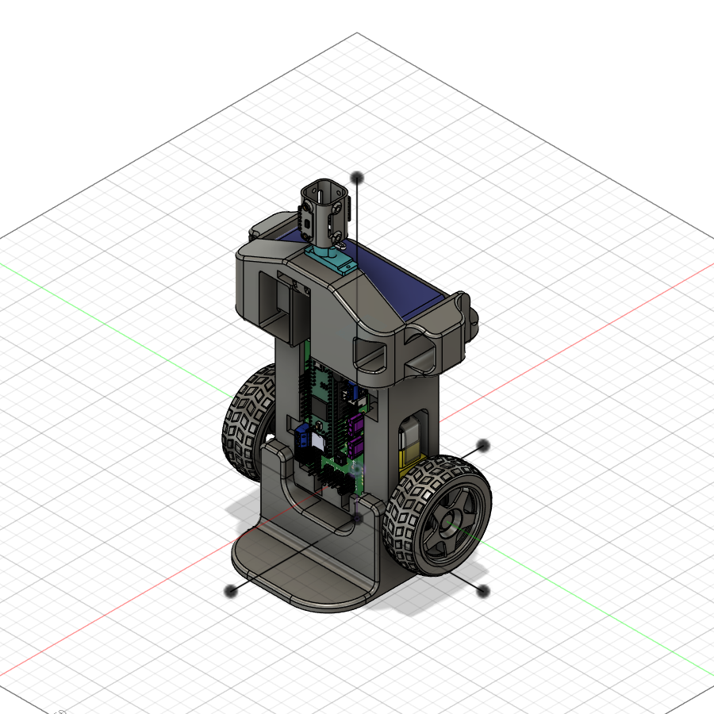
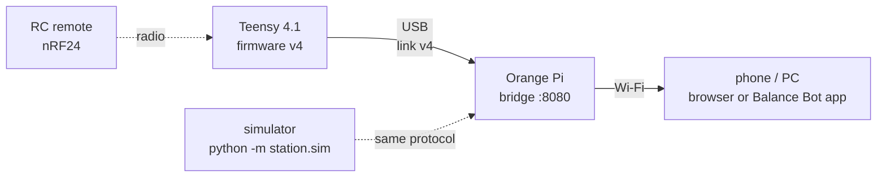
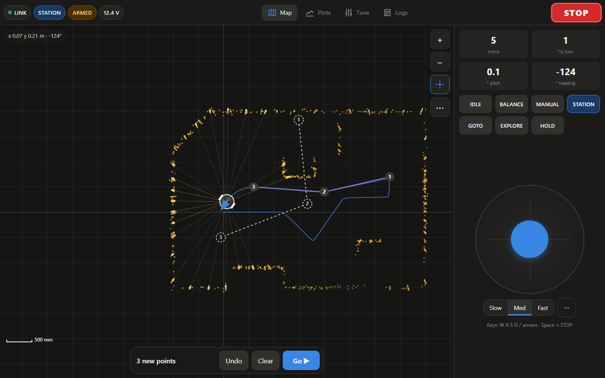
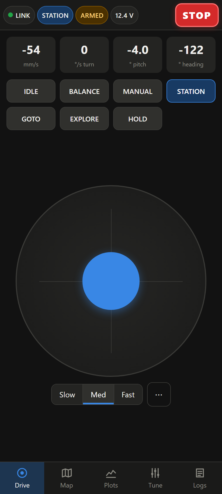

# Self-balancing robot 3

Two-wheel balancing robot: a Teensy 4.1 keeps it upright, an Orange Pi serves a web app to drive, map and tune it.

`HELLO link v4 radio v2 params 96`

## Quick start (30 s)

| | |
|---|---|
| **Simulator** | `python -m station.sim`, then open http://localhost:8080 |
| **Real robot** | open http://192.168.0.209:8080, or install the **Balance Bot** app (it finds the robot) |
| **Drive** | tap **Arm & Balance** twice (or flip the remote's ARMED switch), then use the joystick |
| **Stop** | **STOP** disarms and **latches**; press **Release E-stop**, then arm again |

Also in the app: **Find balance point** (Tune), **Falls** (Logs: every tip-over recorded).

## Where to find what

| I want to... | Go to |
|---|---|
| See the app, tab by tab | [station/README.md](station/README.md) |
| Use the Android app | [station/android/README.md](station/android/README.md) |
| Flash the firmware, open the console | [docs/flashing.md](docs/flashing.md) |
| Understand stop / arm / falls | [docs/safety.md](docs/safety.md) |
| Know the modes | [docs/modes.md](docs/modes.md) |
| Look up a param | [docs/params.md](docs/params.md) |
| Falls, tuning, map details | [docs/station-features.md](docs/station-features.md) |
| Script the bridge (API) | [docs/api.md](docs/api.md) |
| Firmware internals | [docs/firmware.md](docs/firmware.md) |