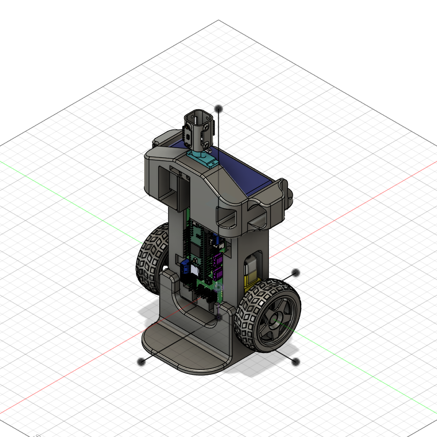
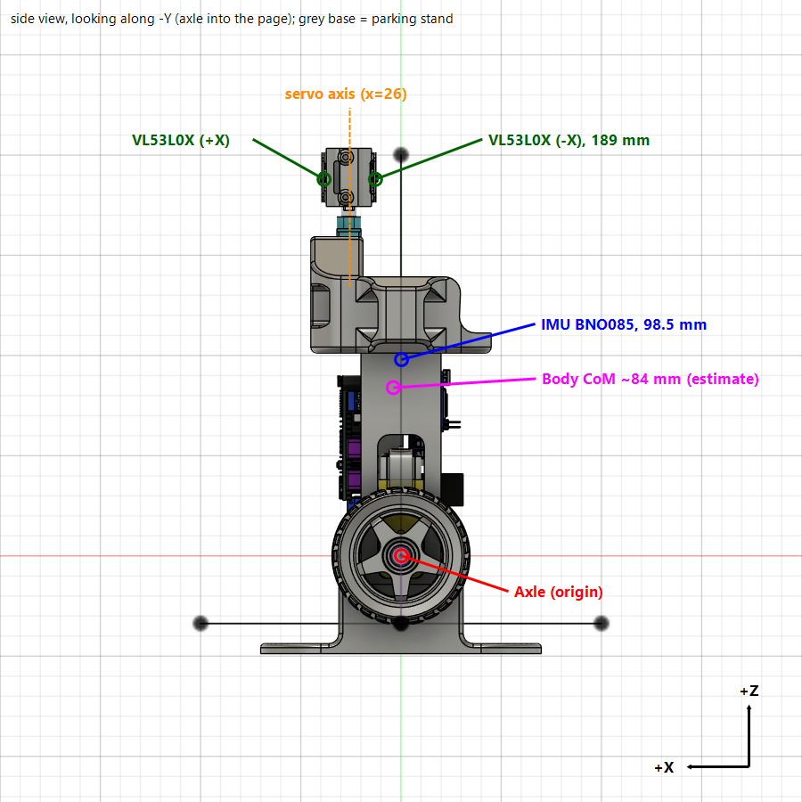
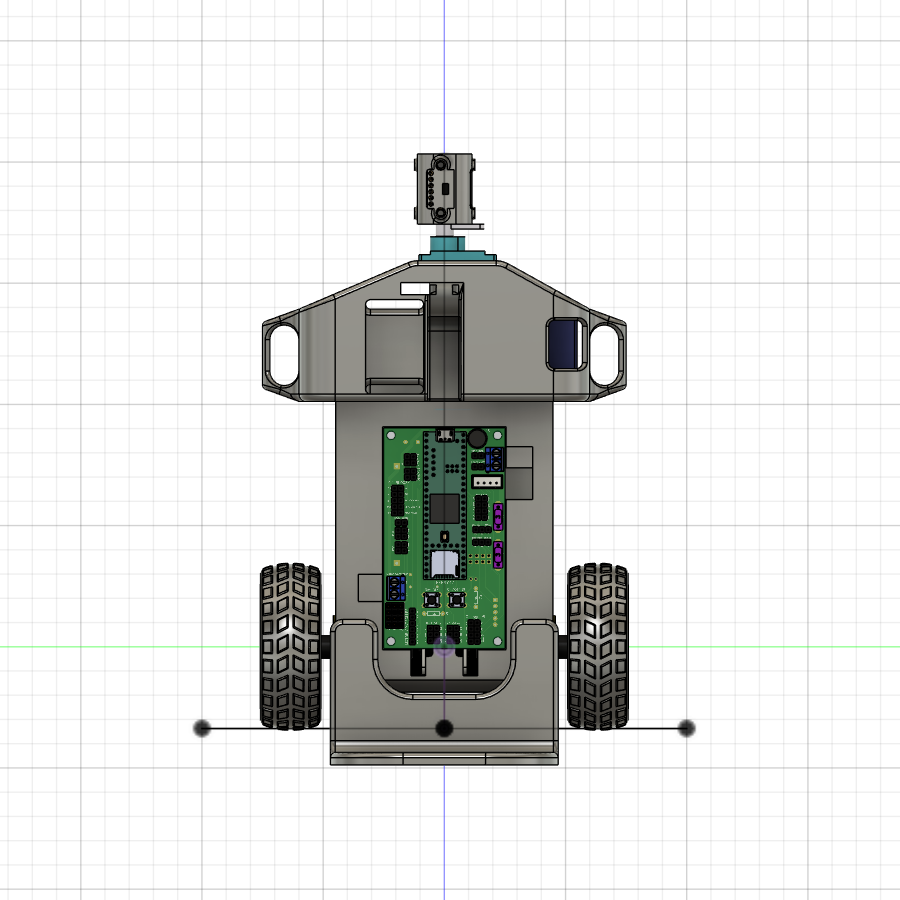

# CAD model (issue #17)

Geometry + mass model taken from the Fusion 360 design **Self_Balancing_Model_Rev3** (v71, saved 2025-02-22).
Numbers live in [`robot_model.json`](robot_model.json).

Axes: origin = axle centre, **Y = axle**, **Z = up**, **X = fore/aft** (+X = PCB/Teensy side). Pitch is about Y.
The grey base is a parking stand, not part of the robot.

## Key numbers

| | CAD | firmware | |
|---|---|---|---|
| Wheel diameter | **68.9 mm** (tread tips, "D65" TT wheel) | 66.0 | +4.4 % |
| Track width (tyre centre to centre) | **126.8 mm** | 123.0 | +3.1 % |
| Axle height | 34.5 mm | | |
| Size (H x W x D) | 238 x 152 x 90 mm | | |
| IMU chip (BNO085) | 98.5 mm above axle, on the centre line, board flat | | |
| Range head (2x VL53L0X, back to back, facing ±X) | 189 mm above axle (223 mm above ground), 12.9 mm from servo axis | | |
| Servo axis | vertical, at x = +26 mm, y = 0 | | |
| Mass, total | ~820 g (estimate) | | |
| Body CoM above axle | ~84 mm (estimate), 4 mm toward +X | | |
| Body pitch inertia about axle | ~0.0073 kg·m² (estimate) | | |
| Fall time constant | ~0.11 s | | |

Where things sit (x, y, z mm): Teensy 4.1 (28, 0, 58) · Orange Pi (-21, -3, 76) · battery (2, 0, 125) ·
motors (0, ±35, 24) (yellow TT gear motors, body above the axle) · AS5600 encoders (0, ±9, 0).

## How sure

- **Geometry: high.** Straight from the CAD.
- **Masses: low.** Nearly every body has Fusion's default *Steel*, so Fusion says 6.8 kg. The masses are
  estimates (catalogue values, or CAD volume x assumed density). The printed `Frame` + `frame_top` are about
  half the mass and their infill is unknown.
- CoM height barely moves with the infill guess (84-85 mm for 50-100 % solid); total mass does (690-950 g).
- Not in the CAD: wires/screws (25 g guessed), and TT gearbox (~1:48) motor inertia, which at the wheel is
  probably bigger than the wheel's own inertia.

## Please weigh / measure

1. Whole robot.
2. `Frame` and `frame_top` prints.
3. Battery, one wheel, one motor, the PCB stack, motor driver, Orange Pi.
4. CoM height: balance the robot on its side across an edge (axle parallel to the edge) and measure from the axle.
5. Rolling diameter: roll 10 wheel turns, distance / (10·π).
6. Track width with calipers.
7. IMU axis signs: tilt forward, log pitch.

Put weights in `MASS_G` in `build_model.py` and run `python cad/build_model.py`.

## Files

- `fusion_dump.py` – read-only Fusion script; writes `fusion_dump.json` (every part's position, size, CAD volume and inertia).
- `build_model.py` – mass estimates → `robot_model.json`.
