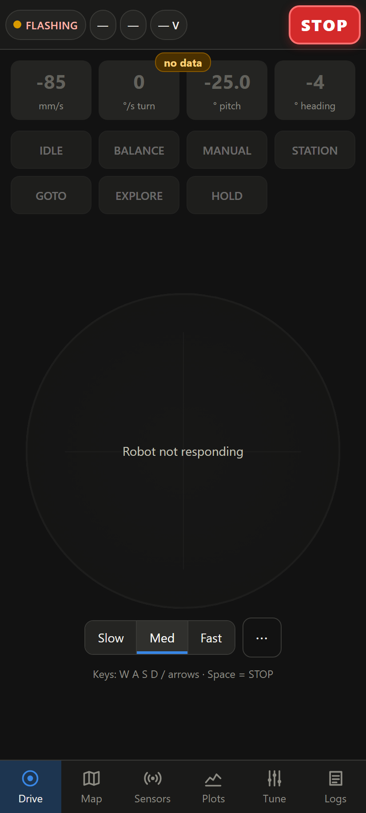
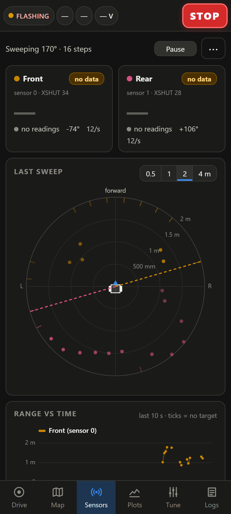

# Bridge: Browser API, install, flashing contract

Visual tour of the app: [station/README.md](../station/README.md).

## Install on the Orange Pi

One time, with sudo (ask the owner first):
```
sudo loginctl enable-linger orangepi        # user services start at boot
sudo usermod -aG dialout orangepi           # only if `id -nG` has no dialout
```
Then, no sudo, from the repo:
```
sh station/bridge/install/install.sh
```
It installs a **systemd user service**: `systemctl --user status|restart sbr3-bridge`, logs
`journalctl --user -u sbr3-bridge -f`. UI: `http://<pi>.local:8080/`.

## Flashing while the bridge runs

The bridge lets go of `/dev/ttyACM0` while **`/tmp/sbr3-bridge.release`** exists, and re-opens it by itself when the file is gone.

```
touch /tmp/sbr3-bridge.release; sleep 1      # bridge closes the port (checked every 0.25 s)
teensy_loader_cli --mcu=TEENSY41 -w -s -v firmware.hex
rm /tmp/sbr3-bridge.release                   # bridge reconnects
```
- No sudo; any process of the same machine can do it. `station/bridge/install/flash-teensy.sh` does exactly this.
- A file older than 15 min is ignored (a crashed flash script can't block the robot forever); touch it again to hold longer.
- Optional: `GET /api/serial` → `{"released": true}`; or `POST /api/serial?release=1` / `?release=0`.

## Browser API (WebSocket `/ws`, JSON)

| Send | |
|---|---|
| `{"t":"set_mode","mode":1}` | mode index from `hello.modes`. With no remote it changes an armed robot's mode only; `"arm":true` (the UI's two-tap Arm step) arms with it (link v4: EVT_LINK_ARM first). Refused while E-stopped. `mode` IDLE = **Disarm**: no remote -> the robot disarms; with a remote present -> IDLE (motors off), the remote's ARMED switch still rules |
| `{"t":"cmd_vel","speed":200,"turn":0}` | mm/s, °/s; forwarded only while sent (300 ms) |
| `{"t":"estop"}` / `{"t":"estop_release"}` | latching E-stop (robot + bridge); release clears the latch only, the robot stays disarmed. `status.estop` = bridge latch, `status.robot_estop` = the robot's (`tlm.remote_flags` 0x08) |
| `{"t":"set_param","id":0,"value":260}` / `{"t":"get_params"}` | |
| `{"t":"cfg","action":"save"}` / `"defaults"` | EEPROM save / firmware defaults |
| `{"t":"goto","points":[[x,y],...],"go":true}` / `{"t":"event","event":3}` | `go` + `"arm":true` arms (no remote); same for `{"t":"plan","action":"goto\|explore","arm":true}` |
| `{"t":"places","action":"add","name":"Couch","x":1200,"y":300}` | saved place on the map (see **Saved places** below). `rename` (`name`, `new`), `delete` (`name`), `list`. `x`/`y` are odometry mm, like `goto` |
| `{"t":"plan","action":"home"}` / `{"t":"plan","action":"goto","place":"Couch"}` | plan a route to Home / a saved place (`arm` as for goto) |
| `{"t":"zones","action":"add","kind":"nogo","pts":[[x,y],...]}` | virtual walls / no-go / fence / slow zones / mazes (see **Zones** below) |
| `{"t":"plan","action":"solve","maze":"m4"}` | drive through that maze to its exit cell, timed (`arm` as for goto) |
| `{"t":"map","action":"trust_pose"}` | LD19 matcher lost (#79): take the pose as it is and map from here (map menu **Trust the pose here**, shown only while lost). Error when it is not lost |
| `{"t":"map","action":"set_pose","x":1200,"y":-300,"th":90}` | Set position (#105, [ld19.md](ld19.md#relocalisation-105)): the robot is at `x`, `y` mm, heading `th` deg **in the map frame** (`"frame":"odom"`: in the odometry frame the browser draws, like `goto` / `places`). The correction is set at once so the robot's current odometry pose maps there; with LD19 matching the scan is then matched within +-600 mm / +-25 deg of it and confirmed by 2 strict matches before anything is mapped again (`map.stats.lmatch.reloc`: `set` -> `confirming` -> `found`, or `set_poor`: kept, not mapping). Errors: no telemetry yet, bad numbers. Map menu **Set position…** |
| `{"t":"map","action":"relocalize"}` | Find myself (#105): search the whole map for the robot now (it also runs by itself: lost > 5 s, a Teensy reboot / pose reset, a map loaded). Not mapped until found and confirmed. Errors: no lidar, matching off, map too small. Map menu **Find myself on the map** |
| `{"t":"map","action":"scan"}` | stop-and-scan pose correction now (#71): the next two sweeps taken standing still are matched to the map (also with the `stop_scan` map setting off). Result: a `scan` message |
| `{"t":"lidar","action":"set","settings":{"yaw_deg":90,...}}` | LD19 lidar (#76, see [ld19.md](ld19.md)): `get` / `set` / `defaults`; the reply (and every new client) is `{"t":"lidar","settings":{...},"defaults":{...},"status":{...}}`. Settings persist in `lidar.json` next to the saved maps. Error when the bridge has no lidar port |
| `{"t":"sub","tune":true}` | receive every telemetry frame as `{"t":"tune","cols":[...],"rows":[...]}` |
| `{"t":"ros","action":"subscribe"}` | ROS stream for the ROS 2 adapter (#96, [ros2.md](ros2.md#the-bridge-ros-stream)): `ros_hello` now, then `ros_scan` (10 Hz), `ros_odom` (25 batches/s, 50 rows/s), `ros_state` (2 Hz), only to this client, droppable. `unsubscribe` / `get` |
| `{"t":"preset"\|"score"\|"motor"\|"balpoint"\|"calib","action":...}` | Tune tools: see the docstring of `bridge/tuning_api.py` |

Receive: `hello`, `status`, `health` (1 Hz: preflight, tiles, battery minutes; also `GET /api/health`), `tlm` (25 Hz), `params`, `ranges`, `nav`, `waypoints`, `log`, `tune`, `map`, `plan`, `places`, `zones`, `scan`,
and for the Tune tools `presets`, `score_state`, `score_runs`, `motor_state`, `motor_fit`, `balpoint_state`, `calib_state`.
`ranges.pts` rows (every reading, batched at 25 Hz): `[i, hit_x, hit_y, sensor_x, sensor_y, valid, tilt, pi_ms, sensor_id, sensor_angle_deg, range_mm]`
(sensor 0 = front / XSHUT 34, 1 = rear / XSHUT 28; angle in the robot frame, + = CCW; raw mm as sent). `status.rng_hz` = readings/s per sensor.
`lidar_scan` (<= 3 Hz, LD19 only): `{"t":"lidar_scan","seq":812,"pts":[x0,y0,x1,y1,...]}`, the newest revolution in mm, odometry frame (what the Map draws as the "Lidar scan" layer).
`status.lidar` (null without a lidar port): `{"state":"ok|waiting|no data|junk|stale|off","port","error","pps","scan_hz","rpm","packets","crc_errors","bytes_dropped","scans","scan_age_s","flowing","cpu_pct","cost_ms","tilt_ref","dropped":{...}}`; Health has a "Lidar" tile from it.
`map.stats.lmatch` (LD19 scan matching, #78, [ld19.md](ld19.md#scan-matching-78)): `{"on":true,"lidar":true,"state":"matched|matched: pose fine|building the map|kept: <why>|wheel slip: ...|lost: searching ...|off","score":0.98,"fix":"xy th","applied":[dx,dy,dth],"ok_pct":97,"ms":3.4,"matched":812,"rejected":9,"jumps":0,"moved_mm":640,"moved_deg":6.2,"mode":"track|slip|lost","grip":0.97,"slip_s":null,"lost_s":null,"window":null,"slips":0,"lost":0,"found":0,"stuck":0,"checking":false,"checks":0}`
(`applied`: the last correction step, mm / deg; `ms`: cost per match). #79 wheel slip ([ld19.md](ld19.md#wheel-slip-79)): `mode` `slip` = the wheels turn but the
body does not follow (position held, nothing mapped), `lost` = the pose is being searched for (nothing mapped); `grip` = body / wheel travel at
the last check; `slip_s` / `lost_s` = seconds in that mode; `window` = the lost search's `[mm, deg]`; `checking` = `lost` only to check
the pose after a lidar gap (quiet, lost after 3 s); `slips` / `lost` / `found` / `stuck` / `checks` = counts. While slipping / lost a `map` message without tiles carries the new state and `corr` (<= 1 Hz).
#105 relocalisation: `reloc` (null when nothing is going on) = `{"phase":"pending|searching|confirming|found|ambiguous|none|unconfirmed|set|set_poor","by":"auto|reset|load|user|set","why":"...","score":0.94,"margin":0.41,"ms":220,"cands":2,"age_s":1.3,"running":false}`: the whole-map search (`by` what started it: lost > 5 s, a Teensy reboot / pose reset, a map load, Find myself, Set position), its best fit and margin over the best pose elsewhere; `found` shows for 10 s after the confirmation; `ambiguous` = two places fit (use Set position); `global` / `relocated` = searches run / poses found and confirmed. Its settings are map settings
(`{"t":"map","action":"set","settings":{"lidar_match":false}}`, `match_*`), in `settings.json`.
`status.robot_name` / `status.robot_source` (#97): the robot profile in use, `"balancer"`, `"shark"`, `"sim"` ... (`null` until the first HELLO + params are in), and how it was found: `"sys.platform"` (param 1 = balancer, 2 = shark), `"firmware"` (a simulator, `sim ...`), `"default"` (older firmware: balancer), `"override"` (`--robot NAME`). Maps, places, zones, `lidar.json`, `planner.json`, presets and fall records are kept per robot, see [the station README](../station/README.md#robot-profiles-one-pi-several-robots). The Pi can move between robots: a new connection is identified again from its own HELLO. `status.robot_pending` / `status.robot_wait_s` (#101): the robot on this connection is still being identified, and for how long the link has been up without it (0 = identified). Until it is known the bridge asks again (`GET_PARAMS`, every 2 s, later every 10 s), falls back to the firmware string 3 s after the HELLO, and refuses settings changes (`map` / `lidar` / `plan` `set`) with `{"t": "error", "code": "no_profile", "text": "robot not identified yet; not saved"}`; after 5 s the Health page shows a **Profile** warning tile.
`status.lidar_nav` (null without a lidar port): `{"sent":812,"age_s":0.04,"skipped":{"off","no_pose","stale","tilt","few","no_link"}}`, the obstacle frames for the robot's navigator ([below](#link-messages-to-the-robot)).
`scan` (on connect and after each stop-and-scan): `{"t":"scan","corr":[dx,dy,dth],"applied":3,"last":{...},"history":[{"ok":true,"why":"","dx":-31,"dy":12,"dth":-1.2,"mm":33,"n":58,"inliers":51,"margin":0.11,"who":"auto","time":1795300000},...]}` (newest first, 20 kept; `why` says why a scan was not used).
No WebSocket (old Kindle): `GET /api/state`, `GET|POST /api/cmd`.
The Android app uses `POST /api/cmd` when it is left: `cmd_vel 0`, `{"t":"plan","action":"stop"}`, and `set_mode` BALANCE if the
robot is armed + upright in GOTO / EXPLORE (`plan stop` alone leaves the robot in GOTO / EXPLORE with its waypoints).
That `set_mode` has no `arm`, so it can never arm a robot that was disarmed meanwhile.

### Saved places

Names on the map (Home, Couch, ...), stored with the map in `~/sbr3-maps/<robot>/<map>.places.json` (map frame, mm).

| | |
|---|---|
| `places` `add` | `name` (1-30 characters), `x`, `y` in odometry mm. Max 50. A name that exists is refused, except **Home**: adding it moves Home |
| `places` `rename` / `delete` | `name`, `new`. Deleting Home falls back to the default Home (where the pose was last reset) |
| `places` `list` | asks for the list again |
| reply | `{"t":"places","map":"name","items":[{"name":"Home","x":0,"y":0,"home":true,"default":true},{"name":"Couch","x":2400,"y":-300}]}`, sent to every browser after any change and on connect. Home is always first. A bad request answers `{"t":"error","text":...}` |
| `plan` `home` | route (around walls when there is a map) to Home |
| `plan` `goto` + `place` | route to that saved place; unknown name: `error` "no place called ..."; needs a robot pose ("no robot pose yet") and, like any goto, a link and no E-stop latch |

`plan` `home` / `goto` `place` end like any plan: the Map banner shows the destination, **STOP** or **Clear** ends it.

**GO_HOME reroute.** When the robot itself starts GO_HOME (the remote's Actions > Go home, or event 3), the firmware logs `GO_HOME: to x, y` and drives a straight line. The bridge reads that line and, if it can, takes over with a planned route to the saved Home:

| Situation | Result |
|---|---|
| robot armed, no E-stop latch (bridge or robot), map has data | planned route to Home (or to the firmware's target when no Home is saved); never arms |
| no map yet | the straight line stays, bridge log says so |
| disarmed or latched (the robot ignored the request) | nothing |
| planning fails | the straight line stays, bridge log: "go-home route failed" |

### Zones

Virtual walls, no-go zones, the keep-in fence, slow zones and mazes, stored with the map in `~/sbr3-maps/<robot>/<map>.zones.json`
(map frame, mm; an unsaved map autosaves to `autosave.zones.json`). Points are sent in odometry mm, like `goto`.

| `zones` action | |
|---|---|
| `add` | `kind` `wall` (polyline, 2+ points) / `nogo` / `fence` / `slow` (polygons, 3+ points, at least 0.01 m²), `pts`; `slow`: `speed` mm/s (30-500, default 120). A new fence replaces the old one. Max 100 items, 64 points each |
| `update` | `id`, `pts` and / or `speed` (mazes: no) |
| `delete` / `clear` / `undo` | `id` / optional `kind` (none = all) / the last change (30 kept) |
| `maze` | `x`, `y` centre, `w`, `h` mm (default 3000), `cell` mm (400-1500, default 700), `seed` (optional). Random perfect maze, 2-12 cells a side, entrance on the side facing the robot, exit opposite |
| `list` | send the layers again |
| reply | `{"t":"zones","map":"name","undo":3,"items":[{"id":"n2","kind":"nogo","pts":[[x,y],...]},{"id":"s3","kind":"slow","pts":[...],"speed":100},{"id":"m4","kind":"maze","x0":..,"y0":..,"cols":4,"rows":4,"cell":700,"seed":..,"walls":[[x1,y1,x2,y2],...],"entry":[x,y],"entry_in":[x,y],"exit":[x,y],"exit_out":[x,y],"exit_gap":[x1,y1,x2,y2],"best_s":51.1}]}` to every browser after a change and on connect; errors: `{"t":"error","text":"zones: ..."}` |

`plan` `solve` (`maze` id): a goto to the maze's exit cell with its exit gap counted as a wall, so the route goes in at the entrance.
`plan` messages carry `"solve":{"maze":"m4","elapsed":12.3}` meanwhile; at the end `status` = "maze solved in 51.1 s" and the best time is
kept in the maze (`best_s`). A `goto` / place inside a no-go zone or outside the fence is refused ("not sent: ..."). `status.zone_alert` =
the watchdog's last stop / joystick block. Planner setting `zones_block_manual` (default true): see [safety](safety.md#virtual-walls-and-zones).

### ROS in the station

Issues #106 and #107. ROS 2 runs on the PC (slam_toolbox, Nav2, the explorer). The station UI shows it and steers it; see [ros2.md](ros2.md#use-ros-from-the-station).
Messages go through the bridge; nothing changes while no ROS adapter is connected. `status.ros` is `null` then, and no `ros_*` message is sent.

| Station -> bridge (`/ws` or `POST /api/cmd`) | |
|---|---|
| `{"t":"ros","action":"goal","x":3.3,"y":1.3,"yaw":0.0}` | Nav2 goal in the **ROS map** frame (m, rad; no `yaw` = facing the way from the robot). `"frame":"station"`: `x`, `y` in station-map mm |
| `{"t":"ros","action":"place","name":"Kitchen"}` | Nav2 to a saved station place. The adapter maps it with TF `map <- station_map`, as `go_to.ps1` does |
| `{"t":"ros","action":"patrol","places":["A","B"],"loops":2,"dwell":5}` | patrol in that order. `loops` 0 = forever. A place Nav2 cannot reach is skipped (`patrol.missed`) |
| `{"t":"ros","action":"cancel"}` | cancels every Nav2 goal (also RViz's, `go_to.ps1`, `patrol.ps1`) and the station patrol |
| `{"t":"ros","action":"initial_pose","x":..,"y":..,"yaw":..}` | tells slam_toolbox / AMCL where the robot is (`/initialpose`, like RViz's 2D Pose Estimate). `"frame":"station"` (mm) goes through the last `map <- station_map` taken while the ROS pose was good |
| `{"t":"ros","action":"explore","run":true}` / `"run":false` | starts / stops the #107 explorer |
| `{"t":"ros","action":"save_map","name":"explore-20261124-1530"}` | the explorer saves the ROS map. `name` is optional |
| reply | `{"t":"ros_sent","action":..,"id":n}` (forwarded); refused: `{"t":"error","code":"ros_offline"}` (no adapter) or `"code":"not_manual"` |

**Manual check.** `goal`, `place`, `patrol` and `explore` `run:true` are refused unless the robot is armed in STATION ("Manual"), with no E-stop.
The text is "Switch to Manual to let ROS drive", or "The robot is disarmed: Arm & Balance, then tap Manual to let ROS drive".
Nothing arms the robot or changes its mode for ROS. `cancel`, `initial_pose`, `explore` `run:false` and `save_map` always pass.
The adapter checks again, and it cancels a running station goal or patrol when the robot leaves Manual for 3 s (`ros_nav` `cancelled`, `reason` "stopped: Switch to Manual ...").

| Bridge -> adapter (`/ws`, the client subscribed to the ROS stream) | |
|---|---|
| `{"t":"ros_cmd","cmd":"goal"\|"place"\|"patrol"\|"cancel"\|"initial_pose"\|"explore"\|"save_map","id":n,"who":"client3@...",...}` | the fields above, as sent |

| Adapter -> bridge -> every station client | |
|---|---|
| `ros_status` (1 Hz) | `{"loc":{"state":"ok\|weak\|lost\|searching\|waiting","quality":0.91},"tf":true,"aligned":true,"nodes":{"nav2":"active","nav_server":true,"slam":true,"amcl":false,"map_server":true,"loc_monitor":true,"explore":false},"map":{"w","h","res","seq","kb","ms"},"drivable":true,"why":""}` |
| `ros_map` (on change, <= 0.5 Hz) | `{"seq":3,"frame":"map","w":147,"h":98,"res":0.05,"origin":[x,y,yaw],"enc":"rle4","rle":"<base64>"}`. Row 0 = the bottom row at `origin`. RLE = runs of [class byte, count as LEB128 varint]. Classes: 0 unknown, 1 free (<= 25), 2 occupied (>= 65), 3 in between |
| `ros_pose` (5 Hz, droppable) | `{"p":[x,y,yaw],"T":[x,y,yaw]}`: the robot in the ROS map (m, rad). `T` = `map <- station_map`, so the UI can put places and zones on the ROS map |
| `ros_plan` (on change, <= 1 Hz) | `{"pts":[[x,y],...],"len_m":4.2}`: the Nav2 global plan, Douglas-Peucker 3 cm, at most 300 points. `[]` when the goal ends |
| `ros_nav` (on change, 1 Hz while busy, else every 5 s) | `{"state":"idle\|navigating\|dwell\|succeeded\|failed\|cancelled","kind":"goal\|place\|patrol\|external","goal":[x,y,yaw],"place":"Kitchen","dist_m":2.1,"eta_s":12,"recoveries":0,"reason":"...","elapsed_s":8.4,"seq":7,"patrol":{"places":[...],"i":1,"loop":0,"loops":2,"dwell":5,"missed":[],"dwell_left":3.2}}`. `external` = a goal from RViz / a script |
| `ros_explore` (#107, every change and >= every 2 s while the explorer runs) | `{"state":"waiting\|idle\|exploring\|navigating\|dwell\|done\|stopped\|saving\|error","target":[x_mm,y_mm] (station frame) \| null,"target_map":[x,y],"frontiers":12,"area_m2":14.2,"reason":"...","saved":"name","ok":true,...}`. If the explorer sends only `target_map`, the adapter adds `target` |
| `ros_reply` | `{"id":n,"cmd":"place","ok":false,"text":"no place called 'x' (places: ...)"}` |

`status.ros` (1 Hz, `null` until an adapter talks this run): `{"connected":true,"age_s":0.4,"since_s":812,"nav":"navigating","loc":"ok","nav2":"active","explore":false,"drivable":true}`.
"Connected" means a ROS message arrived in the last 3 s. Only a client subscribed to the ROS stream can send `ros_*` messages: a browser cannot pretend to be ROS.
A new station client gets the newest `ros_status` / `ros_map` / `ros_plan` / `ros_nav` / `ros_explore` / `ros_pose` on connect.
Health: a **ROS** tile, shown once an adapter has talked this run (adapter connected, Nav2 active, slam_toolbox / AMCL up, localized + scan fit).

On the ROS side, explore goes through two topics, so the explorer node needs no WebSocket:
- the adapter publishes `ros_cmd` `explore` / `save_map` on `/station/explore_cmd` (std_msgs/String JSON `{"cmd":"explore","run":true}`, `{"cmd":"save_map","name":...}`);
- it forwards `/explore/status` (String JSON, the `ros_explore` body) as `ros_explore`.

Bridge hook for the station's **Set position** (#105): `bridge.roslink.station_pose_set(x_mm, y_mm, heading_deg)` sends the same pose to ROS as `initial_pose` in the station frame, when ROS is connected. The bridge calls it on every accepted `{"t":"map","action":"set_pose"}` (the Set position tool, in either the station or the ROS view), so ROS gets the initial pose too.
In the UI it is `rosSetPose(x, y, yaw)` from `web/js/ros.js`. The ROS view also has its own **Set ROS position here**: hold on the ROS map.

### Who may command the robot

`/ws` and every `/api/*` request are checked (`httpws.check_origin`), so a web page you happen to open on the same Wi-Fi cannot drive the robot:

| Request | |
|---|---|
| the web app / Kindle page / Android WebView (same origin as the bridge) | allowed |
| curl, `tools/tune.py`, the app's native stop (no `Origin` header) | allowed |
| another site (`Origin` / `Referer` elsewhere, `Sec-Fetch-Site: cross-site`, `Origin: null`) | 403 |
| `Host` that is not an IP, `localhost`, a bare or `.local` / `.lan` name (DNS rebinding) | 403 |
| `POST /api/cmd` that is not `Content-Type: application/json` | 415 |

Relax it only if you must: `--allow-any-origin` (or `SBR3_ALLOW_ANY_ORIGIN=1`), `--allow-host pi.example.org`, `--allow-origin http://tablet.example:3000`.

Bad input never kills a client: any command that fails comes back as `{"t":"error","text":...}`. While the bridge has no link
to the robot, commands that need it (`set_mode`, `set_param`, `cfg`, `goto`, `event`, preset apply, motor test, plan goto / explore)
answer `{"t":"error","code":"no_link","text":"robot not connected ..."}` and change nothing; `estop` still latches but says
the STOP may not have arrived. The web app greys the Drive readouts and Sensors cards with a **no data** badge when
telemetry is older than 1 s:

<p>



</p>

GOTO and EXPLORE in the Drive mode grid need a second tap (like Arm & Balance). **Full rate** on the Tune page (`tlm.hz` 400)
is temporary: when the last Tune page closes (tab closed, phone asleep, app killed) the bridge puts `tlm.hz` back after 10 s,
unless you used **Save to robot** while it was raised (then that is the new default) or set it from `tools/tune.py`.
Half-open phones are dropped (WebSocket ping every 15 s, closed after 45 s of silence or a few MB of unsent data). Log CSV
exports and big downloads run in a worker thread, so they cannot stall the robot's 500 ms heartbeat; if the event loop is ever
blocked for more than 0.2 s the Logs tab says so.

## Link messages to the robot

The bridge <-> Teensy link itself (framed binary, CRC16) is defined in
[include/protocol/link_protocol.h](../include/protocol/link_protocol.h) (link v7), mirrored in `station/bridge/link_protocol.py`.

New in v7: **`MSG_LIDAR_RAW`** (0x07, **Teensy -> Pi**, issue #100): the LD19 is wired to the Teensy's Serial7 (the Pi's H618 UART
can't make 230400 baud) and the Teensy forwards its raw bytes ([ld19.md](ld19.md#wiring-the-pcbs-rplidar-c1-header-100)).
~98 frames/s while the lidar runs (17.6 kB/s of LD19 data), `len` = 2 + n.

| Byte | Field | |
|---|---|---|
| 0 | `seq` u8 | + 1 per chunk taken from Serial7, also for one dropped because the USB link had no room: a gap = lost bytes |
| 1 | `flags` u8 | `LINK_LIDAR_RAW_OVERFLOW` (0x01): Serial7's 2 KB buffer filled up or the UART overran since the previous frame (bytes before this chunk missing) |
| 2 .. 1 + n | raw bytes | n = 1 .. 180 (`LINK_LIDAR_RAW_MAX`); sent at 180, or 12 ms after the first of fewer arrived. Not aligned to the LD19's 47-byte packets |

The bridge joins the chunks into the same LD19 parser as a serial port (header, CRC8, the packets' own ms timestamps time the points).
Sent only while Serial7 runs: `rng.enable` 0 at boot (D28 / D29 are also the sweep's sensor 1 pins). Never blocks: no USB room -> the
bytes wait; the buffer nearly full -> the oldest chunk is dropped (log line `lidar: ... usb drop N, overflow M ...` every 30 s).
A v6 bridge ignores the message (unknown type: no lidar from the Teensy); v6 firmware never sends it. No params, no layout change.
The bridge's CRC-16 is now `binascii.crc_hqx` (the same CRC in C), the firmware's a 256-entry table.

New in v6: **`EVT_LINK_STUCK`** (0x83, a link-only `MSG_EVENT` value, issue #79): the bridge's LD19 matcher saw the wheels turn
for `match_stuck_s` (2.5 s) in GOTO / EXPLORE while the robot did not move (wheel slip, a low obstacle the lidar does not see). The navigator's
next driving stuck check (within 500 ms) takes it like its own: BLOCKED, log `nav: stuck, wheels turn but the lidar sees no motion (waypoint 1/2)`,
back off `nav.stuck_backoff_mm`; the planner replans as after any `nav: stuck`. Not driving then (turning in place, stopped): dropped. v5 firmware
ignores it (unknown event); a v5 bridge never sends it. No new params, no layout change.

New in v5:

**`MSG_LIDAR_OBSTACLES` (0x87, Pi -> Teensy, ~10 Hz, issue #77)**: one LD19 return per sector (the nearest inside the robot's
driving corridor, else the nearest: #99), for the navigator
([ld19.md](ld19.md#obstacles-for-the-robot-issue-77)). Sent by `station/bridge/lidar_obstacles.py` once per good turn.

| Byte | Field | |
|---|---|---|
| 0 | `seq` u8 | + 1 per frame |
| 1 | `sectors` u8 | 36 (`LINK_LIDAR_SECTORS`); another count is dropped |
| 2-3 | `age_ms` u16 | age of the pose the points are relative to (the bridge's newest telemetry); > 300 (`LINK_LIDAR_MAX_AGE_MS`) is dropped |
| 4-147 | `xy_mm` 72 x i16 | x, y per sector: robot frame (x forward, y left, mm from the axle centre). Sector i = (i - 0.5) x 10 .. (i + 0.5) x 10 deg CCW from forward. `0, 0` = no return |

No frame for 500 ms (`LINK_LIDAR_FRESH_MS`) = no lidar: the robot uses the sweep again, or goes blind. v4 firmware ignores the
message; a v4 bridge never sends it.
