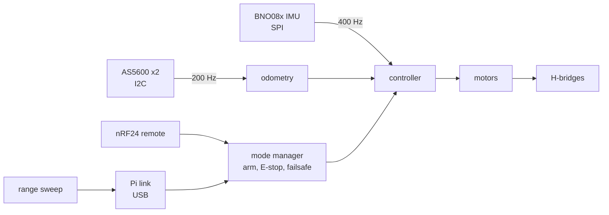

# Firmware v4 (Teensy 4.1)

`loop()`: new IMU sample, balance step, encoders (if due), range slice (at most 1/4 step). Nothing blocks the balance step.

## Rates

| What | Rate |
|---|---|
| Balance + heading loop | every IMU sample, `ctl.rate_hz` (400) |
| Velocity loop | 100 Hz |
| Encoders | 200 Hz (speed over the last 80 ms) |
| Remote | 50 Hz in, telemetry in each ACK |
| TelemetryFrame to Pi | `tlm.hz` (100; set ≥ 400 to get every balance step) |

| Page | What |
|---|---|
| [safety.md](safety.md) | STOP latch, arming, falls |
| [modes.md](modes.md) | IDLE / BALANCE / MANUAL / STATION / GOTO / EXPLORE / HOLD |
| [params.md](params.md) | every live param, with defaults |
| [range-nav.md](range-nav.md) | range sweep, head alignment, navigation |
| [motors.md](motors.md) | motor test, L298N drive, wheel speed loop |
| [internals.md](internals.md) | IMU gotchas, radio stats, error codes |
| [motor-profile.md](motor-profile.md) | measured motor data |
| [api.md](api.md) | Browser API, install, flashing contract |
| [flashing.md](flashing.md) | upload over Wi-Fi, USB, console |