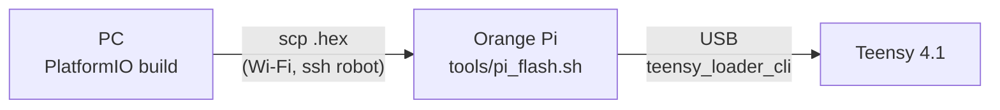

# Flashing and console

## Upload over Wi-Fi (default)



PlatformIO **Upload** button, or:

| Do | Command |
|---|---|
| Build + flash | `pio run -t upload` |
| Checks only, no flash | `$env:ROBOT_FLASH_DRY_RUN=1; pio run -t upload` |
| Other robot / IP | `$env:ROBOT_HOST="orangepi@192.168.0.209"` |

`pi_flash.sh` on the Pi: checks hex + Teensy -> stops if VirtualHere / evesec use the Teensy ->
asks the station bridge to let go of `/dev/ttyACM0` -> flashes (soft reboot, no button) ->
waits for the Teensy to come back. No sudo. Needs `ssh robot` to work without a password.

## USB fallback

Teensy plugged into the PC: `pio run -e teensy41 -t upload`.
Nothing happens? Press the Teensy's button once.

## Console (Teensy serial, over Wi-Fi)

```powershell
tools\robot_console.ps1                # read-only: boot text, HELLO, telemetry summary
tools\robot_console.ps1 --seconds 5
tools\robot_console.ps1 --release      # bridge running? make it let go while the console runs
tools\robot_console.ps1 --get-params   # also list params (sends one request)
```

```
02:17:52  HELLO link v4 radio v2 params 94 firmware 'v4 2026-11-20 abc1234'
02:17:52  [log] imu ok
02:17:52  tlm BALANCE ARMED,UPRIGHT    pitch +2.5  speed +150 mm/s  bat 11.80 V  loop 500 Hz
```
