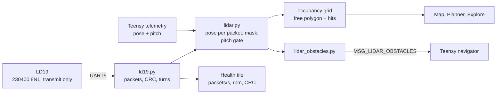
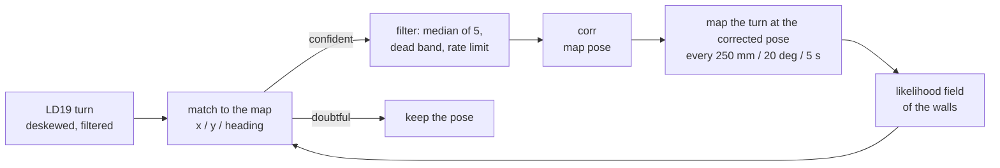
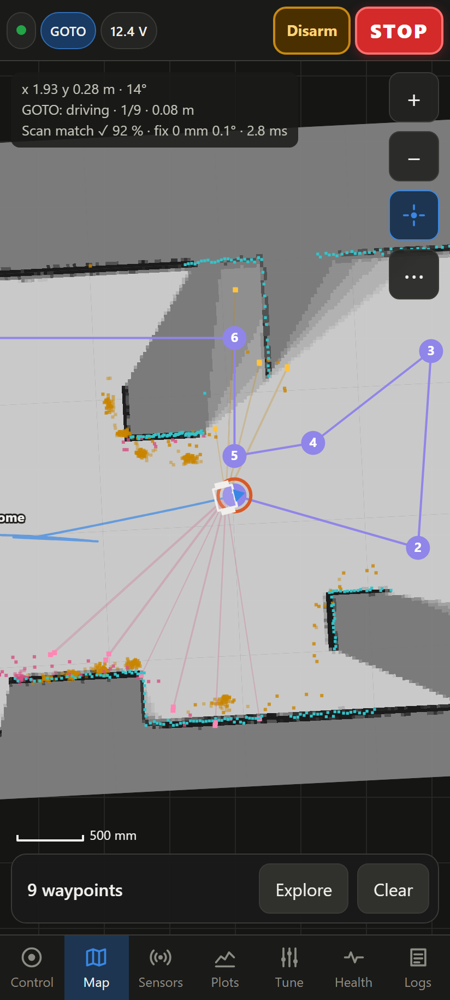
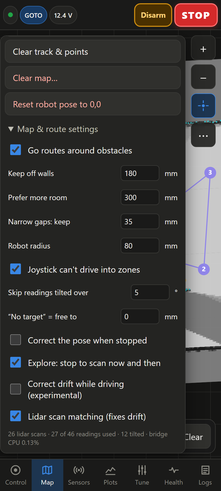
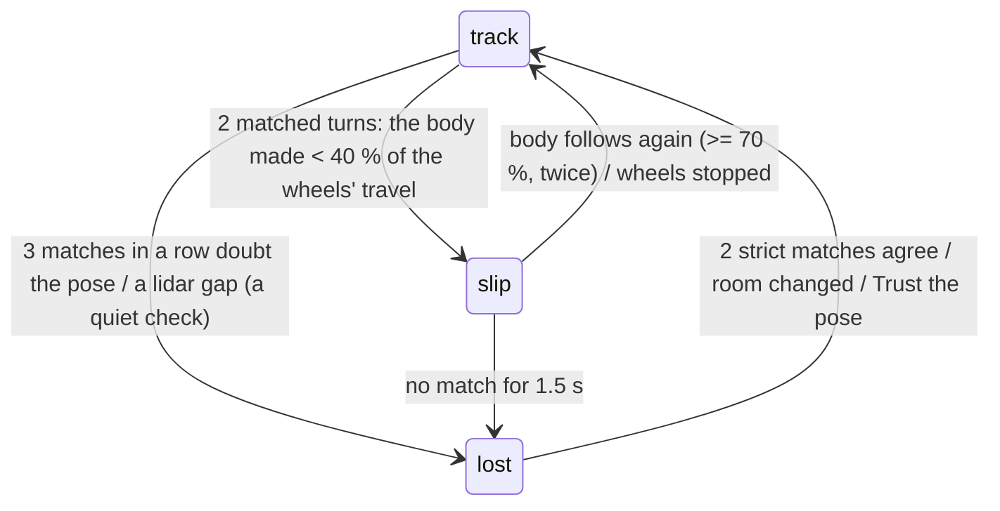
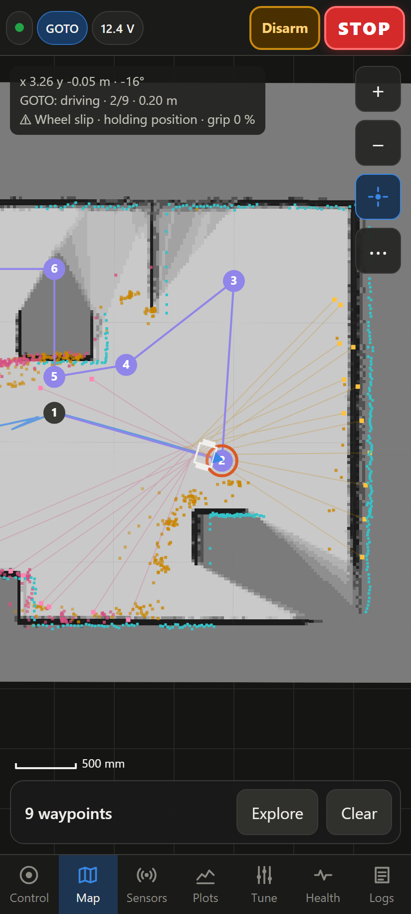
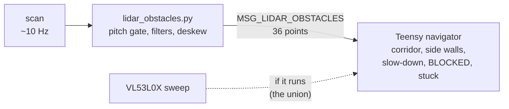

# LD19 lidar (issue #76)

A spinning 360 degree lidar (LDROBOT LD19, 10 turns/s, ~450 points a turn) on the Orange Pi's UART. The bridge turns every turn into
map updates. Everything below works in the simulator first: `python -m station.sim --lidar`.



Source of the protocol facts: LDROBOT *LD19 Development Manual V2.3* (sections 2 to 4). The CRC table and the example packet in the
tests are the manual's.

## Wiring

LD19 connector: ZH1.5T-4P (1.5 mm), pin 1 first.

| LD19 pin | Signal | Orange Pi Zero 2W header | |
|---|---|---|---|
| 1 | **Tx** (3.3 V out) | **pin 13, RXD.5** (PH3, UART5 RX) | the lidar only talks; the Pi's TXD.5 (pin 11) stays unconnected |
| 2 | **PWM** | **GND** (pin 9 or 14) | to GND = the lidar controls its own speed (10 Hz) |
| 3 | GND | GND (pin 9 or 14) | |
| 4 | **P5V** (4.5 - 5.5 V) | 5 V (pin 2 or 4) | or the robot's 5 V rail; keep the grounds common |

Verified on the robot with `gpio readall` (2026-11-24): on the Zero 2W header UART5 is **pins 11 (TXD.5, PH2) / 13 (RXD.5, PH3)**.
Pins 8 / 10 are TXD.0 / RXD.0 (UART0, the debug console), and on this robot they are wired to the Teensy, so don't use them.
Spare UART if needed: UART2 = pins 15 (TXD.2) / 22 (RXD.2), overlay `ph-uart2`, `/dev/ttyS2`.
No level shifter is needed (3.3 V logic both ways). Do not connect a PWM signal: once a 20-50 kHz PWM is seen, the lidar stays
under external speed control until it is power cycled.

## One-time Pi setup (owner, sudo)

The header UART is off by default. On the Orange Pi Ubuntu image it is switched on in `/boot/orangepiEnv.txt` (device tree overlay).
UART5 becomes **`/dev/ttyS5`**.

```bash
# 1. which UART5 overlay does this image have? (name = file name without the sun50i-h616- prefix and .dtbo)
ls /boot/dtb/allwinner/overlay/ | grep -i uart
grep -E '^(overlay_prefix|overlays)=' /boot/orangepiEnv.txt

# 2. switch it on (usually ph-uart5; use the name step 1 printed). Backup first.
sudo cp /boot/orangepiEnv.txt /boot/orangepiEnv.txt.bak
sudo grep -q '^overlays=' /boot/orangepiEnv.txt \
  && sudo sed -i '/^overlays=/ s/$/ ph-uart5/' /boot/orangepiEnv.txt \
  || echo 'overlays=ph-uart5' | sudo tee -a /boot/orangepiEnv.txt
cat /boot/orangepiEnv.txt          # overlay_prefix=sun50i-h616 and overlays=... ph-uart5

# 3. reboot
sudo reboot
```

Same thing without editing the file: `sudo orangepi-config` > System > Hardware > tick `ph-uart5` > Save > reboot.

Your user needs the `dialout` group (the installer already warns about it): `id -nG | grep dialout`, else
`sudo usermod -aG dialout $USER` and log in again.

### Check it

```bash
ls -l /dev/ttyS5                                   # exists, group dialout
systemctl --user stop sbr3-bridge                  # one reader per port (a user unit: no sudo)
python3 -m station.bridge.ld19 /dev/ttyS5 5        # ~375 packets/s, ~600 rpm, 0 bad CRC, "RESULT: lidar OK"
systemctl --user start sbr3-bridge
```

With the bridge running: **Health** shows a **Lidar** tile (grey "no port" until `/dev/ttyS5` exists, green with packets/s and rpm),
and the Map menu has a **Lidar scan** layer (teal dots, the newest turn).
The bridge opens `/dev/ttyS5` by default and retries quietly while it is missing; `--lidar /dev/ttyS3` (or `SBR3_LIDAR`) picks another
port, `--lidar off` turns the lidar off.

### Troubleshooting

| Seen | Likely |
|---|---|
| no `/dev/ttyS5` | overlay name wrong / not applied: `dmesg \| grep -i ttyS`. Some images report a pin mux conflict on PH2 for UART5; then try another overlay name or the other image |
| Health: **silent** | no bytes: 5 V and GND on the lidar? (the motor spins when powered), Tx wire on pin 13? |
| Health: **junk** | bytes but no valid packet: Rx / Tx swapped to the wrong pin, loose ground |
| rpm not 600 | PWM pin not grounded (it floats), or still settling (takes ~3 s) |
| many CRC errors | long / loose wires, a shared noisy 5 V; the data is checked, bad packets are dropped |

## After the mount is built (issue #75): settings to fill in

Defaults are sensible guesses. Persisted in `lidar.json` next to the saved maps (`~/sbr3-maps/<robot>/`), changed live with
`{"t":"lidar","action":"set","settings":{...}}` ([api.md](api.md)), for example:

```bash
curl -s -X POST http://localhost:8080/api/cmd -H 'Content-Type: application/json' \
  -d '{"t":"lidar","action":"set","settings":{"x_mm":-12,"y_mm":0,"yaw_deg":0,"height_mm":210,"mask":[[86,95],[265,274]]}}'
```

Robot frame: x forward, y left (counter-clockwise +), origin at the axle centre, degrees counter-clockwise from forward.

| Setting | Default | Fill in |
|---|---|---|
| `x_mm`, `y_mm` | 0, 0 | lidar axis: mm forward / left of the axle centre |
| `yaw_deg` | 0 | where the LD19's 0 degree direction (its front) points, counter-clockwise from robot forward |
| `flip` | false | true if it is mounted upside down (the angles then run counter-clockwise) |
| `height_mm` | 200 | scan plane above the floor: how far away a tilted beam meets the floor |
| `mask` | `[[87,93],[267,273]]` | the two cage posts: `[from, to]` sectors in the robot frame (they are skipped; up to 8) |
| `min_range_mm` | 120 | closer returns are the cage itself |
| `max_range_mm` | 8000 | farther returns are not mapped |
| `min_intensity` | 15 | weaker returns are noise (~200 = white wall) |
| `pitch_limit_deg` | 2.5 | packets from a scan plane leaning more than this (from the typical pitch) are dropped |
| `tilt_mode` | skip | `project`: keep leaning packets up to `pitch_max_deg` (6), range times cos(tilt) |
| `floor_clip` | true | drop returns beyond `0.9 * height / tan(tilt)`: that far, a downward beam is the floor |
| `deskew` | true | pose per packet (a driving or turning robot does not smear the scan) |
| `time_offset_ms` | 0 | trim if walls look doubled when the robot turns (lidar later than telemetry: +) |
| `every_n`, `ray_step` | 1, 1 | CPU savers: map every n-th turn / use every n-th point |
| map setting `lidar_replaces_sweep` | true | while scans flow, the two VL53L0X sweep readings do not draw into the map |

Finding `yaw_deg` / `x_mm`: robot facing a flat wall about 1.5 m away, lidar layer on in the Map: the dots must be a straight
line square to the robot; if the line is turned, adjust `yaw_deg`. Then turn the robot in place: the wall must not swim; if it does, trim `x_mm`.
The two posts must sit inside the `mask` sectors (they show as short dots 50-80 mm out at the robot's sides).

## What happens to a scan

1. **Pose**: the last 600 telemetry poses (a few seconds) are kept; every packet (12 points, 2.7 ms) is placed at the interpolated pose of its own
   moment (times from the lidar's millisecond counter, wraps handled).
2. **Per point**: range window, intensity, mask sectors, pitch gate, floor clip. A balancing robot rocks, so a few degrees of tilt are normal:
   packets leaning more than `pitch_limit_deg` from the median pitch of the last 3 s (the IMU reads about -3 degrees upright, which therefore
   does not matter) are dropped, and lying down / carried (IMU pitch beyond 30 degrees) never maps.
3. **Grid**: a free-space polygon from the lidar to the points (pulled back one cell + 2 % so range noise does not erase the wall) is filled
   by scanline, wall points become hit cells (neighbours up to 5 cells apart are joined into a line); a gap in the points (mask, dropout) is
   left unknown. The robot's own spot is freed like before.
4. **Planner**: it only reads the grid, so it benefits as is (denser walls, fewer unknown holes for Explore).

CPU (measured in `test_lidar.py`, 450 points, 3.5 x 5 m room, PC, Python 3.11): about 2 ms per turn to map plus 0.2 ms to parse, at 10 turns/s.
The Orange Pi's Cortex-A53 should take roughly 5 - 10 times that (10 - 20 ms per turn, 10 - 20 % of one core): `every_n` 2 halves it.
Health shows the measured cost (`status.lidar.cost_ms`, `cpu_pct`).

## Scan matching (#78)

The odometry (wheels + gyro) drifts: a few degrees a minute, a few % in distance. With the LD19 the bridge matches every
2nd turn to the map and moves the map pose back (SLAM step 2 of #71). On by default; Map menu > settings > **Lidar scan
matching**. The firmware keeps its own odometry: the correction is the map's `corr` (map pose = corr o odometry pose),
which the map, planner routes, places, zones and the browser already use.



1. **Field**: 255 on a wall cell, falling off over 3 cells (75 mm). Updated only where walls changed.
2. **Search**: the turn's points (thinned to ~150, 50 mm apart) are tried at 1 deg x 50 mm steps over +-3 deg / +-100 mm
   around the odometry pose, then refined to 0.25 deg / 25 mm and fitted between cells.
3. **Accept** only a clear match: enough points on mapped ground, most of them on walls, no second pose that fits
   about as well (repeating shelves), not at the edge of the window. **Corridor**: when moving along it changes
   nothing, that direction is not corrected (across it and the heading still are).
4. **Correct**: the median of the last 5 matches, half of it per match, at most 40 mm / 1 deg each; under 8 mm /
   0.1 deg is left alone (the matcher's own noise). A jump over 60 mm / 2 deg (wheel slip, a bump) only after 3
   matches in a row agree.
5. **Map** at the corrected pose, but only every 250 mm / 20 deg / 5 s (more often on new ground): mapping every turn
   lets the walls follow the pose error.

Map info box: `Scan match ✓ 92 % · fix 0 mm 0.1° · 2.8 ms` (score, last step, cost), or why a turn was not used.
The toggle is at the end of the map settings (only with a lidar).

 

| Map setting | Default | |
|---|---|---|
| `lidar_match` | true | on / off (off: as before, every turn mapped with the odometry pose) |
| `match_every_n` | 2 | match every n-th turn (CPU) |
| `match_points` | 150 | points per match |
| `match_window_mm`, `match_window_deg` | 100, 3 | search window around the odometry pose |
| `match_min_score`, `match_min_inliers` | 0.4, 0.5 | fit needed (0..1) |
| `match_min_curv`, `match_min_margin` | 0.05, 0.05 | below: a direction is loose (corridor) / two poses fit (ambiguous) |
| `match_gain`, `match_step_mm`, `match_step_deg` | 0.5, 40, 1 | share applied per match, and the most per match |
| `match_deadband_mm`, `match_deadband_deg` | 8, 0.1 | smaller changes are left alone |
| `match_jump_mm`, `match_jump_deg` | 60, 2 | bigger: a jump, needs 3 agreeing matches |
| `match_warmup` | 10 | turns mapped before matching starts |
| `match_max_turn_dps` | 90 | turning faster: the turn is neither matched nor mapped (lidar / telemetry timing turns the scan) |
| `match_map_mm`, `match_map_deg`, `match_map_s` | 250, 20, 5 | how often a turn goes into the map while matching |

Results (sim, `python -m station.sim.lidar_eval`, 3 tour loops + 2 place returns, ~7 min, 2 seeds; error = map pose vs
the sim's truth, in the map frame):

| odometry | matching | pose error mean / max | heading mean / max | Far / Home return | walls within 50 mm of a real wall | wall cells |
|---|---|---|---|---|---|---|
| drift 3 deg/min, 2 % long | off | 224 / 680 mm | 10.4 / 20.8 deg | 681 / 611 mm | 22 % | 7410 |
| | **on** | **15 / 37 mm** | **0.4 / 0.8 deg** | 42 / 12 mm | 98 % | 2300 |
| miscalibrated (`--miscal`) | off | 277 / 808 mm | 11.2 / 22.5 deg | 606 / 730 mm | 20 % | 9270 |
| | **on** | **11 / 27 mm** | **0.3 / 0.7 deg** | 28 / 7 mm | 97 % | 2520 |
| drift 6 deg/min, 3 % long (1 seed) | off | 455 / 1442 mm | 23 / 46 deg | 1387 / 1406 mm | 13 % | 11218 |
| | **on** | **17 / 44 mm** | **0.6 / 1.1 deg** | 61 / 14 mm | 91 % | 2375 |
| perfect (reference, 1 loop) | on | 2 / 7 mm | 0.06 / 0.24 deg | | 100 % | 1960 |

(Place returns include the navigator's 50 mm arrival radius.)

CPU (this PC: i7-11800H, Python 3.11): a match takes 1.9 ms on average alone (3.2 ms, 95 % under 5.4 ms, with three
sims running side by side), field update and thinning included; at every 2nd turn that is 1 - 1.6 % of a core. The
whole LD19 path costs 3.0 ms per turn with matching on against 3.5 ms off (with matching, a turn is drawn into the map
only every 250 mm). The Pi's Cortex-A53 + Python 3.10 should be ~8 - 12 x slower: matching ~8 - 19 % of one core, the
whole lidar ~25 - 35 % (about what mapping alone costs today); `match_every_n` 3 or `match_points` 100 save a third
of the matching if needed. Measure on the robot: the map
info line shows ms per match, Health the lidar's `cpu_pct`.

Not yet (next version): loop closure and relocalisation. A robot carried somewhere (no wheel travel to go by) further
than the widest search stays **lost** (below) until it is driven back or the pose is trusted by hand.

### Wheel slip (#79)

The heading is the gyro's, so slip does not turn the pose; but the distance is the wheels', so spinning wheels drive the
odometry ahead of the robot. Before #79 the matcher's +-100 mm window lost it after ~0.5 s of spin and, 10 s later,
drew the map at the wrong pose. Now:



| Mode | Pose | Map | Matching |
|---|---|---|---|
| **track** | the #78 filter (median, gain 0.5, 40 mm / match, jumps after 3 agreeing) | every 250 mm / 20° / 5 s | every 2nd turn, +-100 mm / 3° |
| **slip** | position **held**: each turn the odometry's move is taken back out of `corr`; a match is taken as it is (the lidar is the odometry now); heading from the gyro | nothing | every turn, around the held pose |
| **lost** | kept | nothing | wider step by step: +-200 / 300 / 400 mm, 4 / 5 / 6° (the gyro heading does not slip), every 2nd / 3rd / 4th turn, 100 points; also centred further back along the wheels' travel since the last fix (600 mm steps). Back after **2 strict** matches agree (score 0.55, inliers 60 %, margin 15 %) |

- **Slip check** (every matched turn with a full x / y fix): the body's travel (lidar) along the wheels' travel
  (odometry) over the last 1.5 s. Wheels >= 30 mm and the body >= 60 % (and 25 mm) short, or wheels >= 80 mm and the
  body >= 40 % short. A second turn measured against the same older turn must agree, so one bad match cannot start it.
  Not in a corridor's long direction (the lidar cannot see motion along it).
- **Lidar gap** (no turn for 0.5 s, e.g. tilted or the lidar out, while the wheels went >= 100 mm): whatever the wheels
  did meanwhile nobody saw, and a match in the normal window can snap onto the wrong wall. So the pose is checked with
  the lost search (from +-300 mm, also back along the travel), nothing mapped until 2 strict matches agree; it is
  called lost only if that takes over 3 s. Map info line meanwhile: `Scan match: checking the pose after a lidar gap…`.
- **Stuck**: slipping in GOTO / EXPLORE, the wheels turned >= 150 mm but the lidar pose moved < 60 mm for
  `match_stuck_s` (2.5 s): the bridge sends `EVT_LINK_STUCK` (link v6), the navigator backs off as for its own stuck
  check (`nav: stuck, wheels turn but the lidar sees no motion`), the planner replans with more margin. Again every 2.5 s
  while it lasts. (Turning in place needs no help: the gyro shows no turn.)
- **The way out of lost** for a room that really changed (furniture moved): 8 looser matches (score 0.3) over >= 4 s
  that agree with the pose as it is (fix <= 60 mm / 2°) re-anchor it, and every turn is then mapped for 3 s (the new
  furniture goes in). A consistent but far pose that never fits strictly is not taken (in the sim it was a wall snapped
  onto its neighbour). By hand: map menu **Trust the pose here** (shown only while lost), or clear the map.
- **Pose reset** (remote / station): the correction keeps the robot where the lidar last saw it (the map pose does not
  jump to the old origin), and Home is where the reset happened.
- **UI**: map info line `⚠ Wheel slip · holding position · grip 5 %` / `⚠ Pose lost 12 s · searching ±30 cm · not mapping`;
  the bridge log says when a slip starts / ends, when the pose is lost / found, and when the robot is told it is stuck.



(sim: `python -m station.sim --lidar --tour --slip 1:6:8`, the robot spinning its wheels on the second leg)

| Map setting | Default | |
|---|---|---|
| `match_slip` | true | slip / lost / stuck as above (off: the #78 behaviour). Map settings: **… hold the pose when the wheels slip** |
| `match_wide_mm`, `match_wide_deg` | 400, 6 | the widest lost search (400 mm is the field's limit) |
| `match_stuck_s` | 2.5 | slipping this long with the body still in GOTO / EXPLORE: stuck (0 = off) |

No new firmware params: the stuck event uses `nav.stuck_ms` (0 = off) and `nav.stuck_backoff_mm`. The back-off now counts
only travel backwards along the blocked heading (wheels still spinning forward do not count as backing off).

Sim (`python -m station.sim.lidar_eval --slip 0.5 2 5 --lever 170`; one tour loop, drift 3°/min + 2 %, an episode on
the first leg ~400 mm in, at ~250 mm/s; error = map pose vs truth; recovery = from the end of the episode until the
error stays < 50 mm; 2 seeds; the lidar 170 mm above the axle, so leaning moves it):

| episode | matcher | max error | at the episode's end | under 50 mm again | end of the loop | walls within 50 mm |
|---|---|---|---|---|---|---|
| **wheels spin 0.5 s** | #78 | 180 - 187 mm | 178 - 185 mm | 1.0 - 1.1 s later | 15 - 17 mm | 100 % |
| | **#79** | 89 - 128 mm | 17 - 19 mm | already | 15 - 16 mm | 100 % |
| **wheels spin 2 s** | #78 | 632 - 635 mm | 591 - 594 mm | never | 613 - 624 mm | 34 - 36 % |
| | **#79** | 89 - 128 mm | 11 - 14 mm | already | 14 - 15 mm | 100 % |
| **wheels spin 5 s** | #78 | 912 - 923 mm | 877 mm | never | 894 - 898 mm | 29 - 30 % |
| | **#79** | 89 - 128 mm | 4 - 5 mm | already (stuck sent 1 - 2 x, backed off) | 18 - 21 mm | 100 % |
| half slip 0.5 s | #78 | 97 - 102 mm | 95 - 100 mm | 0.7 - 0.8 s | 14 - 23 mm | 100 % |
| | **#79** | 83 - 100 mm | 14 - 100 mm | 0 - 0.1 s | 17 - 18 mm | 100 % |
| half slip 2 s | #78 | 131 - 155 mm | 63 - 84 mm | 0.3 - 0.4 s | 22 - 28 mm | 98 - 100 % |
| | **#79** | 83 - 105 mm | 7 - 11 mm | already | 15 - 17 mm | 100 % |
| half slip 5 s | #78 | 131 - 155 mm | 49 - 65 mm | 0 - 0.4 s | 22 - 28 mm | 98 % |
| | **#79** | 83 - 105 mm | 10 - 14 mm | already | 11 - 15 mm | 100 % |

(The #79 maximum is the ~0.4 s it takes two matched turns to show the slip; the #78 matcher copes with a half slip
through its jump rule, but not with spinning wheels: its pose stays off and the room gets drawn a second time.)

With the lidar out during the slip too (`--lidar-off`: nothing sees it, the pose comes back 0.3 - 0.6 m off):

| episode | matcher | max error | at the episode's end | under 50 mm again | end of the loop | walls within 50 mm |
|---|---|---|---|---|---|---|
| wheels spin 1 s, lidar out | #78 | 349 - 364 mm | 331 - 344 mm | never | 332 - 353 mm | 56 - 59 % |
| | **#79** | 334 - 346 mm | 331 - 344 mm | 0.6 s later | 14 - 17 mm | 100 % |
| wheels spin 2 s, lidar out | #78 | 638 - 645 mm | 596 - 602 mm | never | 624 - 632 mm | 29 % |
| | **#79** | 601 - 609 mm | 596 - 602 mm | 1.3 - 2.8 s later | 10 - 14 mm | 100 % |

(Found by the gap check's search back along the travel; nothing was mapped meanwhile.)

False positives (3 tour loops + 2 place returns, ~7 min each, 3 seeds, no slip): no slip, lost, gap check or stuck in any run; pose error mean 16 - 19 /
max 32 - 40 mm, walls 97 - 99 % within 50 mm, the same as #78 alone (15 - 19 / 34 - 40 mm, 97 - 100 %); scan cost
unchanged (2.2 - 3.7 ms per turn with 4 runs side by side).

CPU (this PC, sim room, `python` scratch benchmark of `match()`): normal +-100 mm 1.5 ms; lost +-200 mm 2.1 ms, +-300 mm
4.6 ms, +-400 mm 8.5 ms (13.8 ms without scoring every 2nd point in the coarse grid). Slipping (every turn at the normal
window) ~1.5 % of a core here; lost at the widest (every 4th turn) ~2 %, after 20 s once a second. The Pi should be
~10 x: ~15 % while slipping, ~21 % at the widest lost search, both only while it lasts. The map info line shows ms per
match.

Not used: the IMU's forward acceleration. The telemetry carries no accelerometer value, and on a balancing robot pitch
and acceleration are coupled (it leans to speed up), so the lidar's own motion is the cleaner signal.

Check on the robot: a real spin-out (wheels up against a door sill, or a slick floor); `map.stats.lmatch.grip` while it
drives normally (should stay near 1); that hard braking / starting does not read as slip; how often a lidar gap check
happens (`checks`) while driving; ms per match in the map info line.

## Obstacles for the robot (issue #77)

Every good turn also goes to the Teensy, so GOTO / EXPLORE / HOLD and STATION commands stop, slow down and keep off walls on the lidar.



| | |
|---|---|
| frame | per 10 degree sector: the nearest return **inside the driving corridor** (the robot's `nav.corridor_mm` / `nav.side_min_mm`), else the nearest (#99); robot frame, 148 bytes ([api.md](api.md#link-messages-to-the-robot)) |
| sent | every turn that passed: robot profile bound (lidar.json loaded), lidar on, pose from telemetry <= 300 ms old, no packet tilted more than `pitch_max_deg` (6) |
| robot | fresh frame (< 0.5 s): the lidar points count together with the sweep's (#99). Same `nav.*` / `rng.obstacle_mm` params, no new ones |
| BLOCKED | let go only after `nav.obst_age_ms` of fresh frames showing the way clear; lidar lost while blocked = stays blocked (#99) |
| lidar silent / tilted / bridge gone | 0.5 s later: the sweep's points if it runs, else **blind** (EXPLORE pauses, GOTO <= `nav.blind_speed`) |
| Health / status | `status.lidar_nav`: frames sent, seconds since the last, why turns were skipped |

**The sweep can come off.** With the LD19 on the new mount, set `rng.enable` 0 (and `cfg.save`): the servo and the two VL53L0X are
then not needed for driving or for the map. Keep `rng.enable` 1 only on a robot without a lidar.
Blind spot: returns closer than `min_range_mm` (120 mm from the lidar, the cage) never arrive. The navigator keeps every lidar
point within 180 mm of the axle as a "ghost" until the robot is 180 mm away from it (#99), so a post or a leg that comes that
close stays an obstacle; one < 141 mm ahead makes GOTO / EXPLORE back off `nav.stuck_backoff_mm` until it shows again.
Something that was never seen (already touching the body) is still caught by the stuck check (no progress), and wheels
spinning against it by the scan matcher ([wheel slip](#wheel-slip-79), `EVT_LINK_STUCK`).

## Simulator

`python -m station.sim --lidar` (fake LD19 on `tcp://127.0.0.1:5762`; the in-process bridge reads it like the UART). The sim sends real 47-byte
packets, with range noise, dropped points, the two cage posts, a lean-dependent floor return, and a robot pose that changes during the turn.
With a separate bridge: `python -m station.sim --no-bridge --lidar`, then
`python -m station.bridge --port tcp://127.0.0.1:5761 --lidar tcp://127.0.0.1:5762`.

## Later (#71)

Loop closure, relocalisation on a saved map, and sending the corrected pose to the firmware navigator (#71 steps 3-4).
The old sweep based `correct` / `stop_scan` corrections need the VL53L0X sweep, which
`lidar_replaces_sweep` switches off while the lidar flows: turn it off to try them next to the lidar.
