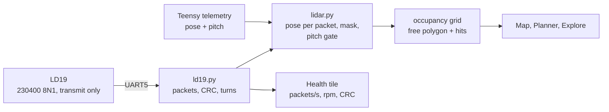

# LD19 lidar (issue #76)

A spinning 360 degree lidar (LDROBOT LD19, 10 turns/s, ~450 points a turn) on the Orange Pi's UART. The bridge turns every turn into
map updates. Everything below works in the simulator first: `python -m station.sim --lidar`.



Source of the protocol facts: LDROBOT *LD19 Development Manual V2.3* (sections 2 to 4). The CRC table and the example packet in the
tests are the manual's.

## Wiring

LD19 connector: ZH1.5T-4P (1.5 mm), pin 1 first.

| LD19 pin | Signal | Orange Pi Zero 2W header | |
|---|---|---|---|
| 1 | **Tx** (3.3 V out) | **pin 10, UART5 RX** (PH3) | the lidar only talks; the Pi's Tx (pin 8) stays unconnected |
| 2 | **PWM** | **GND** (pin 6 or 9) | to GND = the lidar controls its own speed (10 Hz) |
| 3 | GND | GND (pin 6 or 9) | |
| 4 | **P5V** (4.5 - 5.5 V) | 5 V (pin 2 or 4) | or the robot's 5 V rail; keep the grounds common |

Check the pin numbers against the board's printed pinout before powering on: the schematic confirms UART5 = PH2 (Tx) / PH3 (Rx) on the
header, and pins 8 / 10 are where the usual 40-pin-compatible layout puts them.
No level shifter is needed (3.3 V logic both ways). Do not connect a PWM signal: once a 20-50 kHz PWM is seen, the lidar stays
under external speed control until it is power cycled.

## One-time Pi setup (owner, sudo)

The header UART is off by default. On the Orange Pi Ubuntu image it is switched on in `/boot/orangepiEnv.txt` (device tree overlay).
UART5 becomes **`/dev/ttyS5`**.

```bash
# 1. which UART5 overlay does this image have? (name = file name without the sun50i-h616- prefix and .dtbo)
ls /boot/dtb/allwinner/overlay/ | grep -i uart
grep -E '^(overlay_prefix|overlays)=' /boot/orangepiEnv.txt

# 2. switch it on (usually ph-uart5; use the name step 1 printed). Backup first.
sudo cp /boot/orangepiEnv.txt /boot/orangepiEnv.txt.bak
sudo grep -q '^overlays=' /boot/orangepiEnv.txt \
  && sudo sed -i '/^overlays=/ s/$/ ph-uart5/' /boot/orangepiEnv.txt \
  || echo 'overlays=ph-uart5' | sudo tee -a /boot/orangepiEnv.txt
cat /boot/orangepiEnv.txt          # overlay_prefix=sun50i-h616 and overlays=... ph-uart5

# 3. reboot
sudo reboot
```

Same thing without editing the file: `sudo orangepi-config` > System > Hardware > tick `ph-uart5` > Save > reboot.

Your user needs the `dialout` group (the installer already warns about it): `id -nG | grep dialout`, else
`sudo usermod -aG dialout $USER` and log in again.

### Check it

```bash
ls -l /dev/ttyS5                                   # exists, group dialout
systemctl --user stop sbr3-bridge                  # one reader per port (a user unit: no sudo)
python3 -m station.bridge.ld19 /dev/ttyS5 5        # ~375 packets/s, ~600 rpm, 0 bad CRC, "RESULT: lidar OK"
systemctl --user start sbr3-bridge
```

With the bridge running: **Health** shows a **Lidar** tile (grey "no port" until `/dev/ttyS5` exists, green with packets/s and rpm),
and the Map menu has a **Lidar scan** layer (teal dots, the newest turn).
The bridge opens `/dev/ttyS5` by default and retries quietly while it is missing; `--lidar /dev/ttyS3` (or `SBR3_LIDAR`) picks another
port, `--lidar off` turns the lidar off.

### Troubleshooting

| Seen | Likely |
|---|---|
| no `/dev/ttyS5` | overlay name wrong / not applied: `dmesg \| grep -i ttyS`. Some images report a pin mux conflict on PH2 for UART5; then try another overlay name or the other image |
| Health: **silent** | no bytes: 5 V and GND on the lidar? (the motor spins when powered), Tx wire on pin 10? |
| Health: **junk** | bytes but no valid packet: Rx / Tx swapped to the wrong pin, loose ground |
| rpm not 600 | PWM pin not grounded (it floats), or still settling (takes ~3 s) |
| many CRC errors | long / loose wires, a shared noisy 5 V; the data is checked, bad packets are dropped |

## After the mount is built (issue #75): settings to fill in

Defaults are sensible guesses. Persisted in `lidar.json` next to the saved maps (`~/sbr3-maps/`), changed live with
`{"t":"lidar","action":"set","settings":{...}}` ([api.md](api.md)), for example:

```bash
curl -s -X POST http://localhost:8080/api/cmd -H 'Content-Type: application/json' \
  -d '{"t":"lidar","action":"set","settings":{"x_mm":-12,"y_mm":0,"yaw_deg":0,"height_mm":210,"mask":[[86,95],[265,274]]}}'
```

Robot frame: x forward, y left (counter-clockwise +), origin at the axle centre, degrees counter-clockwise from forward.

| Setting | Default | Fill in |
|---|---|---|
| `x_mm`, `y_mm` | 0, 0 | lidar axis: mm forward / left of the axle centre |
| `yaw_deg` | 0 | where the LD19's 0 degree direction (its front) points, counter-clockwise from robot forward |
| `flip` | false | true if it is mounted upside down (the angles then run counter-clockwise) |
| `height_mm` | 200 | scan plane above the floor: how far away a tilted beam meets the floor |
| `mask` | `[[87,93],[267,273]]` | the two cage posts: `[from, to]` sectors in the robot frame (they are skipped; up to 8) |
| `min_range_mm` | 120 | closer returns are the cage itself |
| `max_range_mm` | 8000 | farther returns are not mapped |
| `min_intensity` | 15 | weaker returns are noise (~200 = white wall) |
| `pitch_limit_deg` | 2.5 | packets from a scan plane leaning more than this (from the typical pitch) are dropped |
| `tilt_mode` | skip | `project`: keep leaning packets up to `pitch_max_deg` (6), range times cos(tilt) |
| `floor_clip` | true | drop returns beyond `0.9 * height / tan(tilt)`: that far, a downward beam is the floor |
| `deskew` | true | pose per packet (a driving or turning robot does not smear the scan) |
| `time_offset_ms` | 0 | trim if walls look doubled when the robot turns (lidar later than telemetry: +) |
| `every_n`, `ray_step` | 1, 1 | CPU savers: map every n-th turn / use every n-th point |
| map setting `lidar_replaces_sweep` | true | while scans flow, the two VL53L0X sweep readings do not draw into the map |

Finding `yaw_deg` / `x_mm`: robot facing a flat wall about 1.5 m away, lidar layer on in the Map: the dots must be a straight
line square to the robot; if the line is turned, adjust `yaw_deg`. Then turn the robot in place: the wall must not swim; if it does, trim `x_mm`.
The two posts must sit inside the `mask` sectors (they show as short dots 50-80 mm out at the robot's sides).

## What happens to a scan

1. **Pose**: the last 600 telemetry poses (a few seconds) are kept; every packet (12 points, 2.7 ms) is placed at the interpolated pose of its own
   moment (times from the lidar's millisecond counter, wraps handled).
2. **Per point**: range window, intensity, mask sectors, pitch gate, floor clip. A balancing robot rocks, so a few degrees of tilt are normal:
   packets leaning more than `pitch_limit_deg` from the median pitch of the last 3 s (the IMU reads about -3 degrees upright, which therefore
   does not matter) are dropped, and lying down / carried (IMU pitch beyond 30 degrees) never maps.
3. **Grid**: a free-space polygon from the lidar to the points (pulled back one cell + 2 % so range noise does not erase the wall) is filled
   by scanline, wall points become hit cells (neighbours up to 5 cells apart are joined into a line); a gap in the points (mask, dropout) is
   left unknown. The robot's own spot is freed like before.
4. **Planner**: it only reads the grid, so it benefits as is (denser walls, fewer unknown holes for Explore).

CPU (measured in `test_lidar.py`, 450 points, 3.5 x 5 m room, PC, Python 3.11): about 2 ms per turn to map plus 0.2 ms to parse, at 10 turns/s.
The Orange Pi's Cortex-A53 should take roughly 5 - 10 times that (10 - 20 ms per turn, 10 - 20 % of one core): `every_n` 2 halves it.
Health shows the measured cost (`status.lidar.cost_ms`, `cpu_pct`).

## Simulator

`python -m station.sim --lidar` (fake LD19 on `tcp://127.0.0.1:5762`; the in-process bridge reads it like the UART). The sim sends real 47-byte
packets, with range noise, dropped points, the two cage posts, a lean-dependent floor return, and a robot pose that changes during the turn.
With a separate bridge: `python -m station.sim --no-bridge --lidar`, then
`python -m station.bridge --port tcp://127.0.0.1:5761 --lidar tcp://127.0.0.1:5762`.

## Later (#71)

Scan matching / SLAM on the dense turns (the PC ROS 2 adapter, slam_toolbox) builds on `ld19.Scan` (angle, distance, intensity, time per point)
and the pose history in `lidar.py`. The old sweep based `correct` / `stop_scan` corrections need the VL53L0X sweep, which
`lidar_replaces_sweep` switches off while the lidar flows: turn it off to try them next to the lidar.
