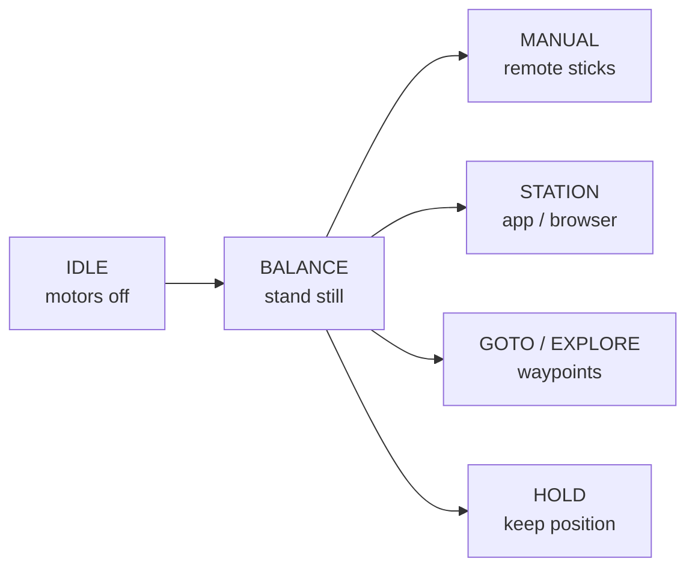

# Modes



| Mode | Drives from |
|---|---|
| IDLE | motors off |
| BALANCE | stand still |
| MANUAL | remote sticks, if packets < 250 ms old (obstacle: flag only) |
| STATION | `MSG_CMD_VEL`, if heartbeat < 500 ms and cmd < 300 ms; obstacle stop + slow-down |
| GOTO, EXPLORE | waypoint list (see Navigation), if supervised ¹ |
| HOLD | hold the position HOLD started at, if supervised ¹ |

¹ supervised = remote packets < 250 ms, or (no remote for 1 s) Pi heartbeat < 500 ms **with `clients` > 0**
(a browser / the app is connected; the planner does not count) and no pending handover. Else: stand still.
Speed ≤ `drv.max_speed` × remote speed limit (while the remote is present).
No range readings for 3 s (`rng.enable 0`): EXPLORE pauses, GOTO ≤ `nav.blind_speed` (0 = pauses).

Mode requests act when they change: a remote mode-switch change, or each Pi `SET_MODE`.

```
 boot ─> first packet: remote shows MANUAL ─> robot learns it, stays IDLE   (remote: Idle>Manual)
         arm                               ─> still IDLE, motors off
         remote selection changes           ─> that mode (e.g. pick Idle, then Manual)
 dropout, reconnect, same selection         ─> mode kept (a Pi SET_MODE is not overwritten)
 dropout, selection changed meanwhile       ─> the new selection
```

Safety rules (stop, arm, fall): [safety.md](safety.md). Navigation: [range-nav.md](range-nav.md).