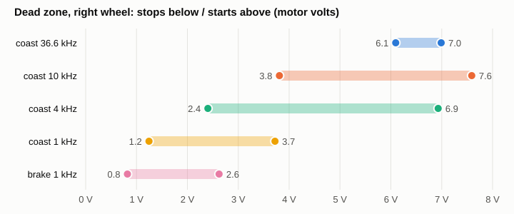
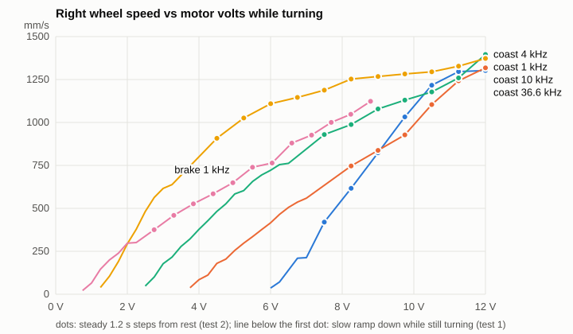

# Motor profile (issue #26)

Right yellow TT motor, wheels up, L298N, 12.0 V bench supply (pack reading invalid: volts = duty / 4095 × 12.0),
firmware dbca98d `mot.test=4` per config, 2026-11-21 night. Left motor unplugged (binding, #23).
Data: Pi `~/sbr3-logs/sbr3-20261121-041027.jsonl`; fit: `python tools/motor_fit.py --ssh robot <that log> --vbatt 12`.

## Result: brake mode at 1 kHz is the motor layer to balance on





| config (`drive:hz`) | starts at | stops below | speed vs V (steady) | t63 | top | reversal @ duty | heatsink |
|---|---|---|---|---|---|---|---|
| coast 36.6 kHz (today) | 7.0 V | 6.1 V | 210 mm/s/V above 5.2 V, 5 % off a line | 24 ms | 1310 | 25 ms, 15.7° @ 7.9 V | – |
| coast 10 kHz | 7.6 V | 3.8 V | 165, 2 % | 40 ms | 1326 | 35 ms, 21.9° @ 8.5 V | – |
| coast 4 kHz | 6.9 V | 2.4 V | 100, bent | 35 ms | 1380 | 48 ms, 40.5° @ 7.9 V | – |
| coast 1 kHz | 3.7 V | 1.3 V | saturates: 908 mm/s at 4.5 V | ~4 ms ¹ | 1342 | 78 ms, 61.1° @ 4.8 V | – |
| **brake 1 kHz** | **2.6 V** | **0.8 V** | **124 mm/s/V, 1 % off a line through ~0 V** | **15 ms** | 1123 @ 8.8 V cap ² | 26 ms, 18.9° @ 3.6 V | **cool** |

Wheel speed in mm/s. Starts at / stops below = test 1 ramps (mean fwd/rev; brake fwd 2.75/0.82, rev 2.49/0.82 V).
¹ step response at 1 kHz coast is too non-linear for a clean t63. ² `mot.test_max 3000`; linear → ~1500 mm/s at 12 V (not tested).
Reversal = command flipped → wheel at its turning point, and the coast angle before it (test 3 duty differs per config).

Why: in coast mode (PWM on EN) the current dies in the off-time, so the motor gets far less than duty × V at low
duty: a 6–7 V "dead zone" that is mostly the drive, not the motor. Brake mode (PWM on IN) keeps the current flowing:
**the motor sees ≈ duty × V, speed ∝ volts once turning**, and it only stops below 0.8 V. Lower coast frequencies
shrink the dead zone too, but bend the speed curve (1 kHz coast saturates at half voltage) and slow reversals 3×.

## What the balance loop sees (u = controller output, right wheel, while turning)

| u | 0.01 | 0.02 | 0.05 | 0.1 | 0.2 | 0.5 | gain (best line) |
|---|---|---|---|---|---|---|---|
| today: coast 36.6 kHz, model 0 | 0 | 0 | 0 | 45 | 310 | 869 | 1732 mm/s per u, dead to u ≈ 0.1 |
| **brake 1 kHz, model 1, dz 0.8 V** | 50 | 73 | 170 | 279 | 420 | 839 | **1738 mm/s per u**, 6 % off a line |
| brake 1 kHz, model 0 (v3 curve) ✗ | 468 | 545 | 671 | 768 | 939 | 1169 | far too hot near 0: **never combine** |

Same overall gain as today, but no dead band once the wheel turns → keep `bal.*` as they are to start.
From rest the wheel still needs ~2.6 V to break away (u ≈ 0.16, same as today): stiction stays, the 6 V band is gone.

## Recommendation (both new motors, floor)

Needs the `motor-profile` firmware (brake mode only ≤ `mot.brake_max_hz` 2000 Hz; dbca98d also accepts it, unguarded).
On the Pi (`~/sbr-tools/tune.py` or `tools/tune.py`), robot disarmed (drive mode / Hz apply with the motors off):

```
python3 tune.py set mot.drive_mode=1 mot.pwm_hz=1000 mot.model=1 mot.vcomp=1 mot.v_ref=12 mot.dz_l_fwd=0.8 mot.dz_l_rev=0.8 mot.dz_r_fwd=0.8 mot.dz_r_rev=0.8 mot.left_scale=1 mot.right_scale=1 mot.k_l=124 mot.k_r=124
```

Back to today: `python3 tune.py set mot.drive_mode=0 mot.pwm_hz=36621 mot.model=0 mot.left_scale=0.95`.
Keep `mot.speed_loop 0` for the first floor run. Refit dz / scales / k with the new motors first (step 2 below),
then use those numbers instead of the 0.8 / 1 / 124 above. 1 kHz whines audibly; 2 kHz is the optional quieter trial.

## Floor test plan for tomorrow (owner present)

1. **Flash** `motor-profile`; check boot + saved params (bal.kp 250, ki 1500, kd 7.15, tlm.hz 400, rng.*). `mot.test_wheels 0`.
   Bench supply without the balance lead: `mot.v_ref` = supply volts (the test uses it, `vbsrc=v_ref`).
2. **Stand, wheels up, both new motors** (IDLE + remote ARMED): `mot.test=4` coast 36621 (baseline) → 60 s off →
   `mot.drive_mode=1 mot.pwm_hz=1000 mot.test_max=3000 mot.test=4` (60 s cool-downs are automatic) → touch the L298N heatsink.
   `motor_fit.py --config 1:1000` → `mot.dz_*` (≈ stop V), `mot.left_scale/right_scale`, `mot.k_l/k_r` (k).
3. Same, `mot.test_max=4095 mot.brake_duty_max=4095` (full-voltage brake run) → heatsink.
4. Set the fitted params, `mot.test=7` (tracking: open loop model 0 / model 1 vs closed loop; `motor_fit.py` prints the rms table).
5. **Floor**: apply the recommendation line (fitted values), HOLD, `tune.py measure 20` standing still: compare with the
   2026-11-21 baseline (rocks ~1.5–2 Hz, ±3°, motor rms 0.12). Then pushes, drive on carpet (forward jerk was the complaint).
6. **Heatsink check after 3–5 min of balancing** (finger test; stop if too hot to hold). Watch the supply current.
7. Retune `bal.kp` / `bal.kd` ±10 % if it buzzes (too hot) or is sluggish; `cfg.save` when good.
8. Optional: `mot.pwm_hz=2000` (≤ brake_max_hz) → step 2 on the stand + heatsink, then floor. Above 2000 needs `mot.brake_max_hz` raised: only after heat checks.
9. Optional: `mot.speed_loop=1` on the stand (`mot.test=6` first), then floor with `bal.*` retuned (u becomes a speed command).

## Closed-loop wheel speed (not run on hardware yet)

`mot.test=5/6/7` and `mot.speed_loop` are in the `motor-profile` firmware (see firmware.md). In the host simulation
(TT-like motor: 6.4 V start, 5.9 V stop, 215 mm/s/V, coast-mode dead zone) the right wheel's rms speed error was:

| controller | ramp 0→300→0 | sine ±50 around 0 | sine 150 ± 50 | steps 150↔250 | t63 up/down |
|---|---|---|---|---|---|
| open loop, model 0 | 65 | 36 | 102 | 105 | 155 / 35 ms |
| open loop, model 1 | 28 | 36 | 27 | 28 | 45 / 160 ms |
| closed loop (kp 0.006, ki 0.08) | 5 | 18 | 7 | 14 | 35 / 35 ms |

Simulation only: real numbers come from step 4 above. Around 0 every controller struggles (stiction from rest).
