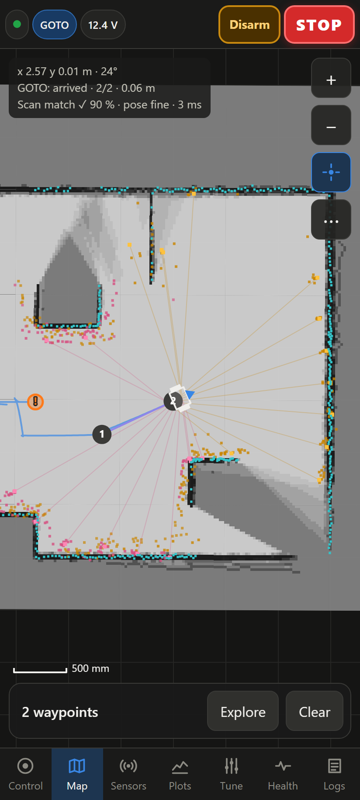
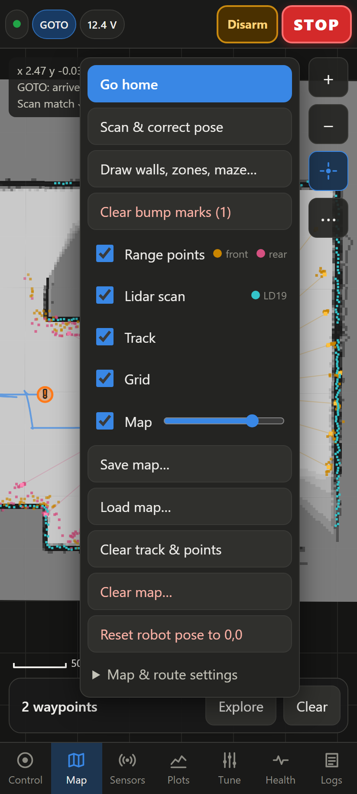

# Range sweep and navigation

## Range sweep (issue #7)

```
            +X = forward (pitch + = leaning this way, wheels roll this way at + speed)
                 ^  sensor 0 at head angle 0
                 |
      +90 (left) |  head angle + = CCW (seen from above)
           <-----O----->  -90 (right)        O = servo axis, 26 mm ahead of the axle
                 |                             sensors 12.9 mm from it, 189 mm above the axle
                 v  sensor 1 = head angle + 180
```

| | |
|---|---|
| Servo command | `90 + trim + servo_dir × head_angle ÷ deg_per_cmd`, clamped to `servo_min_deg … servo_max_deg` |
| Sweep | head −85 … +85 and back (16 steps); sensor 1 covers the other half → 32 points / 360° |
| Hold | `rng.servo_hold_deg` = servo command (trim still added); head angle = `servo_dir × deg_per_cmd × (hold − 90)` |
| Idle off | disarmed / E-stop + `hold` −1 + `rng.idle_off` 1 → centre, settle 0.4 s, no pulses (quiet); still ranges at 0° / 180°; arm → pulses back at centre, sweep resumes (hold ≥ 0 always holds) |
| Reported angle | from the command actually sent (after clamping), so clipped positions are still reported truly |
| RangeFrame | every reading: pose + pitch when it finished, `sensor_angle_deg` = head angle (+180 for sensor 1), `valid` 0 = no target / > `rng.max_mm` / timeout |
| Radio telemetry | `range_front_mm` / `range_rear_mm` = latest reading within half a step of 0° / 180° (0 = none for 2 s) |
| Rate | ~80 ms per position (settle 40 + budget 33 + I2C) → 25 readings/s measured, 360° every ~1.3 s; 50/s when parked |

Never blocks the balance loop: after each balance step it spends at most a quarter of the step
period on I2C (single-shot ranging with raw register writes, ready from the INT pins, fallback polling).
The status line `rng: … readings/s … max slice … us` comes 5 s after start, then every 30 s.

### Aligning the head (motors off, robot on its stand)

**1. Travel** (`trim` 0): `rng.servo_hold_deg` = 5 (= `servo_min_deg`), mark where sensor 0 points;
then 175 (= `servo_max_deg`), mark again. Measure the angle between the marks (protractor / phone
compass app on top of the head). `rng.servo_deg_per_cmd` = angle ÷ 170.
Hold 175 must turn sensor 0 to the robot's **left**; if it goes right, `rng.servo_dir` = −1.
If the servo buzzes at either end, move `servo_min_deg` / `servo_max_deg` in a few degrees.

**2. Zero**: `rng.servo_hold_deg` = 90. Sensor 0 (XSHUT 34) must point straight ahead, along the wheels'
rolling direction. If it points X° left (CCW): `rng.servo_trim_deg` −= X ÷ deg_per_cmd (with `servo_dir` 1;
right → +=). Repeat until straight.

**Or by range, both at once**: robot square to a flat wall 30–60 cm ahead, `rng.sweep_deg` 90,
`rng.steps` 19, wait 20 s, then on the Pi `python3 tools/range_align.py --seconds 15` →
suggested `servo_trim_deg` (fit of the readings to a flat wall). Its `servo_deg_per_cmd` is only rough:
the sensor's ~25° cone flattens the curve, so measure the travel by eye (step 1).

**3.** `rng.servo_hold_deg` −1, `rng.sweep_deg` 170, `rng.steps` 16, `cfg.save`.

## Navigation (issue #8, `src/navigator.*`)

Waypoints (pose frame): remote MARK_WAYPOINT, or the Pi's `MSG_GOTO` (the planner sends `replace = 1`).
GOTO and EXPLORE follow the list the same way; HOLD holds the spot it started at.

```
           new list / mode GOTO, EXPLORE
                     │
                     v          |err| < align                     last point: dist < arrive_mm
 ┌────────────> TURNING ─────────────────> DRIVING ──────────────────────────> (stop) ──┐
 │ corner > 75°  (turn in place)  <───────  pure pursuit, slows for corners             │ stopped
 │                    |err| > max(3·align, 75°) │  ▲   other points: passed, no stop     │ dwell_ms
 │                                     obstacle │  │ GOTO: clear again                    v
 │                            < rng.obstacle_mm v  │ EXPLORE: new MSG_GOTO list        ARRIVED
 │                                           BLOCKED (+ backoff_mm)            (end_heading_deg ≥ 0:
 └───────────── passed a corner > 75° ─── DRIVING                               TURNING to it first)

 HOLD:  HOLDING  speed = hold_kp × forward error (deadband hold_db_mm), BLOCKED if an obstacle is in the way
```

Pass-through waypoints (#103): only the last point of a list stops (the planner's stop-and-scan points are the
last of their list).

```
   ●━━━━━━━━━━━━━━━━━━━━━━━━━━◉━━━━━━━━━━━━━━━━● i          ◉ robot, L = max(arrive_mm, 1 s × speed)
   leg start                   ╲ steers at ✕     ┃          ✕ aim: the route point L from the robot
                                 ╲               ✕            (L >= 3 × its distance to the route),
                                    ╲            ┃            up to the next corner > 75° or the last point
                                                 ● i+1      i done: closer than L, or past it along its leg
```

| Corner | speed there (defaults) | next waypoint |
|---|---|---|
| 0° | `nav.max_speed` | at L |
| 30° / 45° / 60° / 75° | 228 / 151 / 112 / 88 mm/s (the aim cuts it by ~30 mm), ≥ `nav.min_speed` | at L |
| > 75° | slows as for a stop (`speed_kp` × dist) | within `arrive_mm`, then turns in place (`align_deg`) |

Speed = (corner speed + `nav.speed_kp` × distance to go) × cos(error), each corner ahead counted; it rises at most
`speed_kp` × max speed per s (150 mm/s² at 0.6 / 250): no steps at a corner, a start or after an obstacle.
No new params.

| | |
|---|---|
| Obstacles | every valid range reading → a world point (kept `nav.obst_age_ms`); points in a `nav.corridor_mm` strip ahead / behind give the front / rear distance as a sensor range |
| Floor | lean tips the head; a hit lower than `nav.floor_mm` above the floor is ignored |
| Slow-down | `nav.slow_mm` → `rng.obstacle_mm`: speed limit falls linearly (≥ `nav.min_speed`) |
| Side walls (#62) | points beside the body (body rear … 300 mm ahead) give left / right gaps from the body side. Gap < `nav.side_min_mm`: steer away (`nav.side_kp`), slow down (linear to `nav.min_speed` at 0). The corridor is then at most body width + 20 mm: a wall alongside or a door jamb steers, it does not stop. GOTO blocked with a wall alongside: turns away from it in place (≤ 30°) |
| Turning in place | corners sweep r 88 mm. Something ahead / behind within 105 mm → first step straight away (≤ `nav.stuck_backoff_mm`). Target behind and a wall close at one side → turn the nose away from that wall |
| Stuck (#62) | driving (not in the last 3 × `arrive_mm` to a waypoint) or turning, but < `nav.stuck_mm` / 15° progress for `nav.stuck_ms` → BLOCKED, back off `nav.stuck_backoff_mm` (at 2 × `nav.min_speed`, ≤ 5 s). GOTO then goes on; EXPLORE waits for the planner (it replans 5 s later with +100 mm margin). With the LD19 the bridge also reports spinning wheels (`EVT_LINK_STUCK`, #79: the odometry moves, the lidar does not): same reaction. The back-off counts travel backwards along the blocked heading only |
| Applies to | GOTO, EXPLORE, HOLD, STATION. MANUAL: `TLM_OBSTACLE` only |
| LD19 lidar (#77, #113) | a lidar frame in the last 0.5 s (made on the Teensy, link v10; older: `MSG_LIDAR_OBSTACLES` from the bridge): its 36 points (per 10° sector the nearest in the corridor, else the nearest) count together with the sweep's points for everything above (#99; log `nav: lidar obstacles on` / `… lost`). [ld19.md](ld19.md#obstacles-for-the-robot-issues-77-113) |
| GOTO clear again (#99) | only after `nav.obst_age_ms` of **fresh** data (lidar frame or sweep reading < 0.5 s old) with nothing inside `rng.obstacle_mm` + `nav.clear_mm` (+ backoff). No data / blind is never clear; without fresh data a new list or mode keeps the latch |
| Lidar dead zone (#99) | lidar points within 180 mm of the axle stay as "ghosts" until the robot is 180 mm away from them: a post inside the LD19's min range does not vanish. Obstacle < 141 mm ahead: back off `nav.stuck_backoff_mm` (again while it is still that close) |
| No sweep | no fresh lidar frame and `rng.enable 0` (no RangeFrame for 3 s) → no obstacle stop → **EXPLORE paused**, **GOTO ≤ `nav.blind_speed`** (log `nav: no range readings - obstacle stop is off: …`) |
| Pose reset | clears the list, points and hold point (ghosts move into the new frame) |
| GO_HOME | list = [first waypoint, or the origin], mode GOTO (never arms) |
| NavStatusFrame | at once on a change of state / index / count, else 2 Hz in GOTO/EXPLORE/HOLD; `obstacle_mm` = blocking range |
| Log | `nav: blocked, obstacle at 287 mm (waypoint 2/2)`, `nav: clear …`, `nav: passed 1/3, 118 mm off` (#103), `nav: reached 3/3, 12 mm off` (the last one), `nav: arrived`, `nav: stuck, no progress driving for 2.5 s (waypoint 1/2)`, `nav: stuck, wheels turn but the lidar sees no motion (waypoint 1/2)`, `nav: too close to turn (92 mm), stepping back`, `nav: contact bump at 1154,-23 (…)` (below) |

## Contacts: obstacles below the lidar (issues #104, #111)

`src/contact.*`, used by the navigator. The LD19 scans at ~208 mm (the sweep at ~222 mm): shoes, toys, a low box, a step are invisible. The robot finds
them by touch, backs off, and the bridge marks the spot so the planner goes round it.

```
  driving at 250 ──┐ wheel stops    BUMP: speed falls far below the command   ──>  BLOCKED, back off
                   v ■ shoe               + pitch-rate spike (body thrown on)       "nav: contact bump at x,y"
  pushing at 120 ──> ■             STUCK: no new ground for 0.4 s while the         MSG_CONTACT ──> bridge:
                     (still)              command + velocity-loop lean push on       orange bump mark ● on the map
  backing off  ■ <── -40           STALL (#111): wheels still 0.4 s while the  ──>  rear contact, HOLD there
  into it      (still)                    lean builds toward the command             (no back-off, no pushing on)
```

| | |
|---|---|
| Watched | GOTO / EXPLORE while driving, **backing off** (BLOCKED, stuck, contact) or stepping away before a turn (#111); STATION while it commands motion (reported only, the driver keeps control). Never HOLD (pushed by hand), BALANCE, MANUAL, the stop at the last point, turning in place. `nav.stuck_ms` 0 turns it off |
| BUMP | command ≥ 100 mm/s and steady; speed was ≥ 0.6 × command in the last 120 ms and fell by ≥ max(70 mm/s, 40 %) to < 0.6 × command, with a pitch rate ≥ 80 °/s toward the motion (normal balancing ~20 °/s RMS, peaks ~65; hard bumps 100–126) → it must stay < 0.5 × command for 80 ms (stopped or bounced back; rolling over a door strip cancels it). A fall within 0.6 s confirms it too (`fell`) |
| STUCK | command ≥ 100 mm/s and **cruising** (not slowing for a stop: the last point or a sharp corner it turns in place at, and not ramping up from one: the #103 speed rise limit after a start / turn in place / BLOCKED, ~1.4 s to 250 mm/s, while the body still rocks; slowing for a pass-through corner and speeding up after it are cruising, those caps are 88–228 mm/s), it got going (≥ 50 mm/s, 0.5 s after the command came: a start rolls back first), then no new ground (10 mm) for 0.4 s while the velocity-loop lean pushes on (≥ 0.6°). Rocking against it counts. A lidar stuck (`EVT_LINK_STUCK`) waiting confirms it at 0.2 s (`lidar`) |
| STALL (#111) | slow and reverse pushes, reported as `stuck`: command ≥ 30 mm/s either way for 0.3 s, not ramping up (the speed rise limit), then **0.4 s** with the wheels still (travel within −15…+10 mm, mean speed ≤ 15 mm/s now, ≤ 30 over the window) while the velocity-loop lean **grows** toward the command (≥ 0.08°, or held at the anti-windup limit). A build-up, not the absolute lean: the integrator also holds the robot's balance trim (−2…−4° on the real robot). Driving forward: only while cruising, from 60 mm/s, with a 0.8 s window below 100 (the sim's balancer stands in its motor dead band that long at 60, longer at 40–50) |
| DEAD STILL (#111) | any command ≥ 30 mm/s (also **slowing for the last point**, 40 mm/s, ramping up): the wheels not turning at all, from mean speed ≤ 4 mm/s, travel within ±4 mm and ≤ 6 mm/s on average (a twitch is fine), for **0.8 s** while the lean builds ≥ 0.1° → `stuck`. A free balancing robot in its motor dead band creeps or rocks (the sim's: never this still for more than ~0.1 s). The 18:36 miss (40 mm/s into a low box 135 mm before the last point, wheels at 0 for 9 s) is found 1.1 s after it stopped |
| Stuck check | `nav: stuck, no progress driving for 2.5 s` (odometry, off within 3 × `nav.arrive_mm` of the last point): it stands up (contactReset) and backs off; **no contact report** (crawling at 40–50 mm/s a balancing robot can stand in its motor dead band that long with nothing in front of it, e.g. squeezing through a doorway). Again and again at one spot: the same-spot rule marks it |
| Latency | real log replay: the 3 pushes v8 missed (back-offs at −40 / −80) at 0.4–0.6 s of stillness; the 18:36 push before the last point 1.1 s. Sim: bump at 200–250 mm/s ~0.1 s; stuck at 100–150 ~0.4 s; a rear box while backing off ~0.5 s; slow pushes at 80: ~0.9 s; 40–60: 0.8 s once still (the sim's robot bounces off a box 1.4–2.3 s first) |
| Reaction | BLOCKED, the controller's **contactReset** (command 0, velocity integrator back to the lean before it pushed: it stands up instead of leaning on it), back off `nav.stuck_backoff_mm` (rear corridor checked), then **hold** that spot. Found while backing off / stepping away (that way is blocked too): **no back-off, hold** (a rear contact, `rear`, `holding`). GOTO waits 4 s for a new list (the planner's route round the mark) and then tries again; EXPLORE waits for a new list. **GOTO gives up** after 3 stops (contacts / stucks while driving) at the same spot (150 mm) on the way to the same waypoint: `nav: gave up on waypoint 4/4: stopped 3 times at x,y - waiting for a new list` (BLOCKED, holds) |
| Rear (#111) | reversing (back-offs: after a bounce or from standing a balancing robot rocks 0.5–1 s before reverse motion shows): rear contacts only **1 s after the back-off starts**, with the rocking died down (mean pitch rate ≤ 10 °/s), **0.8 s** with the wheels still (mean speed ≤ 15 mm/s over the window: no rocking) and the lean growing backwards ≥ 0.15°. 18:36: the robot made 21 `rear, holding` in rocking back-offs - the replay finds none; the 3 real blocked back-offs of 14:46 (still 1–3 s) still are. A back-off that rocks against something ends after 5 s |
| Report | `MSG_CONTACT` (link v8): kind, contact point (pose frame, on the body's edge in the direction of travel, 50 mm from the axle: behind it when reversing), heading of travel (+180 reversing), peak dps / stalled ms, flags `lidar` / `fell` / `reported only` |
| Log | `nav: contact bump at 1154,-23 (145 dps, backing off)`, `nav: contact stuck at 1160,-23 (400 ms, backing off)`, `nav: contact stuck at 591,-27 (401 ms, rear, holding)`, `nav: contact stuck at … (… reported only)` |
| Bridge | a **bump mark**: disc r 70 mm, 35 mm past the contact point, zones kind `bump` (saved in `<map>.zones.json`). Planner: a wall (inflated by radius + margin). Not the watchdog (the robot is standing at it). A contact within 100 mm of a mark moves it (hits + 1). **No mark when the map has a wall there** (#111: a doorway jamb it touched while squeezing through; a mark would shut the doorway): the planner replans anyway. Map ⋯ → **Clear bump marks**; Draw → delete tool removes one; API `{"t": "zones", "action": "clear", "kind": "bump"}` ([api.md](api.md#zones)) |
| Same spot again (#111) | the planner counts stops: a contact, `nav: stuck`, and `nav: blocked` **at ≤ 160 mm** (inside / at the lidar's dead zone; farther it is mapped, and squeezing through a doorway it stops 260–300 mm in front of it while the route is recentred). **3 within 150 mm in 30 s** → a bump mark where it was blocked, the stuck boost (+100 mm margin), explore gives that frontier up, and it plans another way. Status: `stopped 3 times at the same spot (…): planning another way`. **Goto ends** at the 2nd loop of the job, or at the 1st when the goal is within 250 mm of a bump mark, or when the robot gave up (`nav: gave up`): `can't reach the goal: something low there`, the robot holds where it is; explore gives the frontier up |
| Thresholds | compile-time (`ContactDetector::k*`, `Controller::kBlk*`, planner `LOOP_*`), no params |

### Anti-windup (#111, `src/controller.*`)

```
  lean ▲            without: the integrator leans harder and harder ... until it falls
       │         ╱
       │       ╱  ┌──────────── with: at most +1° past where the wheels stopped (P still pushes)
       │     ╱ ───┘
       │ ──╱  ↑ wheels still 0.3 s (|cmd| ≥ 30, mean |speed| < 15)       contact / stuck → back to the lean before it pushed
       └────────────────────────────────────────────────────────────► t
```

Blocked = commanded (≥ 30 mm/s) but the wheels not turning (mean |speed| < 15 mm/s over ~0.2 s) for 0.3 s: the velocity
integrator leans at most 1° further toward the command than **when the wheels stopped** (kept while it bounces against
it, until it follows a command again; never pulled back: a robot standing in its motor dead band still gets that much to
break free). `CtlOut.held` tells the stall rule. Normal driving and balancing never meet it: the sim's tour with it on
and off is bit-identical (`TestAntiWindup`). Sim, pushed 4 s into a box at 120 mm/s (STATION): +1.00° past where the
wheels stopped (without: +2.56°).

Sim (#111 fix): pushing on against a **low box**, the body leans on it (does not pitch further into it); walls keep the
older contact model.

### Real-log replay

`station/tools/contact_replay.py extract <session.jsonl> <out.csv>` rebuilds the detector's inputs from the 100 Hz
telemetry; `test/host/contact_replay.cpp` and `test_contact.py` (`TestRealReplay`) replay
`station/sim/tests/data/contact_replay_20261125.csv` (v8, 2026-11-25): the 3 missed pushes are found, nothing outside the
stretches where it really was blocked; and `contact_replay_20261125b.csv` (18:36, push-detect flashed): the slow push
just before the last point (missed on the robot: the stall rule skipped slow driving and slowing for a stop, the stuck
check is off near the last point) is found at 133.97 s, 1.1 s after the wheels stopped. (It reported "arrived" on the
robot after the wheels spun 320 mm in place: the odometry ran onto the goal.)

<p>


</p>

Sim: a route straight through a low box at (1.3, 0) m. It bumped (orange ! mark), backed off, and the replanned route went round.

**Check it on the robot** (Logs tab, map; GOTO on a clear floor first):

| Try | Expect |
|---|---|
| GOTO across the room and back, a few times (starts, stops, turns) | no `nav: contact` lines |
| a shoe in the way at 250 mm/s | `contact bump` (may still fall over: the mark is made), backs off, orange mark, route goes round |
| a heavy box at `nav.max_speed` 120 | `contact stuck` ~0.4 s after it stops |
| a heavy box at `nav.max_speed` 80, then 50 | 80: `contact stuck` ~1 s after it stops, stands up, backs off, a mark; 50: `nav: stuck` after 2.5 s, backs off (no mark), after 3 stops there the planner marks it |
| GOTO so it blocks at a wall, a box just behind it (the back-off hits it) | `contact stuck … (…, rear, holding)` ~0.7 s after the back-off starts; no pushing on, a mark behind it |
| leave it wedged like that (EXPLORE) | after 2–3 stops there: `planner: stopped … times at the same spot …: planning another way` |
| over the door strip / onto the carpet | no contact (if it does: the session log has the telemetry, report it) |
| HOLD, push it back by hand and hold it | no contact, no mark |
| Map ⋯ → Clear bump marks | marks gone, routes go straight again |

Simulator: `--low CX,CY,W,H[,HEIGHT]` puts a low box in the room (the lidar and the sweep look over it; the body stops
at it with a pitch kick). Tests: `test/host/nav_sim.cpp` (`testContact*`), `test/host/contact_replay.cpp`, `station/sim/tests/test_contact.py`,
`station/bridge/tests/test_contacts.py`.

Simulator: `station/sim/sim.py` `Navigator` is a line-by-line port (same params, states, logs);
tests `station/sim/tests/test_nav.py`; `station/sim/contact.py` ports `src/contact.cpp`.

Back: [firmware index](firmware.md).
