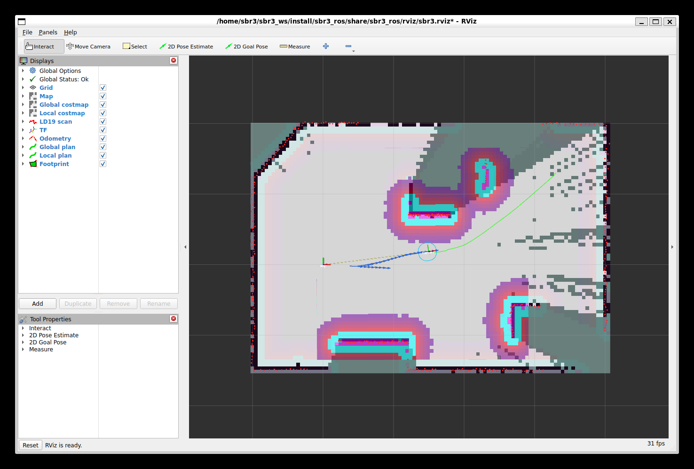
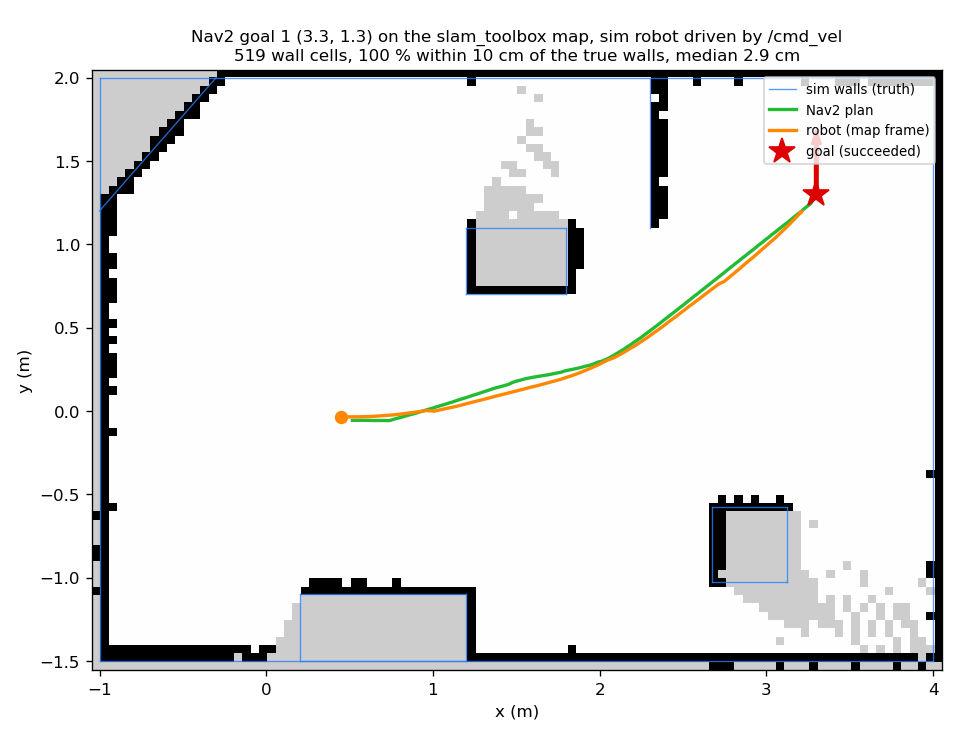
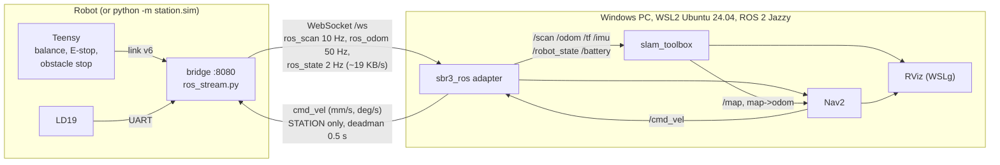
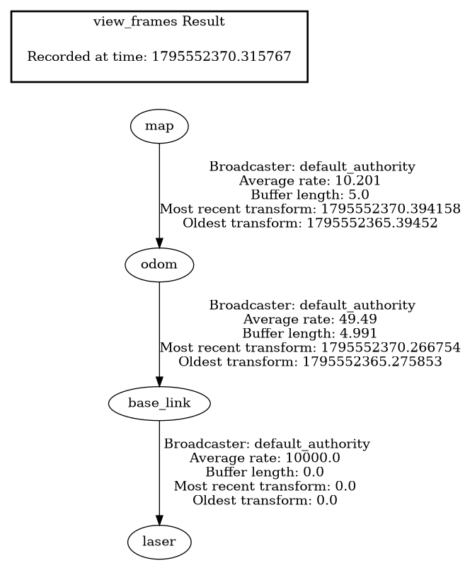
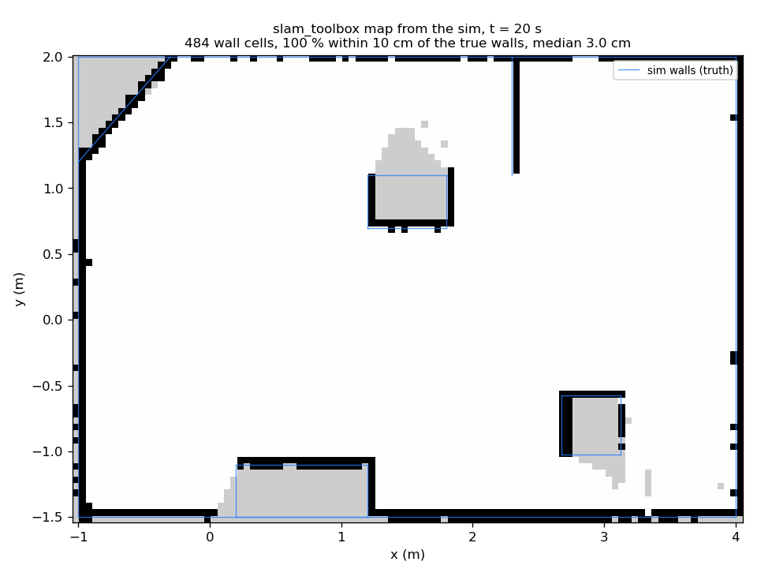
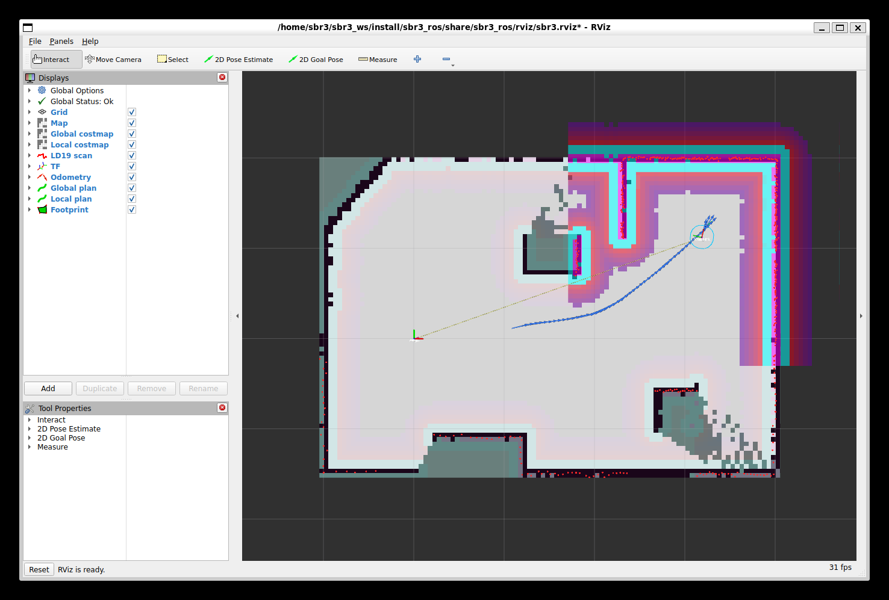

# ROS 2 on the PC (WSL2): slam_toolbox + Nav2

Issue #96. ROS 2 Jazzy runs on the Windows PC in WSL2. The robot does not change: the bridge sends a small opt-in stream, and an adapter turns it into ROS topics.

<p>


</p>
<p>Nav2 drives the sim robot through the bridge (RViz on WSLg), and the goal is reached on the slam_toolbox map. Blue lines are the sim's true walls.</p>

## Architecture



| Frame | From |
|---|---|
| `map -> odom` | slam_toolbox, or AMCL, or the bridge's own LD19 matcher (`localization:=bridge`) |
| `odom -> base_link` | adapter, from telemetry (50 Hz) |
| `base_link -> laser` | adapter, static, from lidar.json: x, y, height (208 mm on the robot), **yaw 0** (the bridge already applies the mount yaw) |



## Install (once, ~10 min, no admin)

```powershell
powershell -ExecutionPolicy Bypass -File ros2\setup_wsl.ps1
```

This sets up the following:

| | |
|---|---|
| WSL distro **Ubuntu-24.04** | `%LOCALAPPDATA%\wsl\Ubuntu-24.04`, user `sbr3` (passwordless sudo). WSL older than 2.4 cannot `--install` it by name, so the script imports Canonical's official image after checking its SHA256 |
| ROS 2 **Jazzy** (apt) | `ros-jazzy-desktop`, `ros-jazzy-slam-toolbox`, `ros-jazzy-navigation2`, `ros-jazzy-nav2-bringup`, colcon, rosdep, `python3-websocket` |
| `sbr3_ros` | built in `~/sbr3_ws` from a copy of `ros2/sbr3_ros` (colcon never writes into the Windows checkout) |

Disk: **~9 GB** (the distro's `ext4.vhdx`). It is safe to run again.

## Run with the simulator

The sim runs **inside WSL**, so it needs no firewall or network changes. Its web UI is at http://localhost:8080 from Windows.

| | Command (PowerShell, repo root) |
|---|---|
| Map | `powershell -File ros2\run_mapping.ps1 -Sim`: the sim drives a loop and the map builds in RViz |
| Navigate | `powershell -File ros2\run_nav.ps1 -Sim`, then **Arm & Balance** and **Manual** in the web UI, then click **2D Goal Pose** in RViz |
| Headless | add `-NoRviz` |
| Tests | `wsl -d Ubuntu-24.04 -- bash ros2/scripts/sim_e2e_mapping.sh`, and `sim_e2e_nav.sh` (map PNGs + goal JSON in `~/sbr3-e2e`) |

Save a map (from a second window):

```
wsl -d Ubuntu-24.04 -- bash -lc "ros2 run nav2_map_server map_saver_cli -f ~/maps/room"
wsl -d Ubuntu-24.04 -- bash -lc "python3 /mnt/c/<repo>/ros2/scripts/map_png.py ~/maps/room.yaml /mnt/c/<repo>/room.png"
```

### Sim results

<p>



</p>
<p>slam_toolbox map at 20 s, at 45 s, and after 150 s of the tour. All of its wall cells are within 10 cm of the true walls (median 1.3 cm).</p>

<p>


</p>
<p>With odometry drift (<code>--drift 3</code>: 3 deg/min heading, 2 % distance), slam_toolbox still closes the map. Right: RViz while mapping.</p>

| Nav2 goal (sim) | Result |
|---|---|
| (3.3, 1.3) m, past the box | succeeded, 20 s, 0.14 m from the goal (tolerance 0.15 m) |
| back to (0, 0) | succeeded, 26 s |

<p>


</p>

| Topic | Rate (sim) |
|---|---|
| `/scan` | 10.0 Hz, 480 beams (0.75 deg), ~20 KB/s in ROS |
| `/odom`, `/tf` odom->base_link, `/imu` | 50 Hz |
| `/map` | 0.5 Hz |
| `/robot_state`, `/battery` | 2 Hz |

## Run with the robot

1. On the phone: **Arm & Balance**, then **Manual** (STATION). ROS only drives in STATION mode.
2. On the PC:
   ```powershell
   powershell -File ros2\run_mapping.ps1          # or run_nav.ps1; -Url ws://<pi-ip>:8080/ws if it moved
   ```
3. Drive with the phone joystick while mapping, or click goals in RViz with `run_nav.ps1`.

WSL2's default NAT networking is fine here: WSL connects out to the robot. Nothing has to connect into WSL.

The adapter has not been run against the real robot yet: it was tested on the sim only.

## Safety

| Rule | Where |
|---|---|
| ROS never arms, never changes the mode, never releases an E-stop | adapter: it only sends `cmd_vel` |
| `/cmd_vel` drives only when the robot is armed, in **STATION**, with no E-stop and live telemetry; anything else is logged once and ignored | `convert.drivable` |
| Deadman: no `/cmd_vel` for 0.5 s means one zero command, then silence. The bridge stops forwarding after 300 ms, and the firmware after its own timeout | `convert.CmdGate` |
| Caps 0.25 m/s, 1.0 rad/s; slew 0.4 m/s², 2 rad/s² (adapter params `max_*`) | adapter |
| Nav2: 0.18 m/s, velocity smoother 0.3 m/s² up and 0.4 m/s² down (a balancing robot leans to speed up) | `config/nav2.yaml` |
| The Teensy keeps the last word: obstacle stop / slow-down in STATION, the link watchdog, E-stop, falls; the bridge's zones filter still applies | firmware, bridge |
| Adapter closed: the bridge stops the robot at once (`cmd_vel 0`). Wi-Fi lost: no `cmd_vel` arrives, so forwarding stops after 300 ms | bridge |

**STOP** on the phone always works. While it is latched, ROS commands are ignored.

## The bridge ROS stream

`station/bridge/ros_stream.py` is opt-in per WebSocket client: `{"t":"ros","action":"subscribe"}`. Phones never get it. A slow client skips it.

| Message | Content |
|---|---|
| `ros_hello` | frames, lidar mount, scan layout (480 bins from -pi, base64 uint16 mm), odom columns |
| `ros_scan` | one LD19 turn: ranges in the **laser frame at the turn's end** (`ts`), deskewed per packet with the telemetry pose. Range / intensity / mask / floor-clip filters come from lidar.json. Also `tilt` (max \|pitch - typical\|) and `tilt_pk` (packets beyond the 6 deg gate, left out), plus `corr` (map <- odom of the bridge matcher) |
| `ros_odom` | rows `[ts, x_mm, y_mm, heading_deg, speed_mms, turn_rate_dps, pitch_deg, pitch_rate_dps, roll_deg, yaw_rate_dps]` |
| `ros_state` | mode, armed, E-stops, battery, link, `corr`, matcher state, stream stats |

**Clock:** every `ts` / `now` uses the bridge's monotonic clock, the same clock the lidar deskew uses. The adapter keeps one offset to ROS time: the smallest `ros_now - now` seen, creeping 0.05 % so it follows clock-rate drift, and reset after a bridge restart. So `/scan` and `/tf` stamps agree with each other, and no NTP is needed.

**Tilt:** the adapter drops turns with `tilt > max_tilt_deg` (6 deg) or any left-out packet. While the robot lies on the floor, every turn is dropped, so slam_toolbox starts its map once the robot stands.

**Cost** (measured on the sim, this PC):

| | |
|---|---|
| Bandwidth | **18.5 KB/s** per subscriber (scan ~1.3 KB x 10, odometry ~4 KB/s, state) |
| Bridge CPU | **0.5 ms per turn**, 0.6-0.8 % of one PC core. Expect roughly 5-8x that on the Pi Zero 2W (~4 ms per turn, ~5 % of one core). Nothing runs when no one subscribes |

## Troubleshooting

| Problem | Fix |
|---|---|
| Sim on **Windows** (not in WSL) | WSL's NAT cannot reach Windows' `127.0.0.1`. Either run the sim in WSL (`-Sim`), or start it with `--host 0.0.0.0` and use `ws://<Windows IP from WSL>:8080/ws` (`ip route \| awk '/default/{print $3}'`). That needs a Windows Firewall inbound rule for Python. Or turn on mirrored networking (`%USERPROFILE%\.wslconfig`: `[wsl2]` / `networkingMode=mirrored`), which affects every WSL distro |
| Adapter log: `ignoring /cmd_vel: robot in BALANCE ...` | tap **Manual** on the phone (arm first) |
| No `/map` | the robot is lying down (every turn is tilted), or no lidar (`ros_hello` says so) |
| TF `extrapolation into the future` | the adapter clock offset is still settling (first second), or the Wi-Fi is stalling. Check the `clock offset` and `KB/s` in the adapter's 10 s report |
| Nav2 goal `outside bounds` | wait for the map to grow (`/map` every 2 s) before the first goal |
| RViz window missing | WSLg comes with WSL 2: check that `echo $DISPLAY` prints `:0` in WSL. The RViz log line `indexed_8bit_image ... same texture image unit` is a harmless WSLg GL warning |
| Costmap displays orange in mapping | normal: Nav2 is not running in `mapping.launch.py` |

## Package

| Path | |
|---|---|
| `ros2/sbr3_ros/sbr3_ros/adapter.py` | the node (`ros2 run sbr3_ros adapter --ros-args -p url:=...`) |
| `ros2/sbr3_ros/sbr3_ros/convert.py` | conversions, clock sync, cmd_vel gate (no ROS, unit tested on Windows) |
| `ros2/sbr3_ros/sbr3_ros/goal_test.py` | one Nav2 goal, logs the plan and track to JSON |
| `ros2/sbr3_ros/launch/` | `mapping.launch.py`, `navigation.launch.py` (`localization:=slam\|amcl\|bridge`, `map:=`) |
| `ros2/sbr3_ros/config/` | `slam_toolbox.yaml` (LD19, 5 cm, 20 cm / 0.2 rad per node), `nav2.yaml` (RPP, r 0.12 m footprint) |
| `ros2/*.ps1`, `ros2/scripts/` | setup / run from PowerShell, build, e2e tests, `map_png.py` |

Tests: `python -m unittest discover -s ros2/sbr3_ros/test` (adapter, Windows or WSL), and `station/bridge/tests/test_ros_stream.py` (stream) inside the station suite.

## What's next

- **Real robot:** first run with the robot on a stand, then on the floor, mapping only, then Nav2 at 0.1 m/s.
- **On the robot's SBC** (#71: Pi 5 8 GB): run the same `sbr3_ros` there with `url:=ws://127.0.0.1:8080/ws`. slam_toolbox + Nav2 move with it, and the PC keeps RViz over DDS (same `ROS_DOMAIN_ID`; WSL needs mirrored networking for DDS discovery). Later the adapter could read the LD19 and the link directly and drop the WebSocket hop.
- Loop closure / relocalisation on a saved map (`localization:=amcl`), and `localization:=bridge` to compare with the bridge's own matcher.
