# ROS 2 on the PC (WSL2): slam_toolbox + Nav2

Issues #96 and #98. ROS 2 Jazzy runs on the Windows PC in WSL2. The robot does not change: the bridge sends a small opt-in stream, and an adapter turns it into ROS topics.

| I want to | Run (PowerShell, repo root) | Section |
|---|---|---|
| **Watch and steer ROS from the phone (no RViz)** | `ros2\run_localize.ps1 -Map room -NoRviz`, then the station's **ROS** button | [Use ROS from the station](#use-ros-from-the-station) |
| Record a run | `ros2\record_run.ps1` | [Record and replay](#record-and-replay-rosbag2) |
| Make a map, save it | `ros2\run_mapping.ps1`, `ros2\save_map.ps1 -Name room` | [Saved maps](#saved-maps-and-localization) |
| Drive on a saved map | `ros2\run_localize.ps1 -Map room` | [Saved maps](#saved-maps-and-localization) |
| Go to a place / patrol | `ros2\go_to.ps1 -Place kitchen`, `ros2\patrol.ps1 -Places "A,B"` | [Places](#places-and-patrols) |
| Keep out of zones | automatic (zones drawn on the phone) | [Keep-out zones](#keep-out-zones) |
| Map a new place by itself | `ros2\run_explore.ps1`, then **Explore (ROS)** on the Map page | [Explore](#explore) |
| Drive with a gamepad | `ros2\teleop.ps1` | [Gamepad](#gamepad-optional) |
| First time with the real robot | | [Checklist](#first-real-robot-session-checklist) |

<p>


</p>
<p>Nav2 drives the sim robot through the bridge (RViz on WSLg), and the goal is reached on the slam_toolbox map. Blue lines are the sim's true walls.</p>

## Use ROS from the station

Issue #106. ROS keeps running on the PC, and the station UI (phone or desktop) shows and steers it. RViz is optional: add `-NoRviz`.

<p>
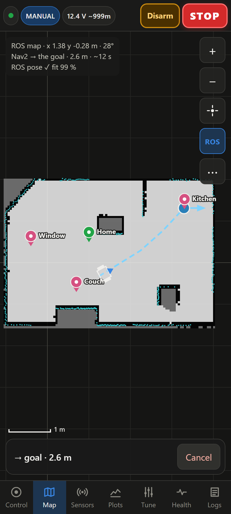
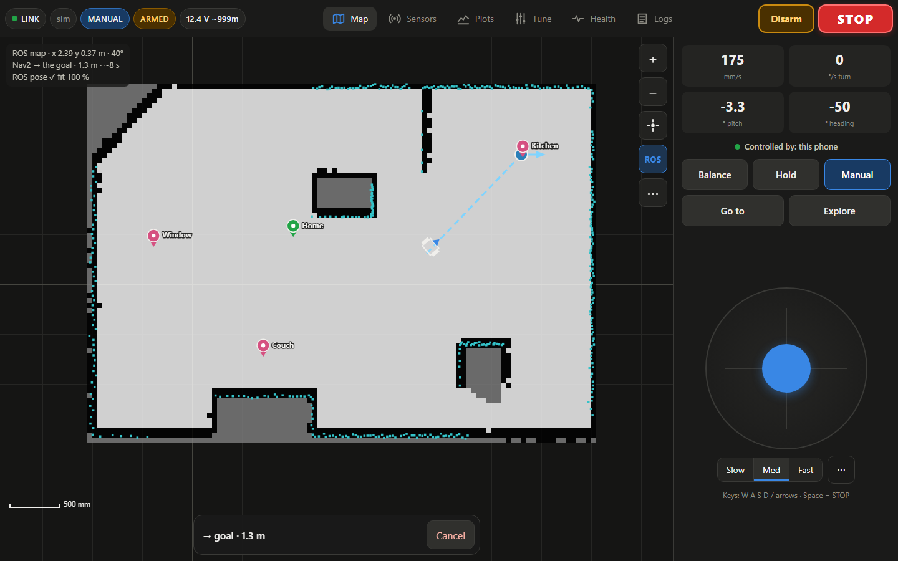
</p>

| Do | Where |
|---|---|
| Show ROS | Map page, **ROS** button (top right). It appears only while ROS is connected |
| Nav2 goal | ROS view: tap the map. Drag the arrow's end circle to set the heading (drag the dot to move it). Then **Go ▶** |
| Go to a place | tap a pin, then **Go here (ROS) ▶** (two taps) |
| Patrol | **Patrol…** in the bar (or the pin's ⋯). Tap places in order, pick loops (1, 2, 3, ∞) and the wait, then **Patrol ▶** |
| Cancel | **Cancel** in the bar or on the pin sheet. It cancels every Nav2 goal, RViz's too |
| Tell ROS where the robot is | ROS view: hold on the map, **Set ROS position here**, turn the arrow, **Set ▶** (= RViz 2D Pose Estimate) |
| Explore (#107) | **Explore** in the bar, **Save ROS map…** in ⋯. Both show only while the explorer runs |
| Status | the info box (top left): Nav2 → place · distance · ETA, patrol stop / loop, failure reason, ROS pose fit, explorer state |
| Health | the **ROS** tile: adapter connected, Nav2 active, slam_toolbox / AMCL up, localized + scan fit |

<p>
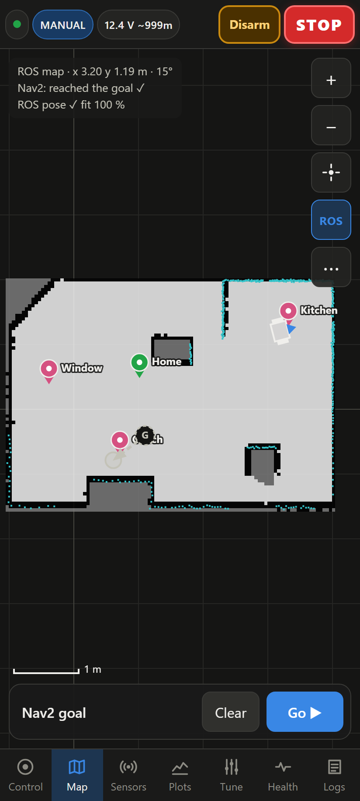
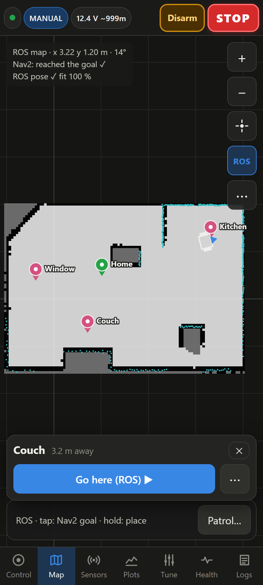
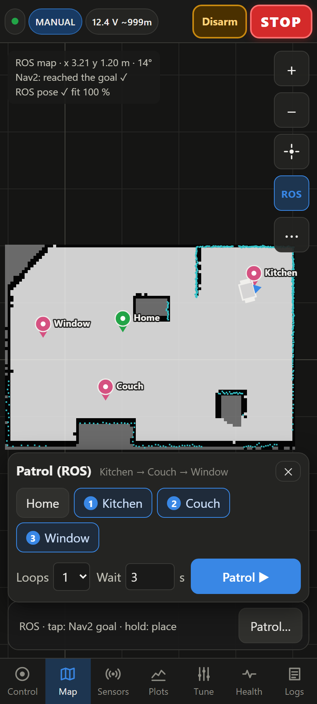
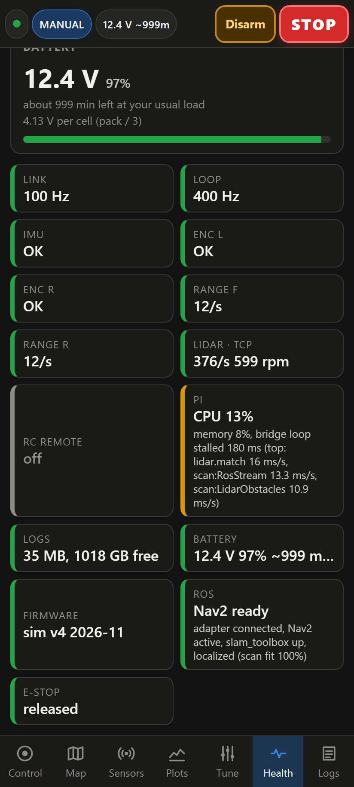
</p>

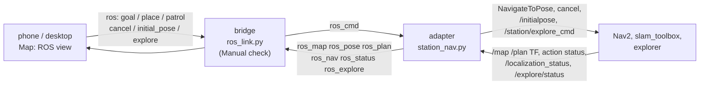

**ROS view.** The Map draws in the ROS map frame: the ROS grid, the ROS pose, the Nav2 plan (blue dashes) and the goal.
The station's places, zones and live LD19 points are put on top with `map <- station_map`. Two good signs: the lidar dots sit on the ROS walls, and the pins sit in the right rooms.
The station view (ROS button off) is unchanged.
Drawing walls / zones switches back to the station view.

**Safety (unchanged).**
- Goals only make Nav2 publish `/cmd_vel`. The adapter forwards it only while the robot is armed in **Manual** (STATION).
- A goal / place / patrol sent while it is not in Manual is refused at once: "Switch to Manual to let ROS drive".
- If the robot leaves Manual for 3 s during a goal (STOP, Disarm, another mode), the adapter cancels it and the info line says why.
- Nothing arms the robot or changes its mode for ROS. STOP works as always.

**Sim test** (`scripts/sim_e2e_station.sh simroom`, everything through the station's own API, `scripts/station_e2e.py`):

| Check | Result (sim) |
|---|---|
| goal from the station (3.3, 1.3) | succeeded, 55 s, 0.10 m from the goal (tolerance 0.15 m) |
| plan shown | 48 plan updates (<= 1 Hz), the first 12 points / 3.7 m; cleared when the goal ends |
| cancel on the way | `ros_nav` cancelled at once; cmd_vel stopped within 2 s (deadman), then 0.0 m in 3 s |
| go to place Couch | succeeded, 21 s, 0.14 m from the true spot |
| patrol Window -> Kitchen, wait 2 s | succeeded, 47 s: Window, wait, Kitchen, wait |
| goal before Manual | refused: "The robot is disarmed: Arm & Balance, then tap Manual to let ROS drive" |
| robot leaves Manual during a goal | cancelled after 3 s: "stopped: Switch to Manual to let ROS drive (the robot is in BALANCE)" |
| Health tile | "Nav2 ready" (adapter connected, Nav2 active, slam_toolbox up, localized) |

<p>
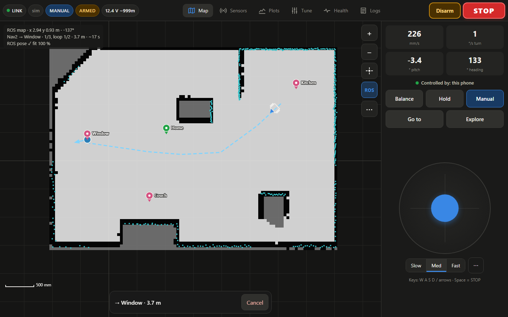
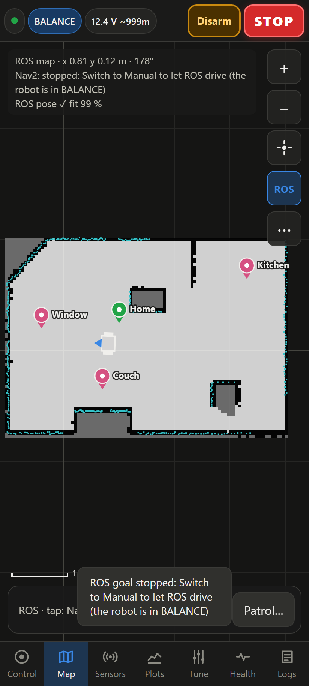
</p>
<p>A patrol (Couch, stop 2 of 3, loop 1 of 2) on the desktop. Right: the robot was switched out of Manual mid-goal, so the adapter cancelled it and the station says why.</p>

Limits:
- The ROS view shows the grid that Nav2 uses (`/map`). In localization mode this is the saved map; slam_toolbox's live additions are not shown.
- Map frame only: no costmaps, no local plan, no footprint.
- Places and zones on the ROS view follow the station's own alignment, as `go_to.ps1` does. If the station's pose is wrong, they are off by the same amount (fix it with Scan & correct).
- **Set ROS position** is set on the ROS view. The station's **Set position** (⋯ menu, #105) also sends its pose to ROS as the initial pose when ROS is connected; that hook uses the last alignment taken while the ROS pose was good, so it needs ROS to have been localized once.
- A sim on a busy PC can starve itself: the bridge loop stalls, Nav2 logs "extrapolation into the future" or aborts (`pose not available in time (TF)`). Its LD19 clock can then fall behind, and every scan is dropped as stale for minutes. That is the sim's clock, not a real LD19. Restart the sim.

The test is isolated, so it can run next to a live session:
- its own workspace (`~/sbr3_ws_station`);
- `ROS_DOMAIN_ID=42`;
- the sim web UI on http://localhost:8095;
- it stops only its own processes.

`HOLD=1` keeps it running for `python -m station.tools.ros_shots` (these screenshots).

**Update the live ROS after pulling this** (the adapter changed; nothing else):
1. Ctrl+C the running `run_localize.ps1` (or `run_nav.ps1`).
2. Start it again: `powershell -File ros2\run_localize.ps1 -Map house -NoRviz`. The run scripts rebuild `~/sbr3_ws` from the checkout on every start.
3. Restart the bridge on the Pi as usual, so the station UI gets the ROS view.

The old adapter keeps working with the new bridge, without the ROS view. The new adapter works with an old bridge too, without the station link.

## First real-robot session (checklist)

Tonight's order: **record first, map, save, localize, then navigate.** Each step works before the next starts.

| # | Do | Check |
|---|---|---|
| 0 | Robot on its stand, then on the floor. Phone: **Arm & Balance**, then **Manual** | the robot stands; STOP works |
| 1 | Window 1: `powershell -File ros2\record_run.ps1 -Name first` | it prints the bag path. Leave it running all session |
| 2 | Window 2: `powershell -File ros2\run_mapping.ps1` | RViz: red scan points on the walls, the map grows |
| 3 | Drive slowly round the room with the phone joystick. Come back to the start (loop closure) | walls stay straight and single, no doubled walls |
| 4 | Window 3: `powershell -File ros2\save_map.ps1 -Name room` | `~/maps/room.posegraph`, `.yaml`, `.pgm`, `.png` |
| 5 | Ctrl+C window 2. Disarm, carry the robot somewhere else. `powershell -File ros2\run_localize.ps1 -Map room`, then Arm & Balance + Manual (scans count only while it stands) | log `global match ... fit 0.9+`, RViz: scan on the walls, `/localization_quality` > 0.7 |
| 6 | RViz **2D Goal Pose** 1 m away (Nav2 drives at up to 0.18 m/s) | it drives there smoothly; STOP on the phone stops it |
| 7 | Save places on the phone (Map > Places), then `powershell -File ros2\go_to.ps1 -Place kitchen` | it arrives within ~15 cm |
| 8 | Ctrl+C window 1 | the bag replays offline: `powershell -File ros2\replay.ps1 -Bag <path>` |

If step 5 says `global match not convincing`, give the start: `-InitialPose "x,y,yaw"` (map metres, radians), or drive a little.

## Architecture

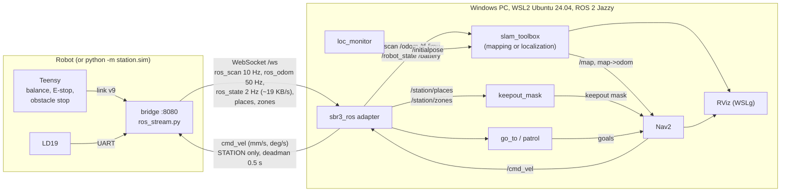

| Frame | From |
|---|---|
| `map -> odom` | slam_toolbox, or AMCL, or the bridge's own LD19 matcher (`localization:=bridge`) |
| `odom -> base_link` | adapter, from telemetry (50 Hz) |
| `odom -> station_map` | adapter: the station's own map frame (places, zones), from the bridge's scan-match correction |
| `base_link -> laser` | adapter, static, from lidar.json: x, y, height (208 mm on the robot), **yaw 0** (the bridge already applies the mount yaw) |


## Install (once, ~10 min, no admin)

```powershell
powershell -ExecutionPolicy Bypass -File ros2\setup_wsl.ps1
```

This sets up the following:

| | |
|---|---|
| WSL distro **Ubuntu-24.04** | `%LOCALAPPDATA%\wsl\Ubuntu-24.04`, user `sbr3` (passwordless sudo). WSL older than 2.4 cannot `--install` it by name, so the script imports Canonical's official image after checking its SHA256 |
| ROS 2 **Jazzy** (apt) | `ros-jazzy-desktop`, `ros-jazzy-slam-toolbox`, `ros-jazzy-navigation2`, `ros-jazzy-nav2-bringup`, colcon, rosdep, `python3-websocket` |
| `sbr3_ros` | built in `~/sbr3_ws` from a copy of `ros2/sbr3_ros` (colcon never writes into the Windows checkout) |
| #98 needs nothing more | rosbag2 + mcap, joy, teleop_twist_joy come with `ros-jazzy-desktop`; MPPI, RPP, the rotation shim, the collision monitor and costmap filters with `ros-jazzy-navigation2`; numpy with ROS |

Disk: **~9 GB** (the distro's `ext4.vhdx`). It is safe to run again.

## Run with the simulator

The sim runs **inside WSL**, so it needs no firewall or network changes. Its web UI is at http://localhost:8080 from Windows.

| | Command (PowerShell, repo root) |
|---|---|
| Map | `powershell -File ros2\run_mapping.ps1 -Sim`: the sim drives a loop and the map builds in RViz |
| Navigate | `powershell -File ros2\run_nav.ps1 -Sim`, then **Arm & Balance** and **Manual** in the web UI, then click **2D Goal Pose** in RViz |
| Headless | add `-NoRviz` |
| Tests | `wsl -d Ubuntu-24.04 -- bash ros2/scripts/sim_e2e_mapping.sh`, and `sim_e2e_nav.sh` (map PNGs + goal JSON in `~/sbr3-e2e`) |

Save a map (from a second window):

```
wsl -d Ubuntu-24.04 -- bash -lc "ros2 run nav2_map_server map_saver_cli -f ~/maps/room"
wsl -d Ubuntu-24.04 -- bash -lc "python3 /mnt/c/<repo>/ros2/scripts/map_png.py ~/maps/room.yaml /mnt/c/<repo>/room.png"
```

### Sim results

<p>

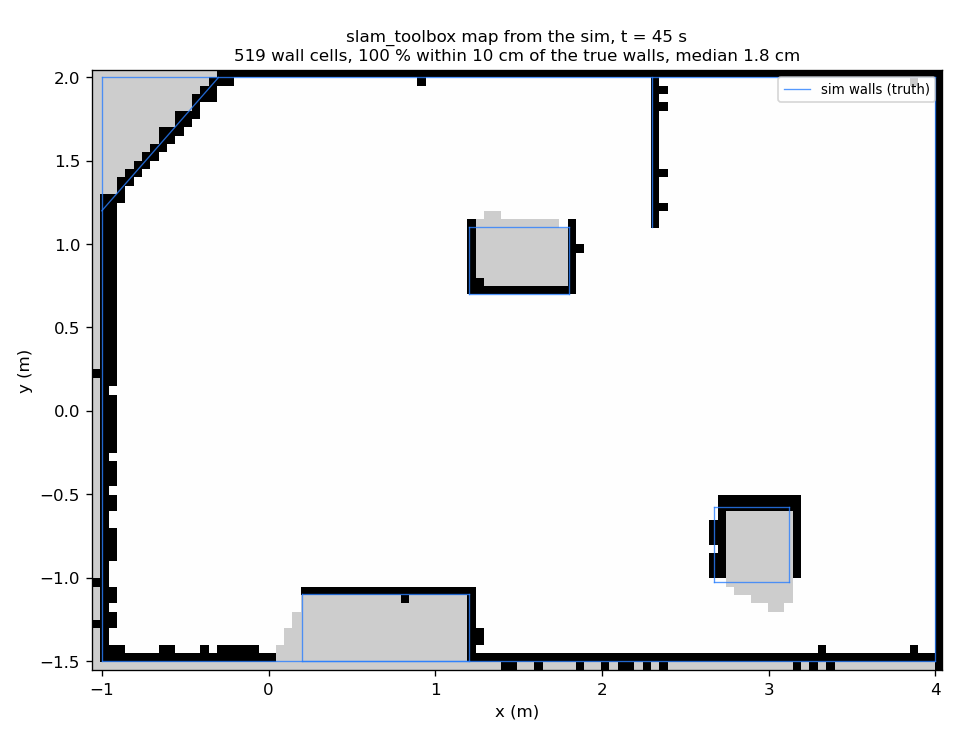
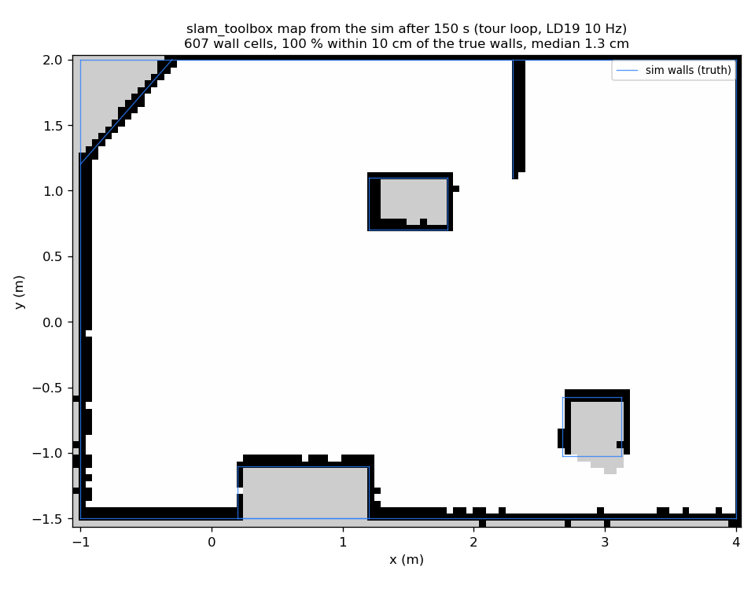
</p>
<p>slam_toolbox map at 20 s, at 45 s, and after 150 s of the tour. All of its wall cells are within 10 cm of the true walls (median 1.3 cm).</p>

<p>
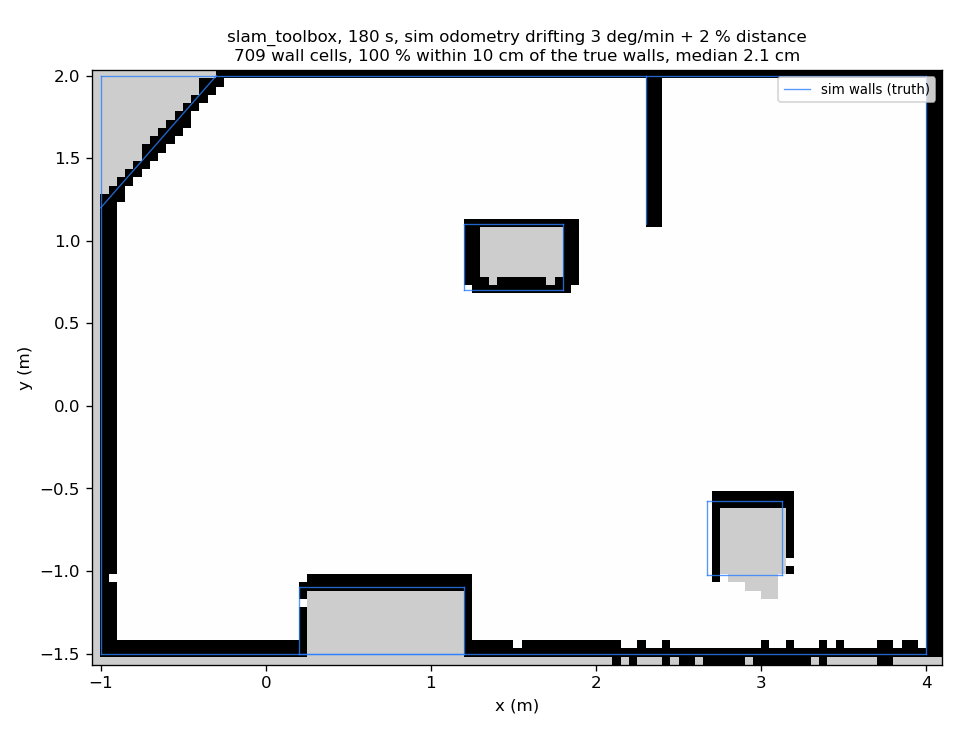
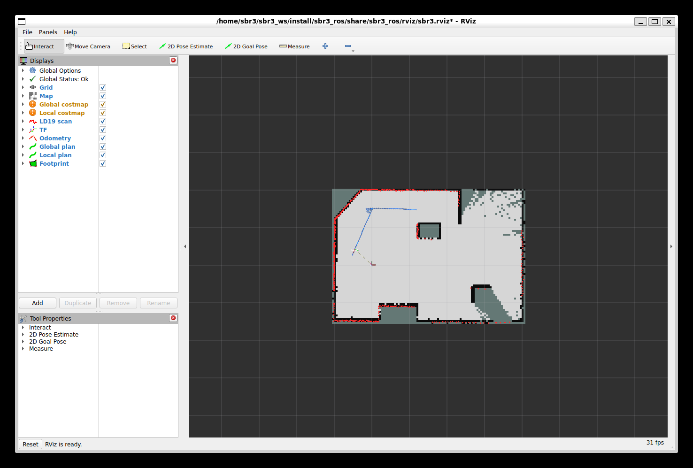
</p>
<p>With odometry drift (<code>--drift 3</code>: 3 deg/min heading, 2 % distance), slam_toolbox still closes the map. Right: RViz while mapping.</p>

| Nav2 goal (sim) | Result |
|---|---|
| (3.3, 1.3) m, past the box | succeeded, 20 s, 0.14 m from the goal (tolerance 0.15 m) |
| back to (0, 0) | succeeded, 26 s |

<p>
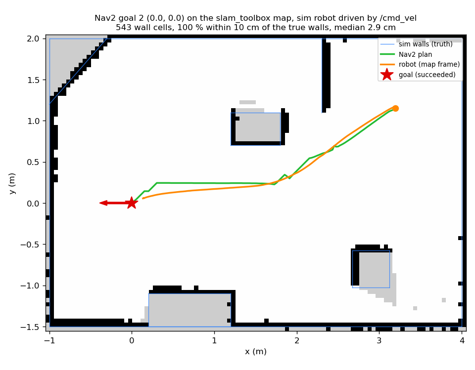

</p>

| Topic | Rate (sim) |
|---|---|
| `/scan` | 10.0 Hz, 480 beams (0.75 deg), ~20 KB/s in ROS |
| `/odom`, `/tf` odom->base_link, `/imu` | 50 Hz |
| `/map` | 0.5 Hz |
| `/robot_state`, `/battery` | 2 Hz |

## Run with the robot

1. On the phone: **Arm & Balance**, then **Manual** (STATION). ROS only drives in STATION mode.
2. On the PC:
   ```powershell
   powershell -File ros2\run_mapping.ps1          # or run_nav.ps1; -Url ws://<pi-ip>:8080/ws if it moved
   ```
3. Drive with the phone joystick while mapping, or click goals in RViz with `run_nav.ps1`.

WSL2's default NAT networking is fine here: WSL connects out to the robot. Nothing has to connect into WSL.

The adapter has not been run against the real robot yet: it was tested on the sim only.

## Record and replay (rosbag2)

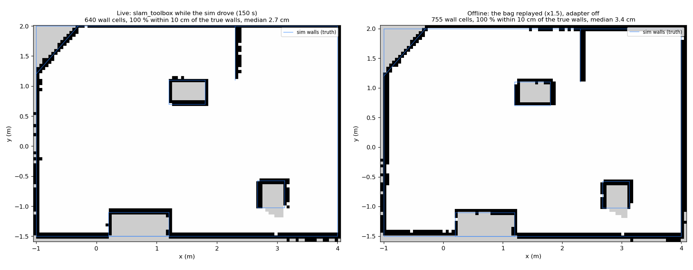

The same 150 s sim run: the live map (left) and the map rebuilt offline from its bag (right). Both have 100 % of their wall cells within 10 cm of the true walls.

| | Command |
|---|---|
| Record (2nd window) | `powershell -File ros2\record_run.ps1 [-Name kitchen] [-Seconds 120]` |
| What | `/scan /odom /imu /tf /tf_static /robot_state /battery /cmd_vel /map` + Nav2, localization and station topics that are live |
| Where | `~/sbr3-bags/<date>_<time>_<name>` in WSL (mcap); Windows: `\\wsl.localhost\Ubuntu-24.04\home\sbr3\sbr3-bags` |
| Size | ~14 MB for 150 s (~95 KB/s) |
| Replay: rebuild the map | `powershell -File ros2\replay.ps1 -Bag <path> [-SlamParams <yaml>] [-Rate 2]`, then `save_map.ps1 -Name room2` |
| Replay: localize on a map | `powershell -File ros2\replay.ps1 -Bag <path> -Mode amcl -Map room` |

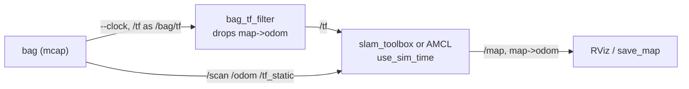

The adapter is off during a replay: the bag is the robot. Its own `map -> odom`, `/map` and localization topics move under `/bag/...`, so the offline slam_toolbox / AMCL makes new ones. Change `config/slam_toolbox.yaml` (or pass `-SlamParams`) and replay the same bag to tune.

## Saved maps and localization

<p>
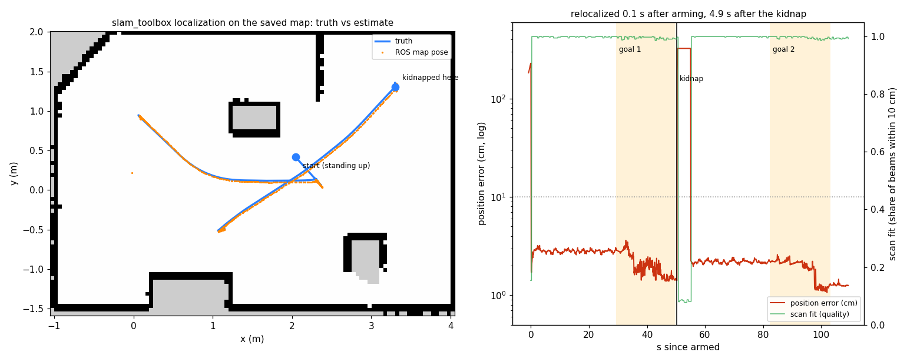
</p>

slam_toolbox localization on the saved sim map. The robot starts 2.6 m from the map origin, turned 135 deg: the global match (0.5 s) finds it as soon as it stands. A Nav2 goal, then the robot is **kidnapped** (teleported 3.2 m): lost after 3 s, found again 4.9 s after the jump, then a second goal. Error 2-3 cm throughout.

| Step | Command |
|---|---|
| Map, then save | `run_mapping.ps1`, then `save_map.ps1 -Name room`: `~/maps/room.posegraph/.data` (slam_toolbox) + `.yaml/.pgm` (AMCL, map_server) + `.png` |
| Localize + Nav2 | `powershell -File ros2\run_localize.ps1 -Map room` |
| AMCL instead | `... -Localization amcl` |
| Known start pose | `... -InitialPose "0,0,0"` (map m, m, rad) |
| Sim, started elsewhere | `... -Map simroom -Sim -SimStart "2600,-200,135"` (world mm, deg) |

**How the robot finds itself (`loc_monitor`).** At start it matches the scan against the whole saved map (every free 10 cm cell x 120 headings, then a fine search: ~0.5 s) and sends the result to `/initialpose`. Every 0.5 s it checks the **scan fit**: the share of scan points within 10 cm of a map wall (`/localization_quality`). Below 0.35 for 3 s = lost (carried, kidnapped): it matches again and moves the pose, but only when the new pose explains the scan clearly better (fit >= 0.6 and +0.2). It never drives the robot.

**slam_toolbox or AMCL?** slam_toolbox localization is the default. Same map, same runs in the sim:

| | slam_toolbox localization | AMCL |
|---|---|---|
| Found at start (global match) | 0.1 s after arming | 0.5 s |
| Error standing / driving | 2.8 / 1.9-2.1 cm (max 3.6 cm) | 4.6 / 4.2-4.6 cm (max 6.4 cm) |
| Kidnapped 3.2 m: found again | 4.9 s | 4.9 s |
| Error after the kidnap | 2.2 cm | 5.7 cm |
| Needs | `.posegraph` (save_map.ps1 saves it) | `.yaml/.pgm` only |

slam_toolbox matches each scan against the saved scans of the graph: about 2x more precise here than AMCL's particles on a 5 cm grid. AMCL stays as the fallback (a map from elsewhere, only a `.pgm`). Both get the start and the kidnap recovery from `loc_monitor`. In both modes Nav2, `loc_monitor` and the keep-out mask use the **saved** grid (`map_server` on `/map`): slam_toolbox localization keeps adding recent scans to the map it publishes, so that one goes to `/slam_toolbox/map`.

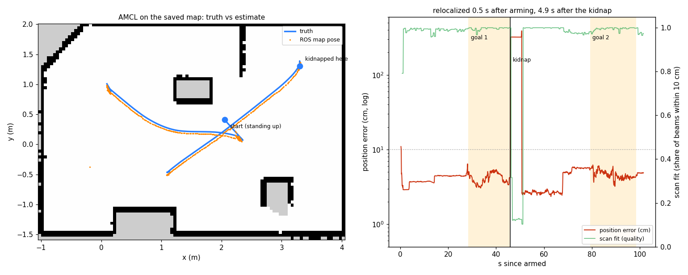

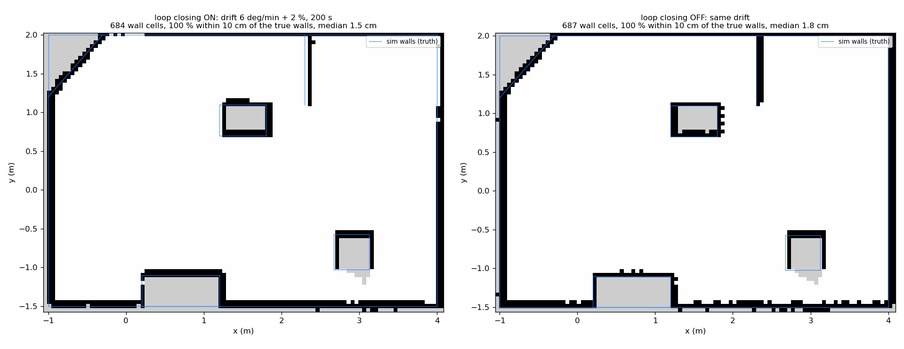

**Loop closure** is on (`do_loop_closing: true` in `config/slam_toolbox.yaml`): a loop needs 10 matched scans in a row (~2 m of driving at 20 cm per scan), searched within 3 m, with the fine-match bar at 0.45 against false loops. In the sim room, with odometry drifting 6 deg/min + 2 % (twice #96's test), 200 s of touring: loop closing on 100 % of wall cells within 10 cm (median 1.5 cm), off 100 % (median 1.8 cm). In a room this small the LD19 sees every wall from everywhere, so scan matching alone already holds the map; loop closure matters once the robot leaves the room and comes back (a flat, a corridor). Tune it offline on a recorded bag: `replay.ps1 -Bag <path> -SlamParams <yaml>`.

## Places and patrols

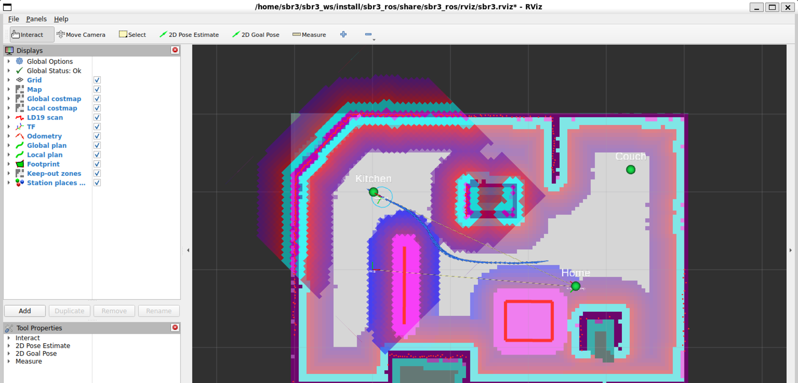

RViz with `run_localize.ps1 -Map simroom -Sim -SimStart "2600,-200,135"`: the robot found itself on the saved map, then `go_to.ps1 -Place kitchen` (blue track; reached 14 cm from the saved spot). Green dots: the station's places; pink: a no-go square and a virtual wall drawn in the station, as keep-out cost.

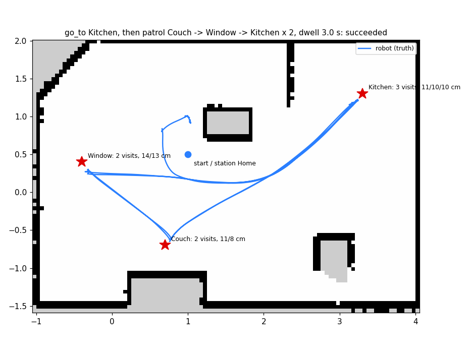

Sim test (`scripts/sim_e2e_places.sh`): the robot starts 1.1 m from the saved map's origin, turned 90 deg, so the station's frame and the ROS map differ. Kitchen, Couch and Window are saved in the station as the phone does. `go_to Kitchen`, then a patrol Couch -> Window -> Kitchen, 2 loops, dwell 3 s:

| | Result |
|---|---|
| Kitchen resolved to | map (3.31, 1.27); true spot (3.30, 1.30) |
| go_to Kitchen | succeeded, 56 s (round the box) |
| Patrol | succeeded, 160 s, nothing missed |
| Closest true distance at each visit | 8-14 cm (Nav2's goal tolerance is 15 cm) |
| Stood at each place | 3.3-6.9 s (dwell 3 s + settling) |

Places are the ones saved on the phone (Map > Places, per robot profile #97). The adapter republishes the bridge's list as `/station/places` and the station's map frame as a TF frame (`odom -> station_map`, from the bridge's own scan-match correction), so a place lands in the right spot on the ROS map whichever localization runs.

| | Command (with `run_localize.ps1` or `run_nav.ps1` running, robot armed in Manual) |
|---|---|
| Go to a place | `powershell -File ros2\go_to.ps1 -Place kitchen` (any case; Home works) |
| Patrol | `powershell -File ros2\patrol.ps1 -Places "Kitchen,Couch,Home" -Loops 3 -Dwell 5` |
| Forever | `-Loops 0`, Ctrl+C stops (cancels the Nav2 goal) |

The patrol sends each place to Nav2's waypoint follower in turn and waits `-Dwell` s there itself (Jazzy's waypoint follower reads its pause only at startup); each place faces the way it is approached (no spin on arrival); a place Nav2 cannot reach is logged and skipped; it waits for a good pose (`loc_monitor` "ok") before it starts. RViz shows the places (green dots + names) and zone outlines.

Places follow the station's own map alignment (its scan-match correction). If the phone shows the robot in the wrong spot, the places are off by the same amount: fix the station's pose first (Scan & correct on the phone).

## Smoother driving: controller, velocity smoother, collision monitor

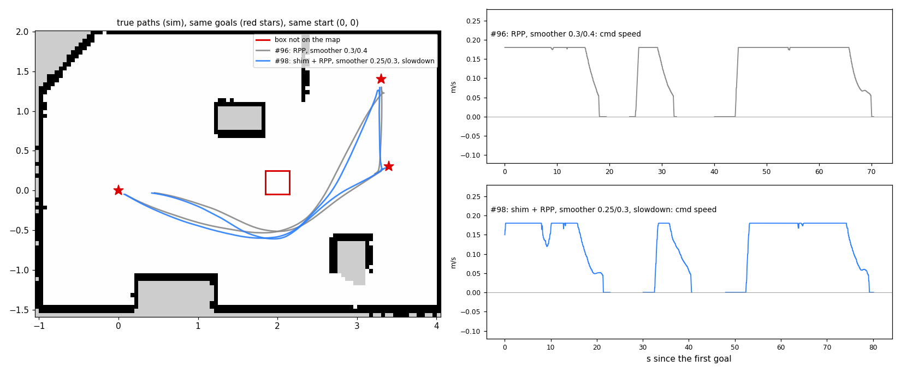

Same saved map, same start, same three goals; a 30 cm box (red) that is **not on the map** sits on the first leg. Measured in the sim (`scripts/sim_e2e_goals.sh` + `nav_metrics.py`):

| | goals | time | path | min clearance (centre to wall) | stops / reversals | peak accel / decel (cmd) | lean change (p95) |
|---|---|---|---|---|---|---|---|
| #96: RPP, smoother 0.3 / 0.4 m/s² | 3 / 3 | 59 s | 8.66 m | 32 cm | 0 / 0 | 0.38 / 0.28 m/s² | 0.8 deg |
| **#98: rotation shim + RPP, smoother 0.25 / 0.3, collision-monitor slowdown** | 3 / 3 | 66 s | 8.85 m | **35 cm** | 0 / 0 | **0.31 / 0.24 m/s²** | 0.9 deg |
| MPPI (2 tries, vx_min 0 and -0.06) | 0 / 1 | | | | | | |

**Choice: rotation shim + Regulated Pure Pursuit.**
- A balancing robot leans to change speed but turns on the spot for free: the shim turns first (path > 35 deg off), then RPP drives an arc it can lean into gently. RPP never reverses, slows for tight curves, near obstacles (cost-regulated) and into the goal.
- MPPI overshot the first goal and then stalled 0.2-0.3 m short ("failed to make progress") in both tries; it is also the heavier controller (1500 sampled trajectories per step, a concern on the robot's Pi later). It stays an option for a later tuning pass (`scripts/nav2_variant.py` makes its params file).
- 12 % slower, for 3 cm more clearance and ~20 % gentler commanded acceleration / braking. The sim's lean barely changes (0.8 vs 0.9 deg, its floor noise dominates); on the real robot the softer steps should show more. The box: the collision monitor halved the speed while passing it (the dip at 8 s); the plan went round it (the global costmap sees it on the scan).

| Layer | #98 setting |
|---|---|
| Controller | rotation shim (turn first > 35 deg, 0.7 rad/s, 1.2 rad/s²) + RPP 0.18 m/s, look-ahead 0.3-0.7 m scaled with speed, approach slow-down from 0.6 m |
| Velocity smoother | 0.25 m/s² up, 0.3 m/s² down (~1.5 deg of lean), 1.2 / 1.5 rad/s², v and w scaled together |
| Collision monitor | half speed within 0.28 m of anything (robot r 0.12 m); "approach": never closer than 1.5 s to a hit |
| Costmaps | inflation 0.45 m, softer (3.0): plans keep off walls where there is room |
| Adapter (unchanged) | caps 0.25 m/s, 1 rad/s, slew 0.4 m/s² |

## Keep-out zones

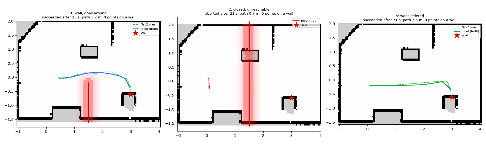

Sim test (`scripts/sim_e2e_keepout.sh`): walls drawn in the station (as on the phone) while ROS runs, the same goal (by the small box) three times:

| Zones | Result |
|---|---|
| 1. A wall from the south wall to y = -0.2 m | **routes around its end**: succeeded, 28 s; the plan bends north round the lethal band + soft margin |
| 2. Two more walls close the gap and the way north of the big box | **fails cleanly**: no plan, Nav2 aborts after 21 s of retries; the robot never moved towards the wall (0 track points on any wall) |
| 3. Zones cleared on the station | the direct route again, succeeded, 31 s. Each change reached the mask in < 1 s |

The station's **virtual walls, no-go zones, fence and mazes** (drawn on the phone, per robot) become a Nav2 **keepout filter** mask:

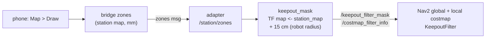

- Kept in sync: the mask is rebuilt when a zone changes (~1 s), when the map grows, or when relocalization moves the station frame by > 3 cm / 1 deg.
- Each shape grows by 15 cm (robot radius 12 cm + margin) of lethal cost, then a 30 cm soft band: filters are applied after the inflation layer, and without the band plans grazed the lethal edge and the controller stopped for a "collision ahead".
- Slow zones are not keep-out (the bridge still enforces them, and its zone watchdog stays on in STATION mode).
- Off: `run_localize.ps1 -NoKeepout`.

## Explore

Issue #107. The robot maps a new place by itself: slam_toolbox maps while a frontier explorer sends Nav2 goals until no reachable frontier is left. Then the map is saved.

<p>
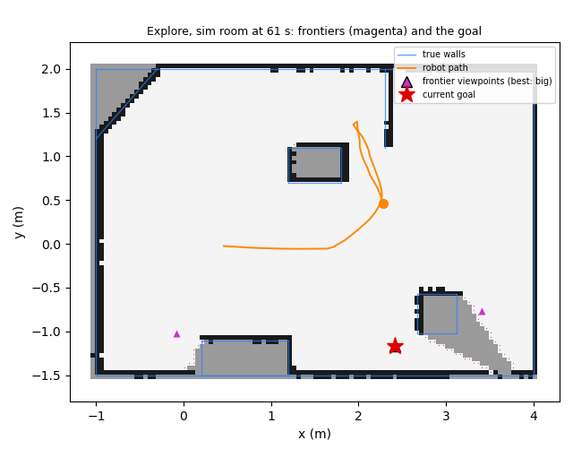
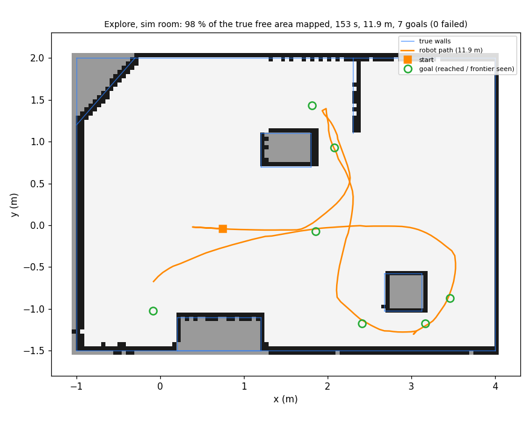
</p>
<p>Sim room. Left, at 60 s: frontiers (magenta: free cells next to the unknown) and the current goal (red star). Right, done: 98 % of the true free area mapped in 153 s.</p>

<p>
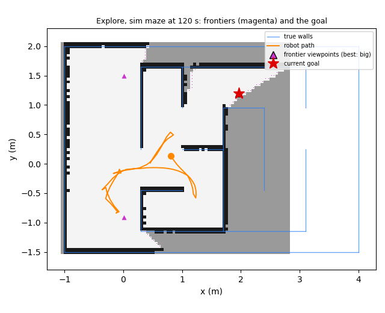
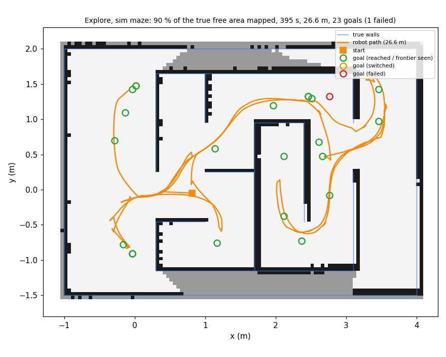
</p>
<p>Sim maze (<code>--maze</code>, 0.7 m corridors), at 120 s and done after 395 s. It works down each corridor and back out of the dead ends. The grey slots between the maze and the room walls are 35 cm wide: too narrow for a viewpoint, and the LD19 only sees into them at a glancing angle.</p>

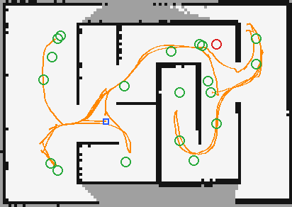

The PNG saved with the map (`<name>.png`): the track (orange) and the goals (green reached, red failed).

| Sim test (`scripts/sim_e2e_explore.sh`) | Room | Maze |
|---|---|---|
| Coverage (map free / true free area) | **98 %** (15.0 of 15.2 m²) | **90 %** (13.5 of 15.0 m²) |
| ... where the robot fits (> 14 cm from walls) | 100 % | 98 % |
| Time to "done" | 153 s | 395 s |
| Driven | 11.9 m | 26.6 m |
| Goals (failed) | 7 (0): 2 reached, 5 ended early (frontier seen on the way) | 23 (1): 7 reached, 14 seen, 1 switched |
| Plan time (max) | 52 ms | 71 ms |
| Same spot (< 0.3 m) chosen | once each | up to 4 times (one dead-end corner; then blacklisted) |

**Run it:**

| | Command (PowerShell, repo root) |
|---|---|
| The robot | `powershell -File ros2\run_explore.ps1`. Phone: **Arm & Balance**, **Manual**. Station Map page: **Explore (ROS)** |
| The robot, start at once | `powershell -File ros2\run_explore.ps1 -Start` (it waits until the robot is armed in Manual) |
| Sim | `powershell -File ros2\run_explore.ps1 -Sim -Start` (web UI http://localhost:8080), `-Maze` for the maze |
| Options | `-Rviz`, `-ReturnHome` (drive back to the start when done), `-MaxMinutes 10`, `-MapDir ~/maps`, `-NoKeepout` (on by itself with `-Maze`) |
| Start / stop by hand | `ros2 service call /explore/start std_srvs/srv/Trigger` (`/explore/stop`) |
| Test | `wsl -d Ubuntu-24.04 -- bash ros2/scripts/sim_e2e_explore.sh ~/e2e room` (or `maze`; `KEEPOUT=false` for the maze) |

The map is saved by itself when exploring ends (done, or stopped after more than 1 m²): `~/maps/explore-<YYYYmmdd-HHMM>` in WSL, the same files as `save_map.ps1` (`.posegraph`/`.data`, `.yaml`/`.pgm`, `.png`) + `.explore.json` (track, goals). Localize on it later: `run_localize.ps1 -Map explore-20261124-2130`.

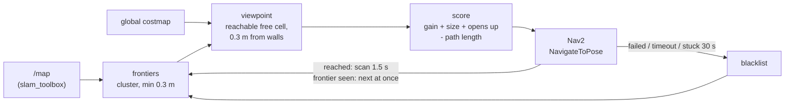

**How it works** (`sbr3_ros/frontier.py`, `explore.py`, `config/explore.yaml`):
- **Frontiers:** free cells next to unknown cells, clustered; clusters shorter than 0.3 m are ignored, and so are small holes in the floor and 5-20 cm gaps in a sparsely seen wall.
- **Reachable:** path lengths from the robot through known free space (Dijkstra), at least the robot radius from walls. No path, no goal. Nothing drives into the unknown.
- **Viewpoint:** the free cell nearest the frontier with 0.3 m clearance and a low global-costmap cost (keep-out zones count). It faces the frontier.
- **Score:** information gain (unknown share of a 3 x 3 m square) + size - 0.6 x path length, + a bonus when the frontier **opens up** into deep unknown (a doorway into an unseen room, not a shadow strip along a wall; the idea of `planner.py` `_opens_up`).
- **On the way:** it re-plans every 2 s. When the target frontier is mapped, it goes on to the next one at once (most goals end like this: "seen"). A clearly better frontier also takes over.
- **Failures:** a goal that Nav2 aborts, that times out, or that makes < 0.2 m progress in 30 s blacklists its frontier and viewpoint. A frontier still there after 2 visits is blacklisted (it cannot be seen from anywhere reachable). Limits: 150 goals, `max_duration_s`.
- **Done:** no reachable frontier in 3 plans in a row.
- **Safety:** it only sends Nav2 goals. `/cmd_vel` still goes through the adapter's gate (armed + STATION). It sends no goal unless the robot is armed in Manual without an E-stop; it waits ("waiting") and goes on when that is back.

**Station link (#106):** the adapter passes the explorer's status to the bridge and the station's buttons back:

| Topic | Message (std_msgs/String JSON) |
|---|---|
| `/explore/status` (latched, on each change, at least every 1 s) | `{"state", "target": [x_mm, y_mm] (station map frame) or null, "target_map": [x, y] (m), "frontiers", "area_m2", "reason", "running", "goals_ok", "goals_failed", "dist_m", "elapsed_s", "saved", "ok"}`. States: `waiting` `idle` `exploring` `navigating` `dwell` `done` `stopped` `saving` `error` |
| `/station/explore_cmd` | `{"cmd": "explore", "run": true}` / `false`; `{"cmd": "save_map", "name": "kitchen"}` (no name: `explore-<date>-<time>`) |

On the bridge WebSocket they are `{"t": "ros_explore", ...status}` (adapter to bridge) and `{"t": "ros_cmd", "cmd": "explore" | "save_map", ...}` (bridge to adapter).

**Limits:**
- The real robot is untested: its LD19 sees less than the sim's (dark / shiny surfaces), so expect more small frontiers; `min_size` and `goal_clear` are the knobs.
- Mirrors, glass and open doors to outside: frontiers that never close are blacklisted after 2 visits or a failure, so it ends, but it may spend a few goals there.
- Drawn walls in narrow corridors: in the sim maze the station's maze walls are also keep-out zones (+15 cm lethal + a 30 cm soft band). With them, Regulated Pure Pursuit kept stopping for "collision ahead" at the 0.7 m maze entrance (2 failed goals, 48 % mapped when stopped at 114 s). The maze test therefore runs with `KEEPOUT=false` (the sim's maze walls are real walls). Same at home: keep drawn walls out of narrow passages, or `keepout:=false`.
- One plan takes ~50 ms in these rooms and ~0.2 s on a 25 x 25 m map (500 x 500 cells), so a whole flat is fine; much bigger maps would want a coarser planning grid.

## Gamepad (optional)

`teleop_twist_joy` -> `/cmd_vel` -> the adapter's safety gate (armed + STATION only, 0.5 s deadman, 0.25 m/s / 1 rad/s caps, slew).

| Pad (Xbox-style) | Does |
|---|---|
| **LB** (hold) | deadman: nothing moves without it; let go = stop |
| **RB** (hold, instead of LB) | turbo: faster caps |
| Left stick up / down | forward / back, 0.12 m/s full stick (turbo 0.22) |
| Left stick left / right | turn, 0.8 rad/s (turbo 1.0) |

```powershell
powershell -File ros2\teleop.ps1                 # next to run_mapping.ps1 / run_localize.ps1
powershell -File ros2\teleop.ps1 -WithAdapter    # nothing else running
```

WSL2 does not see USB pads by itself: attach it once from an admin PowerShell with [usbipd-win](https://github.com/dorssel/usbipd-win) (`usbipd list`, `usbipd bind --busid <id>`, `usbipd attach --wsl --busid <id>`). Mapping: `config/teleop_joy.yaml`. Don't drive while Nav2 has a goal: both publish `/cmd_vel`.

Tested in the sim with fake `/joy` messages (no pad here): stick pushed without LB: no `/cmd_vel`, the robot stays; with LB: 63 `/cmd_vel` at 0.12 m/s, the robot drove 0.37 m in 4 s; LB released: it stopped. `/cmd_vel` has one publisher (teleop) and one subscriber (the adapter).

## Safety

| Rule | Where |
|---|---|
| ROS never arms, never changes the mode, never releases an E-stop | adapter: it only sends `cmd_vel` |
| `/cmd_vel` drives only when the robot is armed, in **STATION**, with no E-stop and live telemetry; anything else is logged once and ignored | `convert.drivable` |
| Deadman: no `/cmd_vel` for 0.5 s means one zero command, then silence. The bridge stops forwarding after 300 ms, and the firmware after its own timeout | `convert.CmdGate` |
| Caps 0.25 m/s, 1.0 rad/s; slew 0.4 m/s², 2 rad/s² (adapter params `max_*`) | adapter |
| Nav2: 0.18 m/s, velocity smoother 0.25 m/s² up and 0.3 m/s² down (a balancing robot leans to speed up); collision monitor: half speed within 0.28 m of anything, no driving into a hit within 1.5 s | `config/nav2.yaml` |
| Keep-out zones from the station in Nav2's costmaps (the bridge's zone watchdog stays on too) | `keepout_mask` |
| `loc_monitor`, `go_to`, `patrol`, gamepad: none of them arms or changes the mode; they only reach the robot through `/cmd_vel` and the adapter | |
| The Teensy keeps the last word: obstacle stop / slow-down in STATION, the link watchdog, E-stop, falls; the bridge's zones filter still applies | firmware, bridge |
| Adapter closed: the bridge stops the robot at once (`cmd_vel 0`). Wi-Fi lost: no `cmd_vel` arrives, so forwarding stops after 300 ms | bridge |

**STOP** on the phone always works. While it is latched, ROS commands are ignored.

## The bridge ROS stream

`station/bridge/ros_stream.py` is opt-in per WebSocket client: `{"t":"ros","action":"subscribe"}`. Phones never get it. A slow client skips it.

| Message | Content |
|---|---|
| `ros_hello` | frames, lidar mount, scan layout (480 bins from -pi, base64 uint16 mm), odom columns |
| `ros_scan` | one LD19 turn: ranges in the **laser frame at the turn's end** (`ts`), deskewed per packet with the telemetry pose. Range / intensity / mask / floor-clip filters come from lidar.json. Also `tilt` (max \|pitch - typical\|) and `tilt_pk` (packets beyond the 6 deg gate, left out), plus `corr` (map <- odom of the bridge matcher) |
| `ros_odom` | rows `[ts, x_mm, y_mm, heading_deg, speed_mms, turn_rate_dps, pitch_deg, pitch_rate_dps, roll_deg, yaw_rate_dps]` |
| `ros_state` | mode, armed, E-stops, battery, link, `corr`, matcher state, stream stats |

**Clock:** every `ts` / `now` uses the bridge's monotonic clock, the same clock the lidar deskew uses. The adapter keeps one offset to ROS time: the smallest `ros_now - now` seen, creeping 0.05 % so it follows clock-rate drift, and reset after a bridge restart. So `/scan` and `/tf` stamps agree with each other, and no NTP is needed.

**Tilt:** the adapter drops turns with `tilt > max_tilt_deg` (6 deg) or any left-out packet. While the robot lies on the floor, every turn is dropped, so slam_toolbox starts its map once the robot stands.

**Cost** (measured on the sim, this PC):

| | |
|---|---|
| Bandwidth | **18.5 KB/s** per subscriber (scan ~1.3 KB x 10, odometry ~4 KB/s, state) |
| Bridge CPU | **0.5 ms per turn**, 0.6-0.8 % of one PC core. Expect roughly 5-8x that on the Pi Zero 2W (~4 ms per turn, ~5 % of one core). Nothing runs when no one subscribes |

## Troubleshooting

| Problem | Fix |
|---|---|
| Sim on **Windows** (not in WSL) | WSL's NAT cannot reach Windows' `127.0.0.1`. Either run the sim in WSL (`-Sim`), or start it with `--host 0.0.0.0` and use `ws://<Windows IP from WSL>:8080/ws` (`ip route \| awk '/default/{print $3}'`). That needs a Windows Firewall inbound rule for Python. Or turn on mirrored networking (`%USERPROFILE%\.wslconfig`: `[wsl2]` / `networkingMode=mirrored`), which affects every WSL distro |
| Adapter log: `ignoring /cmd_vel: robot in BALANCE ...` | tap **Manual** on the phone (arm first) |
| No `/map` | the robot is lying down (every turn is tilted), or no lidar (`ros_hello` says so) |
| TF `extrapolation into the future` | the adapter clock offset is still settling (first second), or the Wi-Fi is stalling. Check the `clock offset` and `KB/s` in the adapter's 10 s report |
| Nav2 goal `outside bounds` | wait for the map to grow (`/map` every 2 s) before the first goal |
| RViz window missing | WSLg comes with WSL 2: check that `echo $DISPLAY` prints `:0` in WSL. The RViz log line `indexed_8bit_image ... same texture image unit` is a harmless WSLg GL warning |
| Costmap displays orange in mapping | normal: Nav2 is not running in `mapping.launch.py` |
| `run_localize`: `global match not convincing` / robot drawn in the wrong spot | furniture moved a lot, or the room is very symmetric: give `-InitialPose "x,y,yaw"`, or RViz **2D Pose Estimate**, then drive a little |
| `/localization_quality` stays < 0.6 | the map is old (furniture), or it is the wrong map: map again and `save_map.ps1` |
| `go_to`: `no place called ...` | the list printed is what the bridge has for this robot's loaded map (places are per robot / map, #97) |
| Goal refused next to a zone | the goal is inside a keep-out zone + 15 cm: pick a point further out |
| `teleop.ps1`: nothing happens | the pad is not attached to WSL (`usbipd`), LB not held, or the robot is not armed in Manual |

## Package

| Path | |
|---|---|
| `ros2/sbr3_ros/sbr3_ros/adapter.py` | the node (`ros2 run sbr3_ros adapter --ros-args -p url:=...`) |
| `ros2/sbr3_ros/sbr3_ros/convert.py` | conversions, clock sync, cmd_vel gate (no ROS, unit tested on Windows) |
| `ros2/sbr3_ros/sbr3_ros/goal_test.py` | one Nav2 goal (or `go_to`: a station place), logs the plan and track to JSON |
| `.../loc_monitor.py`, `scanfit.py` | scan fit, global relocalization, kidnap recovery (numpy) |
| `.../places.py`, `patrol.py` | station places in the map frame, waypoint-follower patrol |
| `.../station_nav.py`, `stationlink.py` | ROS inside the station (#106): map / pose / plan / Nav2 status to the bridge; goals, places, patrols, cancel, initial pose, explore from it |
| `.../keepout_mask.py`, `keepout.py` | station zones -> keepout filter mask, RViz markers |
| `.../explore.py`, `frontier.py` | frontier explorer (Nav2 goals, status, map save); frontier search (numpy + scipy) |
| `.../bag_tf_filter.py`, `pose_logger.py` | replay helper; map pose / speed / pitch to CSV |
| `ros2/sbr3_ros/launch/` | `mapping`, `navigation` (`localization:=slam\|amcl\|bridge`), `localize` (saved map), `explore`, `replay`, `teleop` |
| `ros2/sbr3_ros/config/` | `slam_toolbox.yaml` (LD19, 5 cm, loop closure), `nav2.yaml` (controller, smoother, collision monitor, keepout, AMCL), `teleop_joy.yaml`, `explore.yaml` |
| `ros2/*.ps1`, `ros2/scripts/` | setup / run from PowerShell, build, `sim_e2e_*.sh` tests + their `*_report.py` / `nav_metrics.py`, `map_png.py` |

Tests: `python -m unittest discover -s ros2/sbr3_ros/test` (adapter, scan fit, places, keep-out, frontiers, station link; Windows or WSL, frontiers need numpy + scipy), and `station/bridge/tests/test_ros_stream.py`, `test_ros_link.py` + `station/sim/tests/test_extras.py` inside the station suite. Sim end-to-end (WSL): `sim_e2e_bag.sh`, `sim_e2e_localize.sh`, `sim_e2e_places.sh`, `sim_e2e_goals.sh`, `sim_e2e_keepout.sh`, `sim_e2e_teleop.sh`, `sim_e2e_explore.sh` (own ROS_DOMAIN_ID 43, workspace and sim ports: runs next to a live session), `sim_e2e_station.sh` (isolated: own workspace, domain 42, port 8095).

Sim-only options used by these tests (`python -m station.sim --lidar ...`): `--start x,y,deg` (start pose; odometry reads 0 there), `--teleport-file PATH` (kidnap: write `x y deg`), `--truth-log PATH` (true pose CSV), `--box cx,cy,w,h` (an obstacle that is not on the saved map). `ros2/scripts/sim_station.py` saves places / zones in the local sim as the phone would (it refuses any other bridge).

## What's next

- **Real robot:** the [checklist](#first-real-robot-session-checklist) above; Nav2 first at 0.1 m/s.
- **On the robot's SBC** (#71: Pi 5 8 GB): run the same `sbr3_ros` there with `url:=ws://127.0.0.1:8080/ws`. slam_toolbox + Nav2 move with it, and the PC keeps RViz over DDS (same `ROS_DOMAIN_ID`; WSL needs mirrored networking for DDS discovery). Later the adapter could read the LD19 and the link directly and drop the WebSocket hop.
- Slow zones as a Nav2 speed filter; `localization:=bridge` to compare with the bridge's own matcher.
