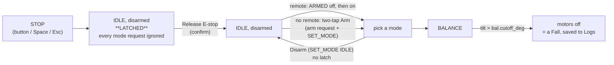
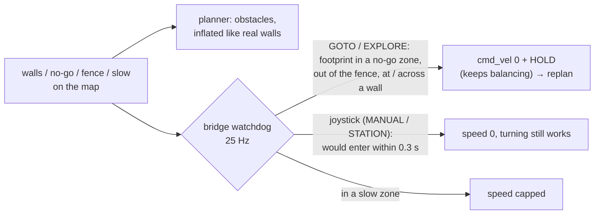
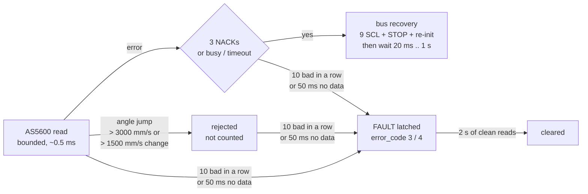
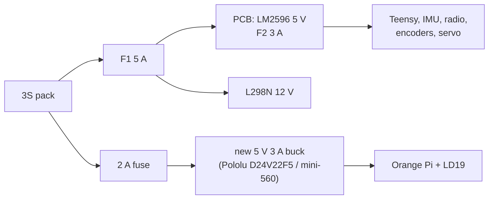

# Safety: stop, arm, fall, watchdog



- **STOP latches.** Release E-stop first, then arm again.
- **Disarm** (next to STOP, one tap) = `SET_MODE IDLE`: no latch. **No RC remote**: the robot disarms; arm again with the two-tap Arm. **RC remote present**: motors off (IDLE) only, the remote's ARMED switch still rules, so it stays armed until the switch goes off.
- **Arming** needs the two-tap **Arm & Balance** (no remote) or the remote's ARMED switch. A plain mode request never arms.
- **Falls** are recorded by themselves: [station tour](../station/README.md), [details](station-features.md).

## Modes and safety

| Condition | Result |
|---|---|
| Remote ESTOP flag | motors off now, latched until a packet without it; then ARMED must go off → on |
| **Station STOP** (`EVT_LINK_ESTOP`) | motors off now, disarmed, **latched**: every mode request (remote selector, `SET_MODE`, GO_HOME) is ignored until the station's **Release E-stop** (`EVT_LINK_ESTOP_RELEASE`); after it still IDLE + disarmed: arm again |
| Not armed / IMU stale 25 ms | IDLE, motors off; controller disengaged (re-engage window + `ctl.settle_ms` when samples return) |
| Boot | IDLE; remote must show ARMED off → on; stays IDLE until the remote's mode selection **changes** (or Pi `SET_MODE`) |
| No remote: arm | only an explicit arm step: `EVT_LINK_ARM`, then `SET_MODE` ≠ IDLE within 500 ms (UI two-tap Arm, Go / Explore confirm). A plain `SET_MODE` only changes an armed robot's mode; `SET_MODE` IDLE disarms |
| Remote present | remote's ARMED/ESTOP rule over the Pi |
| Remote silent 250 ms | speed/turn ramp to 0, keeps balancing |
| Remote gone 1 s in GOTO / EXPLORE / HOLD | stays paused (balancing, zero motion) until the remote is back or the station sends a `SET_MODE` (handover, `remote_flags` 0x10). Never resumes on the Pi heartbeat alone |
| Mode change | commanded motion → 0, heading target reset |
| Tilt > `bal.cutoff_deg` | motors off, integrators reset |
| Back within `bal.reengage_deg` of balance | balance again; steer + velocity after `ctl.settle_ms` |
| Encoder fault (one wheel) | latched; no arming; GOTO / EXPLORE / HOLD / STATION stop → BALANCE in place on the other wheel + gyro ([below](#encoder-fault)) |
| Both encoders faulted | as above, velocity loop off (balance + heading only) |
| Main loop hangs / starves the link | hardware watchdog: motor pins low, reset within 100 ms ([below](#hardware-watchdog)) |
| `cfg.defaults` / `cfg.save` while the motors run | wait until the motors are off (log `params: … wait …`); a pending save runs first |

```
 GOTO under the remote ── remote gone 1 s ──> paused (balancing) ──┬─ remote back ──> GOTO again
                                                                   └─ station SET_MODE ──> station in charge
```

## Phone as the only controller

The RC remote is optional. With none, the phone (this page / the Android app) is the supervisor. What stops the robot:

| Event | What happens | Where |
|---|---|---|
| **STOP** | `EVT_LINK_ESTOP` + IDLE, latched until Release E-stop; the robot stays disarmed after it | bridge + firmware |
| **Disarm** | `SET_MODE IDLE`, disarmed, not latched | firmware (`onPiSetMode`) |
| App leaves the screen (Back, Home, lock, call) | `AppStop`: `cmd_vel 0`, plan stop, GOTO / EXPLORE -> BALANCE. Never E-stops or idles | app (`AppStop.java`) |
| Tab closed / app killed | the socket closes: `cmd_vel 0` at once; client count drops to 0, GOTO / EXPLORE pause within 0.5 s (robot keeps balancing); a phone that connects again carries on | bridge heartbeat + firmware |
| Wi-Fi lost, phone locked (socket stays open, silent) | the bridge pings every 2 s; a client that has not answered for **6 s** stops counting, so the count drops to 0 as above. Dropped for good after 45 s | bridge (`WS_LIVE_S`) |
| Joystick / tilt released, or no `cmd_vel` for 300 ms | speed and turn ramp to 0, keeps balancing | bridge + firmware |
| Robot link silent | Disarm / mode buttons answer "robot link down - not sent"; the firmware's own failsafes act | bridge |

## Virtual walls and zones



**The firmware only knows real range obstacles.** Virtual walls and zones are enforced by the bridge on the Pi:

| | |
|---|---|
| GOTO / EXPLORE | robot footprint (planner radius − 20 mm) touches a no-go zone, the fence or a virtual / maze wall, or crossed a wall since the last frame: `cmd_vel 0` + `SET_MODE HOLD`, then the planner replans after 1.5 s (gives up after 3 stops in one job). Again only if it gets 25 mm deeper in. Never IDLE, never arms, nothing while E-stopped or disarmed |
| Joystick (MANUAL / STATION, phone or PC) | speed that would take the footprint further into a zone / across a wall within 0.3 s is sent as 0; turning on the spot and driving back out are allowed. ⋯ → Map & route settings → **Joystick can't drive into zones** (`zones_block_manual`, default on) |
| Slow zone | joystick speed capped; GOTO / EXPLORE: `nav.max_speed` lowered (RAM only) from 150 mm before the zone, put back after (and before any **Save to robot**) |
| Goals | a goto / place inside a no-go zone or outside the fence is refused |

Limits:
- **The bridge must be running** and linked. The RC remote's MANUAL driving and the robot's own GO_HOME straight line (no map) do not pass through it.
- **Pose drift**: zones are tied to the odometry (+ map correction). After drift or a pose reset they sit in the wrong place: re-check them after **Reset robot pose**.
- Inside a no-go zone the planner has no route: drive it out by hand (allowed).
- 25 Hz telemetry: at 0.5 m/s the robot moves 20 mm between checks.

Tests: `station/bridge/tests/test_zones.py`.

Tests: `station/bridge/tests/test_phone_remote.py` (Disarm with and without a remote, STOP latch / release, tab closed, silent phone),
`test_phone_ui.py` (the Control screen), `test_app_stop.py`, `station/sim/tests/test_nav.py` (no clients -> no motion).

## Runaway motor, 2026-11-25 (#109)

```
 t=93 s   left encoder freezes (600 mm/s, error_code 3) ── robot keeps driving GOTO / STATION / EXPLORE 170 s
 t=265 s  robot falls · session log just stops · Pi reboots          (5 V brownout suspected)
          RIGHT MOTOR FULL SPEED · STOP / disarm do nothing · only a power cycle stops it
```

Why full speed with nothing in charge: the L298N inputs (EN + IN on D4-D9) have **no pull-downs**. With the Teensy in
reset (or hung) they float, or the chip's pad keepers hold the last level: EN high + IN high = full speed.

| Protection | Where | Covers |
|---|---|---|
| **10 k pull-downs on D4-D9** | hardware, [below](#hardware-checks-for-the-owner) | Teensy off / in reset / browning out: the only fix for that |
| Motor pins low a few µs after reset | `startup_early_hook` (motors.cpp) | the ~300 ms boot (USB wait) before `setup()` |
| Hardware watchdog | `watchdog.cpp` | firmware hang, ISR storm, crash, starved link |
| Encoder fault rules | `mode_manager.cpp`, `odometry.cpp` | driving on a dead encoder |
| Bounded I2C + bus recovery | `i2c_bounded.cpp`, `wheel_encoder.cpp` | the stuck left bus (minutes, until a power cycle) |
| Reset cause | `reset_cause.cpp` → HELLO → Health | the next event shows *why* |

## Encoder fault



| While faulted | |
|---|---|
| Arming | refused (remote: ARMED off → on again after it clears; station: `SET_MODE … ignored: encoder fault`) |
| GOTO / EXPLORE / HOLD / STATION | stop → **BALANCE**, zero motion; new requests refused (logged). Nothing resumes by itself |
| Armed robot | **stays armed and balancing** (disarming would drop it) |
| Speed for the velocity loop | the good wheel ± gyro yaw rate × track / 2: it holds its place |
| Both wheels faulted | no speed: balance + heading only (it may drift: STOP it) |
| MANUAL (RC remote) | still works (a person is driving) |
| Station / phone | red **ENC L FAULT** pill + toast, Health **Enc L** tile red, log `enc L: FAULT …` |

Counters every 10 s while anything happens (else 60 s), in the robot log and the Health tile:
`enc: L ok err 12 rej 3 rec 1 resync 0 read 480/510 us last nack | R ok …`

I2C clocks (compile time, `config.h`): left bus **100 kHz** (it failed twice: widest glitch filter, slow edges ok),
right 400 kHz. Read ≈ 0.5 ms at 100 k, 0.25 ms at 200 k, 0.12 ms at 400 k (the `read` mean / max in the line above
is the measured value). A read never waits longer than 2.5× its wire time + 50 µs; nothing stays in flight, so the
VL53L0X sweep (same bus) can follow. The sweep skips its turn while the left bus is recovering.

## Hardware watchdog

```
 loop() pass ──> feed?  background ran < 50 ms ago  AND  (motors off  OR  balance step < 35 ms ago)
                    │ yes: refresh (once per ms)        │ no: let it run out
                    v                                   v
              RTWDOG (32 kHz LPO) ── 100 ms (motors may run) / 2 s (IDLE) ──> IRQ: D4-D9 low ──~2 µs──> reset
                                                                                   │
                                     boot: startup_early_hook D4-D9 low <──────────┘
                                     log: "reset: WATCHDOG (SRSR 0x080) …"
```

- "Motors may run" = armed in a mode, balancing, or the motor test. Blocking work (EEPROM save, IMU / radio / sweep
  re-init) only runs in IDLE, on the 2 s timeout, so it never trips it.
- A crash runs the core's fault handler with interrupts off: the reset still comes within the timeout (CrashReport kept).
- No feed when `background()` starves: the Pi link, the RC radio and STOP would not get through.
- Failed to start → log `watchdog: FAILED …`, `fault_flags` 0x10, Health **Resets** amber.

## Reset cause

Every boot reads `SRC_SRSR` (then clears it) and a marker in the SNVS registers (kept through resets and short dips,
written every second). Sent in every HELLO (link v9) + log `reset: …` (+ the CrashReport summary).

| Cause | Means | Station |
|---|---|---|
| power-on | power was off (SNVS lost, or off ≥ 3 s) | info; **warn** if it happens while the bridge was linked and not flashing |
| **power dip (brownout?)** | power-on reset, SNVS kept, off < 3 s | **warn** |
| **watchdog** | the loop hung / starved the link | **warn** |
| **crash** / **lockup** | fault handler reboot (CrashReport logged) / CPU lockup | **warn** |
| flashed / requested | another build / the reboot button | info |

Bridge: `WARNING: Teensy reset unexpectedly: <cause> (previous run 4 min, off 0 s, SRSR 0x080)` in the log, a toast,
the Health **Resets** tile amber for the rest of the session.

## Hardware checks for the owner

### 1. Pull-downs on the motor inputs (do this first)

H2 "MOTOR CONTROLLER" has no GND pin: solder the six 10 k at the **L298N end** of the cable, to the L298N's GND
(same GND as the Teensy). 1/4 W or 0603, any 10 k (4.7 k .. 22 k works).

```
 PCB H2 (silk)    Teensy        cable          L298N module input pins
 L.en   ──────── D4  ──────────────────────┬── ENA   (jumper OFF)
 L.in1  ──────── D5  ──────────────────┬───┼── IN1
 L.in2  ──────── D6  ──────────────┬───┼───┼── IN2
 R.en   ──────── D7  ──────────┬───┼───┼───┼── ENB   (jumper OFF)
 R.in3  ──────── D8  ──────┬───┼───┼───┼───┼── IN3
 R.in4  ──────── D9  ──┬───┼───┼───┼───┼───┼── IN4
                      10k 10k 10k 10k 10k 10k
                       │   │   │   │   │   │
                       └───┴───┴───┴───┴───┴── GND (L298N logic / power GND)
```

Check: Teensy unplugged from USB and its 5 V off, motor battery on → each L298N input reads **< 0.3 V**, wheels still.

### 2. The 5 V rail under load

Meter on min/max (or a scope, 1 ms/div) on a 5 V pin of the PCB power header, GND next to it. Robot balancing, Pi +
LD19 running, then the wheels-up motor test at full duty.

| 5 V min | |
|---|---|
| ≥ 4.85 V | fine |
| 4.6 .. 4.85 V | marginal: the Pi may throttle |
| **< 4.6 V** | brownout: fix the supply (3, 4) |

### 3. F2 (3 A, after the LM2596)

- Look: a yellow / green disc or an SMD part marked like `300` = **PTC** (resettable). A glass / blade fuse is not.
- A PTC near its hold current heats up and its resistance climbs: measure the **voltage across F2** under the same load.
  > 0.2 V = it is limiting. Replace with a 3 A fast fuse (or a bigger PTC) and fix the load (4).

### 4. A separate buck for the Pi



The Pi's 5 V stops coming from the "Orange Pi" header; GNDs stay common (the USB cable to the Teensy carries it).

### 5. The left encoder (failed twice: 11-24, 11-25)

| Do | Why |
|---|---|
| Reseat / replace the left encoder cable and both connectors (H8 "Left Odom") | intermittent contact = the stuck bus |
| Twist SDA with GND and SCL with 3.3 V, keep it short, route it away from the motor leads | motor PWM (1 kHz) couples into it |
| 0.1 µF ceramic across each motor's terminals (at the motor) | kills the brush noise at the source |
| Stronger pull-ups on the left bus: 4.7 k in parallel with the PCB's 4.7 k (≈ 2.2 k), not below 1.5 k total | faster edges, more noise margin |

### After flashing (link v9)

1. Robot log: `reset: …`, `watchdog: RTWDOG on, 100 ms …`; Health **Resets** green, **Firmware** link v9.
2. Health **Loop** still ~400 Hz; the `enc:` line: left read ~0.5 ms, right ~0.12 ms.
3. Wheels up, **disarmed**: unplug the left encoder → red **ENC L FAULT** pill + toast, Health **Enc L** red; Arm is
   refused. Plug it back → `enc L: ok again` after 2 s.
4. Press the PCB reboot button → `reset: requested`; power cycle → `reset: power-on`.
5. Optional, scope on D4: low within a few ms of power-up (it used to float ~300 ms).

Tests: `test/host/encoder_fault_sim.cpp` (encoder filter / recovery / latch, fallback speed, mode rules, watchdog
feed rule, reset causes), `station/sim/tests/test_encoder_fault.py`, `station/bridge/tests/test_resets_encoders.py`.
Back: [firmware index](firmware.md).