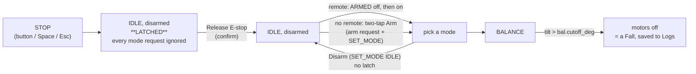
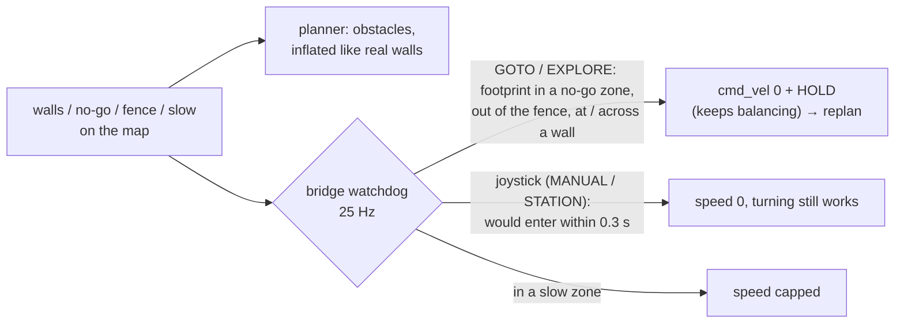

# Safety: stop, arm, fall



- **STOP latches.** Release E-stop first, then arm again.
- **Disarm** (next to STOP, one tap) = `SET_MODE IDLE`: no latch. **No RC remote**: the robot disarms; arm again with the two-tap Arm. **RC remote present**: motors off (IDLE) only, the remote's ARMED switch still rules, so it stays armed until the switch goes off.
- **Arming** needs the two-tap **Arm & Balance** (no remote) or the remote's ARMED switch. A plain mode request never arms.
- **Falls** are recorded by themselves: [station tour](../station/README.md), [details](station-features.md).

## Modes and safety

| Condition | Result |
|---|---|
| Remote ESTOP flag | motors off now, latched until a packet without it; then ARMED must go off → on |
| **Station STOP** (`EVT_LINK_ESTOP`) | motors off now, disarmed, **latched**: every mode request (remote selector, `SET_MODE`, GO_HOME) is ignored until the station's **Release E-stop** (`EVT_LINK_ESTOP_RELEASE`); after it still IDLE + disarmed: arm again |
| Not armed / IMU stale 25 ms | IDLE, motors off; controller disengaged (re-engage window + `ctl.settle_ms` when samples return) |
| Boot | IDLE; remote must show ARMED off → on; stays IDLE until the remote's mode selection **changes** (or Pi `SET_MODE`) |
| No remote: arm | only an explicit arm step: `EVT_LINK_ARM`, then `SET_MODE` ≠ IDLE within 500 ms (UI two-tap Arm, Go / Explore confirm). A plain `SET_MODE` only changes an armed robot's mode; `SET_MODE` IDLE disarms |
| Remote present | remote's ARMED/ESTOP rule over the Pi |
| Remote silent 250 ms | speed/turn ramp to 0, keeps balancing |
| Remote gone 1 s in GOTO / EXPLORE / HOLD | stays paused (balancing, zero motion) until the remote is back or the station sends a `SET_MODE` (handover, `remote_flags` 0x10). Never resumes on the Pi heartbeat alone |
| Mode change | commanded motion → 0, heading target reset |
| Tilt > `bal.cutoff_deg` | motors off, integrators reset |
| Back within `bal.reengage_deg` of balance | balance again; steer + velocity after `ctl.settle_ms` |
| Encoder fault | velocity loop off (balance + heading only) |
| `cfg.defaults` / `cfg.save` while the motors run | wait until the motors are off (log `params: … wait …`); a pending save runs first |

```
 GOTO under the remote ── remote gone 1 s ──> paused (balancing) ──┬─ remote back ──> GOTO again
                                                                   └─ station SET_MODE ──> station in charge
```

## Phone as the only controller

The RC remote is optional. With none, the phone (this page / the Android app) is the supervisor. What stops the robot:

| Event | What happens | Where |
|---|---|---|
| **STOP** | `EVT_LINK_ESTOP` + IDLE, latched until Release E-stop; the robot stays disarmed after it | bridge + firmware |
| **Disarm** | `SET_MODE IDLE`, disarmed, not latched | firmware (`onPiSetMode`) |
| App leaves the screen (Back, Home, lock, call) | `AppStop`: `cmd_vel 0`, plan stop, GOTO / EXPLORE -> BALANCE. Never E-stops or idles | app (`AppStop.java`) |
| Tab closed / app killed | the socket closes: `cmd_vel 0` at once; client count drops to 0, GOTO / EXPLORE pause within 0.5 s (robot keeps balancing); a phone that connects again carries on | bridge heartbeat + firmware |
| Wi-Fi lost, phone locked (socket stays open, silent) | the bridge pings every 2 s; a client that has not answered for **6 s** stops counting, so the count drops to 0 as above. Dropped for good after 45 s | bridge (`WS_LIVE_S`) |
| Joystick / tilt released, or no `cmd_vel` for 300 ms | speed and turn ramp to 0, keeps balancing | bridge + firmware |
| Robot link silent | Disarm / mode buttons answer "robot link down - not sent"; the firmware's own failsafes act | bridge |

## Virtual walls and zones



**The firmware only knows real range obstacles.** Virtual walls and zones are enforced by the bridge on the Pi:

| | |
|---|---|
| GOTO / EXPLORE | robot footprint (planner radius − 20 mm) touches a no-go zone, the fence or a virtual / maze wall, or crossed a wall since the last frame: `cmd_vel 0` + `SET_MODE HOLD`, then the planner replans after 1.5 s (gives up after 3 stops in one job). Again only if it gets 25 mm deeper in. Never IDLE, never arms, nothing while E-stopped or disarmed |
| Joystick (MANUAL / STATION, phone or PC) | speed that would take the footprint further into a zone / across a wall within 0.3 s is sent as 0; turning on the spot and driving back out are allowed. ⋯ → Map & route settings → **Joystick can't drive into zones** (`zones_block_manual`, default on) |
| Slow zone | joystick speed capped; GOTO / EXPLORE: `nav.max_speed` lowered (RAM only) from 150 mm before the zone, put back after (and before any **Save to robot**) |
| Goals | a goto / place inside a no-go zone or outside the fence is refused |

Limits:
- **The bridge must be running** and linked. The RC remote's MANUAL driving and the robot's own GO_HOME straight line (no map) do not pass through it.
- **Pose drift**: zones are tied to the odometry (+ map correction). After drift or a pose reset they sit in the wrong place: re-check them after **Reset robot pose**.
- Inside a no-go zone the planner has no route: drive it out by hand (allowed).
- 25 Hz telemetry: at 0.5 m/s the robot moves 20 mm between checks.

Tests: `station/bridge/tests/test_zones.py`.

Tests: `station/bridge/tests/test_phone_remote.py` (Disarm with and without a remote, STOP latch / release, tab closed, silent phone),
`test_phone_ui.py` (the Control screen), `test_app_stop.py`, `station/sim/tests/test_nav.py` (no clients -> no motion).
Back: [firmware index](firmware.md).