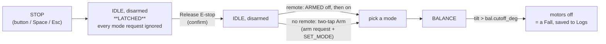

# Safety: stop, arm, fall



- **STOP latches.** Release E-stop first, then arm again.
- **Arming** needs the two-tap **Arm & Balance** (no remote) or the remote's ARMED switch. A plain mode request never arms.
- **Falls** are recorded by themselves: [station tour](../station/README.md), [details](station-features.md).

## Modes and safety

| Condition | Result |
|---|---|
| Remote ESTOP flag | motors off now, latched until a packet without it; then ARMED must go off → on |
| **Station STOP** (`EVT_LINK_ESTOP`) | motors off now, disarmed, **latched**: every mode request (remote selector, `SET_MODE`, GO_HOME) is ignored until the station's **Release E-stop** (`EVT_LINK_ESTOP_RELEASE`); after it still IDLE + disarmed: arm again |
| Not armed / IMU stale 25 ms | IDLE, motors off; controller disengaged (re-engage window + `ctl.settle_ms` when samples return) |
| Boot | IDLE; remote must show ARMED off → on; stays IDLE until the remote's mode selection **changes** (or Pi `SET_MODE`) |
| No remote: arm | only an explicit arm step: `EVT_LINK_ARM`, then `SET_MODE` ≠ IDLE within 500 ms (UI two-tap Arm, Go / Explore confirm). A plain `SET_MODE` only changes an armed robot's mode; `SET_MODE` IDLE disarms |
| Remote present | remote's ARMED/ESTOP rule over the Pi |
| Remote silent 250 ms | speed/turn ramp to 0, keeps balancing |
| Remote gone 1 s in GOTO / EXPLORE / HOLD | stays paused (balancing, zero motion) until the remote is back or the station sends a `SET_MODE` (handover, `remote_flags` 0x10). Never resumes on the Pi heartbeat alone |
| Mode change | commanded motion → 0, heading target reset |
| Tilt > `bal.cutoff_deg` | motors off, integrators reset |
| Back within `bal.reengage_deg` of balance | balance again; steer + velocity after `ctl.settle_ms` |
| Encoder fault | velocity loop off (balance + heading only) |
| `cfg.defaults` / `cfg.save` while the motors run | wait until the motors are off (log `params: … wait …`); a pending save runs first |

```
 GOTO under the remote ── remote gone 1 s ──> paused (balancing) ──┬─ remote back ──> GOTO again
                                                                   └─ station SET_MODE ──> station in charge
```

Back: [firmware index](firmware.md).