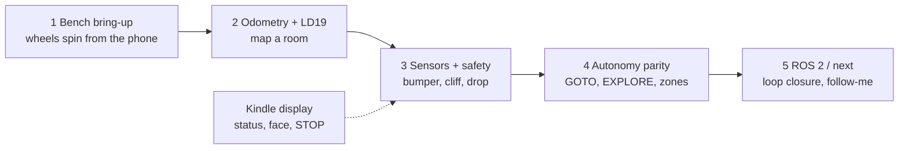
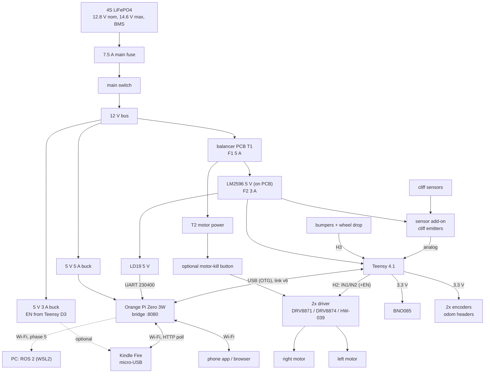
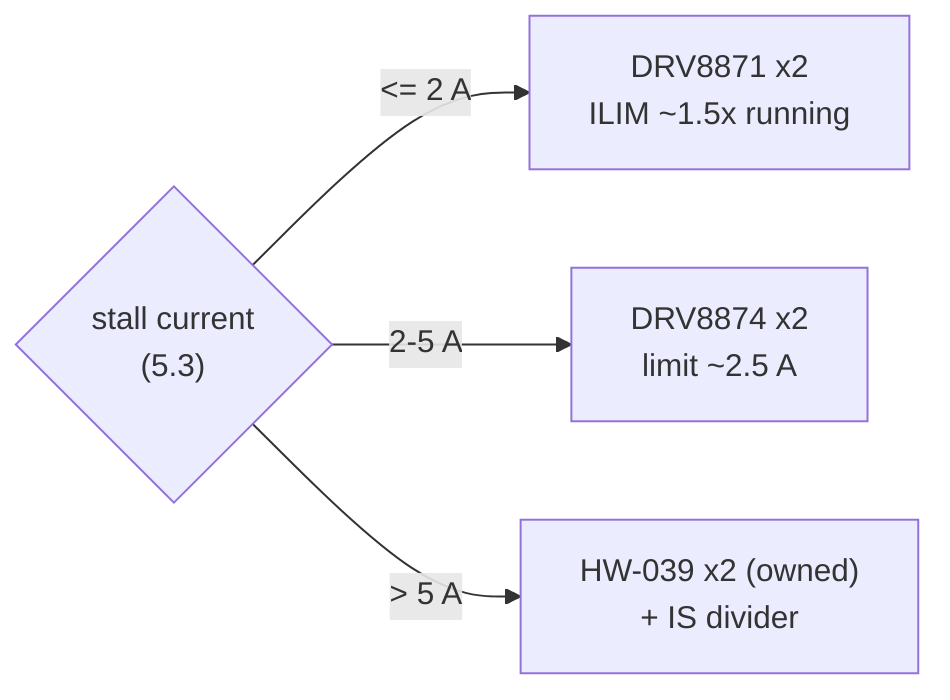
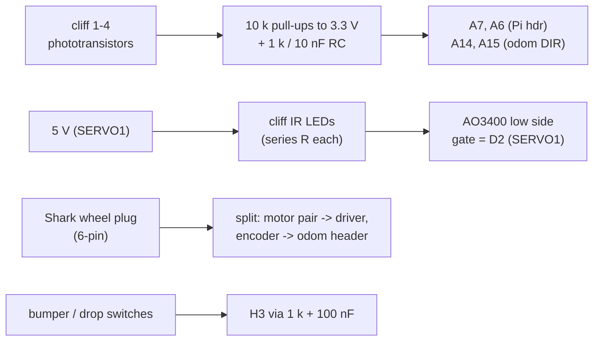
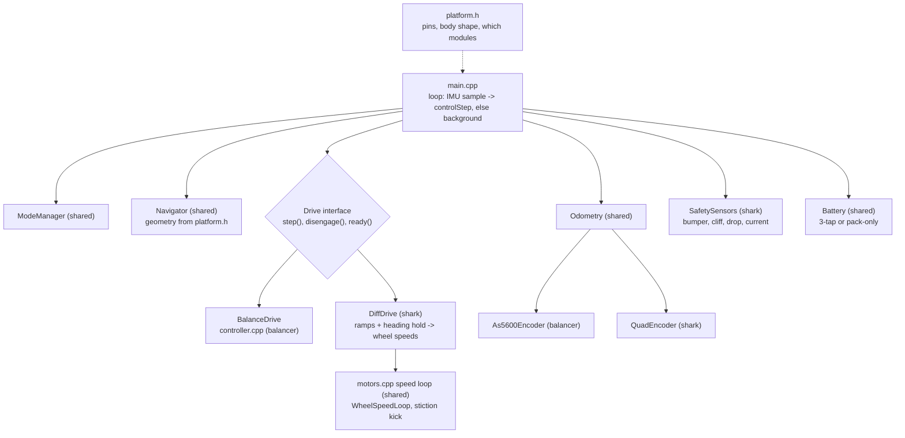
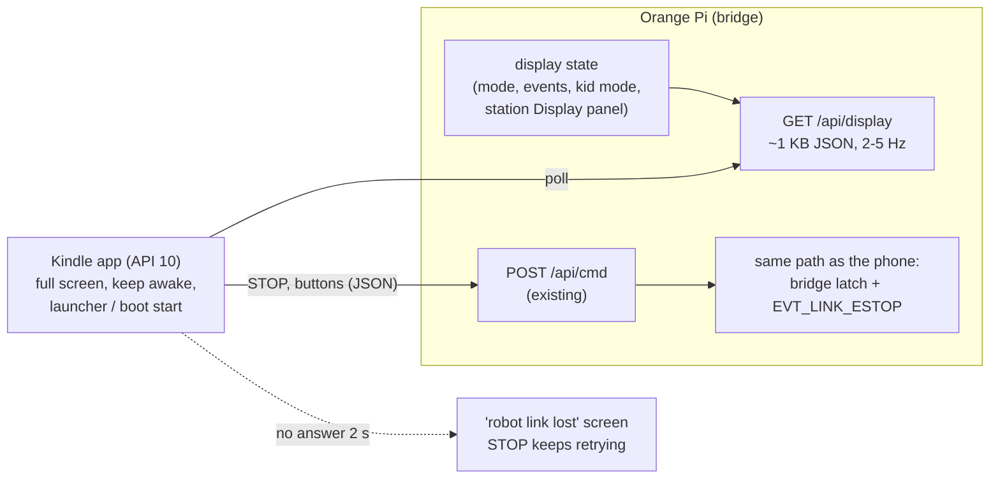
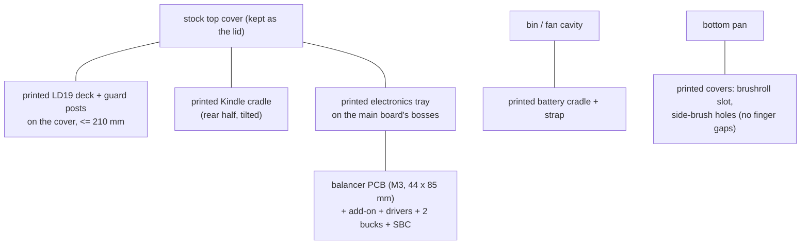

# Shark dev platform v1: build plan

A gutted **Shark RV915** robot vacuum (RV9155WXUS) becomes a non-balancing 2-wheel differential-drive robot.
Same stack as the balancing robot: Teensy 4.1 firmware, Orange Pi bridge, station web app, Android app, LD19.
Optional on-robot screen: the owner's **2011 Kindle Fire**.

Planning only. No CAD until the components are final (#72). Epic #80: see [Issues](#issues).



## Contents

1. [Goals and scope](#1-goals-and-scope)
2. [Key decisions](#2-key-decisions)
3. [Architecture](#3-architecture)
4. [Teardown checklist](#4-teardown-checklist)
5. [Measurements (owner, multimeter + bench supply)](#5-measurements)
6. [Power](#6-power)
7. [Motor driver](#7-motor-driver)
8. [Reusing the balancer PCB + pin budget](#8-reusing-the-balancer-pcb)
9. [Firmware plan](#9-firmware-plan)
10. [Station plan](#10-station-plan)
11. [Kindle display](#11-kindle-display)
12. [Mechanical plan](#12-mechanical-plan)
13. [Milestones](#13-milestones)
14. [Risks and open questions](#14-risks-and-open-questions)
15. [Shopping list](#15-shopping-list)
16. [Issues](#issues)

---

## 1. Goals and scope

| v1 is | v1 is not |
|---|---|
| Indoor dev robot, round, 330 mm, low, can't tip | Outdoor (that's #73, wheelchair base + RTK) |
| Phone drive, GOTO / EXPLORE / HOLD, map, zones, places | ROS 2 on board (phase 5; PC first) |
| LD19 mapping + scan matching (#76, #78) | Camera / vision |
| Bumper, cliff and wheel-drop stop the motors | Docking / self-charging |
| Toddler-safe: slow, enclosed, no pinch points, LiFePO4 | Vacuuming |
| Optional Kindle screen: status, face, touch STOP | A second app for the phone |
| Same repo, same app, same sim | |

**Done when:** it explores and maps two rooms from the phone, stops for bumps, drops and stairs, and returns to a saved place within 10 cm.

## 2. Key decisions

| Question | Decision | Why |
|---|---|---|
| **Same repo or new repo?** | **Same repo**, new PlatformIO envs `shark` / `shark_wifi` with `-DSBR_PLATFORM=2`, plus a read-only param `sys.platform` the station reads | ~80 % of the code is shared and still moving fast (#77, #78, #79). A fork would drift in weeks. One link protocol, one sim, one app, one test suite |
| **Electronics** | **Duplicated** (owner, decided): new Teensy 4.1 (no Ethernet) + new SBC | both robots stay usable; the balancer is mid-tuning (#65) and mid-LD19 (#75) |
| **Board** | **Spare balancer PCB** (50 x 91 mm) + a small **sensor add-on** board | see [8](#8-reusing-the-balancer-pcb): Teensy/IMU/radio/fuse/buck/divider/motor header are already there; 1 resistor swap, no trace cuts |
| **SBC** | **Orange Pi Zero 3W 6 GB** (Allwinner A733: 2x A76 + 6x A55) | room for ROS 2 later. Image: Ubuntu 26.04 "Resolute" + ROS 2 2026 LTS; fallback Jammy + Humble. ROS 2 on the PC first, then on the robot |
| IMU | BNO085 (same driver, same PCB socket) | gyro heading for scan matching and slip (#79); tilt = picked up |
| Battery | **4S LiFePO4 12 V 7 Ah** (owned), if it fits (measure first) | safe chemistry near a toddler, internal BMS, ~4 h. Plan B: aftermarket RVBAT850 4S Li-ion in the stock bay |
| Motor driver | waits for the stall current: **<= ~2 A DRV8871** (Amazon), **higher DRV8874** (pololu.com) **or the owned HW-039s** | [7](#7-motor-driver) |
| Encoders | Shark's own, on the PCB's **odometry headers** (A/B on SDA/SCL) | built-in 4.7 k pull-ups to 3.3 V; no new parts unless 5 V push-pull |
| Display | Optional **Kindle Fire** with a native API-10 app polling the bridge | [11](#11-kindle-display) |
| LD19 | borrow the balancer's for phase 2 if needed; buy a second before phase 4 | both robots need one |

## 3. Architecture

### Power, data, sensors



### What stays the same

| Layer | Shared as is | Changes for the Shark |
|---|---|---|
| Link protocol, codec, Pi link (USB) | yes | + `MSG_SAFETY` (link v6) |
| Mode manager (arm, E-stop, supervision, handover) | yes | BALANCE mode shown as **Ready** |
| Navigator (GOTO, EXPLORE, HOLD, lidar obstacles, stuck) | yes | body geometry from `platform.h` (round, r ~165 mm), `upright` -> `ready`, bumper/cliff inputs |
| Motors + motor model + motor test + speed loop | yes | driver type `mot.driver` (DRV IN/IN decay), speed loop on by default |
| Odometry | pose maths yes | encoder source: quadrature instead of AS5600; `odo.counts_rev` |
| Params (EEPROM, live set, save) | yes | append Shark params; widen `odo.track_mm` max |
| Battery | yes | pack-only mode for LiFePO4 |
| IMU, radio, reboot button, buzzer | yes | radio optional |
| **Balance controller** (`controller.cpp`) | **balancer only** | new `DiffDrive` (speed + heading -> wheel speeds) |
| **Range sweep** (servo + VL53L0X) | **balancer only** | not built |
| Station: map, planner, explore, zones, places, LD19, scan matching | yes | robot profile (radius, lidar mount, UI labels) |
| Station: Find balance point, Falls | **balancer only** | hidden; **Safety events** log instead |
| Station: HTTP polling API (`/api/state`, `/api/cmd`) | yes | + `GET /api/display` for the Kindle |
| Android app | yes | robot picker when 2 robots are found |

## 4. Teardown checklist

Photos first: every connector before unplugging it, with a strip of tape labelled per cable.

| | Part | Action | Note |
|---|---|---|---|
| KEEP | Round shell, top cover, bottom pan | keep | top cover stays as the lid (toddler-proof enclosure) |
| KEEP | 2 drive-wheel modules (75.6 mm, spring arm, encoder) | keep, unplug at the white 6-pin | keep the stock cable + plug |
| KEEP | Front swivel caster | keep | check for wires (some casters have a rotation sensor) |
| KEEP | Bumper + its switches | keep | note which board/cable each switch is on |
| KEEP | Cliff sensors (front underside windows) | keep with cables | count them, label L->R |
| KEEP | Original screws | bag them | reuse in the shell bosses |
| REMOVE | Main board (with SoM, camera, Wi-Fi 20012211) | remove, keep in a bag | handy as a reference for connector pinouts |
| REMOVE | Upward camera | goes with the board | proprietary ribbon to the SoM, not reusable |
| REMOVE | Vacuum fan + duct | remove | frees the bin/fan cavity = battery + electronics bay |
| REMOVE | Brushroll + its motor + belt | remove | **cover the bottom opening** (fingers) |
| REMOVE | Side-brush motors (2, orange/grey hubs) | remove | cover the holes |
| REMOVE | Dust bin parts | remove | |
| ? | Two metal cylinders + red/purple twisted pair near the rear-left | identify (weights? a sensor?) | photo + note |
| ? | Rear metal pads (bottom) | dock charge contacts: leave, unused | |
| ? | Other sensor boards found on the perimeter harness | photo + wire count, keep | IR wall / dock sensors: maybe later |

## 5. Measurements

Tools: multimeter (ohms, diode, DC V, DC A), **current-limited** bench supply, 10 k and 100 ohm resistors, jumper wires, phone camera (sees IR).
Optional but very helpful: a $12 USB logic analyzer + PulseView.

> **Teensy 4.1 pins are 3.3 V only, not 5 V tolerant.** Nothing goes to the Teensy until its voltage is known.

### 5.1 Wheel module cable (do both modules)

1. **Photo:** the encoder board under the black cap (both sides if it comes off), the connector with pin 1 marked, the wire colour order.
2. Module unpowered. Ohms between every pair of the 6 wires, wheel still. Then turn the wheel slowly and watch.
   - Motor pair: a few ohms to ~30 ohm, **flickers as the wheel turns** (commutator).
   - Drop switch pair (if in this cable): open <-> short when you push the wheel arm up / let it drop.
   - Encoder pins: diode-like readings in diode mode (note both directions).
3. Mark the motor pair. Bench supply **12 V, limit 0.5 A**, touch it to the motor pair for 2 s. Note which way the wheel turns.

| Pin (1 = marked) | Colour | Reads to | Ohms / diode | Guess | Confirmed |
|---|---|---|---|---|---|
| 1 | | | | | |
| 2 | | | | | |
| 3 | | | | | |
| 4 | | | | | |
| 5 | | | | | |
| 6 | | | | | |
| Connector pitch (2.0 / 2.5 mm) | | | | | |

### 5.2 Encoder type and voltage

1. **Photo:** the sensor part on the encoder board, close up. Hall IC (3-4 legs, small black) or slotted optical sensor (U-shaped)?
2. Start at **3.3 V, limit 20 mA** on the candidate VCC/GND. Read the current: hall ~3-10 mA, optical ~10-25 mA. 0 mA = wrong pins or polarity.
3. Each candidate output: 10 k pull-up to 3.3 V, meter on DC V, turn the wheel slowly. It should toggle ~0 V <-> ~3.3 V.
4. Nothing at 3.3 V? Try **5 V, limit 30 mA**. Then check each output **without** the pull-up:
   - floats / stays low = **open collector** -> pull up to 3.3 V, safe for the Teensy;
   - drives itself to ~5 V = **push-pull 5 V** -> needs a 74LVC buffer or a divider.
5. Count outputs that toggle: **2 = quadrature (A/B)**, 1 = single channel (no direction).
6. Counts per wheel turn: logic analyzer, or later with the firmware (milestone 1). No-load speed: count wheel turns in 10 s at 12 V.

| | Left | Right |
|---|---|---|
| Sensor type (hall / optical) | | |
| Works at 3.3 V? current mA | | |
| Needs 5 V? current mA | | |
| Outputs: count, open collector / push-pull | | |
| Counts per wheel turn | | |
| No-load wheel rpm at 12 V, current A | | |

### 5.3 Stall current

Gloves on; the gearbox is strong. Max **2 s** per try, let it cool between tries.

1. Supply 12.8 V, **limit 1 A**. Hold the wheel firmly (or clamp it). Read the current. If the supply hits the limit (voltage drops), raise the limit 0.5 A at a time up to 4 A.
2. Cross-check: `I_stall ~= 12.8 V / R_motor`, R_motor = the **lowest** motor-pair reading over a few wheel positions (5.1).
3. Same at 14.6 V (charger max) by calculation.

| | Left | Right |
|---|---|---|
| R_motor (min of 5 positions), ohm | | |
| Running current, no load, 12.8 V | | |
| Stall current measured (A) at 12.8 V | | |
| Stall current calculated 12.8 V / 14.6 V | | |

### 5.4 Bumper switches

1. **Photo:** each bumper switch board + its connector.
2. Microswitch? Ohms across its pins: press the bumper left, centre, right.
3. If it's an optical flag (slot sensor) instead: measure like a cliff sensor (5.5), digital use.

| Switch | Cable colours | Type | Released | Pressed left | centre | right |
|---|---|---|---|---|---|---|
| Left | | | | | | |
| Right | | | | | | |

### 5.5 Cliff sensors

Each window = an IR LED (emitter) + a phototransistor (receiver). Count them first.

1. **Photo:** each cliff board, both sides, and its cable.
2. Diode mode: find the LED (forward ~1.0-1.4 V). Find the phototransistor pair.
3. Emitter: **3.3 V through 100 ohm, limit 30 mA**. Phone camera: it glows purple. Note the current (target 10-25 mA). If the board already has a resistor, apply 3.3 V directly with the 30 mA limit and note the current.
4. Receiver: collector -> 10 k -> 3.3 V, emitter -> GND, meter on the collector. Emitter on.

| Sensor (L->R) | LED pins / colour | LED mA at 3.3 V | V: white paper 1 cm | wood floor | carpet | black mat | **air (no floor)** | LED off, room light |
|---|---|---|---|---|---|---|---|---|
| 1 | | | | | | | | |
| 2 | | | | | | | | |
| 3 | | | | | | | | |
| 4 | | | | | | | | |

Good sensor: floor -> low volts, **air -> close to 3.3 V**, with a clear gap.

### 5.6 Wheel drop

1. Not in the 6-wire cable? Look for a microswitch or flag on the swing arm. **Photo** it.
2. Ohms with the wheel pushed up (robot on the floor) vs hanging (lifted).

| | Where | Type | Wheel up | Wheel down |
|---|---|---|---|---|
| Left | | | | |
| Right | | | | |

### 5.7 Power draw (USB meter)

| | Idle | Busy (all cores / Wi-Fi) |
|---|---|---|
| Orange Pi Zero 3W, 5 V | | |
| Kindle Fire, screen on, charging | | |

### 5.8 Shell measurements (for the later CAD)

See [12. Mechanical plan](#12-mechanical-plan).

## 6. Power

### Battery

| | 4S LiFePO4 12 V 7 Ah (owned) | 3S LiPo (owned) | Aftermarket RVBAT850 4S Li-ion |
|---|---|---|---|
| Voltage | 10-14.6 V (12.8 nom) | 9.9-12.6 V | 12-16.8 V (14.4 nom) |
| Energy | ~90 Wh, ~4 h | ~30-50 Wh | ~37 Wh |
| Size / mass | 151x65x94 mm, 0.9 kg | small | fits the stock bay |
| Protection | internal BMS | none, balance taps | internal BMS |
| Near a toddler | **best** | fire risk | ok |
| Charger | 14.6 V LiFePO4 charger | balance charger | 16.8 V Li-ion charger |
| Firmware | pack-only mode | today's 3-tap mode | pack-only (R5 470 k reads up to 18.8 V) |
| Verdict | **v1, if it fits** (94 mm may be too tall laid flat, 65 mm on its side) | no | plan B (~$35) |

### 5 V budget

Estimates; the Zero 3W and Kindle numbers get measured (5.7).

| Load | Rail | Typical | Peak |
|---|---|---|---|
| Orange Pi Zero 3W (A733, Wi-Fi, bridge; ROS 2 later) | SBC buck | 1.0 A | **2.5 A** |
| LD19 | PCB LM2596 | 0.18 A | 0.3 A (spin-up) |
| Teensy 4.1 + BNO085 + nRF24 + buzzer | PCB LM2596 | 0.12 A | 0.2 A |
| 2 encoders | PCB (3.3 V) | 0.02 A | 0.04 A |
| Cliff emitters (pulsed) | PCB LM2596 | 0.05 A | 0.1 A |
| Kindle Fire (screen on + charging) | Kindle buck | 0.6 A | **1.8 A** |
| **All on one 5 V rail** | | **~2.0 A** | **~4.9 A** |

| Rail | Load peak | Supply | Verdict |
|---|---|---|---|
| PCB LM2596 (3 A nameplate, ~2 A real without a heatsink, F2 3 A) | ~0.65 A | as is | **ok**, lots of margin |
| Same LM2596 + the SBC | ~3.1 A | | **no**: over the real limit and F2 |
| SBC buck 5 V 5 A (new) | 2.5 A | Pololu D36V50F5 or similar | ok, also fits a future Pi 5 |
| Kindle buck 5 V 3 A (new), EN pin | 1.8 A | Pololu D24V22F5 / mini-560 | ok; can't brown out the Pi / Teensy |

**12 V side:** 5 V loads ~10 W typical -> ~0.9 A at 12.8 V; motors ~0.3-0.6 A each running. ~1.8 A average -> **~3.5-4 h** on 7 Ah (more without Kindle charging).

**Fuses:** 7.5 A main fuse at the battery (covers the bus to the 3 bucks); the PCB's F1 (5 A) covers motors + LM2596; 2 A inline on each new buck input.

**Switch**: main rocker (10 A DC) after the main fuse. Optional red latching button that cuts only T2 (motors dead, Pi keeps running).

### Battery monitoring

| Today (3S, PCB U8) | Shark (4S LiFePO4, same PCB) |
|---|---|
| 3 taps: U8 pins 3 / 2 / 1 -> A0 / A16 / A17, each 330 k / 100 k | **pack only**: pack + to U8 pin 1 (A17), pack - to U8 pin 4 (GND) |
| full scale 3.3 V x 4.3 = **14.2 V** (`batt.adc_per_v` 73.3) | **swap R5 330 k -> 470 k**: full scale 3.3 V x 5.7 = **18.8 V**; `batt.adc_per_v` ~54.3 (calibrate with a meter) |
| `batt.low_cell` 3.4 V per cell | `batt.low_pack_v` 12.0 V (warn, under load), `batt.crit_pack_v` 11.0 V (stop autonomy, go Ready) |
| | A0 / A16 freed (still behind 330 k / 100 k: fine for slow signals, e.g. motor current) |
| | new `batt.mode`: 0 = 3S taps, 1 = pack only |

## 7. Motor driver

Signal scheme: **2 PWM per motor (IN1/IN2)**, like the L298N `mot.drive_mode 1`. The PCB's motor header H2 carries exactly that.

| Driver | VM max | Current | Current limit / sense | 3.3 V logic | Where | Notes |
|---|---|---|---|---|---|---|
| **Adafruit DRV8871** (x2) | 45 V | 3.6 A peak | limit (ILIM resistor), **no readout** | yes | Amazon Prime | **pick if stall <= ~2 A**. No enable pin (sleeps when both INs low) |
| **Pololu DRV8874 carrier** (x2) | 37 V | 2.1 A cont, 6 A peak | **limit + IPROPI readout** | yes | pololu.com | **pick if stall 2-5 A**. nSLEEP = EN pin |
| HW-039 / IBT-2 (owned, x2) | 27 V | 43 A | IS pins (divider needed) | yes (VCC 3.3 V) | owned | **pick if stall > 5 A** (or to start now). Big |
| Cytron MDD3A (dual) | **16 V** | 3 A, 5 A peak | none | yes | | tight margin at 14.6 V |
| L298N (owned) | 46 V | 2 A | none | yes | owned | 2 V drop, hot: fallback only |



**Wiring on the PCB's H2 header** (silk: L.en, L.in1, L.in2, R.en, R.in3, R.in4)

| H2 pin | Teensy | DRV8871 | DRV8874 | HW-039 |
|---|---|---|---|---|
| L.en | D4 | - | nSLEEP | R_EN + L_EN |
| L.in1 / L.in2 | D5 / D6 | IN1 / IN2 | IN1 / IN2 (PMODE high = IN/IN) | RPWM / LPWM |
| R.en | D7 | - | nSLEEP | R_EN + L_EN |
| R.in3 / R.in4 | D8 / D9 | IN1 / IN2 | IN1 / IN2 | RPWM / LPWM |
| **GND** | (not on H2) | **add a wire** to a PCB GND pin | same | same |
| current | | - | IPROPI -> U8 pin 3 (A0) / pin 2 (A16), read through 330 k / 100 k (~0.26 V/A, ~13 mA per count) | IS -> divider -> same |
| VM | PCB T2 (12 V after F1) | VM | VM | B+ / B- |

**Firmware note:** on the DRV887x, both INs low = **coast**, both high = **brake**. On the L298N (EN high) both INs low = brake. So `mot.drive_mode` needs a driver type `mot.driver` (0 L298N, 1 DRV887x IN/IN, 2 HW-039) to pick the right pin pattern. PWM 20-25 kHz (quiet; the L298N brake-mode limit `mot.brake_max_hz` doesn't apply).

## 8. Reusing the balancer PCB

The owner has spare boards. Schematic: EasyEDA "Self-Balancing-Robot-3", 2024-02-26. Board 50 x 91 mm.

### Verdict: **reuse it + a small sensor add-on board**

| | Spare PCB + add-on | New perfboard |
|---|---|---|
| Teensy socket, BNO085 socket + PS0/PS1 jumpers | done | rebuild |
| nRF24 + its own AMS1117 | done (optional) | rebuild |
| 12 V in, 5 A fuse, 470 uF, LM2596 5 V + 3 A fuse | done | rebuild |
| Battery divider | done (swap R5) | rebuild |
| Motor header (EN/IN1/IN2 x2), motor power T2 | done | rebuild |
| Encoder headers with 4.7 k pull-ups to 3.3 V | done (odom H7 / H8) | rebuild |
| Bumper / drop inputs | done (H3) | rebuild |
| Reset / on-off buttons, buzzer, Vin/Vusb jumpers, M3 holes | done | rebuild |
| Cliff analog inputs + emitter switch | **add-on** | rebuild |
| Mods | 1 resistor, 1 GND wire, harness reduced | n/a |
| Known-good firmware pin map | yes (same Teensy pins) | new |

New perfboard only if there are more than 4 cliff sensors **and** the wheel-drop switch is in the wheel cable (then underside wires to D24 / D25, see mods).

### Header map for the Shark

| PCB header (silk) | Pins | Balancer use | **Shark use** |
|---|---|---|---|
| T1 "Power In" | 12 V, GND | 3S pack | 12 V bus (after main fuse + switch) |
| T2 "Motor Controller" | 12 V (after F1), GND | L298N | driver VM |
| H2 "MOTOR CONTROLLER" | D4-D9 | L298N | drivers (table in [7](#7-motor-driver)) |
| U8 "Battery Balance" | 1: A17, 2: A16, 3: A0, 4: GND | 3S taps | 1: **pack +**, 4: pack -, 2/3: motor current (DRV8874 / HW-039) |
| H8 "Left Odom" | VCC 3.3, GND, SDA (D18), SCL (D19), DIR (D38), OUT (n/c) | left AS5600 | **left encoder**: VCC, GND, A -> SDA, B -> SCL; DIR (A14) -> **cliff 3** or wheel drop L |
| H7 "Right Odom" | VCC 3.3, GND, SDA1 (D17), SCL1 (D16), DIR (D39), OUT (n/c) | right AS5600 | **right encoder**: A -> SDA1, B -> SCL1; DIR (A15) -> **cliff 4** or wheel drop R |
| H3 "LIDAR SENSOR" | 1 SHUT D34, 1 INT D35, 2 SHUT D28, 2 INT D29, VCC, GND, SCL, SDA | VL53L0X | **bumper L D34, bumper R D35, wheel drop L D28 / R D29** (INPUT_PULLUP, switch to GND). Don't use its SCL/SDA (= left encoder) |
| "RPLidar C1" | 5 V, D28, D29, GND | unused | same D28/D29 nets as H3: use one or the other |
| SERVO1 "Lidar Rot" | D2, 5 V, GND | sweep servo | **cliff emitter switch** (D2 -> MOSFET gate on the add-on; 5 V feeds the LEDs) |
| SERVO2 "Lidar Pitch" | D3, 5 V, GND | unused | **Kindle buck EN** (optional) |
| "Orange Pi" 8-pin | 5 V, GND, RX (D21), TX (D20), RST (D31), On/Off, Pgm | Pi harness | **no harness**: the link is USB and flashing is a soft reboot. RX/TX pins = **A7 / A6 -> cliff 1 / 2** |
| Power header (4x 5 V, 4x 3.3 V, 4x GND) | | | add-on supply + driver logic GND |
| GY-BNO08X | SPI, CS D10, INT D30, RST D33 | IMU | IMU (same jumpers) |
| NRF24L01 | CE D32, CSN D36 | radio | optional (leave empty in v1) |
| Buzzer SG1 | D23 | buzzer | buzzer |

### Encoders on the odom headers

| Encoder turns out (5.2) | Hook-up |
|---|---|
| works at 3.3 V | straight in: header VCC (3.3 V), the PCB's 4.7 k pull-ups do the rest |
| 5 V only, **open collector** | encoder VCC from a 5 V pin of the power header; outputs to SDA/SCL: the 4.7 k pull-ups keep them at 3.3 V. Safe |
| 5 V only, **push-pull** | **74LVC244 at 3.3 V** on the add-on between the encoder and SDA/SCL (5 V-tolerant inputs) |
| single channel | A only; direction from the command sign |

Interrupt pins: every Teensy 4.1 digital pin can interrupt; PJRC `Encoder` lib on 18/19 and 17/16. I2C is not started on the Shark, so no conflict.

### Teensy pin budget (Shark)

| Pin | Shark use | Via |
|---|---|---|
| 2 | cliff emitter MOSFET | SERVO1 |
| 3 | Kindle buck EN | SERVO2 |
| 4 / 5 / 6 | L: EN-nSLEEP / IN1 / IN2 | H2 |
| 7 / 8 / 9 | R: EN-nSLEEP / IN1 / IN2 | H2 |
| 10-13, 30, 33 | BNO085 SPI, INT, RST | IMU socket |
| 14 (A0) / 40 (A16) | motor current L / R (DRV8874, HW-039) | U8 pins 3 / 2 |
| 16 / 17 | right encoder B / A | H7 |
| 18 / 19 | left encoder A / B | H8 |
| 20 (A6) / 21 (A7) | cliff 2 / cliff 1 | "Orange Pi" header TX / RX |
| 23 | buzzer | on board |
| 28 / 29 | wheel drop L / R | H3 |
| 31 | reboot button | on board |
| 32 / 36 | nRF24 (optional) | on board |
| 34 / 35 | bumper L / R | H3 |
| 38 (A14) / 39 (A15) | cliff 3 / cliff 4 (or wheel drop if it's in the wheel cable) | H8 / H7 DIR |
| 41 (A17) | pack voltage | U8 pin 1 |
| free, not broken out | 0, 1, 15, 22, 24-27, 37 | underside wires if ever needed |

**4 cliff sensors + 2 bumpers + 2 drops + 2 quadrature encoders + 2 currents fit with no soldering on the PCB.**

### Board mods

| # | Mod | Required? |
|---|---|---|
| 1 | **R5 330 k -> 470 k** (pack divider for 14.6 V) | yes |
| 2 | GND wire from each driver's logic GND to a PCB GND pin (H2 has no GND) | yes |
| 3 | LM2596 trimmed to 5.05 V; keep F2 3 A | check |
| 4 | Pi harness: **not fitted**. SBC powered by its own buck; Teensy USB to the SBC with an OTG cable | yes |
| 5 | Teensy VUSB-VIN: H9 open (pad cut on the Teensy), so the SBC's USB never back-feeds the PCB 5 V; H10 closed | check (same as the balancer) |
| 6 | Leave R1-R4 in place (A0 / A16 become scaled analog inputs) | none |
| 7 | Only if > 4 cliff sensors and drop in the wheel cable: 30 AWG wires from the PCB underside pads D24 / D25 (A10 / A11) to the add-on | maybe |
| - | trace cuts | **none** |

### Sensor add-on board (perfboard ~40 x 50 mm)



### Mounting (from the DXF)

| | |
|---|---|
| Outline | 50.0 x 91.0 mm (layer BoardOutLine) |
| Mounting holes | 4x plated **3.25 mm (M3)** at (3, 3), (47, 3), (3, 88), (47, 88) -> **44 x 85 mm** pattern |
| Origin | DXF (0, 0) = board corner; the motor header / terminals sit at low Y, the 470 uF at high Y |
| Height | Teensy on sockets + LM2596 module: measure (~25 mm) |

### SBC: Orange Pi Zero 3W notes

| | |
|---|---|
| Link to the Teensy | USB (OTG cable), `/dev/ttyACM0` as today |
| LD19 UART | find a free header UART + its overlay on the A733 image (UART5 pins 11/13 on the Zero 2W won't carry over); update docs/ld19.md |
| Power | its own 5 V 5 A buck (USB-C or header 5 V); **not** from the PCB |
| Install | `station/bridge/install` targets the Zero 2W's Ubuntu: test on Ubuntu 26.04 (Python version, serial group, user units); Jammy image as fallback |
| Cooling | small heatsink (+ fan for ROS 2 later) |

## 9. Firmware plan

### Build

```ini
[env:shark]          ; USB
extends = env:teensy41
build_flags = -DSBR_PLATFORM=2      ; 1 = balancer (default), 2 = shark
lib_deps = ${env:teensy41.lib_deps}
	paulstoffregen/Encoder
[env:shark_wifi]     ; flash through the Shark's SBC
extends = env:shark
upload_protocol = custom
upload_command = "$PYTHONEXE" "$PROJECT_DIR/tools/wifi_upload.py" "$SOURCE"
```

`ROBOT_HOST` picks the SBC, so `shark_wifi` flashes the Shark, `teensy41_wifi` the balancer.

### Structure



### Diff-drive control

```
target speed / turn (STATION, MANUAL, navigator)
  -> safety gate (bumper / cliff / drop: block forward, reverse, or all)
  -> ramps: drv.accel, drv.turn_accel
  -> heading hold (gyro): turn cmd 0 -> PID on heading error (str.kp / ki / kd)
  -> wheels: v_l = v - w * track/2,  v_r = v + w * track/2
  -> WheelSpeedLoop per wheel (mot.speed_loop 1, mot.k_*, mot.dz_*, mot.bk_*)
  -> driver IN1/IN2 PWM 20 kHz (H2)
```

Loop: IMU-paced at `ctl.rate_hz` = 200 Hz, encoders read every step. Motor test (`mot.test` 1-7) runs as on the balancer (wheels up), fits `mot.k_*` / `mot.dz_*` / `mot.bk_*`.

### Safety (into the stop)

| Event | Action | Clears |
|---|---|---|
| Bumper pressed | stop; navigator BLOCKED + back off `safe.bump_backoff_mm`; joystick: forward blocked | released |
| Cliff (any sensor sees "air") | **stop at once**, forward blocked, only reverse allowed; navigator BLOCKED, bridge marks a no-go spot | floor seen again |
| Wheel drop (either) | **motors off, disarm** (picked up / over an edge) | wheels down + arm again |
| Tilt > 20 deg (IMU) | motors off, disarm | arm again |
| Wheel stall (current > `safe.i_max_a` or no motion at high duty for `safe.stall_ms`) | motors off; log | next command |
| Battery critical | autonomy -> Ready, joystick capped, Kindle buck off | charge |
| Touch STOP on the Kindle | same latching E-stop as the phone (bridge -> `EVT_LINK_ESTOP`) | Release E-stop (phone) |
| Existing: E-stop, disarm, IMU stale, no supervisor, link lost | unchanged | unchanged |

Cliff read: per channel, ADC with the emitter **off**, then **on** (200 us), use the difference: ignores room light.

### Link and params

| | |
|---|---|
| New message | `MSG_SAFETY` (Teensy -> Pi, 10 Hz + on change): bumper / cliff / drop / stall bits, cliff values, motor currents. **Link v6** (old bridges ignore it) |
| Read-only param | `sys.platform` (min = max: 1 balancer, 2 shark). The bridge picks the robot profile from it |
| New params (appended) | `mot.driver`, `odo.counts_rev`, `batt.mode`, `batt.low_pack_v`, `batt.crit_pack_v`, `safe.cliff_enable`, `safe.cliff_delta`, `safe.bump_backoff_mm`, `safe.i_max_a`, `safe.stall_ms`, `kid.max_speed`, `disp.power` |
| Changed ranges | `odo.track_mm` max 200 -> 400 (Shark ~250 mm). Range changes don't touch the EEPROM layout CRC (names only) |
| Shark defaults | `odo.wheel_d_mm` 75.6, `odo.track_mm` (measured), `batt.adc_per_v` ~54.3, `mot.speed_loop` 1, `ctl.rate_hz` 200, `nav.corridor_mm` ~360, `drv.max_speed` 300, `nav.max_speed` 200 |
| Encoder scaling | `odo_mm_per_count()` uses `odo.counts_rev` (4096 on the balancer) |
| Host tests | DiffDrive, SafetySensors, Navigator with the round body, both envs build |

## 10. Station plan

Little changes. The bridge reads `sys.platform` at HELLO and loads a **robot profile**.

| Area | Balancer | Shark profile |
|---|---|---|
| Planner `robot_radius_mm` | 80 | ~185 (165 shell + ~20 axle offset, measure) |
| Mapping `body_free_mm` | 50 | 150 |
| LD19 mount (x, y, yaw, height, mask) | as set | measured on the Shark deck; mask the Kindle if it shadows |
| Pitch gating | on | on (rarely triggers) |
| Arm button | "Arm & Balance" | "Arm" |
| BALANCE mode | Balance | **Ready** |
| Tune: Find balance point | yes | hidden |
| Logs: Falls | yes | **Safety events** (bumper, cliff, drop, stall) |
| Health tiles | | + bumper / cliff / drop / motor currents, Kindle display online |
| Map | | bumper hits as obstacle marks; **cliffs become no-go zones** |
| Kid mode (#74) | no | speed cap `kid.max_speed`, big buttons, parent PIN |
| Display | | `GET /api/display` + a Display panel (screen, face mood, message) |

**Sim**: `python -m station.sim --robot shark` = diff-drive kinematics (no pendulum), first-order wheel lag + speed loop, round 330 mm body, bumper contact against room walls, a "stairs" drop area for the cliff sensors, LD19 scans (existing `--lidar`). The sim navigator mirror takes the platform geometry. All bridge tests run against both robots.

**Android app**: two robots on the LAN -> a picker (name + IP); remember the last one.

**ROS 2 (phase 5)**: PC-side first (WSL2): an adapter talks to the bridge's WebSocket API and publishes `/scan`, `/odom`, `/tf`, `/imu`, takes `/cmd_vel`. slam_toolbox + Nav2 on the PC. Then on the Zero 3W (6 GB, ROS 2 2026 LTS on Ubuntu 26.04).

## 11. Kindle display

The owner's **2011 Kindle Fire** (Fire OS 6.3.4 = Android 2.3.4, API 10, 600 x 1024, not rooted; ~190 x 120 x 11.4 mm, ~413 g) as an optional screen on the Shark. The robot decides what it shows.

### Use cases

| Screen | Shows | Phase |
|---|---|---|
| **Face** | expressive eyes: idle blink, look toward motion / the goal, happy / surprised / sleepy; kid modes (#74) | v1 |
| **Status** | battery %, mode, armed, Wi-Fi + IP, LD19 + scan-match state, last message | v1 |
| **Touch STOP** | big red button on every screen -> latching E-stop, same path as the phone | v1 |
| **QR code** | opens the web station (`http://<ip>:8080`) on a phone | v1 |
| Mini map | map + robot + current goal / route | v2 |
| Buttons | Go home, places, kid games (parent PIN to leave) | v3 |

### Architecture



| Option | Verdict | Why |
|---|---|---|
| **Native API-10 app** (PopRush Gradle-free pipeline: aapt2 + javac -source 8 + d8 --min-api 10 + v1 signing) polling the bridge over Wi-Fi | **v1** | full screen, keep screen on, starts at boot / as the launcher (kiosk without root), fast Canvas drawing, reconnects by itself |
| Stock browser on the polling page (#11) | quick test only | no full screen, sleeps, URL bar, slow JS on Android 2.3 |
| USB link | later fallback | `adb reverse` needs Android 5+: no. `adb forward` from the SBC to a small server in the Kindle app would work (no Wi-Fi needed) but adds adb on the SBC |

`GET /api/display` (new; `/api/state` is too heavy for 2-5 Hz on the Kindle):

```json
{"v": 1, "screen": "face", "face": {"mood": "happy", "look": [0.2, 0], "blink": true},
 "status": {"batt_pct": 78, "mode": "Ready", "armed": false, "estop": false, "wifi_dbm": -55,
            "ip": "192.168.0.x", "lidar": "ok", "match": "matched"},
 "msg": "Exploring the kitchen", "qr": "http://192.168.0.x:8080", "buttons": ["stop"]}
```

Rules:
- Touch STOP = `POST /api/cmd {"t":"estop"}` (JSON, no Origin header: allowed by `check_origin`). **Release** only from the phone / web.
- The Kindle never arms and never counts as a supervising client (it is a display, not a supervisor).
- STOP is a Wi-Fi button, not a hardware stop: the red motor-kill button stays the hard stop.
- QR drawn on the Kindle from a module matrix the bridge sends (no QR lib on API 10).

### Power and mount

| | |
|---|---|
| Rail | own **5 V 3 A buck**, EN from Teensy D3 (SERVO2): can't brown out the Pi / Teensy; the firmware cuts it at low battery (`disp.power`) |
| Charge current | up to ~1.8 A (D+/D- shorted = dedicated charger) or ~0.5 A (data lines open): pick after the 5.7 measurement |
| Cable | short right-angle micro-USB, strain relief |
| Mount | printed cradle on the rear half of the top cover, tilted ~15-20 deg toward people, below the LD19 scan plane; slide-in + retaining lip + rubber edge: removable, survives bumps |
| LD19 | scan plane ~10 mm above the Kindle's top edge, or mask the Kindle sector |
| Balancing robot | no: 413 g, high up, falls |

### Phases

| Phase | Content |
|---|---|
| Display v1 | status + face + touch STOP + QR |
| Display v2 | mini map + goal, messages from the station Display panel |
| Display v3 | kid games (#74), mode buttons behind a parent PIN |

## 12. Mechanical plan



| Part | Where | Notes |
|---|---|---|
| Electronics tray | main board's screw bosses (front half) | PCB on 4x M3 at 44 x 85 mm, add-on, drivers, 2 bucks, SBC on standoffs; heat-set inserts |
| Battery cradle | bin + fan cavity | LiFePO4 flat or on its side; strap; low and near the axle |
| LD19 deck | on the top cover, centred over the axle if possible | scan plane clear 360 deg above the shell and the Kindle; 2-4 thin guard posts (toddler grabs) masked in software |
| Kindle cradle | rear half of the top cover | removable, tilted, rubber edge |
| Bottom covers | brushroll opening, side-brush holes | screwed, no gaps > 5 mm |
| Cable pass-throughs | top cover -> deck | grommet |

Printer: Ender 3 V3 KE, 215 x 215 x 266 mm, PLA, no supports, brass heat-set inserts for bolted joints. Every part <= 210 mm.

### Measure in the shell (for the CAD)

| What | Value |
|---|---|
| Shell outer diameter, height, ground clearance | |
| Top cover: inner diameter, flat area for the deck + Kindle, screw positions | |
| Main board bosses: positions (x, y from centre), hole size, screw size, height | |
| Bin cavity: L x W x H, openings | |
| Fan cavity after removing the fan: L x W x H | |
| Brushroll opening: L x W | |
| **Track width** (wheel contact centres) | |
| **Axle offset** from the shell centre (fore/aft) | |
| Caster position (from the axle) | |
| Cliff sensor positions (x, y from the axle centre) | |
| Bumper travel, switch trigger point | |
| Stock battery bay: L x W x H, connector | |
| PCB stack height (Teensy on sockets, LM2596 module) | |
| Mass: gutted shell with wheels (kitchen scale) | |

Photos with a ruler in frame, straight from above, for each of: top cover inside, empty shell from above, bottom.

## 13. Milestones

| # | Milestone | Owner does | Claude does | Done when |
|---|---|---|---|---|
| 1 | **Bench bring-up** | teardown, measurements (5), order parts, build the spare PCB + add-on, SBC image | platform layer, `shark` env, DiffDrive, driver modes, encoders, pack-only battery, add-on wiring diagram | wheels up: both wheels follow phone commands; motor test fit; on the floor: 1 m straight at 0.3 m/s; STOP works |
| 2 | **Odometry + LD19 mapping** | mount the LD19 (temporary deck ok), square test, LD19 UART on the Zero 3W | robot profile, Shark sim, scan matching on the Shark | Calibrate odometry passes; a 2-room map; back to start within 10 cm |
| 3 | **Sensors + safety** | wire bumper / cliff / drop; tests at the stair top with a guard board | SafetySensors, `MSG_SAFETY` (link v6), Health + Safety events, cliff no-go | each event stops the robot in tests; enclosure closed, toddler-safe |
| 3+ | **Kindle display v1** (optional) | Kindle buck + cradle, install the app | `/api/display`, Kindle app (status, face, STOP, QR) | STOP from the Kindle latches; face + status live |
| 4 | **Autonomy parity** | supervised runs | GOTO / EXPLORE / HOLD / zones / places on the Shark; kid mode basics (#74) | 10 min supervised explore, only bumper touches |
| 5 | **ROS 2 / next** | Zero 3W image with ROS 2 | PC ROS 2 adapter, slam_toolbox, Nav2; then on the robot; loop closure, relocalisation, follow-me, patrols (#71) | Nav2 drives the Shark through the bridge |

Printed parts (section 12) start after milestone 1's measurements fix the components.

## 14. Risks and open questions

| Risk | Impact | Plan |
|---|---|---|
| LiFePO4 brick (94 mm) doesn't fit inside | battery on the deck, high CG, ugly | measure first; plan B aftermarket RVBAT850 in the stock bay |
| Encoder is single-channel | no direction from the encoder | direction from the command sign; fine for a diff drive except right at reversal |
| Encoder is 5 V push-pull | could damage the Teensy | 74LVC244 at 3.3 V on the add-on |
| Stall current high | DRV8871 too small | DRV8874 or the HW-039s |
| A733 board support on Ubuntu 26.04 (new SoC) | bridge / UART / Wi-Fi trouble | Jammy + Humble vendor image as fallback; bridge is plain Python |
| Zero 3W draws more than estimated | 5 V sag | own 5 V 5 A buck; measure (5.7) |
| More than 4 cliff sensors | out of free analog pins | underside wires to D24 / D25, or read 2 sensors as one |
| Cliff sensors use a modulated / IC design | can't read raw | read their output as digital, or replace with 2x TCRT5000 / VL6180X |
| Bumper is optical, not a switch | needs power + threshold | same circuit as a cliff sensor |
| Kindle charging drains the pack | shorter runtime | `disp.power` cuts it at low battery; ~0.5 A charge mode |
| Kindle glass at toddler height | breakage | rubber-edged cradle, removable; v1 can run without it |
| Pinch points: wheel wells, brushroll slot | toddler fingers | covers, current limit + stall stop, kid speed cap |
| One LD19 for two robots | blocks phase 2 or the balancer | borrow briefly; buy a second before phase 4 |
| Two robots on one LAN / one nRF24 remote | wrong robot answers | app picker; radio address param later (v1: Shark phone-only) |
| One repo, two platforms | more `#if` | small `platform.h` + Drive interface; both envs build + host tests in every check |

**Open questions for the owner**

| # | Question | Recommendation |
|---|---|---|
| 1 | Keep the stock top cover as the lid? | yes |
| 2 | nRF24 remote on the Shark? | not in v1 (leave the module off the spare PCB) |
| 3 | Buy the second LD19 now or later? | before milestone 4 |
| 4 | Robot name / hostname for the app picker | e.g. `shark` |
| 5 | Kid-mode top speed | 0.2 m/s |
| 6 | Kindle charge current: full (1.8 A) or trickle (0.5 A)? | measure first (5.7) |

## 15. Shopping list

Prices approximate, check before buying. Driver choice waits for the stall measurement.

| Item | Qty | ~$ | When | Change |
|---|---|---|---|---|
| Teensy 4.1 (no Ethernet) | 1 | 32 | now | |
| **Orange Pi Zero 3W 6 GB** + 64 GB A2 microSD + heatsink | 1 | ~70 | now | replaces the Zero 2W |
| USB-C OTG to micro-B cable (SBC -> Teensy) | 1 | 6 | now | new |
| BNO085 breakout (Adafruit 4754 or SparkFun) | 1 | 25 | now | |
| Spare balancer PCB | 1 | owned | | **new: replaces the perfboard carrier** |
| PCB parts: LM2596S module, 5 A + 3 A fuses, 470 uF, 330 k x2 + **470 k**, 100 k x3, 4.7 k x4, 10 k x2, female headers, buttons, buzzer | 1 set | 15 | now | replaces carrier parts |
| USB logic analyzer 24 MHz 8 ch | 1 | 12 | **now (helps 5.2 / 5.5)** | |
| Driver: **DRV8871 x2** (Amazon) *or* DRV8874 x2 (pololu.com) *or* owned HW-039 | 2 | 15-25 | after 5.3 | DRV8871 now first choice <= 2 A |
| 5 V 5 A buck, >= 24 V in (Pololu D36V50F5), for the SBC | 1 | 25 | now | now SBC-only |
| 5 V 3 A buck with EN (Pololu D24V22F5 / mini-560), for the Kindle | 1 | 8 | with the Kindle | new |
| Main fuse holder + 7.5 A fuse, 2x inline 2 A | 1 | 8 | now | was 5 A |
| Rocker switch 10 A DC (+ optional red latching button) | 1 | 5-10 | now | |
| XT60 pair, 18 AWG silicone wire, small terminal block | 1 | 10 | now | |
| Mating headers for the 6-pin wheel plug (pitch from 5.1) | 2 | 3 | after 5.1 | |
| Add-on perfboard parts: 10 k / 1 k / 100 ohm, 10 nF / 100 nF, AO3400 MOSFET, JST-XH kit | 1 | 10 | now | smaller than before |
| 74LVC244 (only if encoders are 5 V push-pull) | 1 | 1 | after 5.2 | |
| LiFePO4 14.6 V charger (if not owned) | 1 | 20 | now | |
| Short right-angle micro-USB cable (Kindle) | 1 | 6 | with the Kindle | new |
| Second LD19 | 1 | 70-100 | before milestone 4 | |
| Optional: WS2812 ring, small speaker (kid mode) | 1 | 12 | later | |

**Now: ~$270** (SBC upgrade included; drivers +$15-25 after 5.3).

## Issues

Epic **#80**. Label `shark`.

| Milestone | Issue | Who |
|---|---|---|
| 1 | #81 Teardown + shell measurements | owner |
| 1 | #82 Measure wheel modules, encoders, stall, bumper, cliff, drop | owner |
| 1 | #83 Decide electronics / driver / battery, order parts | owner |
| 1 | #84 Spare balancer PCB + sensor add-on board (mods, wiring) | Claude, owner builds |
| 1 | #85 Firmware: platform abstraction + `shark` env | Claude |
| 1 | #86 Firmware: diff-drive, driver modes, quadrature encoders | Claude |
| 1 | #87 Battery pack-only mode (LiFePO4) | Claude |
| 2 | #91 Odometry calibration + LD19 mapping | both |
| 2-4 | #89 Station robot profile + Shark sim | Claude |
| 3 | #88 Safety sensors -> stop (link v6) | Claude, owner wires |
| 3+ | #94 Kindle display app + bridge `/api/display` | Claude |
| 3+ | #95 Kindle power + mount | owner, Claude CAD |
| 3-4 | #90 Mechanical: tray, cradle, covers, LD19 deck (after parts are final) | Claude CAD, owner prints |
| 4 | #92 Autonomy parity + kid-mode basics | both |
| 5 | #93 ROS 2 adapter, loop closure, follow-me, patrols | Claude |

**Owner's first 3 actions:** #81 teardown (does the LiFePO4 fit?), #82 measurements (section 5), #83 order the "now" parts.
