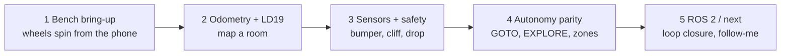
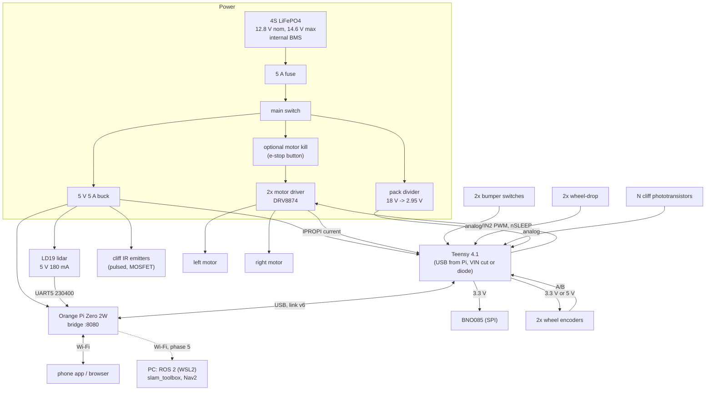
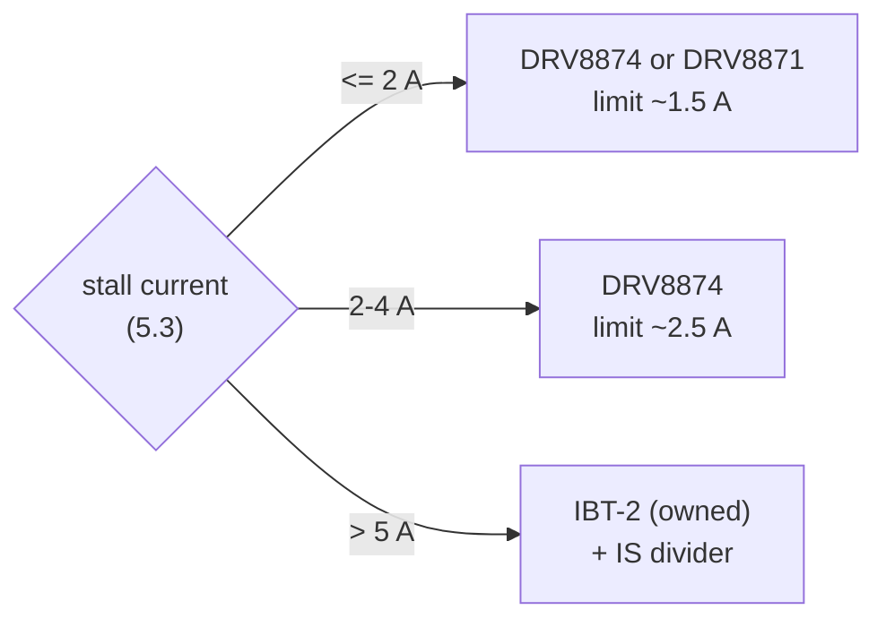
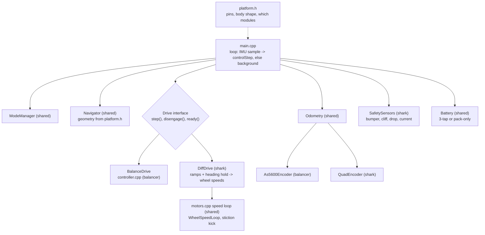
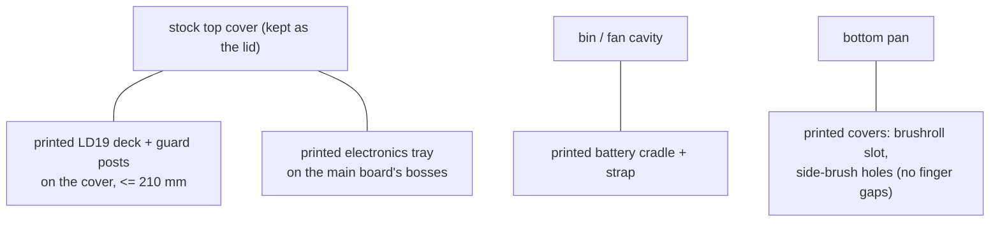

# Shark dev platform v1: build plan

A gutted **Shark RV915** robot vacuum (RV9155WXUS) becomes a non-balancing 2-wheel differential-drive robot.
Same stack as the balancing robot: Teensy 4.1 firmware, Orange Pi bridge, station web app, Android app, LD19.

Planning only. No CAD until the components are final (#72). Epic #80, issues #81-#93: see [Issues](#issues).



## Contents

1. [Goals and scope](#1-goals-and-scope)
2. [Key decisions](#2-key-decisions)
3. [Architecture](#3-architecture)
4. [Teardown checklist](#4-teardown-checklist)
5. [Measurements (owner, multimeter + bench supply)](#5-measurements)
6. [Power](#6-power)
7. [Motor driver](#7-motor-driver)
8. [Teensy pin budget](#8-teensy-pin-budget)
9. [Firmware plan](#9-firmware-plan)
10. [Station plan](#10-station-plan)
11. [Mechanical plan](#11-mechanical-plan)
12. [Milestones](#12-milestones)
13. [Risks and open questions](#13-risks-and-open-questions)
14. [Shopping list](#14-shopping-list)
15. [Issues](#issues)

---

## 1. Goals and scope

| v1 is | v1 is not |
|---|---|
| Indoor dev robot, round, 330 mm, low, can't tip | Outdoor (that's #73, wheelchair base + RTK) |
| Phone drive, GOTO / EXPLORE / HOLD, map, zones, places | ROS 2 on board (phase 5) |
| LD19 mapping + scan matching (#76, #78) | Camera / vision |
| Bumper, cliff and wheel-drop stop the motors | Docking / self-charging |
| Toddler-safe: slow, enclosed, no pinch points, LiFePO4 | Vacuuming |
| Same repo, same app, same sim | A second app |

**Done when:** it explores and maps two rooms from the phone, stops for bumps, drops and stairs, and returns to a saved place within 10 cm.

## 2. Key decisions

| Question | Recommendation | Why |
|---|---|---|
| **Same repo or new repo?** | **Same repo**, new PlatformIO envs `shark` / `shark_wifi` with `-DSBR_PLATFORM=SHARK`, plus a read-only param `sys.platform` the station reads | ~80 % of the code is shared and still moving fast (#77, #78, #79). A fork would drift in weeks. One link protocol, one sim, one app, one test suite. Both envs build in every check |
| **Electronics: move over or duplicate?** | **Duplicate** (new Teensy 4.1, Orange Pi Zero 2W, BNO085) on a new, simple **Shark carrier board** | Both robots stay usable. The balancer is mid-tuning (#65) and mid-LD19 (#75). Swapping means re-wiring + re-flashing + different params each time. Extra cost ~$100-130 |
| IMU on the Shark? | **Yes**, BNO085 (same driver) | Gyro heading makes scan matching and slip handling work (#79). Tilt = picked up / tipped |
| Battery | **4S LiFePO4 12 V 7 Ah** (owned), if it fits the bay (measure first) | Safe chemistry near a toddler, internal BMS, ~4 h. Plan B: aftermarket RVBAT850 4S Li-ion in the stock bay |
| Motor driver | **2x Pololu DRV8874 carrier** if stall <= ~4 A; owned **IBT-2** if more | Current limit + current readout (pinch / stall detection), 37 V, tiny. Final after the stall measurement |
| Encoders | Shark's own encoders, read on interrupt pins (PJRC `Encoder` lib) | Built in, no new parts. Level shifting only if they turn out 5 V push-pull |
| Pi | Orange Pi Zero 2W for v1 | The bridge install, UART5 LD19 setup and app already work on it. Pi 5 / PC-side ROS 2 in phase 5 (#71) |
| LD19 | Use the balancer's for phase 2 if needed; **buy a second** before phase 4 | Both robots need it |

## 3. Architecture

### Power, data, sensors



### What stays the same

| Layer | Shared as is | Changes for the Shark |
|---|---|---|
| Link protocol, codec, Pi link | yes | + `MSG_SAFETY` (link v6) |
| Mode manager (arm, E-stop, supervision, handover) | yes | BALANCE mode shown as **Ready** |
| Navigator (GOTO, EXPLORE, HOLD, lidar obstacles, stuck) | yes | body geometry from `platform.h` (round, r ~165 mm), `upright` -> `ready`, bumper/cliff inputs |
| Motors + motor model + motor test + speed loop | yes | driver type `mot.driver` (DRV IN/IN decay), speed loop on by default |
| Odometry | pose maths yes | encoder source: quadrature instead of AS5600; `odo.counts_rev` |
| Params (EEPROM, live set, save) | yes | append Shark params; widen `odo.track_mm` max |
| Battery | yes | pack-only mode for LiFePO4 |
| IMU, radio, reboot button | yes | radio optional |
| **Balance controller** (`controller.cpp`) | **balancer only** | new `DiffDrive` (speed + heading -> wheel speeds) |
| **Range sweep** (servo + VL53L0X) | **balancer only** | not built |
| Station: map, planner, explore, zones, places, LD19, scan matching | yes | robot profile (radius, lidar mount, UI labels) |
| Station: Find balance point, Falls | **balancer only** | hidden; **Safety events** log instead |
| Android app | yes | robot picker when 2 robots are found |

## 4. Teardown checklist

Photos first: every connector before unplugging it, with a strip of tape labelled per cable.

| | Part | Action | Note |
|---|---|---|---|
| KEEP | Round shell, top cover, bottom pan | keep | top cover stays as the lid (toddler-proof enclosure) |
| KEEP | 2 drive-wheel modules (75.6 mm, spring arm, encoder) | keep, unplug at the white 6-pin | keep the stock cable + plug |
| KEEP | Front swivel caster | keep | check for wires (some casters have a rotation sensor) |
| KEEP | Bumper + its switches | keep | note which board/cable each switch is on |
| KEEP | Cliff sensors (front underside windows) | keep with cables | count them, label L->R |
| KEEP | Original screws | bag them | reuse in the shell bosses |
| REMOVE | Main board (with SoM, camera, Wi-Fi 20012211) | remove, keep in a bag | handy as a reference for connector pinouts |
| REMOVE | Upward camera | goes with the board | not reusable on the Zero 2W |
| REMOVE | Vacuum fan + duct | remove | frees the bin/fan cavity = battery + electronics bay |
| REMOVE | Brushroll + its motor + belt | remove | **cover the bottom opening** (fingers) |
| REMOVE | Side-brush motors (2, orange/grey hubs) | remove | cover the holes |
| REMOVE | Dust bin parts | remove | |
| ? | Two metal cylinders + red/purple twisted pair near the rear-left | identify (weights? a sensor?) | photo + note |
| ? | Rear metal pads (bottom) | dock charge contacts: leave, unused | |
| ? | Other sensor boards found on the perimeter harness | photo + wire count, keep | IR wall / dock sensors: maybe later |

## 5. Measurements

Tools: multimeter (ohms, diode, DC V, DC A), **current-limited** bench supply, 10 k and 100 ohm resistors, jumper wires, phone camera (sees IR).
Optional but very helpful: a $12 USB logic analyzer + PulseView.

> **Teensy 4.1 pins are 3.3 V only, not 5 V tolerant.** Nothing goes to the Teensy until its voltage is known.

### 5.1 Wheel module cable (do both modules)

1. **Photo:** the encoder board under the black cap (both sides if it comes off), the connector with pin 1 marked, the wire colour order.
2. Module unpowered. Ohms between every pair of the 6 wires, wheel still. Then turn the wheel slowly and watch.
   - Motor pair: a few ohms to ~30 ohm, **flickers as the wheel turns** (commutator).
   - Drop switch pair (if in this cable): open <-> short when you push the wheel arm up / let it drop.
   - Encoder pins: diode-like readings in diode mode (note both directions).
3. Mark the motor pair. Bench supply **12 V, limit 0.5 A**, touch it to the motor pair for 2 s. Note which way the wheel turns.

| Pin (1 = marked) | Colour | Reads to | Ohms / diode | Guess | Confirmed |
|---|---|---|---|---|---|
| 1 | | | | | |
| 2 | | | | | |
| 3 | | | | | |
| 4 | | | | | |
| 5 | | | | | |
| 6 | | | | | |
| Connector pitch (2.0 / 2.5 mm) | | | | | |

### 5.2 Encoder type and voltage

1. **Photo:** the sensor part on the encoder board, close up. Hall IC (3-4 legs, small black) or slotted optical sensor (U-shaped)?
2. Start at **3.3 V, limit 20 mA** on the candidate VCC/GND. Read the current: hall ~3-10 mA, optical ~10-25 mA. 0 mA = wrong pins or polarity.
3. Each candidate output: 10 k pull-up to 3.3 V, meter on DC V, turn the wheel slowly. It should toggle ~0 V <-> ~3.3 V.
4. Nothing at 3.3 V? Try **5 V, limit 30 mA**. Then check each output **without** the pull-up:
   - floats / stays low = **open collector** -> pull up to 3.3 V, safe for the Teensy;
   - drives itself to ~5 V = **push-pull 5 V** -> needs a 74LVC buffer or a divider.
5. Count outputs that toggle: **2 = quadrature (A/B)**, 1 = single channel (no direction).
6. Counts per wheel turn: logic analyzer, or later with the firmware (milestone 1). No-load speed: count wheel turns in 10 s at 12 V.

| | Left | Right |
|---|---|---|
| Sensor type (hall / optical) | | |
| Works at 3.3 V? current mA | | |
| Needs 5 V? current mA | | |
| Outputs: count, open collector / push-pull | | |
| Counts per wheel turn | | |
| No-load wheel rpm at 12 V, current A | | |

### 5.3 Stall current

Gloves on; the gearbox is strong. Max **2 s** per try, let it cool between tries.

1. Supply 12.8 V, **limit 1 A**. Hold the wheel firmly (or clamp it). Read the current. If the supply hits the limit (voltage drops), raise the limit 0.5 A at a time up to 4 A.
2. Cross-check: `I_stall ~= 12.8 V / R_motor`, R_motor = the **lowest** motor-pair reading over a few wheel positions (5.1).
3. Same at 14.6 V (charger max) by calculation.

| | Left | Right |
|---|---|---|
| R_motor (min of 5 positions), ohm | | |
| Running current, no load, 12.8 V | | |
| Stall current measured (A) at 12.8 V | | |
| Stall current calculated 12.8 V / 14.6 V | | |

### 5.4 Bumper switches

1. **Photo:** each bumper switch board + its connector.
2. Microswitch? Ohms across its pins: press the bumper left, centre, right.
3. If it's an optical flag (slot sensor) instead: measure like a cliff sensor (5.5), digital use.

| Switch | Cable colours | Type | Released | Pressed left | centre | right |
|---|---|---|---|---|---|---|
| Left | | | | | | |
| Right | | | | | | |

### 5.5 Cliff sensors

Each window = an IR LED (emitter) + a phototransistor (receiver). Count them first.

1. **Photo:** each cliff board, both sides, and its cable.
2. Diode mode: find the LED (forward ~1.0-1.4 V). Find the phototransistor pair.
3. Emitter: **3.3 V through 100 ohm, limit 30 mA**. Phone camera: it glows purple. Note the current (target 10-25 mA). If the board already has a resistor, apply 3.3 V directly with the 30 mA limit and note the current.
4. Receiver: collector -> 10 k -> 3.3 V, emitter -> GND, meter on the collector. Emitter on.

| Sensor (L->R) | LED pins / colour | LED mA at 3.3 V | V: white paper 1 cm | wood floor | carpet | black mat | **air (no floor)** | LED off, room light |
|---|---|---|---|---|---|---|---|---|
| 1 | | | | | | | | |
| 2 | | | | | | | | |
| 3 | | | | | | | | |
| 4 | | | | | | | | |

Good sensor: floor -> low volts, **air -> close to 3.3 V**, with a clear gap.

### 5.6 Wheel drop

1. Not in the 6-wire cable? Look for a microswitch or flag on the swing arm. **Photo** it.
2. Ohms with the wheel pushed up (robot on the floor) vs hanging (lifted).

| | Where | Type | Wheel up | Wheel down |
|---|---|---|---|---|
| Left | | | | |
| Right | | | | |

### 5.7 Shell measurements (for the later CAD)

See [11. Mechanical plan](#11-mechanical-plan).

## 6. Power

### Battery

| | 4S LiFePO4 12 V 7 Ah (owned) | 3S LiPo (owned) | Aftermarket RVBAT850 4S Li-ion |
|---|---|---|---|
| Voltage | 10-14.6 V (12.8 nom) | 9.9-12.6 V | 12-16.8 V (14.4 nom) |
| Energy | ~90 Wh, ~4 h | ~30-50 Wh | ~37 Wh |
| Size / mass | 151x65x94 mm, 0.9 kg | small | fits the stock bay |
| Protection | internal BMS | none, balance taps | internal BMS |
| Near a toddler | **best** | fire risk | ok |
| Charger | 14.6 V LiFePO4 charger | balance charger | 16.8 V Li-ion charger |
| Firmware | pack-only mode | today's 3-tap mode | pack-only, divider for 16.8 V |
| Verdict | **v1, if it fits** (94 mm may be too tall laid flat, 65 mm on its side) | no | plan B (~$35) |

### Budget

| Load | Current |
|---|---|
| Orange Pi Zero 2W (Wi-Fi, bridge) | 0.5-1.2 A @ 5 V |
| LD19 | 0.18 A (0.3 A start) @ 5 V |
| Teensy 4.1 + BNO085 + radio | 0.15 A @ 5 V |
| Cliff emitters (pulsed) | 0.1 A @ 5 V |
| Later: USB camera, LEDs, speaker | 0.5 A @ 5 V |
| **5 V total, peak** | **~2.3 A -> buck 5 V 5 A** (also covers a Pi 5 later) |
| 2 motors, running (estimate, measure) | 0.3-0.6 A each @ 12.8 V |
| 2 motors, stall (measure in 5.3) | I_stall each, capped by the driver |

**Fuse** = 1.25 x (2 x driver current limit + 5 V load / 12 V / 0.85). With a 2 A limit per motor: ~5 A blade fuse, at the battery.

**Switch**: main rocker (10 A DC) after the fuse. Optional red latching button that cuts only the driver VM (motors dead, Pi keeps running).

**Buck**: 5 V 5 A, input >= 24 V (e.g. Pololu D36V50F5). Teensy powered from 5 V (VIN) with its USB VUSB-VIN pad cut, or through the Pi USB only (pick one; never both without the cut).

### Battery monitoring (firmware)

| Today (3S) | Shark (4S LiFePO4) |
|---|---|
| 3 taps: pins 14 / 40 / 41 | **pack only**: pin 41 |
| `batt.adc_per_v` 73.3 -> clips at **13.95 V** | new divider **51 k / 10 k** -> 18 V reads 2.95 V; `batt.adc_per_v` ~50.8 (calibrate with a meter) |
| `batt.low_cell` 3.4 V per cell | `batt.low_pack_v` 12.0 V (warn, under load), `batt.crit_pack_v` 11.0 V (stop autonomy, go Ready) |
| | new `batt.mode`: 0 = 3S taps, 1 = pack only |

Pack-only mode also helps the balancer if it ever runs on the LiFePO4 (#72 comment).

## 7. Motor driver

Signal scheme: **2 PWM per motor (IN1/IN2)**, like the L298N `mot.drive_mode 1`.

| Driver | VM max | Current | Current limit / sense | 3.3 V logic | Fits 4S LiFePO4 (14.6 V) | Notes |
|---|---|---|---|---|---|---|
| **Pololu DRV8874 carrier** (x2) | 37 V | 2.1 A cont, 6 A peak | **limit + IPROPI readout** | yes | yes | **pick if stall <= ~4 A**. nSLEEP = enable pin |
| Adafruit DRV8871 (x2) | 45 V | 3.6 A peak | limit (ILIM resistor), no readout | yes | yes | cheaper; no pinch/stall current signal |
| Cytron MDD3A (dual) | **16 V** | 3 A, 5 A peak | none | yes | tight margin | no current sense |
| HW-039 / IBT-2 (owned, x2) | 27 V | 43 A | IS pins (divider needed) | yes (VCC 3.3 V) | yes | **pick if stall > 5 A**. Big |
| L298N (owned) | 46 V | 2 A | none | yes | yes | 2 V drop, hot: fallback only |
| TB6612FNG | 13.5 V | 1.2 A | none | yes | **no** | out |



**DRV8874 wiring (per motor)**

| DRV8874 pin | To | Note |
|---|---|---|
| VM / GND | switched battery, after the fuse | 100 uF near the board |
| OUT1 / OUT2 | motor pair (5.1) | keep the stock ferrites |
| IN1 / IN2 | L: pins 5 / 6, R: 8 / 9 | same pins as today |
| nSLEEP | L: pin 4, R: pin 7 | today's EN pins: low = off |
| PMODE | 3.3 V (IN/IN mode) | check the carrier's default |
| IPROPI / CS | L: pin 26 (A12), R: pin 27 (A13) | ~1.1 V/A on the Pololu carrier (check); current limit from VREF |
| VCC (logic) | 3.3 V | |

**Firmware note:** on the DRV887x, both INs low = **coast**, both high = **brake**. On the L298N (EN high) both INs low = brake. So `mot.drive_mode` needs a driver type `mot.driver` (0 L298N, 1 DRV887x IN/IN) to pick the right pin pattern. PWM 20-25 kHz (quiet; the L298N brake-mode limit `mot.brake_max_hz` doesn't apply).

## 8. Teensy pin budget

Today's use from `src/config.h`. Shark column = the new carrier board (duplicate electronics, so free to choose).

| Pin | Balancer today | Shark |
|---|---|---|
| 0 | free | spare (Serial1 RX) |
| 1 | free | WS2812 LEDs (kid mode, later) |
| 2 | range servo | **enc L A** |
| 3 | free | **enc L B** |
| 4 / 5 / 6 | motor L EN / D1 / D2 | **nSLEEP L / IN1 L / IN2 L** |
| 7 / 8 / 9 | motor R EN / D1 / D2 | **nSLEEP R / IN1 R / IN2 R** |
| 10-13 | IMU CS + SPI | IMU CS + SPI |
| 14 (A0) | batt tap 1 | spare analog |
| 15 (A1) | free | **cliff 1** |
| 16 / 17 | Wire1 (right AS5600) | **cliff emitter MOSFET** / spare |
| 18 / 19 | Wire (left AS5600, VL53L0X) | I2C spare (INA226, OLED later) |
| 20 / 21 / 22 (A6-A8) | free | **cliff 2 / 3 / 4** |
| 23 / 24 (A9 / A10) | free | cliff 5 / 6 (if there are 6) |
| 25 | free (on a motor PWM timer: no analogWrite) | spare input |
| 26 / 27 (A12 / A13) | free | **motor current L / R** |
| 28 / 29 | sweep XSHUT1 / INT1 | **enc R A / B** |
| 30 | IMU INT | IMU INT |
| 31 | reboot button | reboot button |
| 32 / 36 | radio CE / CSN | radio (optional) |
| 33 | IMU RST | IMU RST |
| 34 / 35 | sweep XSHUT0 / INT0 | **bumper L / R** (pull-up, to GND) |
| 37 | free | buzzer |
| 38 / 39 | AS5600 DIR L / R | **wheel drop L / R** |
| 40 (A16) | batt tap 2 | 5 V rail monitor (divider) |
| 41 (A17) | batt tap 3 = pack | **pack voltage** (new divider) |

Fits with room to spare: 7 analog + 8 digital inputs, 6 motor pins. **No extra breakout chip needed.**

**Shark carrier board** (perfboard v1, small PCB later): Teensy socket, BNO085 socket, 2 driver carriers, 2 encoder headers (stock 6-pin mating plug), bumper / drop / cliff headers, pack divider, cliff emitter MOSFET (AO3400 or 2N7002) + resistors, 74LVC244 footprint for 5 V encoder signals (populate only if 5.2 says push-pull 5 V), 5 V buck input, 100 nF on every input.

## 9. Firmware plan

### Build

```ini
[env:shark]          ; USB
extends = env:teensy41
build_flags = -DSBR_PLATFORM=2      ; 1 = balancer (default), 2 = shark
lib_deps = ${env:teensy41.lib_deps}
	paulstoffregen/Encoder
[env:shark_wifi]     ; flash through the Shark's Pi
extends = env:shark
upload_protocol = custom
upload_command = "$PYTHONEXE" "$PROJECT_DIR/tools/wifi_upload.py" "$SOURCE"
```

`ROBOT_HOST` picks the Pi, so `shark_wifi` flashes the Shark, `teensy41_wifi` the balancer.

### Structure



### Diff-drive control

```
target speed / turn (STATION, MANUAL, navigator)
  -> safety gate (bumper / cliff / drop: block forward, reverse, or all)
  -> ramps: drv.accel, drv.turn_accel
  -> heading hold (gyro): turn cmd 0 -> PID on heading error (str.kp / ki / kd)
  -> wheels: v_l = v - w * track/2,  v_r = v + w * track/2
  -> WheelSpeedLoop per wheel (mot.speed_loop 1, mot.k_*, mot.dz_*, mot.bk_*)
  -> DRV8874 IN1/IN2 PWM 20 kHz
```

Loop: IMU-paced at `ctl.rate_hz` = 200 Hz, encoders read every step. Motor test (`mot.test` 1-7) runs as on the balancer (wheels up), fits `mot.k_*` / `mot.dz_*` / `mot.bk_*`.

### Safety (into the stop)

| Event | Action | Clears |
|---|---|---|
| Bumper pressed | stop; navigator BLOCKED + back off `safe.bump_backoff_mm`; joystick: forward blocked | released |
| Cliff (any sensor sees "air") | **stop at once**, forward blocked, only reverse allowed; navigator BLOCKED, bridge marks a no-go spot | floor seen again |
| Wheel drop (either) | **motors off, disarm** (picked up / over an edge) | wheels down + arm again |
| Tilt > 20 deg (IMU) | motors off, disarm | arm again |
| Wheel stall (current > `safe.i_max_a` or no motion at high duty for `safe.stall_ms`) | motors off; log | next command |
| Battery critical | autonomy -> Ready, joystick capped | charge |
| Existing: E-stop, disarm, IMU stale, no supervisor, link lost | unchanged | unchanged |

Cliff read: per channel, ADC with the emitter **off**, then **on** (200 us), use the difference: ignores room light.

### Link and params

| | |
|---|---|
| New message | `MSG_SAFETY` (Teensy -> Pi, 10 Hz + on change): bumper / cliff / drop / stall bits, cliff values, motor currents. **Link v6** (old bridges ignore it) |
| Read-only param | `sys.platform` (min = max: 1 balancer, 2 shark). The bridge picks the robot profile from it |
| New params (appended) | `mot.driver`, `odo.counts_rev`, `batt.mode`, `batt.low_pack_v`, `batt.crit_pack_v`, `safe.cliff_enable`, `safe.cliff_delta`, `safe.bump_backoff_mm`, `safe.i_max_a`, `safe.stall_ms`, `kid.max_speed` |
| Changed ranges | `odo.track_mm` max 200 -> 400 (Shark ~250 mm). Range changes don't touch the EEPROM layout CRC (names only) |
| Shark defaults | `odo.wheel_d_mm` 75.6, `odo.track_mm` (measured), `mot.speed_loop` 1, `ctl.rate_hz` 200, `nav.corridor_mm` ~360, `drv.max_speed` 300, `nav.max_speed` 200 |
| Encoder scaling | `odo_mm_per_count()` uses `odo.counts_rev` (4096 on the balancer) |
| Host tests | DiffDrive, SafetySensors, Navigator with the round body, both envs build |

## 10. Station plan

Little changes. The bridge reads `sys.platform` at HELLO and loads a **robot profile**.

| Area | Balancer | Shark profile |
|---|---|---|
| Planner `robot_radius_mm` | 80 | ~185 (165 shell + ~20 axle offset, measure) |
| Mapping `body_free_mm` | 50 | 150 |
| LD19 mount (x, y, yaw, height, mask) | as set | measured on the Shark deck |
| Pitch gating | on | on (rarely triggers) |
| Arm button | "Arm & Balance" | "Arm" |
| BALANCE mode | Balance | **Ready** |
| Tune: Find balance point | yes | hidden |
| Logs: Falls | yes | **Safety events** (bumper, cliff, drop, stall) |
| Health tiles | | + bumper / cliff / drop / motor currents |
| Map | | bumper hits as obstacle marks; **cliffs become no-go zones** |
| Kid mode (#74) | no | speed cap `kid.max_speed`, big buttons, parent PIN |

**Sim**: `python -m station.sim --robot shark` = diff-drive kinematics (no pendulum), first-order wheel lag + speed loop, round 330 mm body, bumper contact against room walls, a "stairs" drop area for the cliff sensors, LD19 scans (existing `--lidar`). The sim navigator mirror takes the platform geometry. All bridge tests run against both robots.

**Android app**: two robots on the LAN -> a picker (name + IP); remember the last one.

**ROS 2 (phase 5)**: PC-side first (WSL2): an adapter talks to the bridge's WebSocket API and publishes `/scan`, `/odom`, `/tf`, `/imu`, takes `/cmd_vel`. slam_toolbox + Nav2 on the PC. Pi 5 on board later (#71).

## 11. Mechanical plan



| Part | Where | Notes |
|---|---|---|
| Electronics tray | main board's screw bosses (front half) | Teensy carrier, 2 drivers, buck, Pi on M2.5 standoffs; heat-set inserts |
| Battery cradle | bin + fan cavity | LiFePO4 flat or on its side; strap; low and near the axle |
| LD19 deck | on the top cover, centred over the axle if possible | scan plane clear 360 deg above the shell; 2-4 thin guard posts (toddler grabs) masked in software |
| Bottom covers | brushroll opening, side-brush holes | screwed, no gaps > 5 mm |
| Cable pass-throughs | top cover -> deck | grommet |

Printer: Ender 3 V3 KE, 215 x 215 x 266 mm, PLA, no supports, brass heat-set inserts for bolted joints. Every part <= 210 mm.

### Measure in the shell (for the CAD)

| What | Value |
|---|---|
| Shell outer diameter, height, ground clearance | |
| Top cover: inner diameter, flat area for the deck, screw positions | |
| Main board bosses: positions (x, y from centre), hole size, screw size, height | |
| Bin cavity: L x W x H, openings | |
| Fan cavity after removing the fan: L x W x H | |
| Brushroll opening: L x W | |
| **Track width** (wheel contact centres) | |
| **Axle offset** from the shell centre (fore/aft) | |
| Caster position (from the axle) | |
| Cliff sensor positions (x, y from the axle centre) | |
| Bumper travel, switch trigger point | |
| Stock battery bay: L x W x H, connector | |
| Mass: gutted shell with wheels (kitchen scale) | |

Photos with a ruler in frame, straight from above, for each of: top cover inside, empty shell from above, bottom.

## 12. Milestones

| # | Milestone | Owner does | Claude does | Done when |
|---|---|---|---|---|
| 1 | **Bench bring-up** | teardown, measurements (5), order parts, wire the carrier | platform layer, `shark` env, DiffDrive, DRV driver mode, encoders, pack-only battery | wheels up: both wheels follow phone commands; motor test fit; on the floor: 1 m straight at 0.3 m/s; STOP works |
| 2 | **Odometry + LD19 mapping** | mount the LD19 (temporary deck ok), square test | robot profile, Shark sim, scan matching on the Shark | Calibrate odometry passes; a 2-room map; back to start within 10 cm |
| 3 | **Sensors + safety** | wire bumper / cliff / drop; tests at the stair top with a guard board | SafetySensors, `MSG_SAFETY` (link v6), Health + Safety events, cliff no-go | each event stops the robot in tests; enclosure closed, toddler-safe |
| 4 | **Autonomy parity** | supervised runs | GOTO / EXPLORE / HOLD / zones / places on the Shark; kid mode basics (#74) | 10 min supervised explore, only bumper touches |
| 5 | **ROS 2 / next** | Pi 5 decision | PC ROS 2 adapter, slam_toolbox, Nav2; loop closure, relocalisation, follow-me, patrols (#71) | Nav2 drives the Shark through the bridge |

Printed parts (section 11) start after milestone 1's measurements fix the components.

## 13. Risks and open questions

| Risk | Impact | Plan |
|---|---|---|
| LiFePO4 brick (94 mm) doesn't fit inside | battery on the deck, high CG, ugly | measure first; plan B aftermarket RVBAT850 in the stock bay |
| Encoder is single-channel | no direction from the encoder | direction from the command sign; fine for a diff drive except right at reversal |
| Encoder is 5 V push-pull | could damage the Teensy | 74LVC244 at 3.3 V (5 V-tolerant inputs) on the carrier |
| Stall current high | DRV8874 too small | IBT-2 (owned) |
| Cliff sensors use a modulated / IC design | can't read raw | read their output as digital, or replace with 2x TCRT5000 / VL6180X |
| Bumper is optical, not a switch | needs power + threshold | same circuit as a cliff sensor |
| Pinch points: wheel wells, brushroll slot | toddler fingers | covers, current limit + stall stop, kid speed cap |
| One LD19 for two robots | blocks phase 2 or the balancer | borrow briefly; buy a second before phase 4 |
| Two robots on one LAN / one nRF24 remote | wrong robot answers | app picker; radio address param later (v1: Shark phone-only) |
| One repo, two platforms | more `#if` | small `platform.h` + Drive interface; both envs build + host tests in every check |

**Open questions for the owner**

| # | Question | Recommendation |
|---|---|---|
| 1 | Duplicate electronics (~$100-130) or move them? | duplicate |
| 2 | Keep the stock top cover as the lid? | yes |
| 3 | nRF24 remote on the Shark? | not in v1 |
| 4 | Buy the second LD19 now or later? | before milestone 4 |
| 5 | Robot name / hostname for the app picker | e.g. `shark` |
| 6 | Kid-mode top speed | 0.2 m/s |

## 14. Shopping list

Prices approximate, check before buying. Driver choice waits for the stall measurement.

| Item | Qty | ~$ | When |
|---|---|---|---|
| Teensy 4.1 | 1 | 32 | now |
| Orange Pi Zero 2W (1-2 GB) + 32 GB microSD | 1 | 30 | now |
| BNO085 breakout (Adafruit 4754 or SparkFun) | 1 | 25 | now |
| USB logic analyzer 24 MHz 8 ch | 1 | 12 | **now (helps 5.2 / 5.5)** |
| Pololu DRV8874 carrier (#4035) *or* Adafruit DRV8871 | 2 | 20 | after 5.3 |
| 5 V 5 A buck, >= 24 V in (Pololu D36V50F5) | 1 | 25 | now |
| Inline blade fuse holder + 5 A fuses | 1 | 5 | now |
| Rocker switch 10 A DC (+ optional red latching button) | 1 | 5-10 | now |
| XT60 pair, 18 AWG silicone wire | 1 | 8 | now |
| Mating headers for the 6-pin wheel plug (pitch from 5.1) | 2 | 3 | after 5.1 |
| JST-XH kit, perfboard, 10 k / 51 k / 100 ohm resistors, 100 nF caps, AO3400 MOSFETs | 1 | 15 | now |
| 74LVC244 (only if encoders are 5 V push-pull) | 1 | 1 | after 5.2 |
| LiFePO4 14.6 V charger (if not owned) | 1 | 20 | now |
| Second LD19 | 1 | 70-100 | before milestone 4 |
| Optional: INA226 power monitor | 1 | 5 | later |
| Optional: WS2812 ring, small speaker (kid mode) | 1 | 12 | later |
| Optional: Raspberry Pi 5 8 GB + cooler | 1 | 90 | milestone 5 |

**Now: ~$170** (+ ~$20 drivers after 5.3).

## Issues

Epic **#80**. Label `shark`.

| Milestone | Issue | Who |
|---|---|---|
| 1 | #81 Teardown + shell measurements | owner |
| 1 | #82 Measure wheel modules, encoders, stall, bumper, cliff, drop | owner |
| 1 | #83 Decide electronics / driver / battery, order parts | owner |
| 1 | #84 Power + carrier board wiring | Claude, owner builds |
| 1 | #85 Firmware: platform abstraction + `shark` env | Claude |
| 1 | #86 Firmware: diff-drive, DRV887x mode, quadrature encoders | Claude |
| 1 | #87 Battery pack-only mode (LiFePO4) | Claude |
| 2 | #91 Odometry calibration + LD19 mapping | both |
| 2-4 | #89 Station robot profile + Shark sim | Claude |
| 3 | #88 Safety sensors -> stop (link v6) | Claude, owner wires |
| 3-4 | #90 Mechanical: tray, cradle, covers, LD19 deck (after parts are final) | Claude CAD, owner prints |
| 4 | #92 Autonomy parity + kid-mode basics | both |
| 5 | #93 ROS 2 adapter, loop closure, follow-me, patrols | Claude |

**Owner's first 3 actions:** #81 teardown (does the LiFePO4 fit?), #82 measurements (section 5), #83 order the "now" parts.
