# Station features

## Tabs at a glance

| | |
|---|---|
| **STOP** (or Space / Esc) | motors off, robot disarms, **latched**: no mode request (station, app, remote selector) starts the motors until **Release E-stop** (confirm), then arm again |
| **Arm & Balance** | two taps. With no RC remote the phone arms the robot; with the remote, its switch does |
| **Disarm** | next to STOP while armed. One tap = `SET_MODE IDLE`, no latch. No remote: the robot disarms (Arm shows again). With the RC remote on: motors off (IDLE) but its ARMED switch still rules, so the robot stays armed; the button goes away at IDLE |
| **Map** | tap to add waypoints, **Go** (asks before it arms the robot): with a map, the route goes around walls. **Explore**: the robot maps the room by itself |
| **Control** (was Drive) | the phone as the remote: who is in charge (phone / RC remote), Arm, Balance / Hold / Manual (joystick, STATION) / Go to / Explore, Slow / Med / Fast, Tilt in the app. Landscape puts the pad on the right. Battery and link are the top-bar pills; Disarm and STOP sit beside them |
| **Sensors** | both range sensors live: mm, valid, angle, readings/s; last sweep around the robot; range vs time. ⋯ → park / trim / sweep width / direction, **hand test** (cover one sensor: its card lights up). Colours: front amber, rear magenta (map too) |
| **Tune** | live P / I / D at the loop rate (**Full rate**), sliders apply at once, **Save to robot** writes EEPROM (when the motors are off); ⋯ → Restore defaults. Two views: **Balance** and **Motor test** (below) |
| **Health** | **Preflight** (IMU, loop ~400 Hz, encoders, battery, remote or station, E-stop, range sensors): green / amber / red, **never arms anything**. **Battery**: volts, percent and **minutes left** (also in the top bar); a tile each for link, loop, IMU, encoders, range sensors, RC remote (grey **off** when none is used: no alarm), Pi, logs disk, firmware. Tap a tile for its reason. Details below |
| **Logs** | **Falls** (below), messages, session downloads (CSV / JSONL), link details |

## Health (issue #51)

 

The bridge sends one `health` message a second (it reads `/proc` and `/sys/class/thermal` once a second, nothing heavier). Rules live in `station/bridge/health.py`; the page only draws them.

| Part | Green | Amber | Red |
|---|---|---|---|
| Loop | ≥ 90 % of `ctl.rate_hz` | ≥ 70 % | below |
| IMU, encoders | no fault in telemetry `error_code` | | fault code 1-4 |
| Range sensors (if `rng.enable`) | ≥ 4 readings/s | some | none |
| Radio (once a remote was seen) | answering, no gaps | gaps > 100 ms, or < 90 % of 50 pkt/s (from the firmware's `radio:` line) | lost: failsafe |
| Battery | above `batt.low_cell` + 0.15 V per cell, ≥ 5 min | nearly empty | `low_batt` or below the limit |
| Pi | < 70 C, CPU < 90 % | hot or busy | ≥ 80 C |
| Logs disk | ≥ 2 GB free | < 2 GB | < 0.3 GB, or the session log is off |
| E-stop | released | | latched |

- **Minutes left**: the bridge fits `volts = a + b·time + c·load` over the last 10 min (load = mean |motor duty|), so the sag while driving is not taken for discharge. Minutes = (volts at your usual load − 3 × `batt.low_cell`) / −b. It needs about 2 min of data; a LiPo drops faster near empty, so near the end it is optimistic. The percent comes from the sag-corrected resting cell voltage.
- **Bench supply**: pack reading under 3 V (no balance lead): "bench supply", no minutes, battery counts as fine.
- The firmware sends the pack voltage only, so "per cell" is pack ÷ 3.
- Not done here: the wheels-up spin test of each wheel (encoder sign / count). That commands the motors, so it stays in Tune → Motor test.
- API: `health` WebSocket message, `GET /api/health`, and `health` inside `GET /api/state`.

## Falls: the black-box recorder (issue #50)

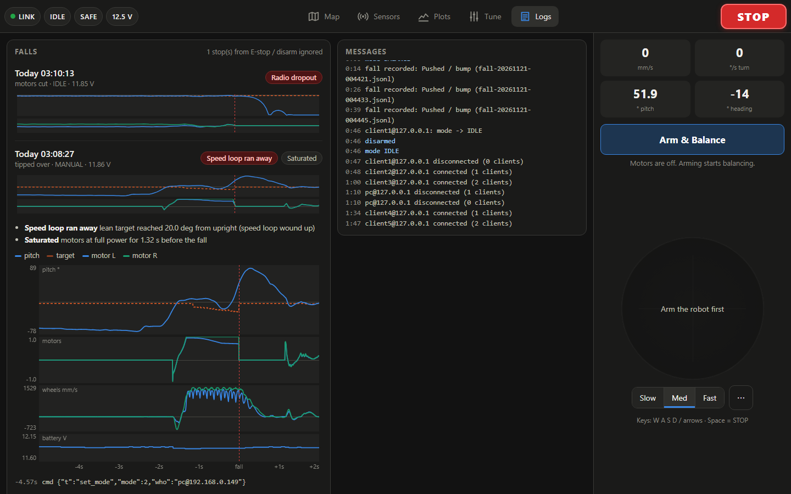

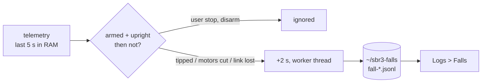

Every fall is saved by itself: 5 s before + 2 s after (full telemetry rate, range readings, log lines, commands, the params then),
about 100 KB at 100 Hz, 350 KB at 400 Hz. Newest first on **Logs → Falls**: tap one for the evidence, big plots and **Download record**.
`~/sbr3-falls/<robot>` keeps the last 200 files / 100 MB (`--falls-dir`). Cost on the Pi: one list append per frame; analysis and writing run in a thread.

| Chip | Rule (first one listed is the cause) |
|---|---|
| Link lost | serial link closed while balancing |
| Radio dropout | RC link dropped out in the last 4 s, then the mode fell to IDLE with the robot still upright (the 2026-11-21 firmware bug) |
| Motors cut | mode left BALANCE with nobody asking, no radio trouble (not saved if the robot did not tip) |
| Battery sag | supply dropped > 0.6 V in 2 s, or low-battery flag |
| IMU / loop dip | loop rate < 85 %, telemetry stall, impossible pitch jump, frozen pitch |
| Hit obstacle | range < obstacle distance in the direction of travel |
| Wheel slip | left/right wheels disagree with equal motors, or wheel speed jumps without a motor change |
| Oscillation | pitch error crossing zero ≥ 2.5 Hz with growing swings |
| Speed loop ran away | lean target > 12° from upright |
| Pushed / bump | pitch-rate spike > 100 °/s while balancing and the motors below full power |
| Saturated | motors at ±1 for ≥ 150 ms just before the fall |

E-stop, **Stop** / `set_mode IDLE` from any client, the remote's E-stop and its ARMED switch are **not** falls (counted as "ignored").
Back-fill or test on old sessions: `python -m station.tools.falls_scan ~/sbr3-logs/<session>.jsonl`.
Try it: `python -m station.sim --shove 12`, press **Arm & Balance**; the sim is knocked over every 12 s.
API: `GET /api/falls`, `GET /api/falls/<id>` (`?raw=1` = the file), `DELETE /api/falls/<id>`; WebSocket `{"t":"fall","fall":{...}}` when one is saved.
### Tune → Balance: presets and scored runs (issue #16)

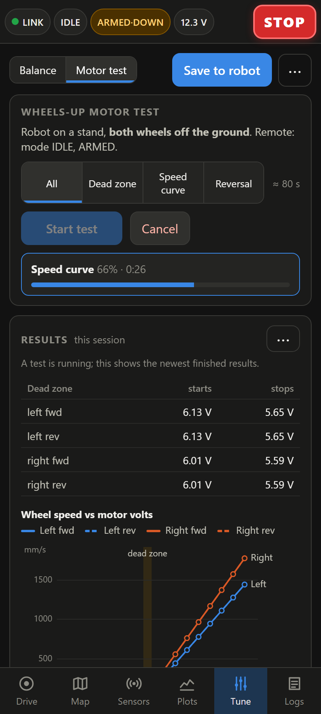

| | |
|---|---|
| **Preset ▾ / Apply** | built-in "v3 known good" and "2026-11-21 (kd 7.15, ki 1500)", plus your own (⋯ → Save current values as… / Compare… / Delete). Kept on the Pi in `~/sbr3-presets/<robot>/*.json`. Apply = only the values that differ; asks first while the robot is armed. Never touches the motor test (`mot.test*`), `mot.drive_mode` and its brake limits, `cfg.*` |
| **Score** | **Last 20 s** (⋯: 10 / 20 / 30 / 60 s) or **Start … Stop** around a run (push it a few times). The bridge scores the full-rate session log like `tools/tune.py score`: pitch error rms, oscillation Hz, motor rms / saturation / sign flips, D noise, pushes > 3° with settle time and overshoot. Needs **Full rate** (400 Hz) |
| **Runs side by side** | one column per run with the params active then (changed ones in yellow, `*` = changed during the run); best value per row highlighted. History lives in the bridge (and in the session log as `["score", t, {...}]`) |

### Tune → Balance: Find balance point (issue #52)

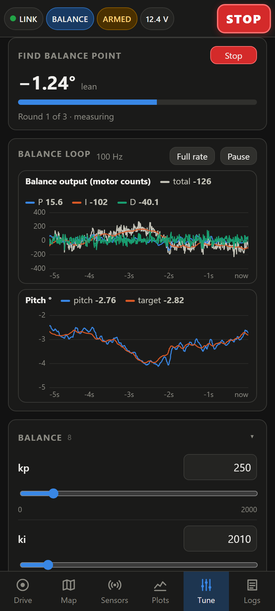
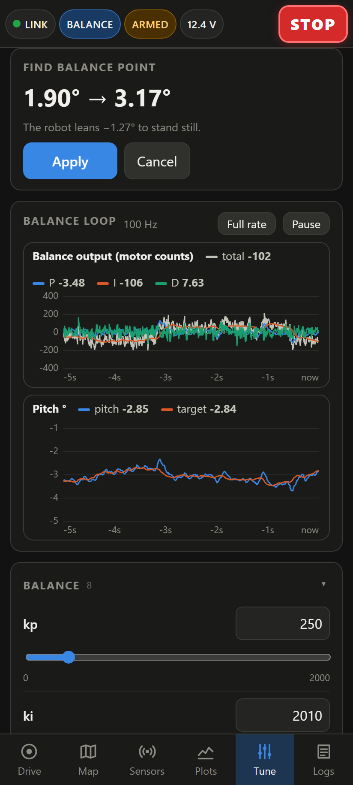
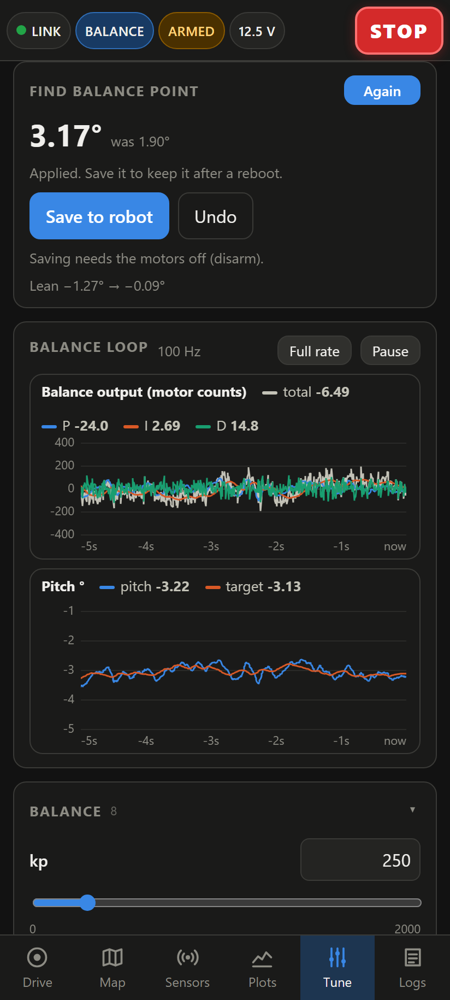

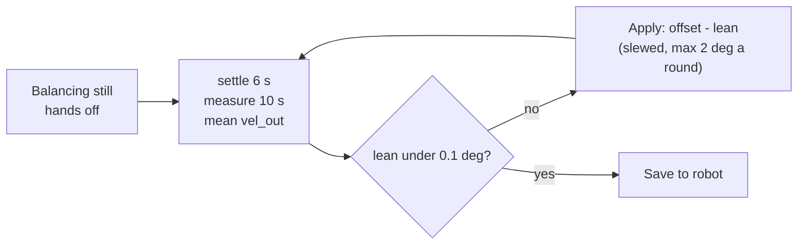

If `bal.offset_deg` is off, the velocity loop has to lean the robot to stop it creeping. That lean (`vel_out_deg`)
is the error: `new offset = offset - mean(vel_out_deg)`. **Start** only works armed, upright, in BALANCE / HOLD and
standing still. It reads telemetry and sets one param (`bal.offset_deg`); it never arms, changes the mode or drives.
A push, driving, disarm, E-stop, lost link or someone else touching the offset aborts it at once.
**Apply** moves the offset gently, then measures again to check; **Undo** restores the old value; **Save to robot** is the
usual EEPROM save (motors off). Browser API: `{"t":"balpoint","action":"start"|"apply"|"revert"|"stop"|"status"}`
(`start` also takes `"auto":true` to apply each step itself, `settle_s`, `window_s`, `rounds`); state arrives as `balpoint_state`.
Sim: set `bal.offset_deg` wrong (real balance point 3.15) and run it. Screenshots: `--prep-balpoint balpoint`.
### Tune → Balance: Calibrate odometry (issue #14)

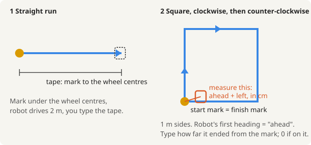

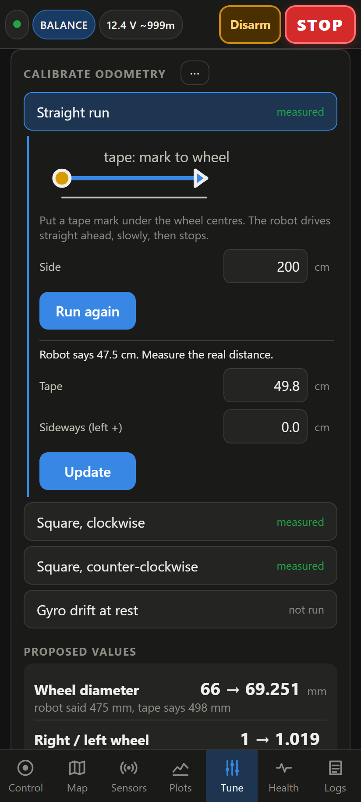
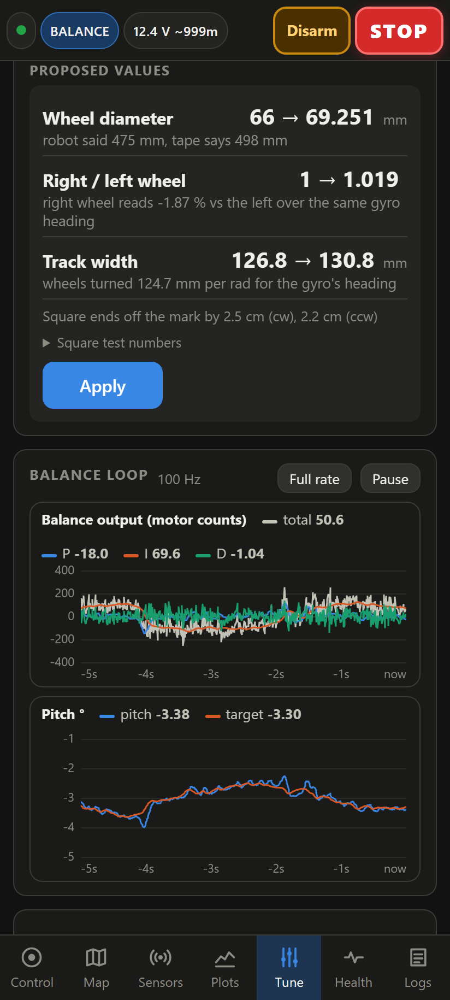

The map and the places are only as good as the odometry: **distance** = wheel travel (`odo.wheel_d_mm`,
`odo.lr_ratio`), **direction** = the gyro. Four short steps, each needs the robot armed (two taps), standing, and
your tap on **Start**. Robot speed is held at 120 mm/s (limit 150), the obstacle stop stays on.

| Step | You do | You get |
|---|---|---|
| **Straight run** (2 m) | tape mark under the wheel centres, robot drives ahead, type the tape distance | `odo.wheel_d_mm` |
| **Square, clockwise** (1 m) | mark, robot drives the square back to the mark, type how far it ended (ahead / left, cm) | closing error, `odo.track_mm`, `odo.lr_ratio` |
| **Square, counter-clockwise** | same, other way (needed to split the errors, UMBmark) | |
| **Gyro drift** (60 s) | nothing, hands off | °/min the gyro walks (under 1 is fine) |

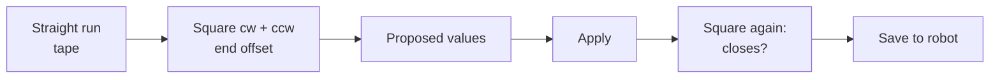

How the numbers come out: the tape distance gives the wheel diameter (`new = old × tape / robot`). The track width and
left/right ratio come from the wheels against the gyro over all runs (least squares: wheel travel difference =
track × gyro turn + ratio error × distance), no tape needed. The square's end offsets are shown as the closing error
and as the textbook Borenstein UMBmark numbers (`E_b`, `E_d`) for comparison. **Apply** sets the params (**Undo**
restores them), **Save to robot** is the usual EEPROM save (motors off). Run the square again afterwards: it should end
within a few cm of the mark. STOP, Disarm, E-stop, a push or a fall end a run at once and put the speed limit back; the bridge
never arms. Browser API: `{"t":"calib","action":"start"|"measured"|"apply"|"revert"|"reset"|"stop"|"status"}`, state arrives as
`calib_state` (`station/bridge/odo_calib.py`). Sim: `SimRobot.set_hardware(wheel_d, track, lr, gyro_bias_dps)` makes the real robot
differ from the `odo.*` params; `test_odo_calib.py` recovers it.

### Tune → Motor test (wheels up)

Robot on a stand, wheels off the ground, remote in IDLE + ARMED. Pick All / Dead zone / Speed curve / Reversal,
**Start test** (asks first); the robot's own interlocks decide when it runs, and its wait reason shows live
("Arm the remote, mode IDLE", "Stand it upright", …). Results = `tools/motor_fit.py` (same module,
`station/bridge/motor_fit.py`): dead zone per wheel and direction, speed vs volts chart, left/right mismatch,
and a proposal → **Apply proposal** sets the ticked `mot.*` values (`mot.model` / `mot.vcomp` only if you tick them).
⋯ → results from an earlier session. Sim: `python -m station.sim --remote` (TT motors: ~6 V start / 5.6 V stop, left 18% weaker).

Screenshots of these: `python -m station.tools.screenshots --url http://localhost:8090/ --prep-tune tune` (sim with `--remote`).

## Map (occupancy grid, route, explore)

| | |
|---|---|
| grey / white / black | unknown / free / wall (25 mm cells, built on the Pi from every range reading) |
| size | **grows with the robot**: starts 20 x 20 m, adds 1 m tiles whenever a reading reaches past the edge. Memory cap 64 MB (200 x 200 m): past it the bridge says so in the log and the map stops growing |
| doorways | hits are range-weighted: close = narrow and strong, far = weak, and a close free reading counts double, so a 260-300 mm doorway is not walled off by far readings. The floor under the robot (50 mm round its centre) is marked free, so a doorway it drove through stays open. Off: `range_weight` / `body_free_mm` = 0 map settings |
| ⋯ → **Map** | on / off + opacity · **Save / Load map** (`~/sbr3-maps/<robot>`) · **Clear map** |
| ⋯ → Map & route settings | keep off walls (180 mm), prefer more room (300), narrow gaps: keep (35), robot radius (80), tilt limit, “no target” handling, pose correction when stopped (#71), drift correction while driving (experimental). Route settings are saved (`~/sbr3-maps/<robot>/planner.json`) |
| **Go** with a map | the bridge plans a route (purple) around obstacles, re-plans when the robot is blocked |
| **Explore** | drives to the nearest unmapped edge until none is left; STOP ends it |
| Narrow gap | no route / frontier with the wall margin → plan again keeping only radius + “narrow gaps” (25 mm cells; with range weighting off: sure walls only); explore then only goes for open space behind a gap (also when only a strip along the far room's wall is seen yet, with unknown open space right beyond it), keeps planning on this map until the robot is out of the gap, and stops after 6 such goals that show nothing new. Waypoints in the gap sit on its centre line (off the 25 mm grid), lead in / out square to it, and move again as the map sharpens (#108). Status: “squeezing through a narrow gap, ~N mm clearance” (the route's own, on the map); the robot slows down beside the walls (`nav.side_min_mm`). The sensor cone can draw a doorway under ~300 mm shut on the map: then it is not tried |
| Robot stuck | robot log `nav: stuck` → it backs off, the next plans keep +100 mm more off walls (−50 per goal reached). With the LD19 also when the wheels spin but the robot does not move (#79) |

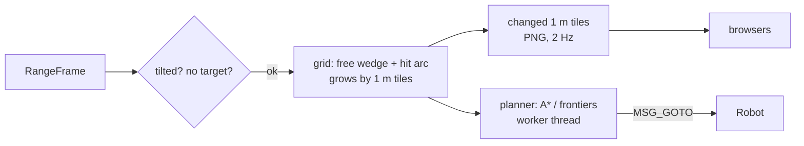

### Pose correction: stop-and-scan (issue #71)

Off by default (⋯ → Map & route settings → **Correct the pose when stopped**). **⋯ → Scan & correct pose** works any time.

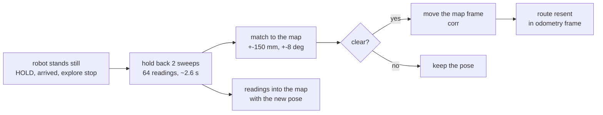

| | |
|---|---|
| beam model | a reading = the nearest wall anywhere in its cone (+-8 deg): the map is ray-cast from the sensor axis for each candidate position, the cone minimum is the range it should read |
| accepted only if | >= 16 readings (and half of them) fit within 2 sigma · a clear best pose (score >= 8 % above any pose 80 mm / 2.5 deg away) · inside the window · above a dead band (25 mm / 0.75 deg: the matcher's own error) |
| corridor | position ambiguous: heading only. Heading loose (common with the wide beam): position only |
| frames | the map frame moves (`corr`), the odometry does not: map, places, zones, the watchdog and plans use the corrected pose; waypoints go to the robot converted to its odometry frame, the rest of a route is resent after a correction. **No link protocol change** |
| explore | with it on, explore stops for a scan at frontier goals and before a new goal after 10 s without one (`scan_pause` route setting) |
| UI | toast "Pose corrected 3.3 cm / 1.2°"; ⋯ → **Pose corrections**: the last 20, with why a scan was not used |
| Pi cost | 0.2-0.3 s per match on a PC (worker thread), a few seconds on the Pi (estimate) |

Sim, `python -m station.sim.scan_eval` (explore + 2 tour loops with a stop per corner + place returns, ~10-11 min, seeds 1-3, mean):

| drift | | pose error mean / end | heading end | return to Far / Home | map: cells on walls | time |
|---|---|---|---|---|---|---|
| 1 deg/min + 2 % | off | 115 / 280 mm | 9.6° | 325 / 272 mm | 46 % | 573 s |
| | **on** | 105 / 165 mm | 5.9° | 248 / 338 mm | 45 % | 669 s |
| 3 deg/min + 2 % | off | 394 / 1170 mm | 35° | 933 / 1160 mm | 22 % | 709 s |
| | **on** | 257 / 480 mm | 19° | 660 / 1020 mm | 25 % | 645 s |

It roughly halves the drift but does not stop it (a 25 deg beam pins the heading poorly), Home got worse at 1 deg/min,
the map is no sharper (old parts stay where they were drawn) and the sim's beam is exactly the +-8 deg the matcher
assumes: so it stays off until it is measured on the robot. Next: spinning lidar (#13).

### Places: Home, Couch, ...

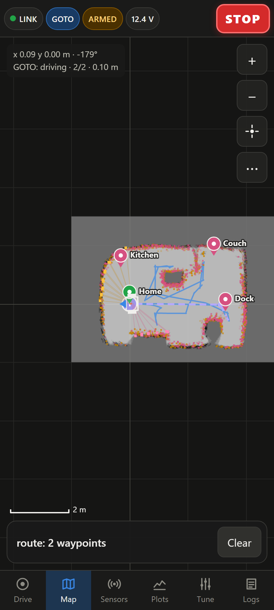
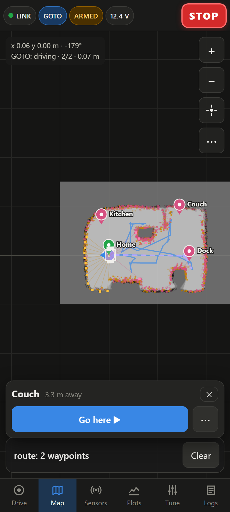

Places on the map, tap a place, the menu

| | |
|---|---|
| save a place | long-press (right-click) the map: **Save place here...** and name it, or **Set Home here**; saved with the map |
| tap a pin | **Go here**: a route around walls; ⋯ renames or deletes it |
| **Home** | always there (green). Save a place called Home to move it; delete it to fall back to where the pose was last reset |
| remote's **Go home** | the robot starts a straight line; the bridge swaps it for a planned route to Home when the robot is armed and a map exists. It never arms the robot |

Browser API and the GO_HOME rules: [api.md](api.md#saved-places).

### Walls, zones and mazes

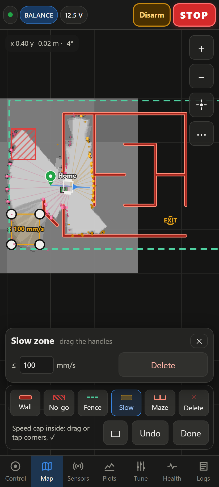
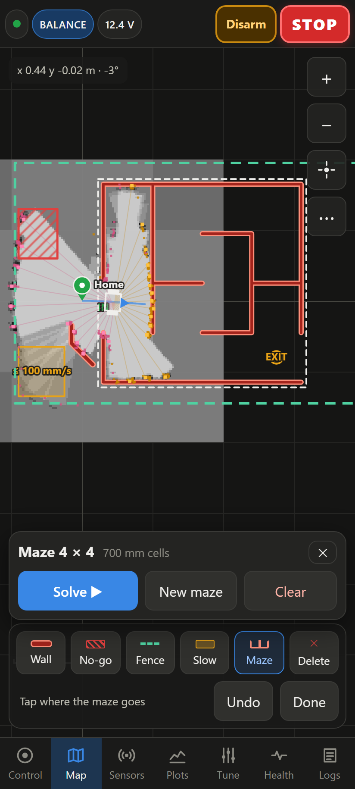
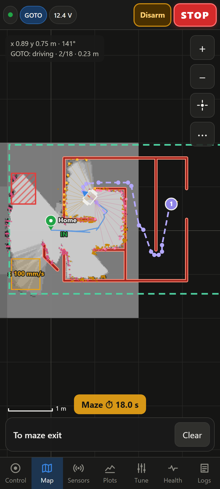

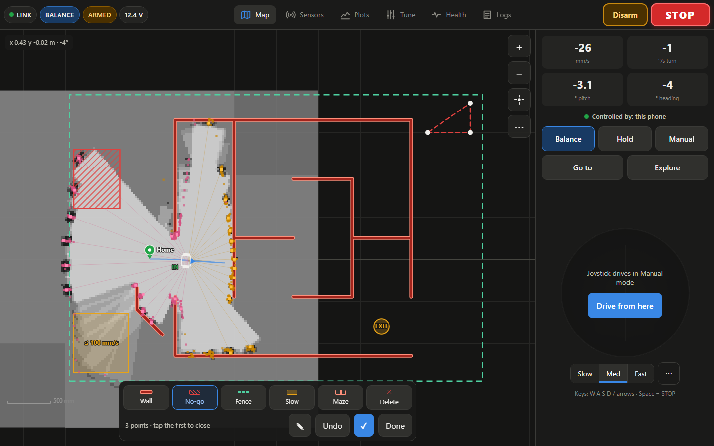 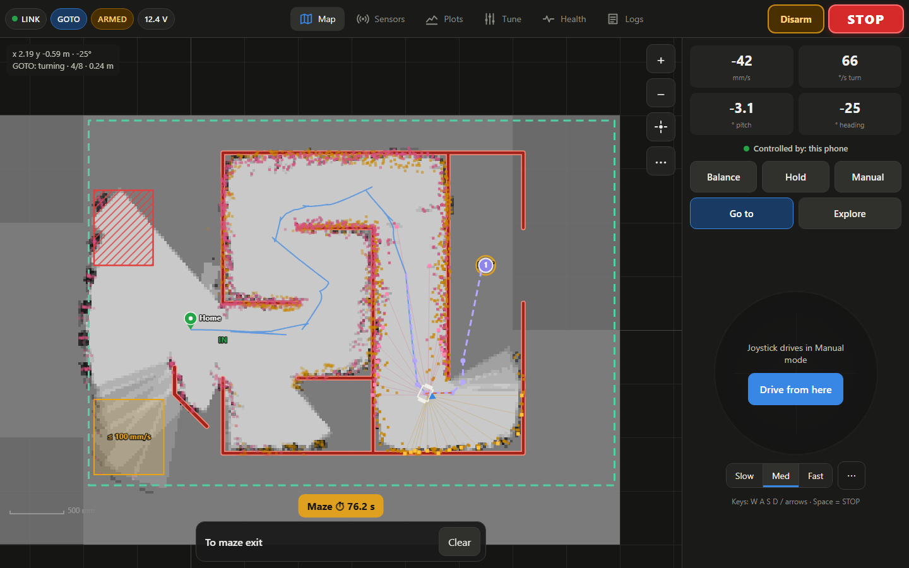

⋯ → **Draw walls, zones, maze…** Pick a tool, draw, **✓**. Tap a shape to select it: drag its white handles, **Delete**. **Undo** steps back. **Done** leaves.

| Tool | Looks | Robot |
|---|---|---|
| **Wall** (tap points) | thick dark red line | never crosses it |
| **No-go** (▭ drag, or ✎ tap corners) | red hatch | never enters |
| **Fence** (one) | green dashes | never leaves |
| **Slow** | amber, `≤ 120 mm/s` (tap it to change) | speed capped inside |
| **Maze** | tap a spot: W × H m, cell width (≥ 400 mm, default 700) → **Generate** | tap it: **Solve ▶** (timer, best time kept), **New maze**, **Clear** |
| **Delete** | tap a shape | |

- Saved with the map (`<map>.zones.json`), like places. **Clear map** clears them too.
- Planner + Explore: walls and zone edges are walls, kept off by robot radius + margin like real ones (narrow-gap squeeze plans too); outside the fence / inside no-go = blocked, no frontier there; slow zones cost 5× (routes go round when they can). A goal inside a no-go zone or outside the fence is refused.
- The bridge enforces them while driving: [safety](safety.md#virtual-walls-and-zones) (stop + HOLD + replan; joystick blocked; limits).
- **Solve**: drive to the exit cell, the exit gap counted as a wall, so the route goes in at the entrance (the planner knows the maze: it is not a blind solve). With real maze walls keep cells ≥ 700 mm: the robot stops 300 mm (`rng.obstacle_mm`) before a wall ahead, so each corner needs ~350 mm.
- Sim: `python -m station.sim --maze [WxH]` = an empty room, a random maze ahead of the robot, and every virtual wall / maze built as a real wall as you draw.
- API: [api.md](api.md#zones).
Pi cost: 0.2 ms per reading (range weighting +10 %, growing: one copy of the grid, a few ms) (< 1 % of a core at 50/s); a route or frontier search 0.1-0.3 s in a worker thread.
Offline: `python -m station.tools.mapbuild ~/sbr3-logs/<session>.jsonl -o map.png`.
Continuous drift correction while driving (`correct`, experimental) is off by default: in the sim it does not beat plain odometry. Stop-and-scan: see above.
Browser API: `{"t":"map","action":"reset|save|load|list|delete|set"}`, `{"t":"plan","action":"goto|explore|stop|set"}`;
receive `map` (tiles), `plan` (route, status). `GET /api/map`, `/api/map/current.png`.

