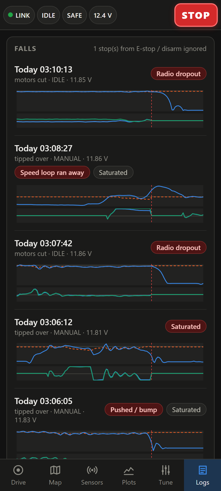
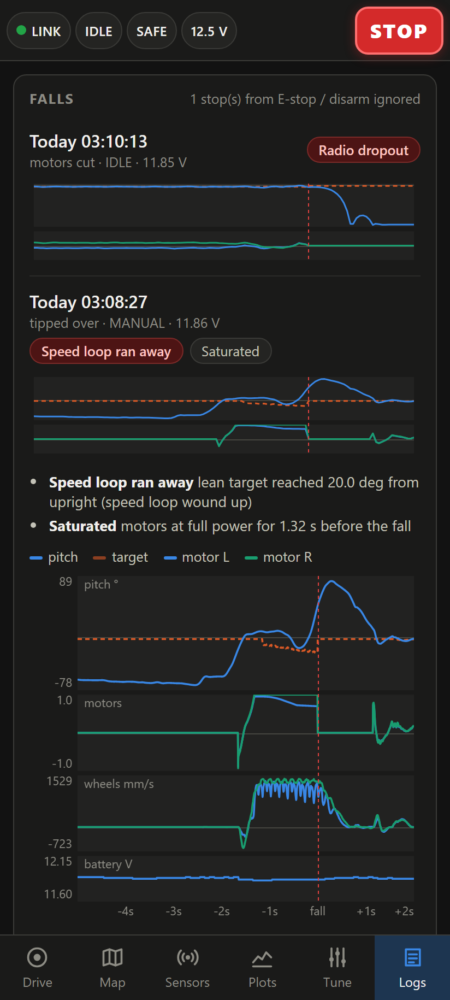
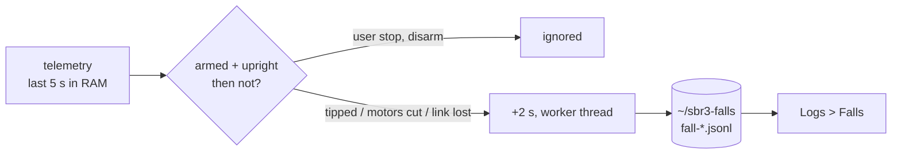
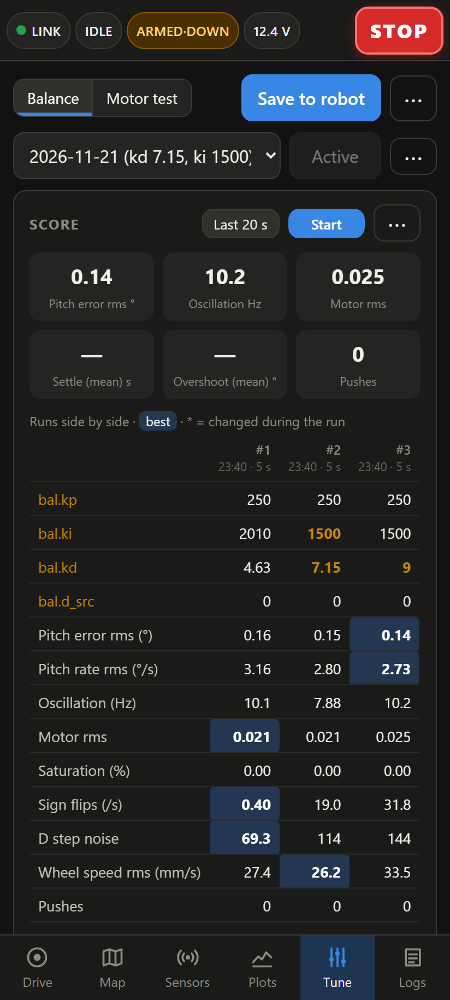
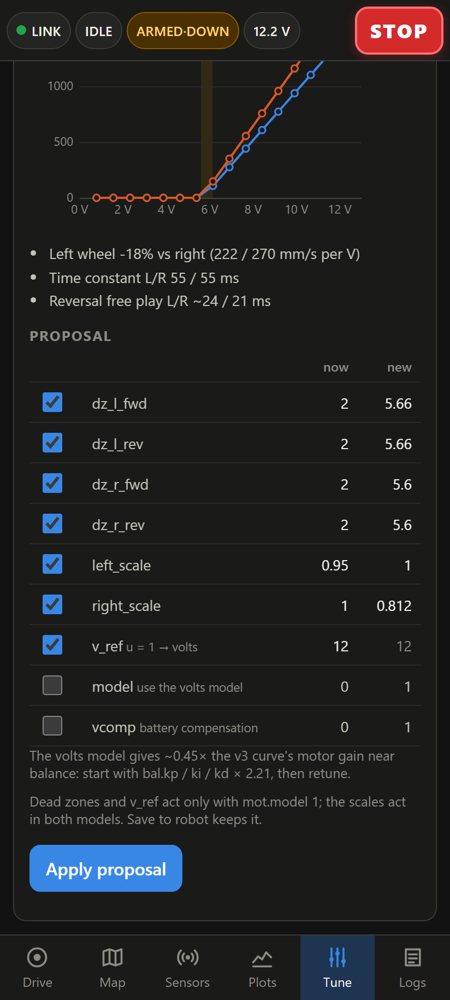
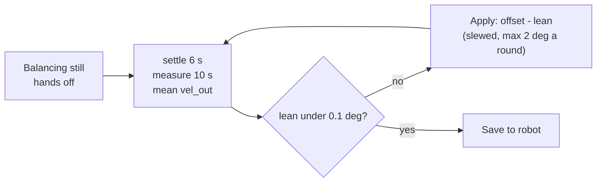
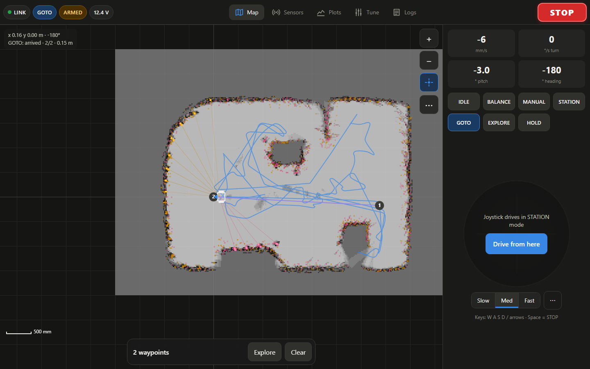
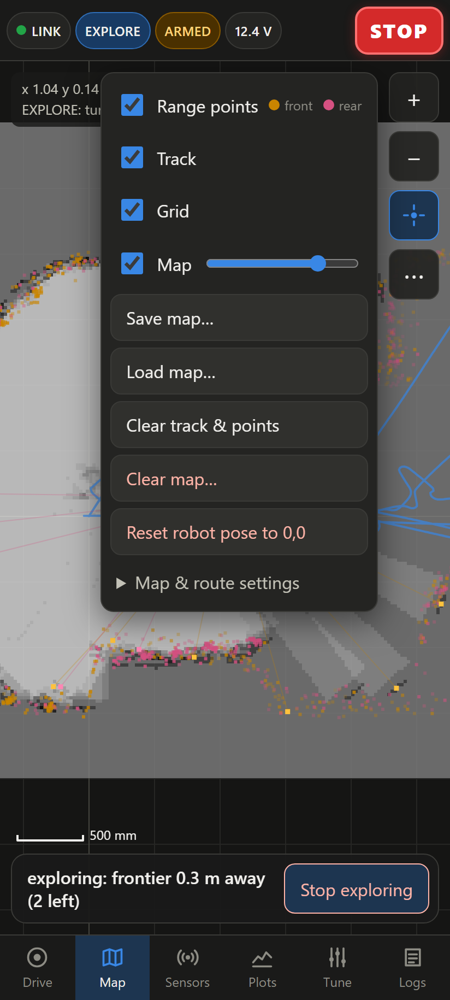
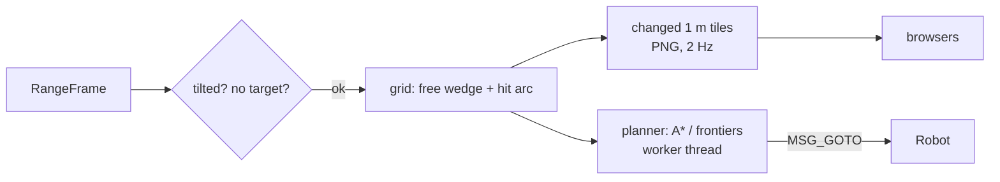

# Station features

## Tabs at a glance

| | |
|---|---|
| **STOP** (or Space / Esc) | motors off, robot disarms, **latched**: no mode request (station, app, remote selector) starts the motors until **Release E-stop** (confirm), then arm again |
| **Arm & Balance** | two taps. With no RC remote, the station arms the robot; with the remote, its switch does |
| **Map** | tap to add waypoints, **Go** (asks before it arms the robot): with a map, the route goes around walls. **Explore**: the robot maps the room by itself |
| **Drive** | joystick / WASD in STATION mode |
| **Sensors** | both range sensors live: mm, valid, angle, readings/s; last sweep around the robot; range vs time. ⋯ → park / trim / sweep width / direction, **hand test** (cover one sensor: its card lights up). Colours: front amber, rear magenta (map too) |
| **Tune** | live P / I / D at the loop rate (**Full rate**), sliders apply at once, **Save to robot** writes EEPROM (when the motors are off); ⋯ → Restore defaults. Two views: **Balance** and **Motor test** (below) |
| **Logs** | **Falls** (below), messages, session downloads (CSV / JSONL), link details |

## Falls: the black-box recorder (issue #50)

Every fall is saved by itself: 5 s before + 2 s after (full telemetry rate, range readings, log lines, commands, the params then),
about 100 KB at 100 Hz, 350 KB at 400 Hz. Newest first on **Logs → Falls**: tap one for the evidence, big plots and **Download record**.
`~/sbr3-falls` keeps the last 200 files / 100 MB (`--falls-dir`). Cost on the Pi: one list append per frame; analysis and writing run in a thread.

| Chip | Rule (first one listed is the cause) |
|---|---|
| Link lost | serial link closed while balancing |
| Radio dropout | RC link dropped out in the last 4 s, then the mode fell to IDLE with the robot still upright (the 2026-11-21 firmware bug) |
| Motors cut | mode left BALANCE with nobody asking, no radio trouble (not saved if the robot did not tip) |
| Battery sag | supply dropped > 0.6 V in 2 s, or low-battery flag |
| IMU / loop dip | loop rate < 85 %, telemetry stall, impossible pitch jump, frozen pitch |
| Hit obstacle | range < obstacle distance in the direction of travel |
| Wheel slip | left/right wheels disagree with equal motors, or wheel speed jumps without a motor change |
| Oscillation | pitch error crossing zero ≥ 2.5 Hz with growing swings |
| Speed loop ran away | lean target > 12° from upright |
| Pushed / bump | pitch-rate spike > 100 °/s while balancing and the motors below full power |
| Saturated | motors at ±1 for ≥ 150 ms just before the fall |

E-stop, **Stop** / `set_mode IDLE` from any client, the remote's E-stop and its ARMED switch are **not** falls (counted as "ignored").
Back-fill or test on old sessions: `python -m station.tools.falls_scan ~/sbr3-logs/<session>.jsonl`.
Try it: `python -m station.sim --shove 12`, press **Arm & Balance**; the sim is knocked over every 12 s.
API: `GET /api/falls`, `GET /api/falls/<id>` (`?raw=1` = the file), `DELETE /api/falls/<id>`; WebSocket `{"t":"fall","fall":{...}}` when one is saved.
### Tune → Balance: presets and scored runs (issue #16)

| | |
|---|---|
| **Preset ▾ / Apply** | built-in "v3 known good" and "2026-11-21 (kd 7.15, ki 1500)", plus your own (⋯ → Save current values as… / Compare… / Delete). Kept on the Pi in `~/sbr3-presets/*.json`. Apply = only the values that differ; asks first while the robot is armed. Never touches the motor test (`mot.test*`), `mot.drive_mode` and its brake limits, `cfg.*` |
| **Score** | **Last 20 s** (⋯: 10 / 20 / 30 / 60 s) or **Start … Stop** around a run (push it a few times). The bridge scores the full-rate session log like `tools/tune.py score`: pitch error rms, oscillation Hz, motor rms / saturation / sign flips, D noise, pushes > 3° with settle time and overshoot. Needs **Full rate** (400 Hz) |
| **Runs side by side** | one column per run with the params active then (changed ones in yellow, `*` = changed during the run); best value per row highlighted. History lives in the bridge (and in the session log as `["score", t, {...}]`) |

### Tune → Balance: Find balance point (issue #52)

If `bal.offset_deg` is off, the velocity loop has to lean the robot to stop it creeping. That lean (`vel_out_deg`)
is the error: `new offset = offset - mean(vel_out_deg)`. **Start** only works armed, upright, in BALANCE / HOLD and
standing still. It reads telemetry and sets one param (`bal.offset_deg`); it never arms, changes the mode or drives.
A push, driving, disarm, E-stop, lost link or someone else touching the offset aborts it at once.
**Apply** moves the offset gently, then measures again to check; **Undo** restores the old value; **Save to robot** is the
usual EEPROM save (motors off). Browser API: `{"t":"balpoint","action":"start"|"apply"|"revert"|"stop"|"status"}`
(`start` also takes `"auto":true` to apply each step itself, `settle_s`, `window_s`, `rounds`); state arrives as `balpoint_state`.
Sim: set `bal.offset_deg` wrong (real balance point 3.15) and run it. Screenshots: `--prep-balpoint balpoint`.
### Tune → Motor test (wheels up)

Robot on a stand, wheels off the ground, remote in IDLE + ARMED. Pick All / Dead zone / Speed curve / Reversal,
**Start test** (asks first); the robot's own interlocks decide when it runs, and its wait reason shows live
("Arm the remote, mode IDLE", "Stand it upright", …). Results = `tools/motor_fit.py` (same module,
`station/bridge/motor_fit.py`): dead zone per wheel and direction, speed vs volts chart, left/right mismatch,
and a proposal → **Apply proposal** sets the ticked `mot.*` values (`mot.model` / `mot.vcomp` only if you tick them).
⋯ → results from an earlier session. Sim: `python -m station.sim --remote` (TT motors: ~6 V start / 5.6 V stop, left 18% weaker).

Screenshots of these: `python -m station.tools.screenshots --url http://localhost:8090/ --prep-tune tune` (sim with `--remote`).

## Map (occupancy grid, route, explore)

| | |
|---|---|
| grey / white / black | unknown / free / wall (25 mm cells, built on the Pi from every range reading) |
| ⋯ → **Map** | on / off + opacity · **Save / Load map** (`~/sbr3-maps`) · **Clear map** |
| ⋯ → Map & route settings | distance kept off walls, robot radius, tilt limit, “no target” handling, drift correction (experimental) |
| **Go** with a map | the bridge plans a route (purple) around obstacles, re-plans when the robot is blocked |
| **Explore** | drives to the nearest unmapped edge until none is left; STOP ends it |

Pi cost: 0.2 ms per reading (< 1 % of a core at 50/s); a route or frontier search 0.1-0.3 s in a worker thread.
Offline: `python -m station.tools.mapbuild ~/sbr3-logs/<session>.jsonl -o map.png`.
Drift correction (scan-to-map matching) is off by default: in the sim it does not beat plain odometry yet.
Browser API: `{"t":"map","action":"reset|save|load|list|delete|set"}`, `{"t":"plan","action":"goto|explore|stop|set"}`;
receive `map` (tiles), `plan` (route, status). `GET /api/map`, `/api/map/current.png`.

