# LD19 lidar mount (issue #75)

New top piece for the balancing robot: holds the same battery, bolts to the same 4 Frame inserts, and carries the
LDROBOT LD19 on a deck. The servo and the two VL53L0X go. **No posts: the full 360° scan is clear.**

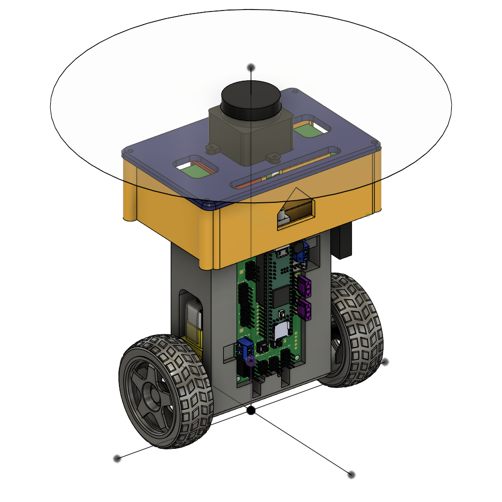

Robot frame (same as [`cad/`](../../cad/README.md)): origin = axle centre, **+X = Teensy side**, Y = axle, Z up.

## Parts

| Part | STL | Print | Supports |
|---|---|---|---|
| Top base | [`ld19_top_base_v1.stl`](ld19_top_base_v1.stl) 90 × 132 × 41.5 mm | floor on the bed (as exported) | **none**. One internal bridge: the strap tunnel roof, 20.5 mm (the original part had it too). The rear-wall window has a 45° top; all other openings are open-topped. |
| Deck | [`ld19_deck_v1.stl`](ld19_deck_v1.stl) 90 × 132 × 4 mm | flat, top face up (as exported) | **none** |

Both fit the 215 × 215 × 266 mm bed. Suggested: PETG (tougher in falls) or PLA, 0.2 mm layers, **4 walls**, 5 top / 5 bottom,
25 % gyroid. The 3 mm walls come out solid.

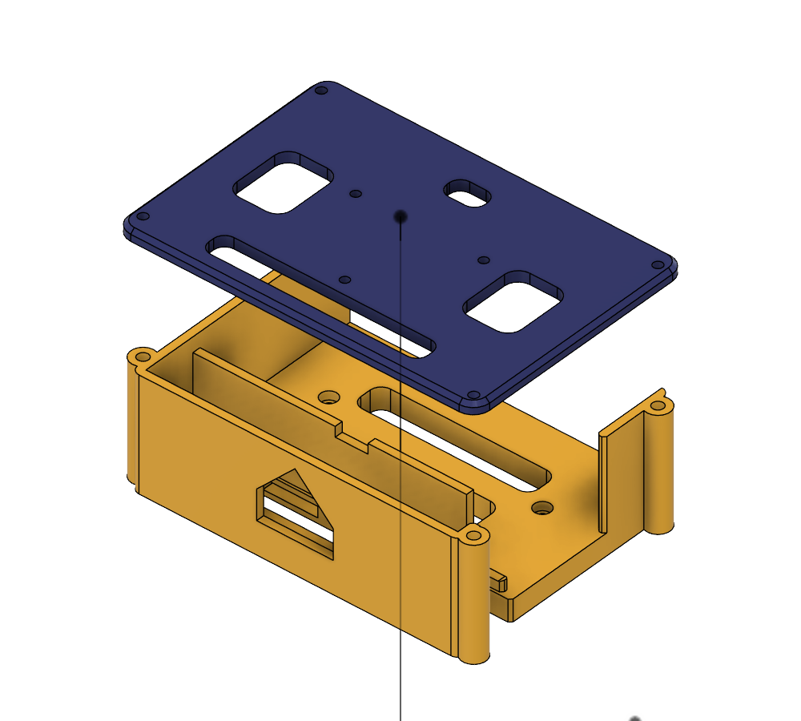

The rear rail (a fall-impact edge) is a 10 mm floor rail plus a full-height 3 mm rear wall: an L-beam from side wall to side wall,
touching the deck. The window lets you see the Teensy USB plug; you reach the plug through the deck's rear window.

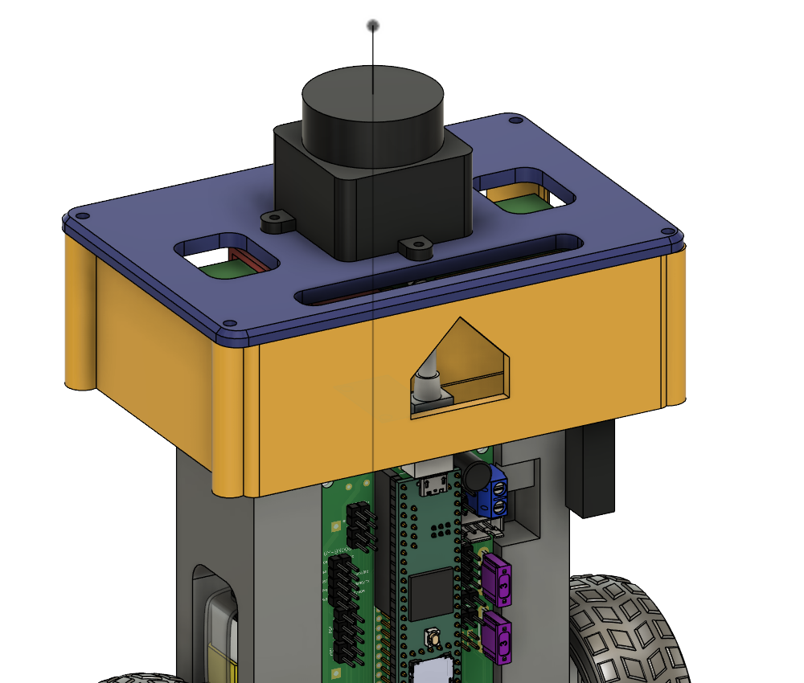

## Hardware

| Qty | Item | Where | Hole |
|---|---|---|---|
| 4 | M3 brass insert | top of the 4 deck bosses | 4.05 × 6.5 deep (same 4.05 as the Frame's inserts) |
| 3 | M2 brass insert | deck, under the LD19 ears | 3.2 through: **check against your kit's M2 insert** |
| 4 | M3 × 10 SHCS | deck → base | 3.4 clearance |
| 4 | M3 × 10 SHCS (×12 also fits) | base → Frame (existing inserts) | 3.5 clearance, 6.0 × 3.2 counterbore, same pattern (±15, ±39) |
| 3 | M2 × 5 SHCS | LD19 → deck | LD19 ears: Ø2.5 thru, Ø4.46 × 2 counterbore |
| 1 | 20 mm Velcro strap | existing | |
| 1 | ZH1.5 4-pin → Dupont female, ~150 mm | LD19 → Pi header | or cut the kit cable |

## Assembly

1. Press the inserts: 4 × M3 into the boss tops, 3 × M2 into the deck from the top.
2. Remove the old top piece, the servo + VL53L0X head and their wires.
3. Thread the Velcro strap through the floor tunnel (front slot → rear window).
4. Bolt the base to the Frame: 4 × M3 × 10 in the counterbores.
5. USB: plug into the Pi (through the front slot) and the Teensy (through the rear window); lay it over the battery spot, over the notch in the end wall.
6. LD19: plug the cable in, feed it through the deck's cable hole, screw the LD19 down (**connector toward the Pi / −X**, round single ear toward +X).
7. Deck onto the base: 4 × M3 × 10. Wire the LD19 to the Pi (below).
8. Battery in (below).

**Battery swap (no tools):** open the Velcro at the front, unplug the T-plug and the balance lead, slide the battery out of the
**right side (+Y)** with its leads and plugs attached. Reverse to fit: push it to the far wall, drop the leads into the slot
behind it and through the floor notch, plug in, close the strap.

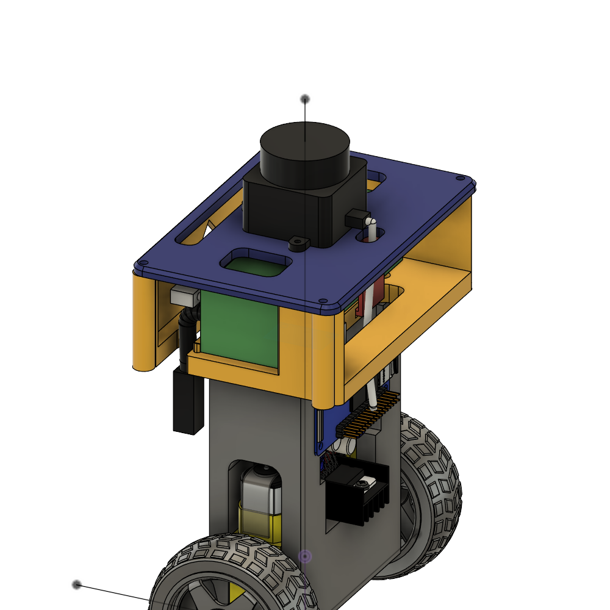

## Kept from the original top piece (measured on `frame_top`)

| Feature | Original | New |
|---|---|---|
| Velcro strap | 20 mm wide (y −30.5…−10.5), 4 mm tunnel in the floor, front slot → back | **same** width and y, 4 mm tunnel, front slot → rear floor window; passes over the end wall and the battery under the deck (6 mm gap) |
| Battery-lead exit | 14 × 20 mm, R2.5, y 43…57, 3.5…23.5 mm above the battery floor, through the back wall | **same** width, y and bottom height; now **open at the top and to the +Y side**, plus a floor notch (13 × 21 mm) so leads, T-plug (17 × 8 mm) and balance plug slide out with the battery; 1 mm chamfers on the opening edges |
| Front slot | 12 × 65 mm (x −29…−17, y ±32.5) | same (strap, Pi USB plug, LD19 cable) |
| Frame interface | 4 × M3 at (±15, ±39), underside z = 101.25 | same |
| Battery seat | x −16…19 against a wall at +X | same x; floor 2 mm lower |

| Original | New |
|---|---|
| 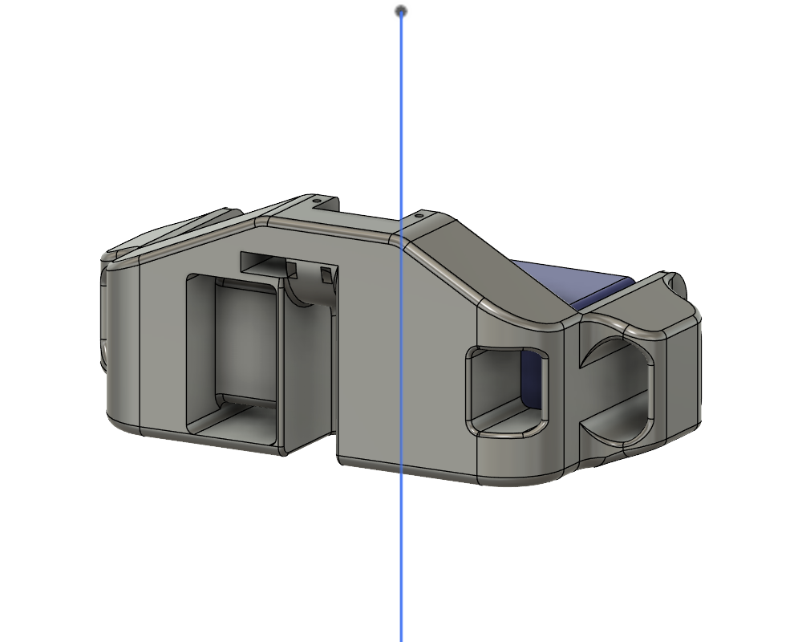 | 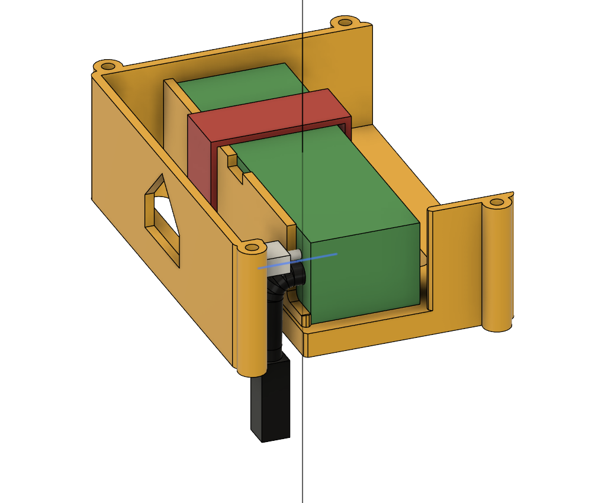 |

## Cables

All cables are **inside the protective plastic** (see the fall table below).

| Cable | Route |
|---|---|
| Pi → Teensy USB | Pi USB-C up through the front slot → over the battery under the deck → over the end-wall notch → down to the Teensy micro-USB. Needs ~15 cm plug to plug. Bends are R10 (fine for a cable that never moves). Coil any extra length in the rear bay, or buy a **15–20 cm USB-C ↔ micro-USB** (thin, not braided). |
| LD19 (4-pin ZH1.5) | connector → deck cable hole → front slot → Pi header |
| Battery leads | battery +Y end → lead slot → rear floor notch → T-plug under the rear right corner |
| Strap | floor tunnel → up behind the end wall → over the battery → down its front face |

| Front | Back |
|---|---|
| 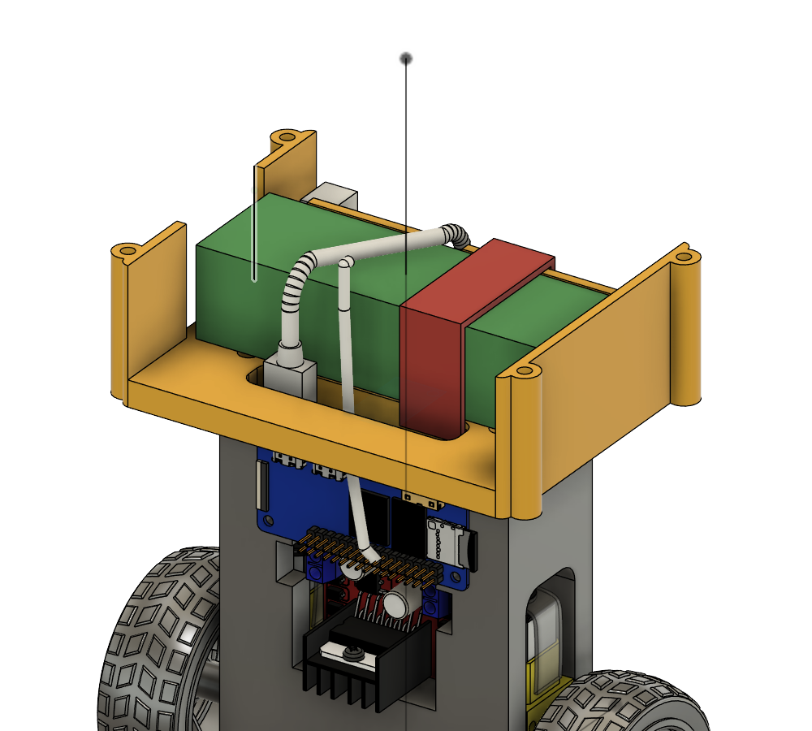 | 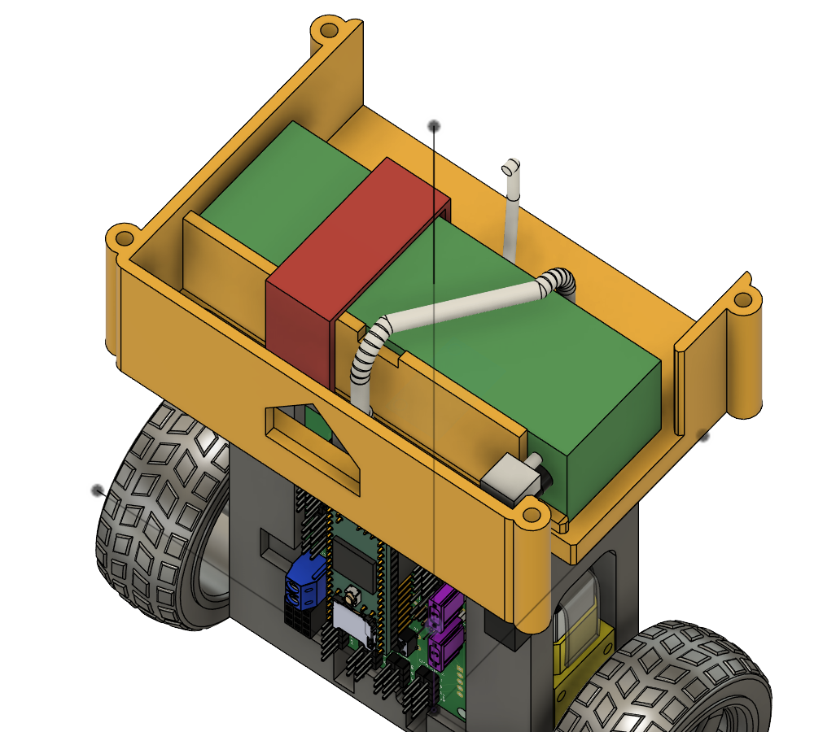 |

**LD19 → Orange Pi:** pin 1 Tx → a Pi UART RX · pin 2 PWM → **GND** (LDROBOT manual: ground it for the internal 10 Hz speed control) ·
pin 3 GND → GND · pin 4 5 V → 5 V. 230400 baud, 8N1. ~180 mA.

## Numbers for the software

| | |
|---|---|
| LD19 centre (scan origin) | x = 0, y = 0 (over the axle), ±0.5 mm |
| LD19 mounting face | 146.75 mm above the axle = **181.2 mm above the floor** |
| **Scan plane** | 173.75 mm above the axle = **208.2 mm above the floor** (CAD wheel r = 34.46; 206.8 with the firmware's 33 mm) |
| LD19 top | 216 mm above the floor (old head: 238) |
| **Yaw** | LD19 0° (toward the single mounting ear) points **+X** (Teensy side). LD19 angles grow **clockwise** seen from above, so robot angle (CCW) = −LD19 angle |
| Scan shadows | **none**: nothing above the deck but the LD19. Self-hits only if the robot pitches > ~18° (deck corner screws) / 31° fore-aft (deck edge) |

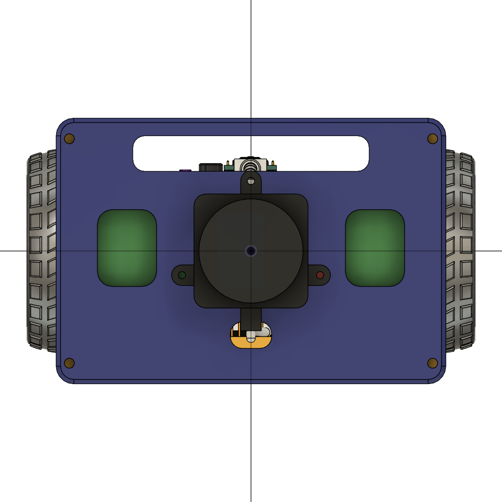

## Fall protection (checked in Fusion against the real geometry)

Fore/aft: the robot ends up at 84° tilt, resting on a wheel and the **base's bottom edge** (x = ±45, same footprint as the old part);
the deck edge is 4 mm from the floor. Sideways: tyre + deck corner (y = ±66).

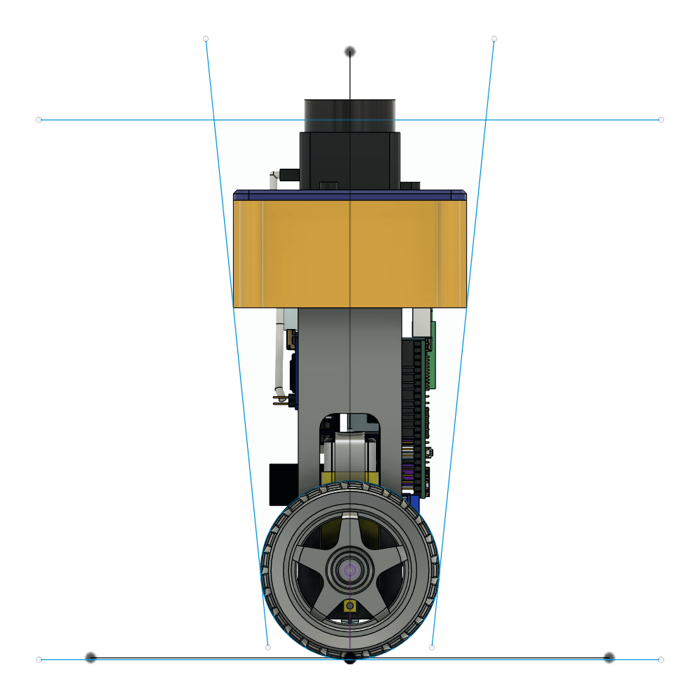

Gap to the floor (mm; target ≥ 8–10 for the LD19):

| | +X fall | −X fall | +Y tip | −Y tip |
|---|---|---|---|---|
| **LD19** | **22.3** | **22.9** | **38.5** | **38.5** |
| battery | 26.7 | 29.7 | 12.0 | 12.0 |
| USB cable | 12.6 | 18.4 | 41.0 | 63.6 |
| LD19 cable | 65.6 | 12.8 | 63.6 | 63.5 |
| battery leads + T-plug | 8.8 | 65.5 | 17.4 | 111 |
| balance lead + plug | 13.4 | 66.3 | 16.1 | 108 |
| PCB / Teensy (existing) | 6.8 | – | 45.7 | 45.7 |
| motor driver (existing) | – | 6.1 | 51.0 | 51.0 |

The PCB and motor-driver gaps (bounding boxes, conservative) are set by the base footprint, which is unchanged from the old part.

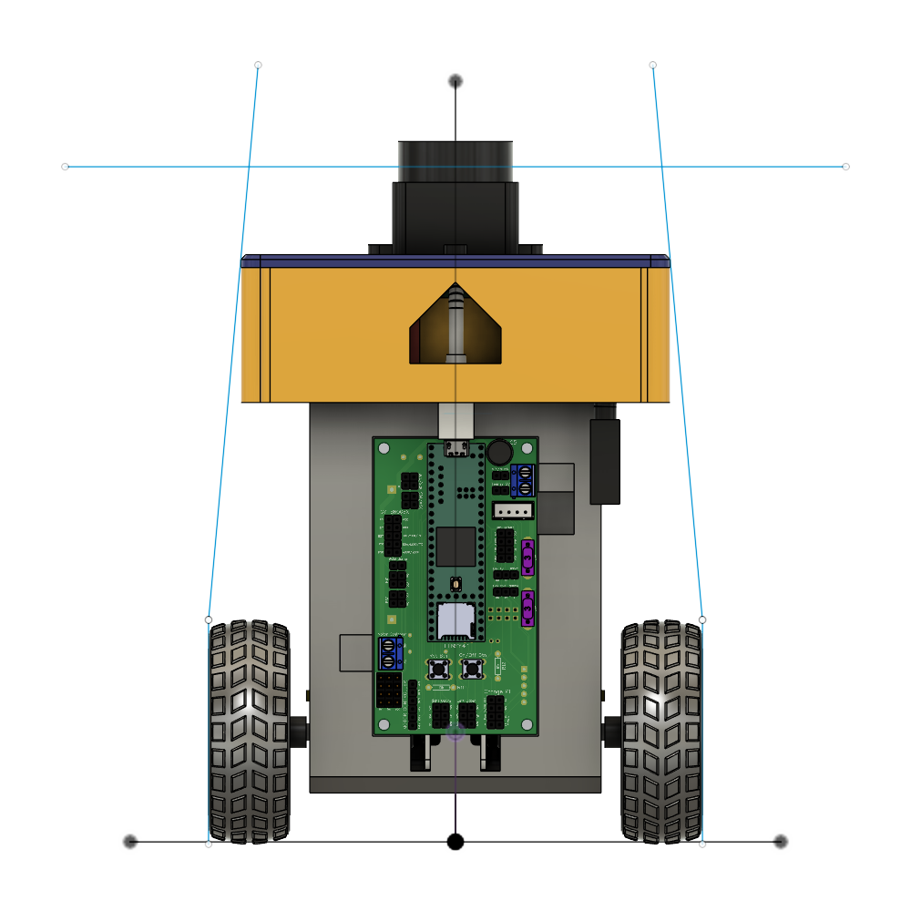

## Mass

| | g | CoM height above axle |
|---|---|---|
| Removed: old top piece + servo + head + 2 × VL53L0X | ~197 | 123 mm |
| New: base 92 + deck 36 + LD19 ~42 + screws/inserts 6 | ~177 | 132 mm |
| Whole robot (estimate) | 820 → **~799** | 79.4 → **79.5 mm** (no change); fore/aft CoM offset 3.9 → **0.7 mm** |

Same density assumption as `cad/build_model.py` (PLA, 75 % solid). The fore/aft balance point moves: re-run **Find balance point**.

## Fusion model

`Self_Balancing_Model_Rev3` (not saved): new components **LD19 Top base v1**, **LD19 Deck v1**, **LD19 proxy (not printed)**,
**Reference - cables & battery (not printed)**, **LD19 scan plane (check only)** (scan disc + fall-line sketches).
The old top piece, servo, head and the old battery are hidden, not deleted.
[`fusion/build_ld19_mount.py`](fusion/build_ld19_mount.py) rebuilds all five from scratch.

## Not modelled

A fixed forward-down VL53L0X: easy to add later as a small bracket on the deck's front edge (two M2 inserts).
