# SBR3 ground station

Drive, map, plot and tune the robot from any browser (phone, PC, Kindle). Python 3.8+, stdlib only, no build step.

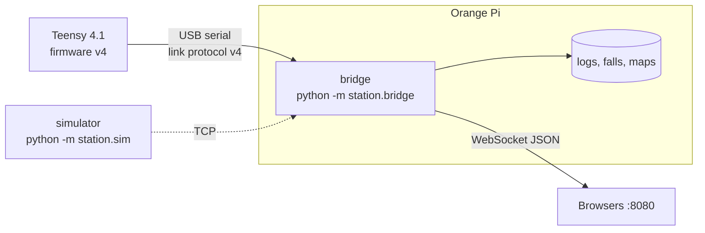

Try it: `python -m station.sim`, open http://localhost:8080/ (`--host 0.0.0.0` shares it on the LAN, `--remote` adds the RC remote, `--shove 12` knocks the robot over every 12 s). Tests: `python -m unittest discover -s station -t .`

**STOP** (or Space / Esc) latches: **Release E-stop**, then arm again with the two-tap **Arm & Balance** (or the remote).

## Quick start: the phone is the remote

The RC remote is optional. Turn it off (or leave it home): the phone arms, drives and stops the robot.

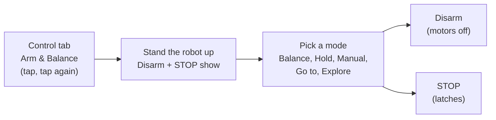

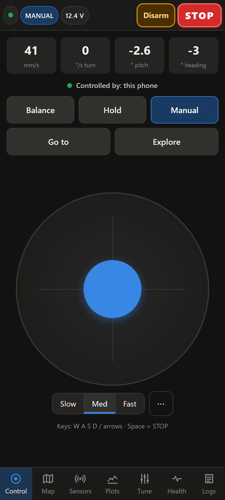
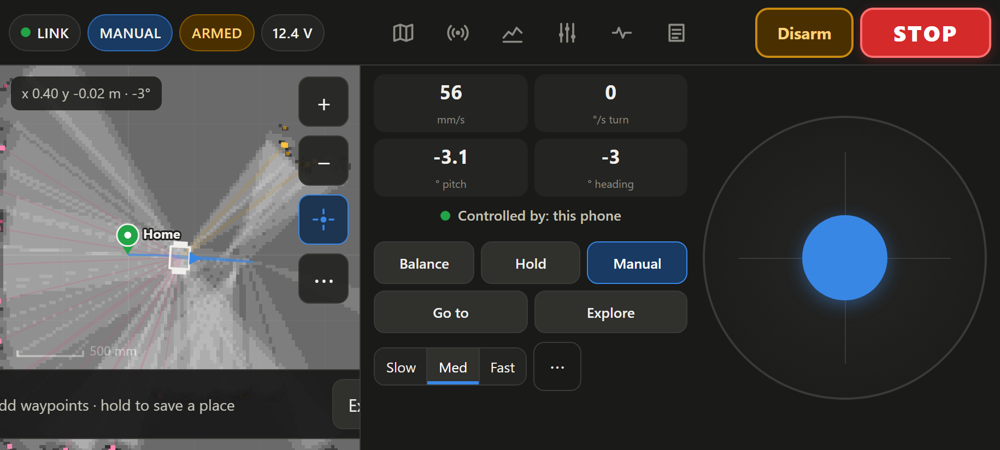

Control screen: portrait, and landscape (the Android app's default)

| Button | What it does |
|---|---|
| **Arm & Balance** | two taps, only when disarmed |
| **Disarm** | one tap, motors off, no latch (next to STOP while armed) |
| **STOP** | emergency stop, latches until **Release E-stop** |
| **Manual** | joystick (or **Tilt** in the app); **Go to** / **Explore** ask for a second tap |

"Controlled by" says who arms: **this phone** (no RC remote) or the **RC remote**. With no remote there is no "RC LOST"
alarm, and Health shows **RC remote: off** in grey. If the phone leaves the Wi-Fi or the app is closed, the robot stops
driving by itself within ~6 s and keeps balancing: [safety](../docs/safety.md).

## Tour

| Tab | |
|---|---|
| **Control** | Arm / Disarm, mode buttons, joystick / WASD, Tilt on the phone |
| **Map** | tap waypoints, **Go**, **Explore** |
| **Sensors** | both range sensors, last sweep |
| **Tune** | live PID, **Find balance point**, **Calibrate odometry**, presets, motor test |
| **Plots** | any signal vs time |
| **Health** | green / amber / red **preflight** before you arm, battery **minutes left**, one tile per part |
| **Logs** | messages, **Falls**, downloads |

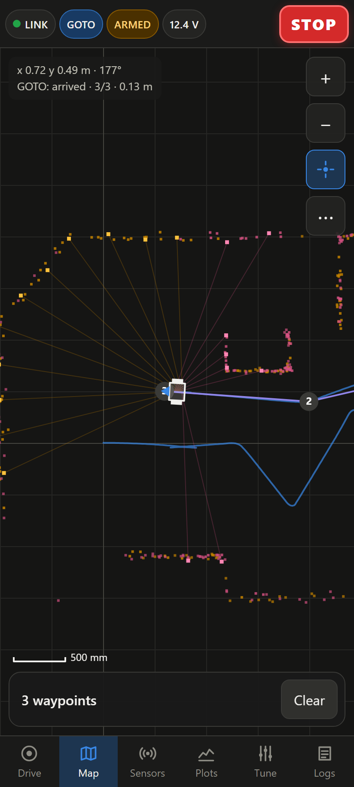

Drive, Map, Sensors

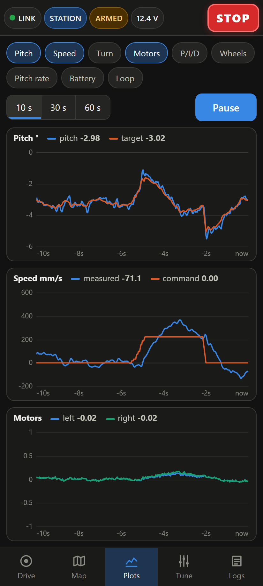
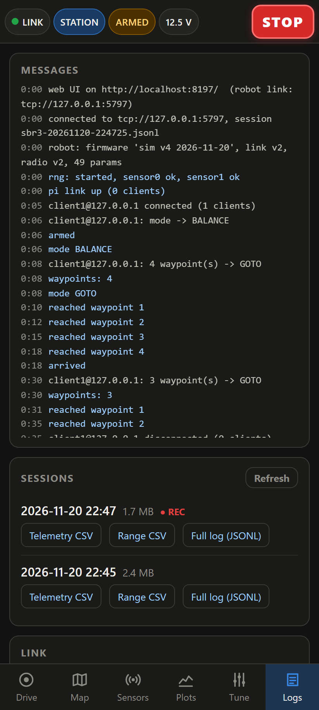

Tune, Plots, Logs

Places (saved spots on the map, **Go here**, Home):

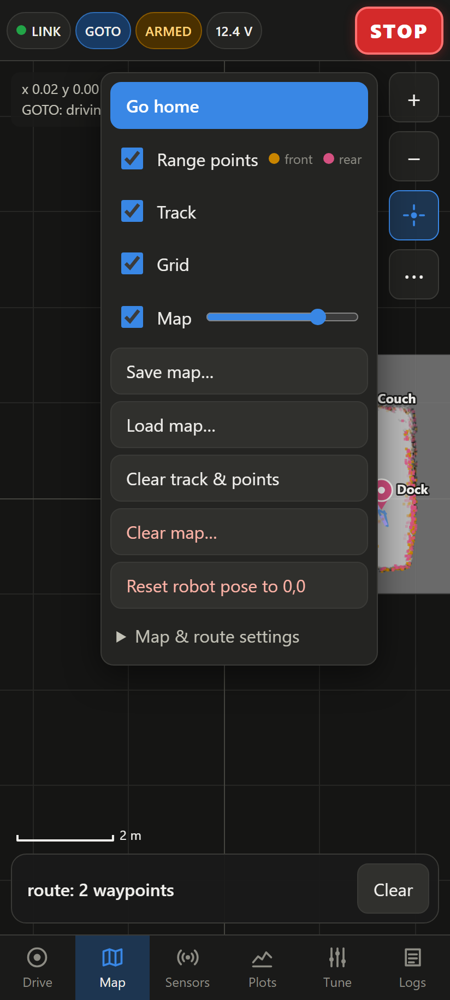

Places on the map, tap a place, the menu. <a href="../docs/station-features.md">Details</a>

Falls (black-box recorder):

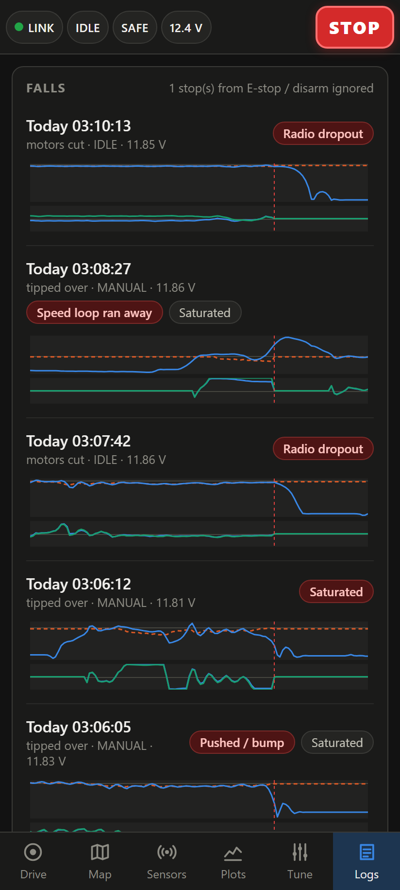

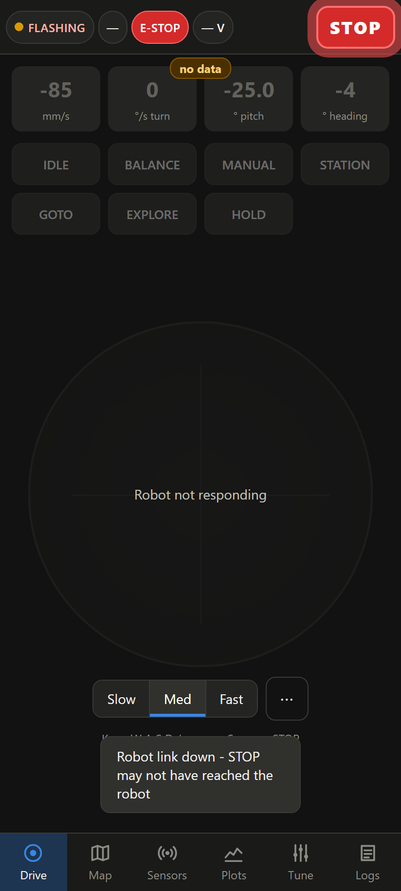

Falls list, Find balance point, no-data badge

Health (preflight checklist, battery minutes, tiles; it only looks, it never arms):

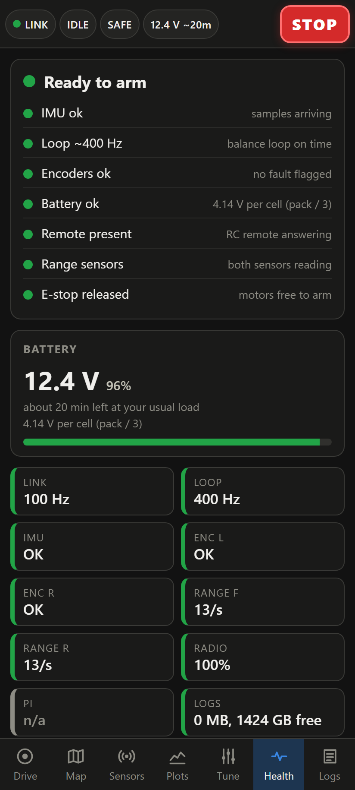
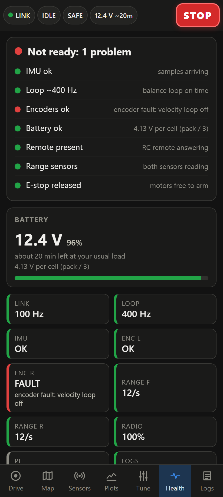

All green, an encoder fault

More: [Android app](android/README.md) | [features in detail](../docs/station-features.md) | [API, install, flashing contract](../docs/api.md)