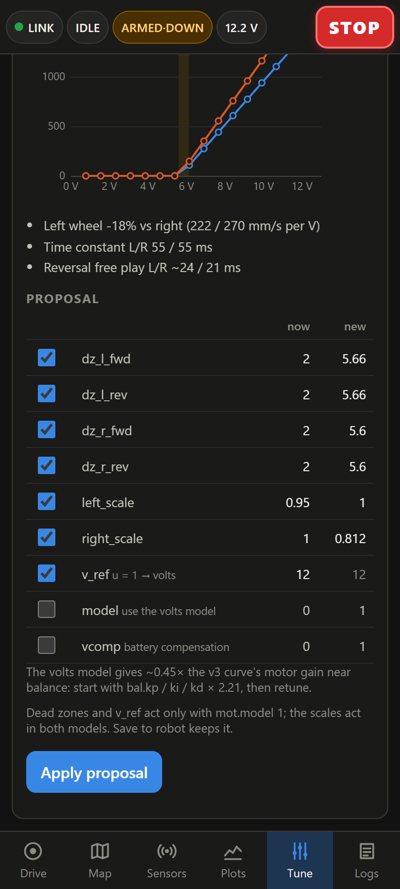
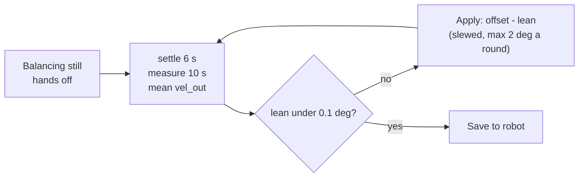
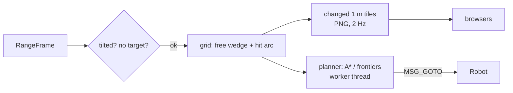

# SBR3 ground station

Drive, map, plot and tune the robot from any browser (phone, PC, Kindle). Python 3.8+, stdlib only, no build step.

<p>


</p>
<p>


</p>


## Try it on a PC (simulator)

```
python -m station.sim
```
Open http://localhost:8080/ . The sim listens on this PC only (127.0.0.1); `--host 0.0.0.0` exposes it on the
LAN (phones, the Android app: its finder lists it as "Simulator", the real robot first). The fake Teensy runs the
firmware's balance controller on a simulated robot (CAD mass/inertia, 400 Hz), so gains behave like the real thing.
Options: `--host 0.0.0.0`, `--remote` (RC remote on: its ARMED switch rules), `--remote-disarmed`, `--http-port 8090`,
`--head-error 8` (range head mounted 8° off: practise the trim). The range sweep follows the firmware
(`rng.*` params: sweep / park / trim / limits / timing).

`--tour` drives a loop around the room (mapping demo), `--drift 3` makes odometry drift (3°/min, 2 % long).

Tests: `python -m unittest discover -s station -t .` (protocol vs the C header, plus a full sim + bridge + browser-API run).
Screenshots: `python -m station.tools.screenshots --url http://localhost:8080/ --prep`

## Android app

[android/](android/README.md): full-screen app for the phone. Finds the robot on the Wi-Fi, tilt-to-drive (hold-to-drive dead-man), Bluetooth gamepad, haptics.

## Use it

| | |
|---|---|
| **STOP** (or Space / Esc) | motors off, robot disarms |
| **Arm & Balance** | two taps. With no RC remote, the station arms the robot; with the remote, its switch does |
| **Map** | tap to add waypoints, **Go** (asks before it arms the robot): with a map, the route goes around walls. **Explore**: the robot maps the room by itself |
| **Drive** | joystick / WASD in STATION mode |
| **Sensors** | both range sensors live: mm, valid, angle, readings/s; last sweep around the robot; range vs time. ⋯ → park / trim / sweep width / direction, **hand test** (cover one sensor: its card lights up). Colours: front amber, rear magenta (map too) |
| **Tune** | live P / I / D at the loop rate (**Full rate**), sliders apply at once, **Save to robot** writes EEPROM (when the motors are off); ⋯ → Restore defaults. Two views: **Balance** and **Motor test** (below) |
| **Logs** | messages, session downloads (CSV / JSONL), link details |

### Tune → Balance: presets and scored runs (issue #16)

<p>



</p>

| | |
|---|---|
| **Preset ▾ / Apply** | built-in "v3 known good" and "2026-11-21 (kd 7.15, ki 1500)", plus your own (⋯ → Save current values as… / Compare… / Delete). Kept on the Pi in `~/sbr3-presets/*.json`. Apply = only the values that differ; asks first while the robot is armed. Never touches the motor test (`mot.test*`), `mot.drive_mode` and its brake limits, `cfg.*` |
| **Score** | **Last 20 s** (⋯: 10 / 20 / 30 / 60 s) or **Start … Stop** around a run (push it a few times). The bridge scores the full-rate session log like `tools/tune.py score`: pitch error rms, oscillation Hz, motor rms / saturation / sign flips, D noise, pushes > 3° with settle time and overshoot. Needs **Full rate** (400 Hz) |
| **Runs side by side** | one column per run with the params active then (changed ones in yellow, `*` = changed during the run); best value per row highlighted. History lives in the bridge (and in the session log as `["score", t, {...}]`) |

### Tune → Balance: Find balance point (issue #52)

<p>


</p>



If `bal.offset_deg` is off, the velocity loop has to lean the robot to stop it creeping. That lean (`vel_out_deg`)
is the error: `new offset = offset - mean(vel_out_deg)`. **Start** only works armed, upright, in BALANCE / HOLD and
standing still. It reads telemetry and sets one param (`bal.offset_deg`); it never arms, changes the mode or drives.
A push, driving, disarm, E-stop, lost link or someone else touching the offset aborts it at once.
**Apply** moves the offset gently, then measures again to check; **Undo** restores the old value; **Save to robot** is the
usual EEPROM save (motors off). Browser API: `{"t":"balpoint","action":"start"|"apply"|"revert"|"stop"|"status"}`
(`start` also takes `"auto":true` to apply each step itself, `settle_s`, `window_s`, `rounds`); state arrives as `balpoint_state`.
Sim: set `bal.offset_deg` wrong (real balance point 3.15) and run it. Screenshots: `--prep-balpoint balpoint`.
### Tune → Motor test (wheels up)

Robot on a stand, wheels off the ground, remote in IDLE + ARMED. Pick All / Dead zone / Speed curve / Reversal,
**Start test** (asks first); the robot's own interlocks decide when it runs, and its wait reason shows live
("Arm the remote, mode IDLE", "Stand it upright", …). Results = `tools/motor_fit.py` (same module,
`station/bridge/motor_fit.py`): dead zone per wheel and direction, speed vs volts chart, left/right mismatch,
and a proposal → **Apply proposal** sets the ticked `mot.*` values (`mot.model` / `mot.vcomp` only if you tick them).
⋯ → results from an earlier session. Sim: `python -m station.sim --remote` (TT motors: ~6 V start / 5.6 V stop, left 18% weaker).

Screenshots of these: `python -m station.tools.screenshots --url http://localhost:8090/ --prep-tune tune` (sim with `--remote`).

## Map (occupancy grid, route, explore)

<p>


</p>

| | |
|---|---|
| grey / white / black | unknown / free / wall (25 mm cells, built on the Pi from every range reading) |
| ⋯ → **Map** | on / off + opacity · **Save / Load map** (`~/sbr3-maps`) · **Clear map** |
| ⋯ → Map & route settings | distance kept off walls, robot radius, tilt limit, “no target” handling, drift correction (experimental) |
| **Go** with a map | the bridge plans a route (purple) around obstacles, re-plans when the robot is blocked |
| **Explore** | drives to the nearest unmapped edge until none is left; STOP ends it |



Pi cost: 0.2 ms per reading (< 1 % of a core at 50/s); a route or frontier search 0.1-0.3 s in a worker thread.
Offline: `python -m station.tools.mapbuild ~/sbr3-logs/<session>.jsonl -o map.png`.
Drift correction (scan-to-map matching) is off by default: in the sim it does not beat plain odometry yet.
Browser API: `{"t":"map","action":"reset|save|load|list|delete|set"}`, `{"t":"plan","action":"goto|explore|stop|set"}`;
receive `map` (tiles), `plan` (route, status). `GET /api/map`, `/api/map/current.png`.

## Install on the Orange Pi

One time, with sudo (ask the owner first):
```
sudo loginctl enable-linger orangepi        # user services start at boot
sudo usermod -aG dialout orangepi           # only if `id -nG` has no dialout
```
Then, no sudo, from the repo:
```
sh station/bridge/install/install.sh
```
It installs a **systemd user service**: `systemctl --user status|restart sbr3-bridge`, logs
`journalctl --user -u sbr3-bridge -f`. UI: `http://<pi>.local:8080/`.

## Flashing while the bridge runs

The bridge lets go of `/dev/ttyACM0` while **`/tmp/sbr3-bridge.release`** exists, and re-opens it by itself when the file is gone.

```
touch /tmp/sbr3-bridge.release; sleep 1      # bridge closes the port (checked every 0.25 s)
teensy_loader_cli --mcu=TEENSY41 -w -s -v firmware.hex
rm /tmp/sbr3-bridge.release                   # bridge reconnects
```
- No sudo; any process of the same machine can do it. `station/bridge/install/flash-teensy.sh` does exactly this.
- A file older than 15 min is ignored (a crashed flash script can't block the robot forever); touch it again to hold longer.
- Optional: `GET /api/serial` → `{"released": true}`; or `POST /api/serial?release=1` / `?release=0`.

## Browser API (WebSocket `/ws`, JSON)

| Send | |
|---|---|
| `{"t":"set_mode","mode":1}` | mode index from `hello.modes`; with no remote, non-IDLE arms |
| `{"t":"cmd_vel","speed":200,"turn":0}` | mm/s, °/s; forwarded only while sent (300 ms) |
| `{"t":"estop"}` | |
| `{"t":"set_param","id":0,"value":260}` / `{"t":"get_params"}` | |
| `{"t":"cfg","action":"save"}` / `"defaults"` | EEPROM save / firmware defaults |
| `{"t":"goto","points":[[x,y],...],"go":true}` / `{"t":"event","event":3}` | |
| `{"t":"sub","tune":true}` | receive every telemetry frame as `{"t":"tune","cols":[...],"rows":[...]}` |
| `{"t":"preset"\|"score"\|"motor"\|"balpoint","action":...}` | Tune tools: see the docstring of `bridge/tuning_api.py` |

Receive: `hello`, `status`, `tlm` (25 Hz), `params`, `ranges`, `nav`, `waypoints`, `log`, `tune`, `map`, `plan`,
and for the Tune tools `presets`, `score_state`, `score_runs`, `motor_state`, `motor_fit`, `balpoint_state`.
`ranges.pts` rows (every reading, batched at 25 Hz): `[i, hit_x, hit_y, sensor_x, sensor_y, valid, tilt, pi_ms, sensor_id, sensor_angle_deg, range_mm]`
(sensor 0 = front / XSHUT 34, 1 = rear / XSHUT 28; angle in the robot frame, + = CCW; raw mm as sent). `status.rng_hz` = readings/s per sensor.
No WebSocket (old Kindle): `GET /api/state`, `GET|POST /api/cmd`.
The Android app uses `POST /api/cmd` when it is left: `cmd_vel 0`, `{"t":"plan","action":"stop"}`, and `set_mode` BALANCE if the
robot is armed + upright in GOTO / EXPLORE (`plan stop` alone leaves the robot in GOTO / EXPLORE with its waypoints).
