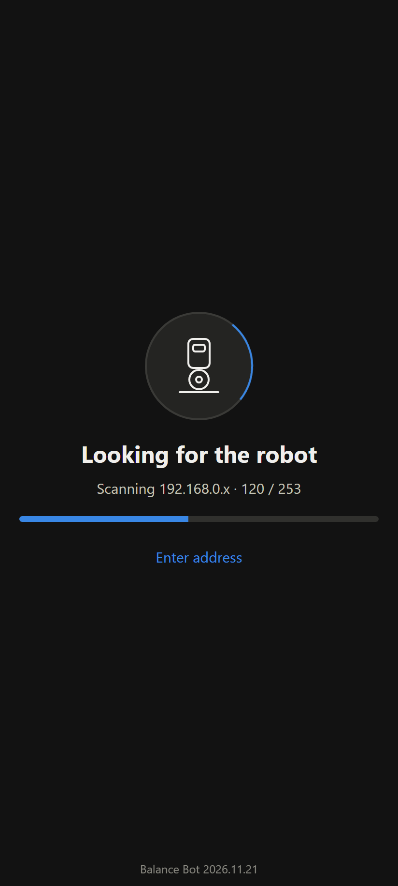
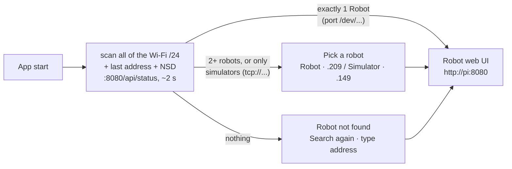

# Balance Bot (Android app)

Full-screen ground station for the Pixel / Android tablets: finds the robot, opens its web UI, adds **tilt** and **gamepad** driving.

<p>



</p>





A simulator on the same Wi-Fi never wins over the real robot (it's only listed). On opening, a small label
"Robot · 192.168.0.209" / "Simulator · …" shows for 4 s (also in the Drive ⋯ menu).

## Install

```
powershell -File station\android\build.ps1          # -> station\android\build\BalanceBot.apk
adb install -r station\android\build\BalanceBot.apk
```
Or copy the APK to the phone and open it (allow "install unknown apps").
Signing key: `%USERPROFILE%\.android\sbr3-station.jks` (made on the first build, never in the repo; keep it, a new key = uninstall first).

The Pi serves the web UI (`station/web`), including Tilt / Pad.

## Control

| | |
|---|---|
| **Tilt** | Control tab → **Tilt**. Press and **hold the pad**, tilt the phone: forward / back = speed, left / right = turn. Zeroed where you pressed. |
| **Gamepad** | Pair it in Android Bluetooth settings. Left stick drives (STATION). **B = STOP**, X = IDLE, Y = BALANCE (twice to arm), A = STATION, L1 / R1 = speed |
| **Speed** | Slow / Med / Fast also limit tilt and gamepad |
| **⋯ menu** | Screen: Auto / Landscape / Portrait · Find another robot |
| **Back** | Exit / Find robot / Stay |

## Safety

- **Dead-man**: tilt drives only while a finger is on the pad. Let go → `cmd_vel 0` at once.
- No tilt samples for 300 ms, a gamepad silent for 400 ms, the app in the background, Wi-Fi gone → stop.
  The bridge also stops forwarding 300 ms after the last command (`python -m unittest discover -s station -t .` checks all of this in Chrome).
- **Leaving the app** (Home, screen off, Back > Exit, app switch, WebView crash) stops the robot from native code, not page JS
  (a frozen WebView never runs JS): `AppStop.java` sends over HTTP `cmd_vel 0`, `plan stop`, then, only if the robot is in
  GOTO / EXPLORE, armed and upright, `set_mode BALANCE`. So a **Go to / Explore stops and the robot keeps balancing** where it
  is. It never E-stops or sets IDLE (that drops a balancing robot) and never arms: a disarmed or fallen robot is left alone.
  STATION / BALANCE / HOLD just get the zero `cmd_vel`. No setting; the page's own JS stop still runs too.
- **Plain http only to the home network** (cleartext is on app-wide, so the code is the guard; `HostPolicy.java`):
  private IPv4 literals (10/8, 172.16/12, 192.168/16, loopback, link-local) are trusted as typed; a **name** (`orangepi.local`, `router`) only
  after it resolved to private addresses only, and it stays pinned to them (a new address later = refused until the Wi-Fi changes).
  Anything else is blocked (403). Only the page's own host:port may load frames / sub-resources, so a foreign iframe never loads next to `SBR3Native`.
  Links leave the app only as `http(s)` after a tap; `intent:` / `file:` / other schemes and redirects are dropped.
- **Wi-Fi changes**: the app follows Wi-Fi / Ethernet while open. A robot hotspot without internet gets the app's traffic, and it is handed back
  when that Wi-Fi goes or is no longer needed. The find screen rescans on a change; the drive page lets go of the dead-man on "Wi-Fi lost".
  A page that crashes the browser engine is rebuilt 3 times a minute at most, then the find screen shows an error.
- **Screen turn** (landscape <-> reverse landscape): the display rotation is read on every tilt sample and sent with it; turning the phone
  while the pad is held lets go, hold again. The pad is excluded from the system Back swipe (Android 10+, `SBR3Native.gestureRects`).

## Files

| | |
|---|---|
| `src/.../MainActivity.java` | WebView, immersive, back, gamepad input, LAN-only guard |
| `AppStop.java` | native stop when the app is left (cmd_vel 0, plan stop, GOTO/EXPLORE → BALANCE) |
| `Finder.java`, `Lan.java` | finding the bridge (parallel probes, 48 threads, ~2 s for a /24) |
| `HostPolicy.java`, `Nets.java`, `NetPick.java` | who is trusted (names pinned) / which Wi-Fi to scan, bind, watch |
| `RateLimit.java`, `GestureRects.java` | renderer-crash limit / Back-swipe exclusion rects |
| `Tilt.java`, `TiltMath.java` | rotation vector → pitch / roll in the screen's frame |
| `Bridge.java` | `window.SBR3Native` (events back via `window.__sbr3.emit`) |
| `assets/find.html` | start / find screen |
| `../web/js/native.js`, `../web/native.css` | the web side (does nothing in normal browsers) |
| `tests/run.ps1` | Java tests (`-Live`: scan this PC's LAN with the app's probe code) |

Screenshots: `python -m station.tools.android_shots --url http://localhost:8090/` (sim running, fake `SBR3Native`).
