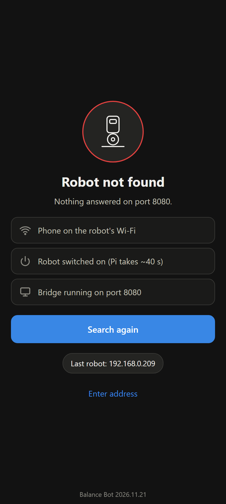
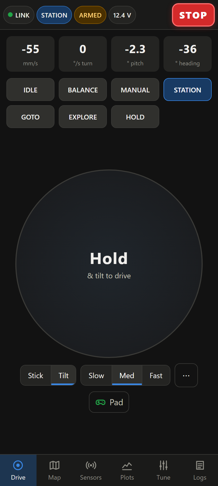
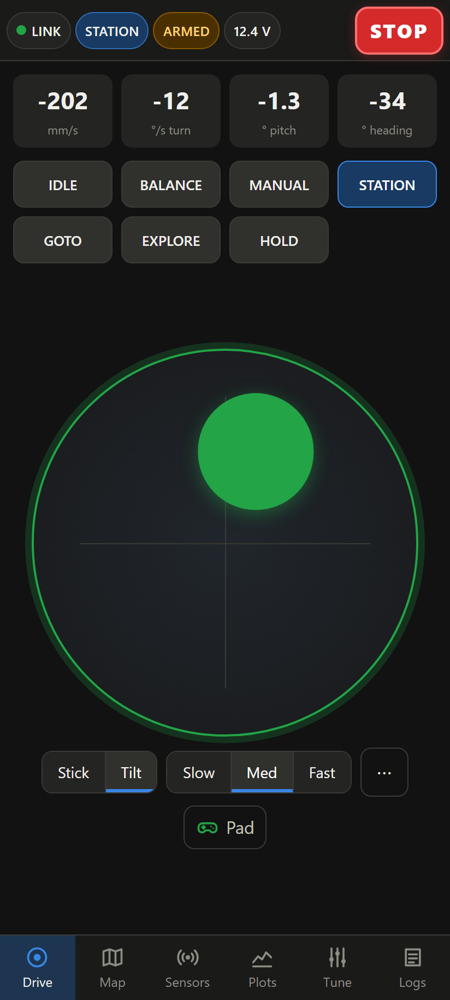
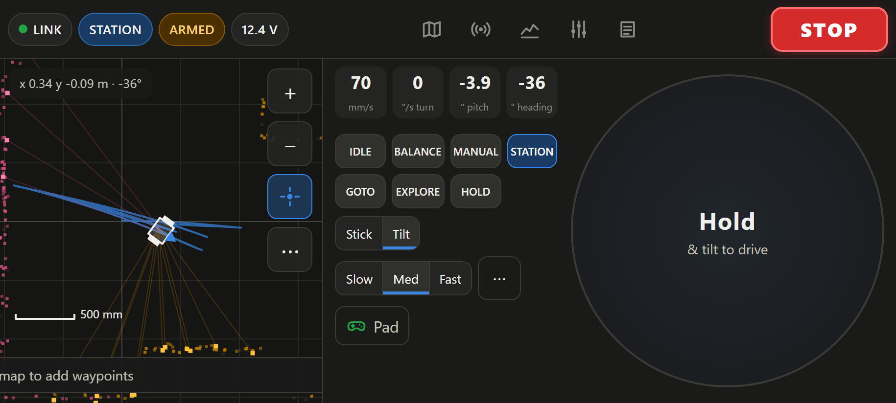
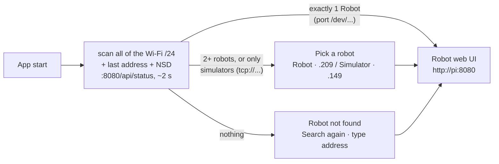
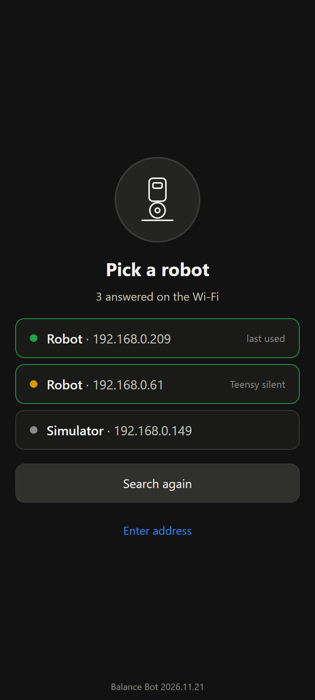

# Balance Bot (Android app)

Full-screen ground station for the Pixel / Android tablets: finds the robot, opens its web UI, adds **tilt** and **gamepad** driving.

<p>




</p>





A simulator on the same Wi-Fi never wins over the real robot (it's only listed). On opening, a small label
"Robot · 192.168.0.209" / "Simulator · …" shows for 4 s (also in the Drive ⋯ menu once the Pi has this branch).

## Install

```
powershell -File station\android\build.ps1          # -> station\android\build\BalanceBot.apk
adb install -r station\android\build\BalanceBot.apk
```
Or copy the APK to the phone and open it (allow "install unknown apps").
Signing key: `%USERPROFILE%\.android\sbr3-station.jks` (made on the first build, never in the repo; keep it, a new key = uninstall first).

The Pi serves the web UI: **pull this branch on the Pi** (`station/web`) so Tilt / Pad show up. Older Pi code still works, just without them.

## Drive

| | |
|---|---|
| **Tilt** | Drive tab → **Tilt**. Press and **hold the pad**, tilt the phone: forward / back = speed, left / right = turn. Zeroed where you pressed. |
| **Gamepad** | Pair it in Android Bluetooth settings. Left stick drives (STATION). **B = STOP**, X = IDLE, Y = BALANCE (twice to arm), A = STATION, L1 / R1 = speed |
| **Speed** | Slow / Med / Fast also limit tilt and gamepad |
| **⋯ menu** | Screen: Auto / Landscape / Portrait · Find another robot |
| **Back** | Exit / Find robot / Stay |

## Safety

- **Dead-man**: tilt drives only while a finger is on the pad. Let go → `cmd_vel 0` at once.
- No tilt samples for 300 ms, a gamepad silent for 400 ms, the app in the background, Wi-Fi gone → stop.
  The bridge also stops forwarding 300 ms after the last command (`python -m unittest discover -s station -t .` checks all of this in Chrome).
- Buzz: E-stop (long), link lost (3 short), obstacle (2 short).
- Plain http only to private LAN addresses (10/8, 172.16/12, 192.168/16, .local names); anything else is blocked.

## Files

| | |
|---|---|
| `src/.../MainActivity.java` | WebView, immersive, back, gamepad input, LAN-only guard |
| `Finder.java`, `Lan.java` | finding the bridge (parallel probes, 48 threads, ~2 s for a /24) |
| `Tilt.java`, `TiltMath.java` | rotation vector → pitch / roll in the screen's frame |
| `Bridge.java` | `window.SBR3Native` (events back via `window.__sbr3.emit`) |
| `assets/find.html` | start / find screen |
| `../web/js/native.js`, `../web/native.css` | the web side (does nothing in normal browsers) |
| `tests/run.ps1` | Java tests (`-Live`: scan this PC's LAN with the app's probe code) |

Screenshots: `python -m station.tools.android_shots --url http://localhost:8090/` (sim running, fake `SBR3Native`).
